**Avant-propos**

L’harmonisation des pratiques dans l’échange des données relatives aux
offres de transport est essentielle :

- pour l’usager, aux fins d’une présentation homogène et compréhensible de
l’offre de transport et de l’engagement sous-jacent des organisateurs
(autorités organisatrices et opérateurs de transports) ;

- pour les AOT, de manière à fédérer des informations homogènes venant de
chacun des opérateurs de transports qui travaillent pour elles.
L’harmonisation des échanges, et en particulier le présent profil,
pourra le cas échéant être imposée par voie contractuelle. Cette
homogénéité des formats d’information permet d’envisager la mise en
place de systèmes d’information multimodaux, produisant une information
globale de l’offre de transports sur un secteur donné, et garantir le
fonctionnement des services d’information, en particulier des
calculateurs d’itinéraires, et la cohérence des résultats, que ces
services soient directement intégrés dans ces systèmes d’information
multimodaux ou qu’ils puisent leurs informations sur des bases de
données réparties ;

- pour les opérateurs, qui pourront utiliser ce format d’échange pour
leurs systèmes de planification, les systèmes d’aide à l’exploitation,
leurs systèmes billettiques et leurs systèmes d’information voyageur
(information planifiée et information temps réel) ;

- pour les industriels et développeurs pour pérenniser et fiabiliser leurs
investissements sur les formats d’échanges implémentés par les systèmes
qu’ils réalisent, tout en limitant fortement l’effort de spécification
lié aux formats d’échange.

Ce document est le fruit de la collaboration entre les différents
partenaires des autorités organisatrices de transports, opérateurs,
industriels, développeurs de solutions et de systèmes informatiques, et
associations d'usagers ayant pour objet l’aide à l’exploitation du
transport public et l’information des voyageurs. Il a pour objet de
présenter le profil d’échange Profil NeTEx Accessibilité: "format de
référence pour l'échange de données de description de l'accessibilité
des réseaux de transport en commun" (issu des travaux *NeTEx* et
*Transmodel)* qui aujourd’hui fait consensus dans les groupes de
normalisation (CN03/GT7 – Transport public / information voyageur).

Ce document a été validé et publié comme suit : 
- travaux de révision : 2024-2025
- date de validation en CN03 : 19 décembre 2025
- date de publication : 6 mars 2026

**Introduction**

Le présent document fait partie du profil France de NeTEx.

NeTEx (CEN/TS 16614 series) propose un format et des
services d'échange de données de description de l'offre de transport
planifiée, basé sur Transmodel (EN 12896 series) et l’ancienne norme IFOPT (EN
28701). NeTEx permet non seulement d'assurer les échanges pour les
systèmes d'information voyageur mais traite aussi l’ensemble des
concepts nécessaires en entrée et sortie des systèmes de planification
de l'offre (graphiquage, etc.) et des SAE (Systèmes d’Aide à
l’Exploitation).

NeTEx se décompose en six parties:

-   Partie 1 : topologie des réseaux (les réseaux, les lignes, les
    parcours commerciaux les missions commerciales, les arrêts et lieux
    d’arrêts, les correspondances et les éléments géographiques en se
    limitant au strict minimum pour l’information voyageur)

-   Partie 2 : horaires théoriques (les courses commerciales, les heures
    de passage graphiquées, les jours types associés ainsi que les
    versions des horaires)

-   Partie 3 : information tarifaire (uniquement à vocation
    d’information voyageur)

-   Partie 4 : profil européen pour l'information voyageur (EPIP)

-   Partie 5 : nouveaux modes (les véhicules partagés en libre service, les courses partagées, etc.)

-   Partie 6 : profil européen pour l'information voyageur en lien avec l'accessibilité (EPIAP)

NeTEx a été développé dans le cadre du CEN/TC278/WG3/SG9 piloté par la
France. Les premières publications de NeTEx datent de 2014 et les plus récentes de mars 2026.

Il faut noter que NeTEx a été l'occasion de renforcer les liens du
CEN/TC278/WG3 avec le secteur ferroviaire, en particulier grâce à la
participation de l'ERA (Agence Européen du Rail, qui a intégré NeTEx
dans la directive Européenne 454/2011 TAP-TSI) et de l'UIC (Union
International des Chemins de fer).

Les normes, dans leur définition même, sont des « documents établis par
consensus ». Celles du CEN/TC278 sont de plus établies à un niveau
européen, en prenant donc en compte des exigences qui dépassent souvent
le périmètre national.

Il en résulte des normes qui sont relativement volumineuses et dont le
périmètre dépasse souvent largement les besoins d'une utilisation
donnée. Ainsi, à titre d'exemple, SIRI propose toute une série d'options
ou de mécanismes dont la vocation est d'assurer la compatibilité avec
les systèmes développés en Allemagne dans le contexte des VDV 453/454.
De même, SIRI propose des services dédiés à la gestion des
correspondances garanties, services qui, s'ils sont dès aujourd'hui
pertinents en Suisse ou en Allemagne, sont pratiquement inexistants en
France.

De plus, un certain nombre de spécificités locales ou nationales peuvent
amener à préciser l'usage ou la codification qui sera utilisée pour
certaines informations. Par exemple, les Anglais disposant d'un
référentiel national d'identification des points d'arrêts (NaPTAN), ils
imposeront naturellement que cette codification soit utilisée dans les
échanges SIRI, ce que ne feront pas les autres pays européens.

Enfin, certains éléments proposés par ces normes sont facultatifs et il
convient, lors d'une implémentation, de décider si ces éléments seront
ou non implémentés.

L'utilisation des normes liées à l'implémentation de l'interopérabilité
pour le transport en commun passe donc systématiquement par la
définition d'un profil (local agreement, en anglais). Concrètement, le
profil est un document complémentaire à la norme et qui en précise les
règles de mise en œuvre dans un contexte donné. Le profil contient donc
des informations comme :

-   détail des services utilisés,

-   détails des objets utilisés dans un échange,

-   précisions sur les options proposées par la norme,

-   précision sur les éléments facultatifs,

-   précision sur les codifications à utiliser,

-   etc.

Ce document présente la partie Accessibilité du profil France de NeTEx, tel que défini par le Groupe de Travail dédié à l'information voyageur et à l'exploitation des services de mobilité (GT7) au sein de la Commission Nationale de normalisation pour le transport public (CN03).

D'autres parties du profil France de NeTEx sont disponibles (arrêts, réseaux, horaire, tarif, parking). Ils
sont tous complémentaires les uns des autres (sans recouvrement) et
s'appuient tous sur le document: **NeTEx - Profil France - Éléments communs.** Il conviendra de se référer à ce document pour tous
les éléments utilisés dans le présent document, et dont la structure
n'est pas détaillée.

Ce profil d’échange a pour objectif de décrire et de structurer
précisément les éléments nécessaires à une bonne information de
l'accessibilité des services de transport public de façon :

-   à pouvoir les présenter d’une manière homogène et compréhensible à
    l’usager des transports publics sur des supports différents (papier
    ou Internet),

-   à pouvoir les échanger entre systèmes d’information (systèmes
    d’information voyageurs et systèmes d’information multimodale,
    systèmes d’aide à l’exploitation, systèmes de planification,
    systèmes billettiques, etc.).

Les éléments présentés ci-dessous couvrent donc l’ensemble des concepts
propres à la description de l'accessibilité.

**NOTE IMPORTANTE** Ce document étant un profil d'échange de NeTEx, il
ne se substitue en aucun cas à NeTEx, et un minimum de connaissance de
NeTEx sera nécessaire à sa bonne compréhension.

# Domaine d'application

Le présent document est un profil de la spécification technique NeTEx CEN/TS 16614 pour
l'échange de données de description de l'accessibilité des réseaux en
France. Il permet de décrire et de structurer l'information pour des
échanges entre systèmes d'information ainsi que pour en proposer des
présentations aux voyageurs.

Ce document se positionne en complément des profils existants (Éléments
Communs, Arrêts, Réseaux et Horaires) qui ont déjà introduit les notions
de base de l'accessibilité via les concepts d'**ACCESSIBILITÉ**
(ACCESSIBILITY ASSEMENT) et de **LIMITATION D'ACCESSIBILITÉ**
(ACCESSIBILITY LIMITATION), détaillées dans le profil Éléments Communs
et utilisées par tous les autres. On notera aussi que le profil Réseaux
propose une vue très limitée du CHEMINEMENT (NAVIGATION PATH) dont la
vocation est de porter les ***AccessFeatureList*** (types
d'équipement rencontrés sur un cheminement) pour les correspondances
entre sites.

Cette première approche de l'accessibilité se voulait minimale et le
présent document l'aborde de façon beaucoup plus détaillée.

Ce document a été élaboré sur la base des réflexions et échanges
intervenus dans le cadre du GT7 ainsi qu'en utilisant les conclusions de
l'étude CAMERA.

Ce document a également été enrichi à l'aide du standard d’échange de
données sur l’accessibilité des déplacements pour les personnes en
situation de handicap produit par le groupe de travail CNIG sur
l'Accessibilité. Ce modèle a pour but de décrire l'accessibilité
des cheminements extérieurs en voirie, typiquement des trottoirs
reliant un arrêt de transport en commun à l’entrée d’un ERP.

Des compléments permettant d'assurer la mise en relation avec l'ontologie
 du projet OpenStreetMap ont également été apportés au document.
 OpenStreetMap (OSM) est un projet collaboratif de cartographie
 proposant une base de données géographiques libre du monde
entier.

Si la première motivation pour la définition de ce profil est bien
l'accessibilité, cet objet n'est en aucun cas limitatif et les
informations contenues (en particulier concernant les équipements et les
cheminements) ont été généralisées pour un usage de type information
voyageur sans restriction particulière à l'accessibilité (ce qui
correspond bien à l'approche de NeTEx).

# Références normatives

Les documents de référence suivants sont indispensables pour
l'application du présent document. Pour les références datées, seule
l'édition citée s'applique. Pour les références non datées, la dernière
édition du document de référence s'applique (y compris les éventuels
amendements).

TS 16614-1, Network and Timetable Exchange (NeTEx) — Part 1: Public
transport network topology exchange format

TS 16614-2, Network and Timetable Exchange (NeTEx) — Part 2: Public
transport scheduled timetables exchange format

EN 12896, Public transport - Reference data model (Transmodel)

# Termes et définitions

NOTE Pour les besoins du présent document, les termes et définitions
suivants s'appliquent. Ils sont directement issus de la traduction
française de Transmodel et NeTEx <span class="hl">(on notera que
certaines traductions sont un peu « étonnantes », toutefois il a été
jugé préférable de rester cohérent avec la traduction officielle). Il
conviendra souvent de se référer au corps du document car certaines
traductions officielles peuvent amener à une totale incompréhension des
concepts.</span>

Pour une information complète, il conviendra toutefois de se référer au
document normatif.

**ACCESSIBILITY ASSESSMENT (ÉVALUATION D'ACCESSIBILITÉ)**

Caractéristiques d'accessibilité d'une entité utilisée par les
passagers, telles qu'un LIEU D’ARRET ou un COMPOSANT DE LIEU D’ARRET.
Décrites par LIMITES D'ACCESSIBILITÉ et / ou un ensemble de d’APTITUDEs
(pour l’accessibilité).

**ACCESSIBILITY LIMITATION (LIMITE D'ACCESSIBILITÉ)**

Catégorisation des caractéristiques d'accessibilité d'un SITE (p. ex. :
LIEU D'ARRÊT ou COMPOSANT DE LIEU D'ARRÊT) pour indiquer son
utilisabilité par les passagers ayant des besoins spécifiques, notamment
ceux nécessitant un accès par fauteuil roulant, un accès sans marche ou
ceux voulant éviter les espaces confinés tels que les ascenseurs.
Quelques catégories bien définies sont utilisées, choisies pour
permettre la saisie efficace des données et le calcul efficace
d'itinéraires pour les différentes classes d'usager.

**ACCESS (ACCÈS)**

Possibilité matérielle (spatiale) pour un usager d'accéder à un système
de transports publics ou de le quitter. Ce tronçon peut être utilisé
pendant un déplacement pour permettre au voyageur d'effectuer : - le
trajet à pied d'un LIEU (origine du déplacement) vers un POINT D'ARRÊT
PLANIFIÉ (origine du DÉPLACEMENT SUR RÉSEAU), ou - le trajet à pied
depuis un POINT D'ARRÊT PLANIFIÉ (destination du DÉPLACEMENT SUR RÉSEAU)
vers un LIEU (destination du déplacement).

**ACCESS END (FIN D'ACCÈS)**

Origine ou destination d'un tronçon d'ACCÈS. Peut indiquer un POINT
et/ou un LIEU.

**ACCESS MODE (MODE D'ACCÈS)**

Caractérisation du trajet d'un passager lorsqu'il emprunte un moyen de
transport autre que les transports publics (p. ex : à pied, à vélo, etc.).

**ACCOMODATION (HÉBERGEMENT)**

Combinaison de caractéristiques d'hébergement disponibles sur un service
(p. ex : "Couchette première classe douche/2 lits").

**ACTUAL VEHICLE EQUIPMENT (ÉQUIPEMENT VÉHICULE RÉEL)**

Équipement d'un type particulier sur un VÉHICULE donné.

**ASSISTANCE SERVICE (SERVICE D'ASSISTANCE)**

SERVICE LOCAL spécialisé dans l'ASSISTANCE, fournissant des informations
telles que la langue, le personnel formé à l'accessibilité, etc.

**CATERING SERVICE (SERVICE DE RESTAURATION)**

Spécialisation de SERVICE LOCAL dédiée aux services de restauration.

**COMMUNICATION SERVICE (SERVICE DE COMMUNICATIONS)**

Spécialisation de SERVICE LOCAL dédiée aux services de communications.

**COMPLAINTS SERVICE (SERVICE DE RÉCLAMATIONS)**

Spécialisation du SERVICE CLIENT pour les RÉCLAMATIONS.

**CROSSING EQUIPMENT (ÉQUIPEMENT DE CROISEMENT)**

ÉQUIPEMENT D'ACCÈS À LA PLACE spécialisé pour ÉQUIPEMENTS DE
FRANCHISSEMENT (passages piétons, éclairage piétons, dispositif
acoustique, capteurs, bandes de guidage tactiles, etc.).

**CUSTOMER SERVICE (SERVICE CLIENT)**

SERVICE LOCAL générique spécial pour SERVICE CLIENT (objets perdus,
point de rencontre, réclamations, etc.).

**CYCLE STORAGE EQUIPMENT (ÉQUIPEMENT DE STOCKAGE DE CYCLE)**

Spécialisation de l'ÉQUIPEMENT DE PLACE décrivant les équipements de
parc pour deux-roues.

**ENCUMBRANCE NEED (BESOIN DE TRANSPORT DE BAGAGES)**

BESOIN D'USAGER spécifique, à savoir une exigence d'un passager
voyageant avec des bagages, un animal ou tout autre objet, et qui
nécessite donc des dispositions particulières pour accéder aux
transports publics.

**ENTRANCE EQUIPMENT (ÉQUIPEMENT D'ENTRÉE)**

Spécialisation d'ÉQUIPEMENT D'ACCÈS À LA PLACE pour ENTRÉES (portes,
barrières, portes tournantes, etc.)

**EQUIPMENT (ÉQUIPEMENT)**

Équipement installé de manière fixe (ÉQUIPEMENT DE LIEU) ou à bord des
véhicules (ÉQUIPEMENT VÉHICULE). Un service (SERVICE LOCAL de type
CONSIGNE, SERVICE DE BILLETTERIE) est considéré comme un équipement
immatériel.

**EQUIPMENT PLACE (LIEU DES EQUIPEMENTS)**

COMPOSANT DE SITE comprenant un ÉQUIPEMENT

**EQUIPMENT POSITION (POSITION DES EQUIPEMENTS)**

La place précise au sein d'un LIEU DES ÉQUIPEMENTS d'équipements
particuliers.

**ESCALATOR EQUIPMENT (ÉQUIPEMENT D'ESCALIER ROULANT)**

Spécialisation de l'ÉQUIPEMENT D'ESCALIER pour des ESCALIERS ROULANTS.

**FACILITY (INSTALLATION)** 

*note : la traduction SERVICE aurait probablement été plus appropriée*

Commodité nommée mise à la disposition du public sur un SITE ou un
SERVICE. Une prestation ne possède pas d'autres propriétés qu'un nom. Un
ÉQUIPEMENT ou SERVICE LOCAL est utilisé pour décrire les autres
propriétés fournies dans le cadre d'une prestation particulière.

**FACILITY SET (ENSEMBLE D'INSTALLATIONS)**

Ensemble d'INSTALLATIONS disponibles pour une COURSE COMMERCIALE ou un
MORCEAU DE COURSE. L'ensemble peut être disponible uniquement pour un
TYPE DE VÉHICULE spécifique du SERVICE (p. ex : voiture équipée d'un
plancher surbaissé).

**GENERAL SIGN (SIGNALISATION GÉNÉRALE)**

Spécialisation d'ÉQUIPEMENT DE SIGNALISATION différent des INDICATIONS
DE DIRECTION et de LIEU.

**HEADING SIGN (SIGNALISATION DE TITRE)** 

*note : GIROUETTE aurait été une traduction plus appropriée*

Spécialisation d'ÉQUIPEMENT DE SIGNALISATION indiquant le nom d'une
direction, d'une ligne, etc.

**HIRE SERVICE (SERVICE DE LOCATION)**

Spécialisation de SERVICE LOCAL dédiée aux services de location (cycles,
voitures).

**INSTALLED EQUIPMENT (ÉQUIPEMENT INSTALLÉ)**

Équipement installé de manière fixe (ÉQUIPEMENT DE LIEU) ou embarqué
(associé à des véhicules). Cet équipement est matérialisé par opposition
à un service (SERVICE LOCAL), considéré comme un équipement immatériel.

**LEFT LUGGAGE SERVICE (SERVICE DE CONSIGNE)**

Spécialisation du SERVICE CLIENTÈLE pour les consignes à bagages
(casiers en libre-service, gratuits, etc.).

**LIFT EQUIPMENT (ÉQUIPEMENT D'ASCENSEUR)**

Spécialisation d'ÉQUIPEMENT D'ACCÈS À LA PLACE pour ASCENSEURS (indique
des caractéristiques telles que la profondeur, la charge maximale,
etc.).

**LOCAL SERVICE (SERVICE LOCAL)**

Service identifié en fonction de l'utilisation du SITE ou des services
de transport à un lieu particulier (p. ex :porteur, assistance aux
usagers handicapés, bureaux de réservation). Le service peut posséder
une CONDITION DE VALIDITÉ qui lui est associée. Un SERVICE LOCAL est
traité comme une forme d'ÉQUIPEMENT immatériel.

**LOST PROPERTY SERVICE (SERVICE DES OBJETS TROUVÉS)**

Spécialisation du SERVICE CLIENTÈLE pour les objets trouvés.

**LUGGAGE SERVICE (SERVICE BAGAGES)**

Spécialisation du SERVICE CLIENTÈLE pour les bagages
(installations/équipements et caractéristiques telles que les chariots à
bagages, l'utilisation gratuite, etc.).

**LUGGAGE LOCKER EQUIPMENT (ÉQUIPEMENT DE CONSIGNE À BAGAGES)**

Spécialisation de l'ÉQUIPEMENT DE POINT D'ARRÊT pour les consignes à
bagages.

**MEDICAL NEED (BESOIN MÉDICAL)**

BESOIN D'USAGER spécifique, à savoir une exigence d'un passager en ce
qui concerne une contrainte médicale (p. ex : allergie) pour accéder aux
transports publics.

**MEETING POINT SERVICE (SERVICE DE POINT DE RENCONTRE)**

Spécialisation du SERVICE CLIENT pour les points de rencontre
(caractéristiques telles que la description, le libellé, etc.).

**MOBILITY NEED (BESOIN DE MOBILITÉ)**

BESOIN D'USAGER spécifique, à savoir une contrainte d'un passager en ce
qui concerne sa mobilité (p. ex : fauteuil roulant, fauteuil roulant
motorisé).

**MONEY SERVICE (SERVICE DE CHANGE)**

Spécialisation de SERVICE LOCAL dédiée aux services d'argent.

**NAVIGATION PATH (CHEMINEMENT USAGER)**

Un tronçon désigné entre deux endroits. Peut inclure une séquence triée
de TRONÇONS DE CHEMINEMENT.

**NAVIGATION PATH ASSIGNMENT (AFFECTATION DE CHEMINEMENT DE NAVIGATION)**

Affectation d'un CHEMINEMENT USAGER à une AFFECTATION DE POINT D'ARRÊT
spécifique, par exemple, pour indiquer le chemin à prendre pour établir
une CONNEXION.

**ONBOARD STAY (SÉJOUR À BORD)**

Permission d'embarquer avant la course ou de rester à bord après la
course.

**PASSENGER EQUIPMENT (ÉQUIPEMENT USAGER)**

Équipement d'un type particulier réellement disponible au niveau d'un
LIEU ou d'un VÉHICULE.

**PASSENGER INFORMATION EQUIPMENT (ÉQUIPEMENT D'INFORMATIONS AUX PASSAGERS)**

Un équipement destiné à fournir des informations sur les transports en
commun, tels que des terminaux (dans la rue, aux guichets ou reliés à un
central, etc.) ou des supports papier (affichettes aux points d'arrêt,
fascicules, etc.).

**PASSENGER SAFETY EQUIPMENT (ÉQUIPEMENT DE SÉCURITÉ DES PASSAGERS)**

Spécialisation ÉQUIPEMENT PASSAGER pour la sécurité des passagers.

**PATH JUNCTION (NŒUD DE CHEMINEMENT)**

Un point précis, à l'intérieur ou à l'extérieur d'un LIEU D'ARRÊT ou
d'un POINT D'INTERÊT, au niveau duquel deux TRONÇONS DE CHEMINEMENTS
peuvent se connecter

**PATH LINK (TRONÇON DE CHEMINEMENT)**

Un tronçon dans un LIEU ou entre plusieurs LIEUX (par exemple, LIEUX
D'ARRÊT, ESPACES D'ACCÈS ou QUAIS, POINTS D'EMBARQUEMENT, POINTS
D'INTÉRÊT, etc., NŒUDS DE CHEMINEMENT), qui représente une étape d'un
itinéraire possible pour les piétons, les cyclistes ou les autres
passagers non véhiculés au sein d'un LIEU ou entre des LIEUX.

NOTE Il est possible, mais pas obligatoire, qu'un TRONÇON DE CHEMINEMENT
projette sur un ensemble d'infrastructures ou de tronçons de mapping
plus détaillés qui tracent l'itinéraire dans l'espace, ce qui permet de
le représenter sur des plans et des systèmes de suivi.

**PATH LINK END (FIN DE TRONÇON DE CHEMINEMENT)**

SITE de départ ou d'arrivée d'un TRONÇON DE CHEMINEMENT. Il peut être
lié à un NIVEAU spécifique du SITE.

**PATH LINK IN SEQUENCE (TRONÇON DE CHEMINEMENT EN SÉQUENCE)**

Étape d'un CHEMINEMENT USAGER indiquant la traversée d'un TRONÇON DE
CHEMINEMENT particulier au sein d'un itinéraire recommandé.

**PLACE ACCESS EQUIPMENT (ÉQUIPEMENT D'ACCÈS À LA PLACE)**

Spécialisation d'ÉQUIPEMENT DE LIEU dédiée à l'accès (ascenseurs,
entrées, escaliers, rampes, etc.).

**PLACE EQUIPMENT (ÉQUIPEMENT DE LIEU)**

Équipement d'un type particulier réellement disponible au niveau d'un
LIEU.

**PLACE IN SEQUENCE (LIEUX ACCESSIBLES EN SEQUENCE)**

Point traversé par un CHEMINEMENT USAGER en séquence, connecté par un
TRONÇON DE CHEMINEMENT jusqu'au point suivant. Il peut s'agir d'un lieu,
d'un NŒUD ou d'un POINT.

**PLACE LIGHTING (ÉCLAIRAGE DE LA PLACE)**

Spécialisation de l'ÉQUIPEMENT DE LIEU pour ÉQUIPEMENT D'ÉCLAIRAGE (par
ex., réverbère).

**PLACE SIGN (SIGNALISATION DE PLACE)**

Panneau portant le nom d'un LIEU.

**POINT OF INTEREST (POINTS D'INTÉRÊT)**

Type de LIEU vers ou à travers lequel les passagers peuvent souhaiter
circuler au cours de leur course et qui est modélisé en détail par les
calculateurs d'itinéraire.

**PSYCHOSENSORY NEED (BESOIN PSYCHOSENSORIEL)**

BESOIN D'USAGER spécifique, à savoir une contrainte d'un passager
relative à un handicap psychosensoriel (p. ex : troubles visuels ou
auditifs, aversion pour les espaces confinés).

**QUEUING EQUIPMENT (ÉQUIPEMENT DE FILE D'ATTENTE)**

Spécialisation d'ÉQUIPEMENT D'ACCÈS AU LIEU dédiée aux files d'attente.

**RAMP EQUIPMENT (ÉQUIPEMENT DE RAMPE)**

Spécialisation d'ÉQUIPEMENT D'ACCÈS AU LIEU pour rampes (indique des
caractéristiques telles que la profondeur, la pente, etc.).

**RETAIL SERVICE (SERVICE DE DÉTAIL)**

Spécialisation de SERVICE LOCAL dédiée aux services de distribution.

**ROUGH SURFACE (SURFACE RUGUEUSE)**

Spécialisation de l'ÉQUIPEMENT DE LIEU pour surfaces rugueuses, qui
indique la texture des surfaces, principalement pour informer les
personnes handicapées.

**RUBBISH DISPOSAL (ÉLIMINATION DES DÉCHETS)**

Spécialisation des ÉQUIPEMENTS pour évacuation des déchets, indiquant
les types de déchets, etc.

**SANITARY EQUIPMENT (ÉQUIPEMENT SANITAIRE)**

Spécialisation ÉQUIPEMENT PASSAGER pour les installations sanitaires.

**SEATING EQUIPMENT (ÉQUIPEMENT DE SIÈGES)**

Spécialisation de l'ÉQUIPEMENT DE LIEU décrivant les propriétés des
sièges

**SERVICE FACILITY SET (ENSEMBLE D'INSTALLATIONS DE SERVICE)**

Ensemble d'INSTALLATIONS disponibles pour un TYPE DE VÉHICULE spécifique
(p. ex : voiture équipée d'un plancher surbaissé), éventuellement pour
un service uniquement (ou pour une COURSE ou une COURSE COMMERCIALE).

**SHELTER EQUIPMENT (ÉQUIPEMENT D'ABRIS)**

Spécialisation de l'ÉQUIPEMENT D'ATTENTE pour un abri.

**SIGN EQUIPMENT (ÉQUIPEMENT DE SIGNALISATION)**

Spécialisation de l'ÉQUIPEMENT DE LIEU pour la signalisation
(directions, etc.).

**SITE EQUIPMENT (ÉQUIPEMENT DE SITE)**

Spécialisation d'ÉQUIPEMENT DE LIEU pour SITES (CASIER À BAGAGES,
ÉQUIPEMENT D'ATTENTE, STAND DE CHARIOTS, etc.)

**SITE FACILITY SET (ENSEMBLE D'INSTALLATIONS SUR SITE)**

Ensemble d'INSTALLATIONS disponibles pour un ÉLÉMENT DE SITE.

**STAIR EQUIPMENT (ÉQUIPEMENT D'ESCALIER)**

Specialisation of ACCESS EQUIPMENT for stairs (stair, escalator,
staircase, etc.).

**STAIRCASE EQUIPMENT (ÉQUIPEMENT D'ESCALIER)**

Spécialisation d'ÉQUIPEMENT D'ACCÈS AU LIEU pour escaliers (escalier,
escalier mécanique, cage d'escalier, etc.).

**SUITABILITY (APPROPRIATION)**

Déclaration stipulant si un BESOIN D'USAGER particulier peut être
satisfait. Elle peut être utilisée pour indiquer si un SITE est
accessible par un passager ayant un BESOIN particulier.

**TICKET VALIDATOR EQUIPMENT (ÉQUIPEMENT DE VALIDATION DE TITRES DE TRANSPORT)**

Spécialisation de l'ÉQUIPEMENT PASSAGER (ÉQUIPEMENT DE LIEU) décrivant
les contrôleurs de billets.

**TICKETING EQUIPMENT (ÉQUIPEMENT DE DISTRIBUTION DE TITRES DE TRANSPORT)**

Spécialisation de l'ÉQUIPEMENT PASSAGER pour la billetterie.

**TICKETING SERVICE (SERVICE DE DISTRIBUTION DE TITRES DE TRANSPORT)**

Spécialisation de SERVICE LOCAL pour billetterie, fournissant des
informations sur les guichets de billetterie et les achats en ligne,
également associée à la méthode de paiement et au TYPE DE BILLET.

**TRAVELATOR EQUIPMENT (ÉQUIPEMENT DE TAPIS ROULANT)**

Spécialisation d'ÉQUIPEMENT D'ACCÈS AU LIEU pour tapis roulants
(propriétés telles que la vitesse, etc.).

**TROLLEY STAND EQUIPMENT (ÉQUIPEMENT DE STANDS DE CHARIOTS)**

Spécialisation de l'ÉQUIPEMENT DE POINT D'ARRÊT pour les stands de
chariots.

**TYPE OF ACCESSIBILITY TOOLS (TYPE D'OUTILS D'ACCESSIBILITÉ)**

Classification des OUTILS D'ACCESSIBILITÉ utilisés ou mis à disposition
par le SERVICE D'ASSISTANCE (fauteuils roulants, cannes, navigateurs
audio, navigateurs visuels, etc.).

**TYPE OF ASSISTANCE SERVICE (SERVICE DE TYPE D'ASSISTANCE)**

Classification de SERVICE D'ASSISTANCE (assistance à l'embarquement, à
bord, portage, langues étrangères, traduction en langage des signes,
etc.).

**TYPE OF EMERGENCY SERVICE (SERVICE DE TYPE D'URGENCE)**

Typologie des services d'urgence (police, premiers secours, borne
d'appel, vidéosurveillance).

**TYPE OF GENDER LIMITATION (SERVICE DE LIMITATION DE SEXE)** 

*Note le
traducteur officiel aurait peut-être pu se relire ici !!* 

Classification des LIMITATIONS SELON LE GENRE (principalement pour
ÉQUIPEMENTS SANITAIRES, par ex., réservé aux hommes/femmes, ou les
deux).

**TYPE OF HANDRAIL (TYPE DE MAIN COURANTE)**

Classification de MAIN COURANTE (un côté, deux côtés).

**TYPE OF SANITARY FACILITY (SERVICE D'INSTALLATION SANITAIRE)**

Classification d'ÉQUIPEMENT SANITAIRE (toilettes, toilettes pour
handicapés, douches, table à langer, table à langer pour handicapés)

**TYPE OF STAFFING (TYPE DE PERSONNEL)**

Classification de disponibilité du PERSONNEL associé à un SERVICE
D'ASSISTANCE (plein temps, temps partiel)

**TYPE OF USER NEED (TYPE DE BESOIN D'USAGER)**

Classification des BESOINS D'USAGERS.

**USER NEED (BESOIN D'USAGER)**

Besoin d'un usager exigeant une APPROPRIATION particulière.

**VEHICLE ACCESS EQUIPMENT (ÉQUIPEMENT D'ACCÈS AU VÉHICULE)**

Spécialisation de l'ÉQUIPEMENT VÉHICULE permettant l'accès aux
véhicules, qui fournit différentes

informations (p. ex : plancher surbaissé, rampe, dimensions de la zone
d'accès).

**VEHICLE CHARGING EQUIPMENT (ÉQUIPEMENT DE RECHARGE DE VÉHICULE)**

Spécialisation de l'ÉQUIPEMENT DE PLACE pour la recharge de véhicule.

**WAITING EQUIPMENT (ÉQUIPEMENT D'ATTENTE)**

Spécialisation de l'ÉQUIPEMENT DE LIEU D'ARRÊT pour ÉQUIPEMENTS
D'ATTENTE (abri, salle d'attente, etc.).

**WAITING ROOM EQUIPMENT (ÉQUIPEMENT DE SALLE D'ATTENTE)**

Spécialisation de l'ÉQUIPEMENT D'ATTENTE pour salle d'attente, classée
par TYPE DE SALLE D'ATTENTE.

**WHEELCHAIR VEHICLE EQUIPMENT (ÉQUIPEMENT VÉHICULE POUR FAUTEUILS ROULANTS)**

Spécialisation de l'ÉQUIPEMENT VÉHICULE permettant l'accès des fauteuils
roulants à bord d'un VÉHICULE, qui fournit différentes informations (p.
ex : nombre de places pour fauteuils roulants et dimensions de l'accès).

# Symboles et abréviations

AO

<div class="Definition">

Autorité Organisatrice de Transports

</div>

CNIG

<div class="Definition">

Conseil National de l'Information Géographique

</div>

OSM

<div class="Definition">

OpenStreetMap

</div>

PMR

<div class="Definition">

Personne à Mobilité Réduite

</div>

# Exigences minimales liées au code des transports et la règlementation européenne

La collecte et la mise à disposition des données « accessibilité » sont obligatoires et se conforment aux exigences :
- Au niveau européen, du règlement délégué (UE) 2017/1926 de la Commission du 31 mai 2017 modifié par le
  règlement délégué (UE) 2024/490 de la Commission du 29 novembre 2023 (<https://eur-lex.europa.eu/eli/reg_del/2017/1926/2024-03-04>), dit "règlement MMTIS" ;
- Au niveau français, des articles L. 1115-1 à L. 1115-7 , D. 1115-1, R. 1115-2 à R. 1115-8 et D. 1115-9 à D. 1115-11 du code du transports,
  notamment créés ou modifiés par les articles 25 et 27 de loi n° 2019-1428 du 24 décembre 2019 d’orientation des mobilités, dites loi « LOM ».
  Ces mêmes articles de la LOM précise le calendrier de mise à disposition des données. Par ailleurs, l’arrêté du 28 mai 2024 relatif aux dispositions de 
  la collecte des données « accessibilité » dans les transports et en voirie pour les déplacements des personnes handicapées ou à mobilité réduite pris en 
  application des articles L. 1115-6, L. 1115-7, D. 1115-9 et D. 1115-10 du code des transports, des articles L. 141-13 et R. 121-24 du code de la voirie routière 
  (<https://www.legifrance.gouv.fr/loda/id/JORFTEXT000049642987/>) précise les modalités de collecte et de mise à disposition de ces données.

Les exigences techniques en matière d’accessibilité de la voirie, des espaces publics 
et des équipements associés (arrêts de bus, information voyageur…) à respecter sont 
listées dans l’arrêté du 15 janvier 2007 (modifié) relatif l'accessibilité de la voirie 
et des espaces publics. Pour les établissements recevant du public et les équipements de
type sanitaires, l’arrêté du 20 avril 2017 relatif à l’accessibilité des établissements recevant du public, 
dits arrêté « ERP », liste l’ensemble des exigences techniques à respecter.

Ainsi, les critères proposés dans le Profil « Accessibilité » sont marqués « oui » 
uniquement s’ils sont conformes à la réglementation en vigueur. Par exemple, 
pour que le critère « accessible en fauteuil roulant » soit marqué « oui » pour un arrêt de bus, 
ce dernier doit impérativement respecter les exigences techniques mentionnées aux trois premiers 
alinéas du 12° de l’article 1 de l’arrêté du 15 janvier 2007.

Le profil « Accessibilité » propose 3 niveaux d’information, du plus basique au plus complet et 
afin de fournir une information détaillée aux usagers, il est recommandé de compléter directement 
les attributs du niveau 3 du profil « Accessibilité » lorsqu’ils sont disponibles. 
Ces 3 niveaux d’information sont : 
- les informations de base (voir 6.2), fondées sur l’évaluation a minima du respect
 des exigences d'accessibilité définies par la réglementation en vigueur mais pouvant
 également être déduites par le renseignement du niveau 3 (6.5, 6.6 et Annexes) ;
- un niveau intermédiaire décrivant les services disponibles (voir 6.4) ;
- un niveau complet détaillant les cheminements et les équipements
 (voir 6.5, 6.6 et Annexe), permettant le déploiement de l’information voyageur afin 
 proposer des trajets accessibles selon le profil et les besoins des usagers, respectant 
 ainsi le caractère non discriminatoire des services d’information et les exigences de l’article 
 L. 1115-8 du code des transports en matière d’information sur l’accessibilité.

L’arrêté du 28 mai 2024 définit les éléments a minima obligatoires pour la description de l’accessibilité, 
soit tous les éléments de base.

Le tableau ci-dessous résulte de l’analyse du code des transports et du règlement MMTIS et fournit la liste des concepts 
concernés dans le présent profil correspondant aux données mentionnées dans le dispositif réglementaire. Il est donc nécessaire 
de fournir les données prévues dans ces concepts pour être conforme au cadre réglementaire. Les différents concepts présentés ne 
sont bien sûr pas détaillés dans ce tableau mais dans le profil lui-même. C’est aussi dans la description du profil que l’on trouvera 
les détails concernant les attributs (obligatoire/facultatif, règles de remplissage, codification, etc.). Pour ce qui est des attributs 
facultatifs, la règle reste que, pour les objets ci-dessous, toute information disponible est supposée être fournie. 

Notez que beaucoup de concepts dépendent des concepts issus de Transmodel/NeTEx et sont liés entre eux, soit par héritage, soit par relation 
au sens UML des termes. De plus, les noms des catégories (colonnes Catégorie et Détail) ont été
conservés dans la langue originale du document (l’anglais) pour éviter
tout risque de confusion. Pour la même raison, les noms des concepts
concernés sont ceux de la version originale de Transmodel.

Pour certaines catégories de données, il peut arriver que les concepts
correspondants soient multiples, mais aussi qu’ils soient différents
suivant le niveau de précision porté par la donnée. La colonne
« Concepts à minima » correspond alors au minimum à fournir pour
répondre à la catégorie en question et les colonnes « Autres concepts »
décrit des informations complémentaires qui, si elles sont utiles, ne
sont pas indispensables pour répondre à cette catégorie.

Notez que dans certains cas, ces concepts additionnels peuvent relever d’autres
parties du profil France, précisés dans le tableau le cas échéant. 
Dans le contexte spécifique de l’accessibilité, les concepts eux-mêmes
(arrêts, véhicules, lignes, etc.) sont majoritairement définis dans les
autres parties du profil France (Arrêt, Horaire, Réseau et Parking) et le profil
« Accessibilité » vient compléter ces informations.

La première colonne reprend la notion de *niveau* tel qu’il est décrit
et utilisé par le règlement européen.

Concernant le cas spécifique du rail, la STI PMR
(<https://eur-lex.europa.eu/legal-content/FR/TXT/PDF/?uri=CELEX:32019R0772&from=FR>)
exige un « inventaire des actifs » ayant pour objet :  « de recenser les obstacles et
entraves existants à l’accessibilité », et de « fournir des informations pratiques aux
usagers ». Ces données doivent être fournies en utilisant le profil européen de NeTEx dédié à l’accessibilité (NeTEx – EPIAP). 
En tout état de cause, comme indiqué précédemment, le strict minimum reste de fournir les informations de base décrites en 6.2, 
et celles rendues obligatoires par l’arrêté du 28 mai 2024 relatif aux dispositions de la collecte des données « accessibilité » 
dans les transports et en voirie pour les déplacements des personnes handicapées ou à mobilité réduite.

Note : sur ce point, une synchronisation avec le profil NeTEx accessibilité France est en cours, 
bien que les deux profils soient déjà très proches.

Les différents concepts présentés ne sont bien sûr pas détaillés dans ce
tableau, mais dans le profil lui-même. C’est aussi dans la description
du profil que l’on trouvera les détails concernant les attributs
(obligatoire/facultatif, règles de remplissage, codification, etc.).
Pour ce qui est des attributs facultatifs, la règle reste que, pour les
objets ci-dessous, toute information disponible est supposée être
fournie. Notez aussi que, pour l’accessibilité, la LOM impose qu’un
certain nombre d’informations soient collectées (Obligation précisée aux articles 
L. 1115-6 et L. 1115-7 et D. 1115-9 et D. 1115-10 du code des transports ainsi qu’à
l’article R. 141-24 du code de la voirie routière pris en application du L. 141-13 
du code de la voirie routière),voir le texte lui-même pour plus de détails.

<div class="table-title">Concepts relatifs à la LOM et à la Règlementation Européenne</div>

<table>
<colgroup>
<col style="width: 9%" />
<col style="width: 15%" />
<col style="width: 23%" />
<col style="width: 13%" />
<col style="width: 16%" />
<col style="width: 21%" />
</colgroup>
<thead>
<tr class="header">
<th><strong>Niveau</strong></th>
<th><strong>Catégorie</strong></th>
<th><strong>Détail</strong></th>
<th><strong>Concepts à minima</strong></th>
<th><p><strong>Autres</strong></p>
<p><strong>concepts</strong></p></th>
<th><strong>Commentaire</strong></th>
</tr>
</thead>
<tbody>
<tr class="odd">
<td>1</td>
<td><em><strong>Trip plan computation — scheduled modes transport</strong></em></td>
<td>Stop facilities access nodes (including platform information, help desks/information points, ticket booths, lifts/stairs, entrances and exit locations)</td>
<td><p><strong>FACILITIES</strong></p>
<p><em>(Profil Arrêt)</em></p>
<p><strong>STOP PLACE</strong></p></td>
<td><strong>EQUIPMENT</strong></td>
<td>Voir 6.2 et 6.4 pour le minimum à fournir</td>
</tr>
<tr class="even">
<td><strong>1</strong></td>
<td><em><strong>Trip plan computation — scheduled modes transport</strong></em></td>
<td>Accessibility of access nodes, and paths within an interchange (such as existence of lifts, escalators)</td>
<td><p><strong>FACILITIES</strong></p>
<p><em>(Profil Arrêt)</em></p>
<p><strong>STOP PLACE</strong></p></td>
<td><strong>EQUIPMENT<br />
NAVIGATION PATH<br />
</strong></td>
<td>Voir 6.2 et 6.4 pour le minimum à fournir</td>
</tr>
<tr class="odd">
<td>1</td>
<td><em><strong>Trip plan computation — scheduled modes transport</strong></em></td>
<td>Existence of assistance services (such as existence of on-site assistance)</td>
<td><p><strong>FACILITIES</strong></p>
<p><em>(Profil Arrêt)</em></p>
<p><strong>STOP PLACE</strong></p></td>
<td><strong>LOCAL SERVICE<br />
</strong></td>
<td>Voir 6.2 et 6.4 pour le minimum à fournir</td>
</tr>
<tr class="even">
<td>1</td>
<td><em><strong>Trip plan computation — scheduled modes transport</strong></em></td>
<td>Vehicles (low floor; wheelchair accessible.)</td>
<td><p><strong>FACILITIES</strong></p>
<p><em>(Profil Horaires)</em></p>
<p><strong>VEHICLE TYPE</strong></p></td>
<td><strong>EQUIPMENT</strong></td>
<td>Voir 6.2 et 6.4 pour le minimum à fournir</td>
</tr>
<tr class="odd">
<td>1</td>
<td><em><strong>Trip plan computation — road transport (for personal modes)</strong></em></td>
<td>Pedestrian network and accessibility facilities</td>
<td></td>
<td><strong>NAVIGATION PATH<br />
</strong></td>
<td>Le profil Accessibilité peut caractériser l'accessibilité des infrastructures mais pas fournir la topologie nécessaire à un calculateur d'itinéraire<br />
INSPIRE (en partie seulement), OSM et DGF sont les principales sources potentielles pour ces informations</td>
</tr>
<tr class="even">
<td>1</td>
<td><em><strong>Passing times, trip plans and auxiliary information</strong></em></td>
<td>Status of access node features (including dynamic platform information, operational lifts/escalators, closed entrances and exit locations — all scheduled modes)</td>
<td><p><em>(Profil SIRI)</em></p>
<p><strong>General Message</strong></p></td>
<td><p><em>(Profil SIRI)</em></p>
<p><strong>Situation Exchange<br />
Facility Monitoring</strong></p></td>
<td></td>
</tr>
<tr class="odd">
<td>3</td>
<td><em><strong>Detailed common standard and special fare query (all scheduled modes)</strong></em></td>
<td>Passenger classes (classes of user such as adult, child, student, veteran, impaired access and qualifying conditions and classes of travel such as 1st, 2nd.)</td>
<td><p><em>(Profil Tarif)</em></p>
<p><strong>ACCESS RIGHT PARAMETER ASSIGNMENT</strong></p></td>
<td></td>
<td>À associer au FARE PRODUCT en priorité, ou aux FARE OFFER PACKAGEs et FARE STRUCTURE ELEMENTs (nécessite donc une description de l’offre tarifaitre).</td>
</tr>
<tr class="even">
<td><p><em>Cas</em></p>
<p><em>particulier</em></p></td>
<td><p><strong>Parking</strong></p>
<p><strong>REGULATION (EU) 2015/962</strong> et</p>
<p><strong>REGULATION (EU) 2017/1926</strong></p></td>
<td>Informations sur les parkings (tous modes confondus)</td>
<td><p><em>(Profil Parking<br />
à venir)</em></p>
<p><strong>PARKING</strong></p>
<p><strong>PARKING AREA</strong></p>
<p><strong>PARKING BAY</strong></p></td>
<td><strong>EQUIPMENT<br />
NAVIGATION PATH<br />
</strong></td>
<td>Note : le règlement Européen ne réclame pas explicitement les informations d’accessibilité des parkings, mais la LOM va plus loin que le règlement sur ce point.</td>
</tr>
</tbody>
</table>

# Description du profil d’échange

## Conventions de représentation

NOTE les choix de conventions présentés ici ont pour vocation d'être
cohérents avec ceux réalisés dans le cadre du profil SIRI. De plus tous
les profils NeTEx partagent les mêmes conventions.

Les messages constituant ce profil d'échange sont décrits ci-dessous
selon un double formalisme: une description sous forme de diagrammes XSD
(leur compréhension nécessite une connaissance préalable de XSD : XML
Schema Definition) et une description sous forme tabulaire. Les tableaux
proposent ces colonnes:

| **Classification** | **Nom** | **Type** | **Cardinalité** | **Description** |
|---------------------|---------|----------|------------------|-----------------|

-   **Classification** : permet de catégoriser l'attribut. Les
    principales catégories sont:

    -   PK (Public Key) que l'on peut interpréter comme Identifiant
        Unique: il permet à lui seul d'identifier l'objet, de façon
        unique, pérenne et non ambiguë. C'est l'identifiant qui sera
        utilisé pour référencer l'objet dans les relations.

    

    -   AK (Alternate Key) est un identifiant secondaire, généralement
        utilisé pour la communication, mais qui ne sera pas utilisé dans
        les relations.

    

    -   FK (Foreign Key) indique que l'attribut contient l'identifiant
        unique (PK) d'un autre objet avec lequel il est en relation.

    

    -   GROUP est un groupe XML nommé (ensemble d'attributs utilisables
        dans différents contextes) (cf:
        <http://www.w3.org/TR/2001/REC-xmlschema-0-20010502/#AttrGroups>
        )

    

    -   «cntd» (contained) indique une structure, un ensemble d'éléments,
        contenus dans l'objet décrit: on n'en donne alors que 
        l'intitulé et non le détail de façon à éviter de surcharger le
        tableau.


-   **Nom** : nom de l'élément ou attribut XSD


-   **Type** : type de l'élément ou attribut XSD (pour certains d'entre
    eux, il conviendra de se référer à la XSD NeTEx)


-   **Cardinalité** : cardinalité de l'élément ou attribut XSD exprimée
    sous la forme "***minimum:maximum***" ("0:1" pour au plus une
    occurrence; "1:\*" au moins une occurrence et sans limites de nombre
    maximal; "1:1" une et une seule occurrence; etc.).


-   Description : texte de description de l'élément ou attribut XSD
    (seuls les attributs retenus par le profil ont un texte en français;
    les textes surlignés en jaune indiquent une spécificité du profil
    par rapport à NeTEx).

Les textes surlignés en <span class="hl">Jaune</span> sont ceux
présentant une particularité (spécialisation) par rapport à NeTEx : une
codification particulière, une restriction d'usage, etc.

Les attributs et éléments rendus obligatoires dans le cadre de ce profil
restent facultatifs dans l'XSD (le contrôle de cardinalité devra donc
être réalisé applicativement).

Dans les schémas UML, les objets présentés en gris clair (ou crème)
correspondent à des objets intermédiaires de la chaine d'héritage mais
qui ne seront pas utilisés en tant que tel (soit qu'ils sont "abstraits"
soit qu'ils ne sont pas retenus par le profil). Ils restent
toutefois présents dans les schémas car ils sont indispensables à la
bonne compréhension des schémas.

<!--- if you need to explicitely choose image size, you can do it this way
the empty <span></span> makes the figure autonumbering work.
--->
<span></span>
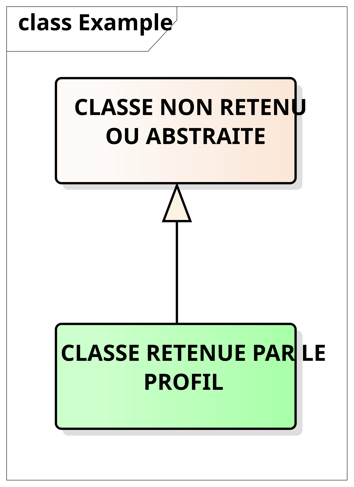
*Exemple de classe abstraite ou non retenue*

De plus les schémas UML conservent les noms des classes en anglais (non
traduit) car c'est sous cette dénomination que les objets présentés se
retrouveront dans le modèle XSD et donc dans les tags XML utilisés dans
l'implémentation et les échanges.

## Éléments d'accessibilité de base partagés par toutes les parties du profil France

Tous les objets contenus dans les autres parties du profil France (Éléments Communs, Arrêts, Réseaux, Horaires, Tarifs et Parking) proposent une information de base sur l'accessibilité en utilisant les ÉVALUATIONs D’ACCESSIBILITÉ (<span lang="en">ACCESSIBILITY ASSESSMENT</span>).
Celles retenues dans le profil France sont :

- *<span lang="en">WheelchairAccess</span>* : on peut s’y déplacer en fauteuil roulant
- *<span lang="en">StepFreeAccess</span>* : on peut s’y déplacer sans franchir de marche ou d'escalier
- *<span lang="en">EscalatorFreeAccess</span>* : on peut s’y déplacer sans utiliser d'escalator
- *<span lang="en">LiftFreeAccess</span>* : on peut s’y déplacer sans utiliser d'ascenseur
- *<span lang="en">AudibleSignalsAvailable</span>* : une information sonore ou une signalétique auditive
 est disponible
- *<span lang="en">VisualSignsAvailable</span>* : une information visuelle ou une signalétique visuelle
 est disponible
- *<span lang="en">TactileGuidanceAvailable</span>* : il y a des éléments linéaires au sol qui peuvent être détectés et suivis avec une canne, comme par exemple une bande de guidage podotactile


Les valeurs potentiellement portées par chacun de ces indicateurs sont:
***Oui***, ***Non***, ***Partiel*** ou ***Inconnu***.

"***Oui***" signifie que les exigences réglementaires sont remplies
 (principalement l’arrêté du 15 janvier 2007 relatif à l’accessibilité de la voirie
 et des espaces publics et l’arrêté du 20 avril 2017 relatif à l’accessibilité des ERPs).

"***Partiel***" peut vouloir dire plusieurs choses :

* partiel au niveau temporel (par exemple : pas toujours accessible
UFR si le service d'accompagnement est limité aux jours de semaine)

* partiel au niveau de l'objet/géographique (par exemple: pour une
gare, accès possibles pour les UFR uniquement sur certains quais)

* partiel par rapport à l'étendu du service (par exemple:
signalétique auditive en cas de perturbations mais pas d'annonces pour
les prochains passages)

<span class="hl">Dans le cadre du profil France il est convenu, lorsque
"</span>***<span class="hl">Partiel</span>***<span class="hl">" est
utilisé, de systématiquement remplir le champ "</span>***<span
class="hl"><span lang="en">ValidityCondition->Description</span></span>***<span class="hl">"
pour préciser comment l'information doit être interprétée. Il est à noter
que seul le champ </span>***<span class="hl"><span lang="en">ValidityCondition</span></span>***
<span class="hl"> permet de contenir une description textuelle, sous forme d'un
texte libre susceptible d'être présenté au public en complément des
indicateurs ci-dessus.</span>

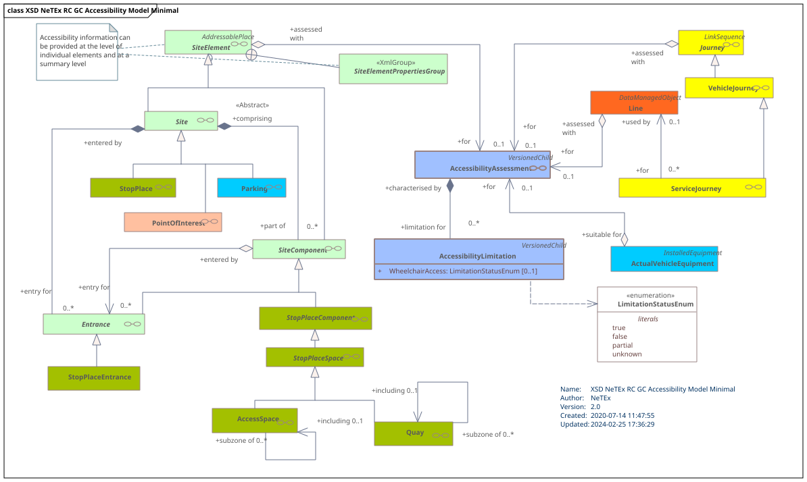
*Accessibilité dans les autres parties du profil France*

Toutefois, cela correspond à une information globale et synthétique,
mais qui dans de nombreuses situations manquera de précisions, d'une
part vis-à-vis des besoins d'accessibilité et d'autre part en terme de
précision sur les équipements et cheminements rencontrés.

<div class="table-title"><span lang="en">AccessibilityAssessment</span> – Élément (objet inclus)</div>

<table>
<colgroup>
<col style="width: 9%" />
<col style="width: 20%" />
<col style="width: 20%" />
<col style="width: 8%" />
<col style="width: 41%" />
</colgroup>
<tbody>
<tr class="odd">
<td><strong>Classification</strong></td>
<td><strong>Nom</strong></td>
<td><strong>Type</strong></td>
<td><strong>Cardinalité</strong></td>
<td><strong>Description</strong></td>
</tr>
<tr class="even">
<td>::></td>
<td>::></td>
<td><em><span lang="en">DataManagedObject</span></em></td>
<td>::></td>
<td><span lang="en">ACCESSIBILITY ASSESSMENT</span> hérite de <span lang="en">DATA MANAGED OBJECT</span>.</td>
</tr>
<tr class="odd">
<td></td>
<td><span lang="en">MobilityImpaired</span>­Access</td>
<td><em><span lang="en">AccessibilityEnumeration</span></em></td>
<td>1:1</td>
<td><p>Indication globale d'accessibilité (de la LIGNE ou du LIEU).</p>
<p>Il peut valoir <em><span lang="en">true</span></em> (accessible), <em><span lang="en">false</span></em> (non accessible), <em><span lang="en">partial</span></em> ou <em><span lang="en">unknown</span></em></p></td>
</tr>
<tr class="even">
<td>«<span lang="en">cntd</span>»</td>
<td><span lang="en">limitations</span></td>
<td><span lang="en">AccessibilityLimitation</span></td>
<td>0:1</td>
<td>Limitations d'accessibilité</td>
</tr>

<tr class="even">
<td></td>
<td><em><strong><span lang="en">Comment</span></strong></em></td>
<td><em><span lang="en">MultilingualString</span></em></td>
<td>0:1</td>
<td><p>Commentaire complémentaire sur l'accessibilité.</p>
<p><span class="hl">Ce champ a pour vocation à compléter, en termes d'information voyageur, l'information générale de la structure. Il a donc pour vocation à être affiché avec les informations d'accessibilité.</span></p></td>
</tr>
</tbody>
</table>

**NOTE** : L'attribut ***<span lang="en">MobilityImpairedAccess</span>*** n'a pas été retenu dans le
cadre des travaux sur le modèle d'arrêt partagé (car considéré comme
trop générique). Toutefois, ce champ étant obligatoire dans NeTEx, il
devra être présent dans les échanges. Les valeurs qu'il peut prendre
étant <span lang="en">***true***/***false***/***unknown***/***partial***</span>, il est
recommandé (pour des raisons de cohérence) que sa valeur soit:

-   ***<span lang="en">true</span>*** si tous les champs de ***<span lang="en">AccessibilityLimitation</span>*** sont
    à ***<span lang="en">true</span>***

-   ***<span lang="en">false</span>*** si tous les champs de ***<span lang="en">AccessibilityLimitation</span>*** sont
    à ***<span lang="en">false</span>***

-   ***<span lang="en">partial</span>*** si seulement certains champs de
    ***<span lang="en">AccessibilityLimitation</span>*** sont à ***<span lang="en">true</span>***

-   ***<span lang="en">unknown</span>*** dans tous les autres cas

<div class="table-title"><span lang="en">AccessibilityLimitation</span> – Élément (objet inclus)</div>

| **Classification** | **Nom**                        | **Type**               |     | **Description**                                                                                                                                                                                                          |
| ------------------ | ------------------------------ | ---------------------- | --- | ------------------------------------------------------------------------------------------------------------------------------------------------------------------------------------------------------------------------ |
|                    | ***<span lang="en">WheelchairAccess</span>***         | *<span lang="en">LimitationStatusEnum</span>* | 1:1 | Indique si on peut s’y déplacer en fauteuil roulant.                                                                                                 |
|                    | ***<span lang="en">StepFreeAccess</span>***           | *<span lang="en">LimitationStatusEnum</span>* | 0:1 | Indique si on peut s’y déplacer sans franchir de marche ou d’escalier.                                                                          |
|                    | ***<span lang="en">EscalatorFreeAccess</span>***      | *<span lang="en">LimitationStatusEnum</span>* | 0:1 | Indique si on peut s’y déplacer sans utiliser d’escalator.                                                                                            |
|                    | ***<span lang="en">LiftFreeAccess</span>***           | *<span lang="en">LimitationStatusEnum</span>* | 0:1 | Indique si on peut s’y déplacer sans utiliser d’ascenseur.                                                                                            |
|                    | ***<span lang="en">AudibleSignsAvailable</span>***    | *<span lang="en">LimitationStatusEnum</span>* | 0:1 | Indique si une information sonore ou une signalétique auditive est disponible.                                                                                                   |
|                    | ***<span lang="en">VisualSignsAvailable</span>***     | *<span lang="en">LimitationStatusEnum</span>* | 0:1 | Indique si une information visuelle ou une signalétique visuelle est disponible.                                                                                                   |
|                    | ***<span lang="en">TactileGuidanceAvailable</span>*** | *<span lang="en">LimitationStatusEnum</span>* | 0:1 | Indique s'il y a des éléments linéaires au sol qui peuvent être détectés et suivis avec une canne, comme par exemple une bande de guidage podotactile. |

## Adéquation aux besoins

<span class="hl">L'adéquation aux besoins n'est pas retenue dans le
cadre du profil accessibilité.</span>


## Les services disponibles

Les SERVICES DISPONIBLES (<span lang="en">FACILITY SET</span>) permettent de décrire, pour une
COURSE, un TYPE DE VÉHICULE ou un SITE, l'ensemble des services
disponibles mais sans en préciser les caractéristiques détaillées, ni le
nombre, ni la localisation. Il sera ainsi possible d'indiquer qu'un site
dispose de toilettes (*<span lang="en">toilet</span>*), de toilettes accessibles en fauteuil
roulant (*<span lang="en">wheelChairAccessToilet</span>*), ou si un véhicule dispose
d'écrans (*<span lang="en">visualDisplays</span>*) et si cet équipement a été conçu
pour un handicap visuel (*<span lang="en">displaysForVisuallyImpaired</span>*).

On peut voir la liste de ces services comme la façon répondre à la prise
en compte des besoins (ADÉQUATION AU BESOIN (<span lang="en">SUITABILITY</span>)) présentée
ci-dessus. Mais on peut aussi y voir une certaine redondance.

La description des services disponibles est retenue dans le cadre du
profil pour l'accessibilité, mais uniquement avec un sous-ensemble des
codes disponibles, et ne devra être utilisée que par les acteurs ne
disposant pas de la possibilité de décrire les équipements disponibles.

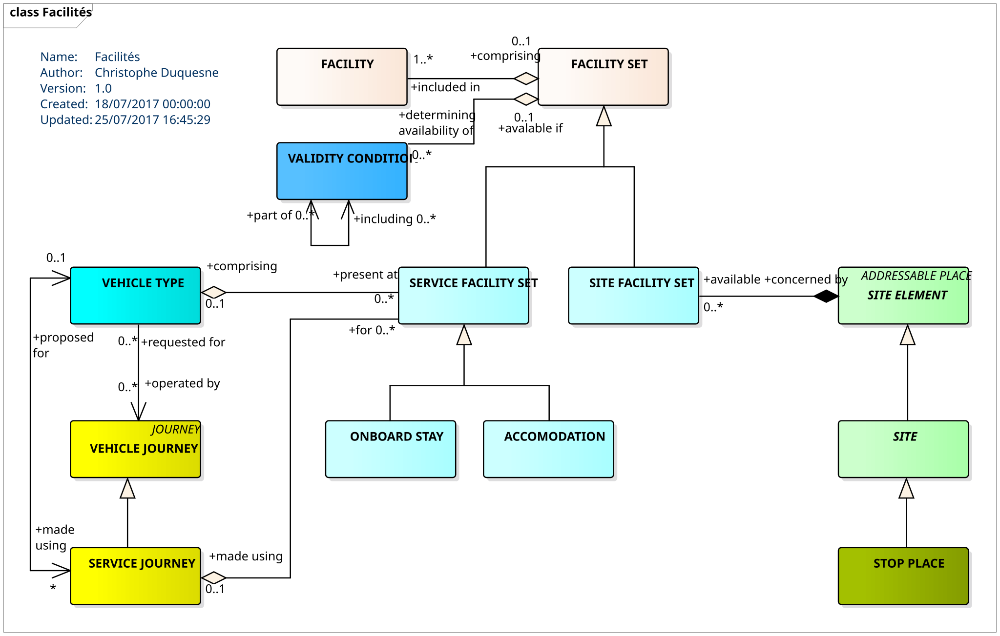
*SERVICES DISPONIBLES*

SERVICES DISPONIBLES (<span lang="en">FACILITY SET</span>) contient une liste de services et
peut se spécialiser en SERVICES SUR SITE (<span lang="en">SITE FACILITY SET</span>) et SERVICES
À BORD (<span lang="en">SERVICE FACILITY</span>) qui lui-même se spécialise en SERVICE
D'INSTALLATION (<span lang="en">ACCOMODATION</span>, qui décrit le type de siège, couchette,
etc.) et POSSIBILITÉ DE RESTER À BORD (<span lang="en">ONBOARD STAY</span>).

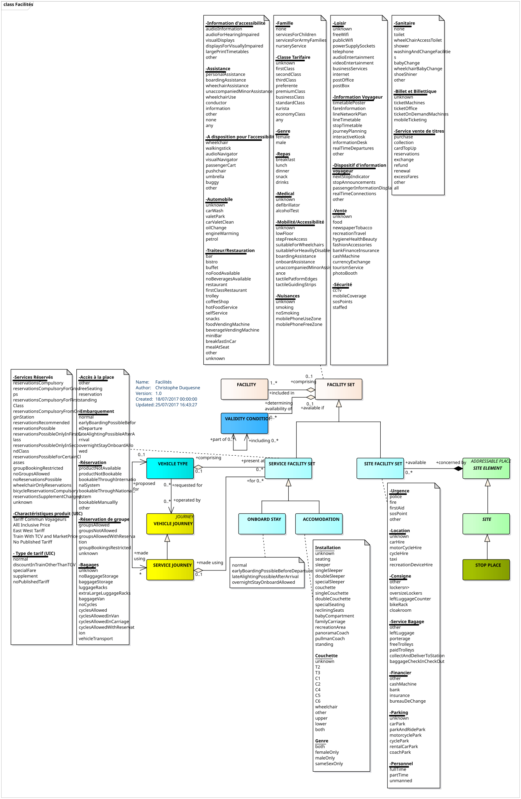
*SERVICES DISPONIBLES – détail des énumérations*

<div class="table-title"><span lang="en">FacilitySet</span> – Élément</div>


| **Classification** | **Nom** | **Type** | **Cardinalité** | **Description** |
|--|--|--|--|--|
| ::> | ::> | *<span lang="en">DataManagedObject</span>* | ::> | <span lang="en">FACILITY SET</span> hérite de <span lang="en">DATA MANAGED OBJECT</span>. |
| «PK» | id | <span lang="en">FacilitySetIdType</span> | 1:1 | Identifiant du <span lang="en">FACILITY SET</span>. |
| | ***<span lang="en">ProvidedByRef</span>*** | <span lang="en">OrganisationRef</span> | 0:1 | ORGANISATION en charge de proposer le <span lang="en">FACILITY SET</span>. |
| | <span lang="en">Description</span> | <span lang="en">MultilingualString</span> | 0:1 | Description du <span lang="en">FACILITY SET</span>. |
| «FK» | <span lang="en">TypeOfFacilityRef</span> | *<span lang="en">TypeOfFacilityRef</span>* | 0:1 | Classification du <span lang="en">FACILITY SET</span>. <span class="hl">Non retenu dans le profil France jusqu'à son harmonisation.</span> |
| «<span lang="en">cntd</span>» | <span lang="en">otherFacilities</span> | _*<span lang="en">TypeOfEquipment</span>*_ / *<span lang="en">TypeTypeOfEquipmentRef</span>* | 0:\* | Types de <span lang="en">FACILITY</span> arbitraires définis par l'utilisateur dans <span lang="en">FACILITY SET</span>, leur définition renvoie à des <span lang="en">TYPES OF EQUIPMENT</span>. <span class="hl">Non retenu dans le profil France jusqu'à son harmonisation.</span> |
| «<span lang="en">cntd</span>» | (<span lang="en">CommonFacilityGroup</span>) | <span lang="en">xxxFacilitList</span> | 0:\* | <span lang="en">FACILITIEs</span> sont définies comme des listes de valeurs énumérées de types fixes qui sont communes à tous les <span lang="en">FACILITY SET</span>s. Il existe d'autres <span lang="en">FACILITIEs</span> spécifiques aux <span lang="en">SERVICE FACILITY</span> SET et <span lang="en">SITE FACILITY SET</span> . |

<div class="table-title"><span lang="en">ServiceFacilitySet</span> – Élément</div>

| **Classification** | **Nom** | **Type** | **Cardinalité** | **Description** |
|-|-|-|-|-|
| ::> | ::> | *<span lang="en">FacilitySet</span>* | ::> | <span lang="en">SERVICE FACILITY SET</span> hérite de <span lang="en">FACILITY SET</span>. |
| «PK» | id | *<span lang="en">ServiceFacilitySetIdType</span>* | 1:1 | Identifiant du <span lang="en">SERVICE FACILITY SET</span>. |
| «<span lang="en">cntd</span>» | ***<span lang="en">ServiceFacilityGroup</span>*** | <span lang="en">xxx*FacilityList</span>* | 0:\* | SERVICE <span lang="en">FACILITies</span> au sein d’un <span lang="en">SERVICE FACILITY SET</span> défini en tant que listes de valeurs énumérées. Il existe des spécificités pour le <span lang="en">SERVICE FACILITY SET</span>. |
| «<span lang="en">cntd</span>» | ***<span lang="en">accommodations</span>*** | *<span lang="en">accommodations</span>* | 0:1 | <span lang="en">Accommodations</span> (couchette, etc.) disponibles. |
| «<span lang="en">cntd</span>» | ***<span lang="en">onboardStays</span>*** | *<span lang="en">onboardStays</span>* | 0:1 | Autorisations de rester à bord. |

<div class="table-title"><span lang="en">SiteFacilitySet</span> – Élément</div>

| **Classification** | **Nom** | | **Type**  | **Cardinalité** | **Description**  |
|-|-|-|-|-|-|
| ::> | ::>  | | *<span lang="en">FacilitySet</span>* | ::>  | SITE <span lang="en">FACILITY SET</span> hérite de <span lang="en">FACILITY SET</span>.  |
| «PK»  | id | <span lang="en">SiteFacilitySetIdType</span> | | 1:1  | Identifiant du SITE <span lang="en">FACILITY SET</span>.  |
| «<span lang="en">cntd</span>»  | *<span lang="en">SiteFacilityGroup</span>* | <span lang="en">xxxFacilityList</span> | | 0:\* | <span lang="en">SITE FACILITies</span> dans <span lang="en">SITE FACILITY SET</span> défini en tant que listes de valeurs énumérées. Il existe des spécificités pour le <span lang="en">SITE FACILITY SET</span>. |

<div class="table-title"><span lang="en">Accommodation</span> – Élément</div>

| **Classification** | **Nom** | **Type** | **Cardinalité** | **Description** |
|-|-|-|-|-|
| | ***<span lang="en">Name</span>*** | *<span lang="en">MultilingualString</span>* | 0:1  | Nom de l’<span lang="en">accomodation</span> |
| | ­<span lang="en">AccommodationFacility</span> | <span lang="en">AccommodationFacilityEnum</span> | 0:1  | Type d'accommodation  |
| | <span lang="en">ToiletFacility</span> | <span lang="en">SanitaryFacilityEnum</span> | 0:1  | Type de toilette pour l’ACCOMMODATION. |
| | ***<span lang="en">PassengerCommsFacilityList</span>*** | *<span lang="en">PassengerCommsFacilityListOfEnumerations</span>* | 0:1  | Listes des services de communication. |


Les SERVICES DISPONIBLES communs à toutes ces spécialisations et <span
class="hl">retenus dans le cadre du profil sont les suivants </span>:

***<u>-Information d'accessibilité</u>***

* *<span lang="en">audioInformation</span> (information audio)*

* *<span lang="en">audioForHearingImpaired</span> (information audio adaptée pour les
malentendants)*

* *<span lang="en">visualDisplays</span> (écran d’affichage)*

* *<span lang="en">displaysForVisuallyImpaired</span> (écran d’affichage adapté pour les mal
voyants)*

* *<span lang="en">largePrintTimetables</span> (grand panneau d’affichage)*

***<u>-Assistance</u>***

* *<span lang="en">personalAssistance</span> (assistance personnalisée)*

* *<span lang="en">boardingAssistance</span> (assistance à l’embarquement)*

* *<span lang="en">wheechairAssistance</span> (assistance pour les fauteuils roulants)*

* *<span lang="en">unaccompaniedMinorAssistance</span> (assistance pour les mineurs non
accompagnés)*

* *<span lang="en">conductor</span> (chef de train ou de station disponible)*

* *<span lang="en">information</span> (information disponible)*

***<u>-A disposition pour l'accessibilité</u>***

* *<span lang="en">wheelchair</span> (fauteuils roulants disponibles)*

* *<span lang="en">walkingstick</span> (cannes disponibles)*

* *<span lang="en">audioNavigator</span> (navigateurs audios disponibles)*

* *<span lang="en">visualNavigator</span> (navigateurs visuels disponibles)*

* *<span lang="en">passengerCart</span> (caddies disponibles)*

* *<span lang="en">pushchair</span> (poussettes disponibles)*

* *<span lang="en">umbrella</span> (parapluies disponibles)*

* *<span lang="en">buggy</span> (voiturettes disponibles)*

***<u>-Famille</u>***

* *<span lang="en">servicesForChildren</span> (services et activités pour les enfants)*

* *<span lang="en">nurseryService</span> (service de garderie)*

***<u>-Médical</u>***

* *<span lang="en">defibrillator</span> (défibrillateur)*

* *<span lang="en">alcoholTest</span> (test d'alcoolémie)*

***<u>-Mobilité/Accessibilité</u>***

* *<span lang="en">lowFloor</span> (plancher bas)*

* *<span lang="en">stepFreeAccess</span> (accès sans marches)*

* *<span lang="en">suitableForWheelchairs</span> (adapté aux fauteuils roulants)*

* *<span lang="en">suitableForHeavilyDisabled</span> (adapté aux handicaps lourds ; <span class="hl">
note : prendre contact avec le gestionnaire pour plus de précisions</span>)*

* *<span lang="en">suitableForPushchairs</span> (adapté aux poussettes)*

* *<span lang="en">boardingAssistance</span> (assistance à l’embarquement)*

* *<span lang="en">onboardAssistance</span> (assistance à bord)*

* *<span lang="en">unaccompaniedMinorAssistance</span> (assistance pour les mineurs non accompagnés)*

* *<span lang="en">tactilePlatformEdges</span> (marquage podotactile sur le bord des quais)*

* *<span lang="en">tactileGuidingStrips</span> (bandes de guidage podotactiles)*

* *<span lang="en">raisedKerb</span> (quai surélevé)*

***<u>-Loisir</u>***

* *<span lang="en">freeWifi</span> (Wifi gratuit)*

* *<span lang="en">publicWifi</span> (Wifi public)*

* *internet (accès Internet disponible)*

* *<span lang="en">powerSupplySockets</span> (prises de courant)*

***<u>-Information Voyageur</u>***

* *<span lang="en">informationDesk</span> (comptoir d’information voyageur)*

* *<span lang="en">realTimeDepartures</span> (horaires de départ <span lang="en">temps-réel</span>)*

**<u>-Dispositif d'information voyageur</u>***

* *<span lang="en">nextStopIndicator</span> (indicateur des prochains arrêts)*

* *<span lang="en">stopAnnouncements</span> (annonce des arrêts)*

* *<span lang="en">passengerInformationDisplay</span> (affichage pour l’information voyageur)*

* *<span lang="en">realTimeConnections</span> (information <span lang="en">temps-réel</span> sur les correspondances)*

***<u>-Sanitaire</u>***

* *<span lang="en">None</span>* *(pas de sanitaires)*

* *<span lang="en">toilet</span> (toilettes)*

* *<span lang="en">wheelChairAccessToilet</span> (toilettes accessible pour les fauteuils
roulants)*

* *<span lang="en">shower</span> (douches)*

* *<span lang="en">washingAndChangeFacilities</span> (espace pour se laver et se changer)*

* *<span lang="en">babyChange</span> (espace bébé)*

* *<span lang="en">wheelchairBabyChange</span> (espace bébé accessible en fauteuil roulant)*

***<u>-Billet et Billettique</u>***

* *<span lang="en">ticketMachines</span> (machine de vente de billet)*

* *<span lang="en">ticketOffice</span> (guichet de vente de billet)*

* *<span lang="en">ticketOnDemandMachines</span> (machine d’impression de billet acheté en
ligne)*

* *<span lang="en">mobileTicketing</span> (billettique mobile – sur smartphone)*

Les SERVICES DISPONIBLES de type Service (sans redondance des catégories
précédentes) <span class="hl">retenus dans le cadre du profil sont les
suivants </span>:

***<u>-Services Réservés</u>***

* *<span lang="en">wheelchairOnlyReservations</span> (service réservé pour fauteuil roulant, sur
réservation)*

***<u>-Accès à la place</u>***

* *standing (debout)*

***<u>-Bagages</u>***

* *<span lang="en">extraLargeLuggageRacks</span> (espace pour les bagages très larges – incluant
les fauteuils roulants notamment)*

* *<span lang="en">cyclesAllowed</span> (vélos autorisés en bagage)*

Les SERVICES DISPONIBLES spécifiques aux lieux (sans redondance des
catégories précédentes) <span class="hl">retenus dans le cadre du profil
sont les suivants </span>:

***<u>-Urgence</u>***

* *<span lang="en">police</span> (police)*

* *<span lang="en">fire</span> (incendie)*

* *<span lang="en">firstAid</span> (premiers secours)*

* *<span lang="en">sosPoint</span> (point SOS, appel d’urgence)*

***<u>-Service Bagage</u>***

* *<span lang="en">porterage</span> (porteur)*

* *<span lang="en">collectAndDeliverToStation</span> (service de collecte et livraison en
station)*

***<u>-Parking</u>***

* *<span lang="en">carPark</span> (parking auto)*

* *<span lang="en">cyclePark</span> (parking vélo)*

***<u>-Personnel</u>***

* *<span lang="en">fullTime</span> (personne présente en permanence)*

* *<span lang="en">partTime</span> (personne présente à temps partiel)*

* *<span lang="en">unmanned</span> (sans personnel)*

Les SERVICES DISPONIBLES disponible au niveau de la place, lors du
voyage (sans redondance des catégories précédentes) <span
class="hl">retenus dans le cadre du profil sont les suivants :</span>

***<u>Installation</u>***

* *<span lang="en">specialSleeper</span> (couchettes spéciales/adaptées)*

* *<span lang="en">specialSeating</span> (sièges spéciaux/adaptés)*

## Les Équipements

Un ÉQUIPEMENT est un matériel particulier installé, soit fixe
(ÉQUIPEMENT DE LIEU) ou à bord de véhicules (ÉQUIPEMENT DE VÉHICULE).
C'est une notion qu'il faut considérer de façon générale et un service
(SERVICE LOCAL tel qu’OBJETS TROUVÉS, BILLETTERIE) est également
considéré comme un ÉQUIPEMENT.

<span class="hl">Dans le cadre du profil pour l'accessibilité, la
description des équipements est recommandée à chaque fois que cela est
possible (et que l'information est disponible). La description des
ÉQUIPEMENTs est donc préférée à la description des services
disponibles.</span>

### Équipements localisés

Le schéma UML ci-dessous présente la structure des ÉQUIPEMENTs. Il
propose deux spécialisations : SERVICE LOCAL (<span lang="en">LOCAL SERVICE</span>) et
ÉQUIPEMENT INSTALLÉ (<span lang="en">INSTALLED EQUIPMENT</span>).

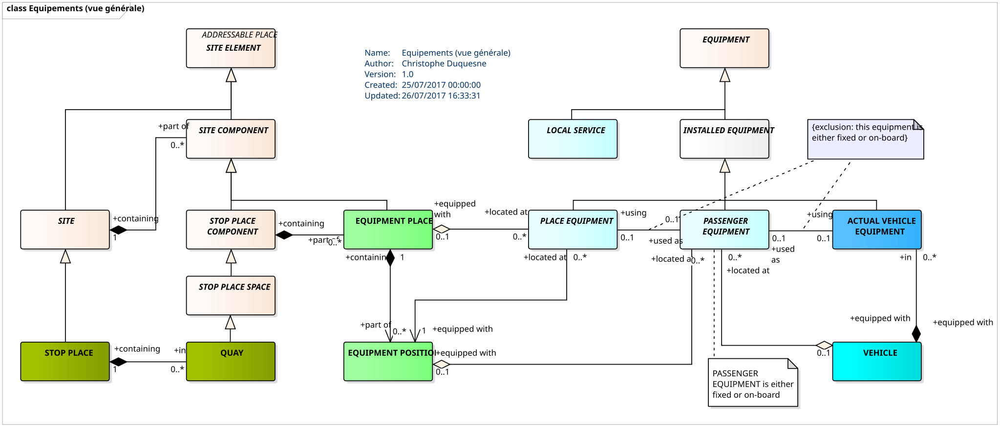
*Structure générique des ÉQUIPEMENT*

L'ÉQUIPEMENT INSTALLÉ (<span lang="en">INSTALLED EQUIPMENT</span>) peut lui-même être
spécialisé en ÉQUIPEMENT DE LIEU ( <span lang="en">PLACE EQUIPMENT</span>), ÉQUIPEMENT POUR
PASSAGER (<span lang="en">PASSENGER EQUIPMENT</span>) ou ÉQUIPEMENT DE VÉHICULE (<span lang="en">ACTUAL VEHICLE EQUIPMENT</span>). On notera que l'ÉQUIPEMENT POUR PASSAGER est particulier car
il peut soit être localisé dans un lieu (LIEU D'ARRÊT) soit dans un
VÉHICULE (par exemple pour des équipements sanitaires comme les toilettes
que le trouvera aussi bien en station que dans une rame de TGV).

<div class="table-title"><span lang="en">Equipment</span> – Élément</div>

<table>
<colgroup>
<col style="width: 8%" />
<col style="width: 19%" />
<col style="width: 23%" />
<col style="width: 7%" />
<col style="width: 41%" />
</colgroup>
<tbody>
<tr class="odd">
<td><strong>Classification</strong></td>
<td><strong>Nom</strong></td>
<td><strong>Type</strong></td>
<td><strong>Cardinalité</strong></td>
<td><strong>Description</strong></td>
</tr>
<tr class="even">
<td>::></td>
<td>::></td>
<td><em><span lang="en">DataManagedObject</span></em></td>
<td>::></td>
<td>ÉQUIPEMENT hérite de <span lang="en">DATA MANAGED OBJECT</span>.</td>
</tr>
<tr class="odd">
<td>«PK»</td>
<td>id</td>
<td><span lang="en">EquipmentIdType</span></td>
<td>1:1</td>
<td>Identifiant de l’ÉQUIPEMENT.</td>
</tr>
<tr class="even">
<td></td>
<td><span lang="en">Name</span></td>
<td><span lang="en">MultilingualString</span></td>
<td>0:1</td>
<td>Nom de l’ÉQUIPEMENT.</td>
</tr>
<tr class="odd">
<td>«AK»</td>
<td><span lang="en">PrivateCode</span></td>
<td><em><span lang="en">PrivateCode</span></em></td>
<td>0:1</td>
<td>Identifiant alternatif de l’ÉQUIPEMENT.</td>
</tr>
<tr class="even">
<td></td>
<td><em><strong><span lang="en">PublicCode</span></strong></em></td>
<td><em><span lang="en">PublicCode</span></em></td>
<td>0:1</td>
<td><p>Code public de l’équipement, et qui figure généralement sur l’équipement, typiquement sous la forme d’une étiquette.</p>
<p><span class="hl">Pourra contenir des codes comme, par exemple, les codes MIR de la RATP</span></p>
<p><span class="hl">Notez que ce code doit être accessible/préhensible sur l'équipement (notament en vue d'utilisation pour du crowd-sourcing et de la signalisation d'anomalie, etc.)</span></p></td>
</tr>
<tr class="odd">
<td></td>
<td><span lang="en">Image</span>­</td>
<td>xsd:<span lang="en">anyURI</span></td>
<td>0:1</td>
<td><p>Image de l’ÉQUIPEMENT.</p>
<p><span class="hl">Pourra aussi référencer des documents audio, des pages web, etc</span></p></td>
</tr>
<tr class="even">
<td>«FK»</td>
<td><span lang="en">TypeOfEquipmentRef</span></td>
<td><span lang="en">TypeOfEquipmentRef</span></td>
<td>0:1</td>
<td>Référence du type l’ÉQUIPEMENT.</td>
</tr>
<tr class="odd">
<td></td>
<td><span lang="en">Description</span></td>
<td><span lang="en">MultilingualString</span></td>
<td>0:1</td>
<td>Description de l’ÉQUIPEMENT.<br />
<span class="hl">Doit pouvoir être présenté au public</span></td>
</tr>
<tr class="even">
<td></td>
<td><span lang="en">Note</span></td>
<td><span lang="en">MultilingualString</span></td>
<td>0:1</td>
<td>Note concernant l’ÉQUIPEMENT.<br />
<span class="hl">Doit pouvoir être présenté au public</span></td>
</tr>
<tr class="odd">
<td></td>
<td><em><strong><span lang="en">OutOfService</span></strong></em></td>
<td><span lang="en">boolean</span></td>
<td>0:1</td>
<td><p>Indique si l’équipement est hors service pour une durée prolongée. Une véritable information de disponibilité en temps réel pourra être fournie avec le service SIRI <span lang="en">Facility Monitoring</span>.</p>
<p><span class="hl">Quand </span><em><strong><span class="hl"><span lang="en">OutOfService</span></span></strong></em><span class="hl"> est utilisé, l'utilisation du <span lang="en">ValidityCondition</span> devient obligatoire pour, en particulier, indiquer la période prévue d'indisponibilité (et donc la date prévue de retour en fonctionnement)</span></p></td>
</tr>
</tbody>
</table>

<div class="table-title"><span lang="en">TypeOfEquipment</span> – Élément</div>

|                     |                    |                       |                  |                                               |
|---------------------|--------------------|-----------------------|------------------|-----------------------------------------------|
| **Classification** | **Nom**           | **Type**              | **Cardinalité** | **Description**                               |
| ::>                 | ::>                | *<span lang="en">TypeOfEntity</span>*        | ::>              | <span lang="en">TYPE OF EQUIPMENT</span> hérite de <span lang="en">TYPE OF ENTITY</span>. |
| «PK»                | id                 | <span lang="en">TypeOfEquipmentIdType</span> | 1:1              | Identifiant du <span lang="en">TYPE OF EQUIPMENT</span>.              |
|                     | <span lang="en">FunctionalPurpose</span> | <span lang="en">MultilingualString</span>    | 1:1              | Objectif fonctionnel du <span lang="en">TYPE OF EQUIPMENT</span>.    |

<div class="table-title"><span lang="en">PlaceEquipment</span> – Élément</div>

|                     |          |                     |                  |                                                  |
|---------------------|----------|---------------------|------------------|--------------------------------------------------|
| **Classification** | **Nom** | **Type**            | **Cardinalité** | **Description**                                  |
| ::>                 | ::>      | *<span lang="en">DataManagedObject</span>* | ::>              | <span lang="en">PLACE EQUIPMENT</span> hérite de <span lang="en">DATA MANAGED OBJECT</span>. |

Le LIEUX D'ARRÊT contient des espaces dédiés pour positionner les
équipements : ce sont les LIEUX D'ÉQUIPEMENT (ce sont de COMPOSANTS DE
SITE). Un LIEUX D'ÉQUIPEMENT peut contenir de nombreux ÉQUIPEMENTs (qui
peuvent être de types différents et caractéristiques) : chaque ÉQUIPEMENT
aura un POSITION D'ÉQUIPEMENT au sein du LIEUX D'ÉQUIPEMENT.

On aura donc, par exemple, dans une gare, un espace où l'on trouvera des
équipements de vente de titre grande ligne, des équipements de vente de
titre banlieue et un distributeur de boisson. Chaque ÉQUIPEMENT aura sa
position et ses caractéristiques propres.

<div class="table-title"><span lang="en">EquipmentPlace</span> – Élément</div>

|                     |                           |                   |                  |                                                                                                                                 |
|---------------------|---------------------------|-------------------|------------------|---------------------------------------------------------------------------------------------------------------------------------|
| **Classification** | **Nom**                  | **Type**          | **Cardinalité** | **Description**                                                                                                                 |
| ::>                 | ::>                       | *<span lang="en">Place</span>*           | ::>              | <span lang="en">EQUIPMENT PLACE</span> hérite de <span lang="en">PLACE</span>.                                                                                              |
| «PK»                | id                        | <span lang="en">EquipmentPlaceId</span>  | 0:1              | Identifiant de l’<span lang="en">EQUIPMENT PLACE</span>.                                                                                               |
| «<span lang="en">cntd</span>»              | ***<span lang="en">equipment</span>­Positions*** | <span lang="en">EquipmentPosition</span> | 0:\*             | <span lang="en">EQUIPMENT POSITIONs</span> au sein <span lang="en">EQUIPMENT PLACE</span> (notez que plusieurs équipement peuvent être placés dans un même lieu d’équipement) |
|                     | ***<span lang="en">placeEquipments</span>***     | <span lang="en">Equipment</span>         | 0:\*             | Liste des <span lang="en">EQUIPMENTs</span> au sein de l’<span lang="en">EQUIPMENT</span> PLACE</span>.                                                                              |

10 — *<span lang="en">EquipmentPosition</span> – Élément*

|                     |                          |                         |                  |                                                                                                                                                                                                                                                                                                                             |
|---------------------|--------------------------|-------------------------|------------------|-----------------------------------------------------------------------------------------------------------------------------------------------------------------------------------------------------------------------------------------------------------------------------------------------------------------------------|
| **Classification** | **Nom**                 | **Type**                | **Cardinalité** | **Description**                                                                                                                                                                                                                                                                                                             |
| ::>                 | ::>                      | *<span lang="en">DataManagedObject</span>*     | ::>              | <span lang="en">EQUIPMENT POSITION</span> hérite de <span lang="en">DATA MANAGED OBJECT</span>.                                                                                                                                                                                                                                                                          |
| «PK»                | id                       | <span lang="en">EquipmentPositionIdType</span> | 0:1              | Identifiant de l’<span lang="en">EQUIPMENT POSITION</span>.                                                                                                                                                                                                                                                                                        |
|                     | ***<span lang="en">EquipmentRef</span>***       | *<span lang="en">EquipmentRef</span>*          | 1:1              | Référence à l’<span lang="en">EQUIPMENT</span> dont on fournit la position.                                                                                                                                                                                                                                                                        |
|                     | <span lang="en">Description</span>              | <span lang="en">MultilingualString</span>      | 0:1              | Description de la position de l'équipement.                                                                                                                                                                                                                                                                                  |
|                     | ***<span lang="en">Location</span>***           | *<span lang="en">Location</span>*              | 0:1              | Position de l’<span lang="en">EQUIPMENT</span> (position géographique).                                                                                                                                                                                                                                                                             |
| «FK»                | ***<span lang="en">ReferencePointRef</span>*** | *<span lang="en">PointRef</span>*              | 0:1              | Point de référence pour un positionnement relatif de l’équipement (réalisé par les 2 attributs suivants : <span lang="en">XOffset</span> et <span lang="en">YOffset</span>). S’il est absent on utilisera le coin supérieur gauche de l’<span lang="en">EQUIPMENT PLACE</span>. S’il est présent, il correspondra à une entrée ou un élément facilement identifiable au sein de l’<span lang="en">EQUIPMENT PLACE</span>. |
|                     | ***<span lang="en">XOffset</span>***            | *<span lang="en">LengthType</span>*            | 0:1              | Position nord/sud ou décalage vertical par rapport au point de référence                                                                                                                                                                                                                                                    |
|                     | ***<span lang="en">YOffset</span>***            | *<span lang="en">LengthType</span>*            | 0:1              | Position est/ouest ou décalage horizontal par rapport au point de référence                                                                                                                                                                                                                                                 |

La figure ci-dessous regroupe en une seule fois tous les équipements
disponibles: il faut la voir comme un panorama, mais le grand nombre
d'ÉQUIPEMENT rend le résultat très dense. Aussi il est détaillé dans les
figures suivantes.

*NOTE : Dans cette figure et celles qui suivent, les objets encadrés en
bleu foncé (comme <span lang="en">RAMP EQUIPMENT</span>) sont ceux qui ont été spécifiquement
retenus par le projet CAMERA avec pour vocation de répondre à la
réglementation en terme d'information sur l'accessibilité. Pour mémoire,
l'étude CAMERA porte uniquement sur les modes de surface et ne couvre
donc pas tous les besoins du profil.*

Toutefois, les tableaux d'attributs des équipements ne sont fournis qu'en
annexe pour ne pas trop alourdir le document.

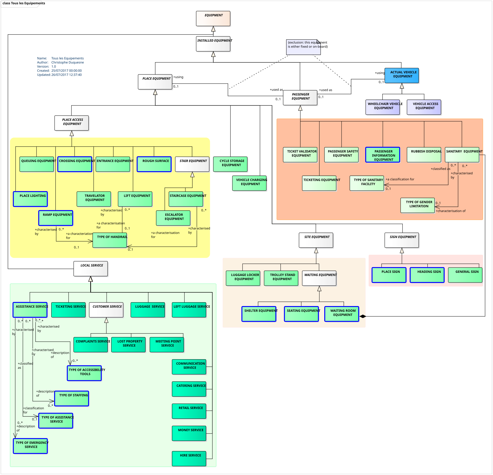
*Liste détaillée des ÉQUIPEMENTs*

Parmi tous ces équipements, certains sont plus particulièrement dédiés à
l'accessibilité. Dans le cadre du présent profil pour l'accessibilité,
le tableau ci-dessous identifie les principaux types d'équipement
correspondant, mais cette liste n'est bien sûr qu'indicative et d'une
part ces équipements peuvent avoir un usage en dehors des contraintes
d'accessibilité et d'autre part d'autres équipements peuvent aussi
assurer un rôle dans l'accessibilité.

<div class="table-title">Résumé des principaux équipements dédiés à l'accessibilité</div>

| **Groupe**        | **Sous-groupe**     | **Équipement**                                                             | **Principaux attributs relatifs à l’accessibilité**                                                        |
|-------------------|---------------------|----------------------------------------------------------------------------|------------------------------------------------------------------------------------------------------------|
| <span lang="en">PlaceEquipment</span>   | <span lang="en">AccessEquipment</span>    | ***<span lang="en">RoughSurface</span>** (surface accidentée)*                                    | Type de surface                                                                                            |
|                   |                     | ***<span lang="en">EntranceEquipment</span>** (entrée)*                                           | Dimensions, franchissable en fauteuil roulant, modes d’ouverture, capteur acoustique, automatique.         |
|                   |                     | ***<span lang="en">StairEquipment</span>** (escalier)*                                            | Rampe, hauteur de la rampe, hauteur des marches, nombre de marches.                                        |
|                   |                     | ***<span lang="en">LiftEquipment</span>** (ascenseur)*                                            | Dimensions, accessible en fauteuil roulant, diamètre de giration (pour fauteuil roulant).                    |
|                   |                     | ***<span lang="en">EscalatorEquipment</span>** (escalator)*                                       | Largeur, dénivelé                                                                                          |
|                   |                     | ***<span lang="en">TravelatorEquipment</span>** (tapis roulant)*                                  | Largeur, longueur.                                                                                         |
|                   |                     | ***<span lang="en">RampEquipment</span>** (rampe)*                                                | Dimensions, pente, rampe et main courante, bande de guidage/interception.                                  |
|                   |                     | ***<span lang="en">QueuingEquipment</span>** (gestion de queue)*                                  |                                                                                                            |
|                   |                     | ***<span lang="en">CrossingEquipment</span>** (passage piéton et croisement)*                     | Bande podotactile, information sonore, capteurs, aide acoustique, bateau.                                  |
|                   | <span lang="en">SignEquipment</span>       | ***<span lang="en">PlaceSign</span>** (signalétique dans un lieu)*                               | Information sur le nom de l’arrêt                                                                          |
|                   |                     | ***<span lang="en">HeadingSign</span>** (girouette de véhicule)*                                  |                                                                                                            |
|                   |                     | ***<span lang="en">GeneralSign</span>** (signalétique générale)*                                  |                                                                                                            |
|                   | <span lang="en">Ticketing</span>           | ***<span lang="en">TicketingEquipment</span>** (équipement billettique)*                          | Comptoir abaissé                                                                                           |
|                   |                     | ***<span lang="en">TicketValidatorEquipment</span>** (validateur billettique)*                    |                                                                                                            |
|                   | <span lang="en">StopPlace</span>           | ***<span lang="en">LuggageLockerEquipment</span>** (consigne et casiers)*                         |                                                                                                            |
|                   |                     | ***<span lang="en">ShelterEquipment</span>** (abris)*                                             | Nombre de sièges, dimensions, présence de marches, largeur et profondeur de l’espace pour fauteuil roulant. |
|                   |                     | ***<span lang="en">TrolleyStandEquipment</span>** (emplacement pour chariots et caddies)*         |                                                                                                            |
|                   |                     | ***<span lang="en">WaitingRoomEquipment</span>** (salle d’attente)*                               | Nombre de sièges, dimensions, présence de marches, largeur et profondeur de l’espace pour fauteuil roulant. |
|                   | <span lang="en">PassengerEquipment</span> | ***<span lang="en">PassengerInfoEquipment</span>** (équipement d’information voyageur)*           | Informations d’accessibilité                                                                               |
|                   |                     | ***<span lang="en">PassengerSafetyEquipment</span>** (équipement pour la sécurité des voyageurs)* | Caméras, bouton d’urgence, téléphone d’urgence, hauteur des appareils d’urgence, annonces sonores.          |
|                   |                     | ***<span lang="en">SanitaryEquipment</span>** (sanitaires)*                                       | Genre, type de sanitaires, diamètre de giration pour fauteuil roulant.                                        |
| **<span lang="en">Local Service</span>** | <span lang="en">Customer</span>            | ***<span lang="en">AssistanceService</span>** (service d’assistance)*                             | Aide à l’embarquement et autres aides disponibles.                                                          |
|                   |                     | ***<span lang="en">MeetingpointService</span>** (point de rendez-vous)*                           |                                                                                                            |

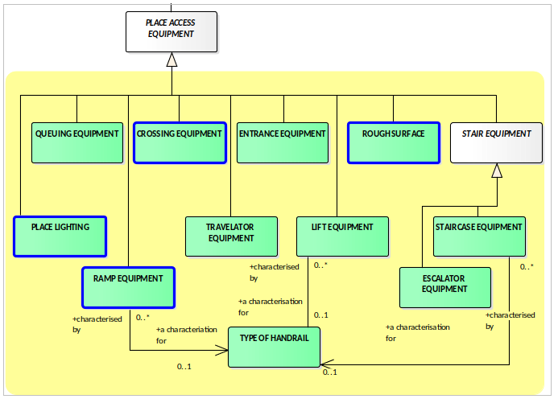
*ÉQUIPEMENTs de lieux*

Les ÉQUIPEMENTs DE LIEU sont les suivants (voir en annexe pour la
sélection du profil) :

-   Équipement de gestion de queue (<span lang="en">QUEING EQUIPMENT</span>)

-   Passage piéton (<span lang="en">CROSSING EQUIPMENT</span>)

-   Équipement d'entrée (<span lang="en">ENTRANCE EQUIPMENT</span>)

-   Surfaces au sol spéciales (<span lang="en">ROUGH EQUIPMENT</span>)

-   Escalier (<span lang="en">STAIRCASE EQUIPMENT</span>)

-   Escalator (<span lang="en">ESCALATOR EQUIPMENT</span>)

-   Éclairage (<span lang="en">PLACE LIGHTING</span>)

-   Rampe d'accès (<span lang="en">RAMP EQUIPMENT</span>)

-   Ascenseur (<span lang="en">LIFT EQUIPMENT</span>)

-   Tapis roulant (<span lang="en">TRAVELATOR EQUIPMENT</span>)

Quand nécessaire, la description d'une rampe (escalier, etc.) peut être
associée à l'équipement.

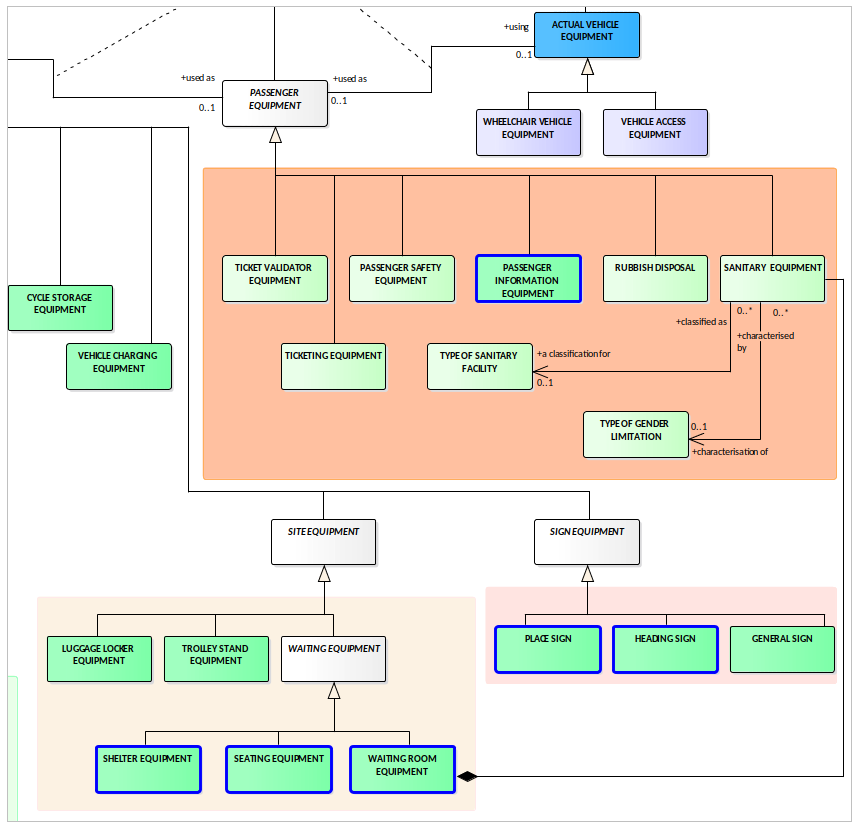
*ÉQUIPEMENTs pour les passagers, de site et de signalisation*

Les ÉQUIPEMENTs proposés par NeTEx pour les passagers sont les suivants
(voir en annexe pour la sélection du profil) :

-   Valideur de billet (<span lang="en">TICKET VALIDATOR EQUIPMENT</span>)

-   Équipement billettique (<span lang="en">TICKETING EQUIPMENT</span>)

-   Équipement de sécurité (<span lang="en">PASSENGER SAFETY EQUIPMENT</span>) comme des
    caméras vidéo ou des boutons d'appel

-   <u>Équipement d'information voyageur (<span lang="en">PASSENGER INFORMATION
     EQUIPMENT</span>) comme un afficheur ou un indicateur d'arrêt suivent,
    etc.</u>

-   Poubelle (<span lang="en">RUBBISH DISPOSAL</span>)

-   Équipement sanitaire (<span lang="en">SANITARY EQUIPMENT</span>)

Les ÉQUIPEMENTs sur site sont les suivants (voir en annexe pour la
sélection du profil) :

-   Consigne à bagages (<span lang="en">LUGGAGE LOCKER EQUIPMENT</span>)

-   Point pour chariots à bagage (<span lang="en">TROLLEY STAND EQUIPMENT</span>)

-   Abris (<span lang="en">SHELTER EQUIPMENT</span>)

-   Siège (<span lang="en">SEATING EQUIPMENT</span>)

-   Salle d'attente (<span lang="en">WAITING ROOM EQUIPMENT</span>)

Les ÉQUIPEMENTs de signalétique sont les suivants (voir en annexe pour
la sélection du profil) :

-   Poteau ou indication du nom du lieu (<span lang="en">PLACE SIGN</span>)

-   Panneau de guidage (<span lang="en">HEADING SIGN</span>)

-   Affichage et indicateurs (<span lang="en">GENERAL SIGN</span>)

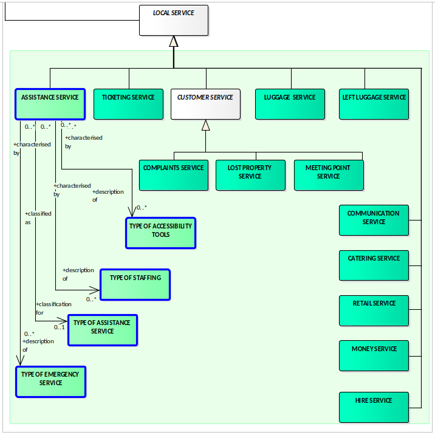
*SERVICE LOCAL*

Les SERVICE LOCAUX sont les suivants (voir en annexe pour la sélection
du profil) :

-   Service d'assistance (<span lang="en">ASSISTANCE SERVICE</span>), précisant les équipements
    mis à disposition (fauteuil roulant, etc.), le personnel
    d'assistance, le type de service et le cas échéant le type de
    service d'urgence

-   Les services de billetterie (<span lang="en">TICKETING SERVICE</span>)

-   Les services liés aux bagages (<span lang="en">LUGGAGE SERVICE</span>)

-   Les services liés aux bagages perdus (<span lang="en">LEFT LUGGAGE SERVICE</span>)

-   Les services de réclamation (<span lang="en">COMPLAINTS SERVICE</span>)

-   Les services d'objets perdus (<span lang="en">LOST PROPERTY SERVICE</span>)

-   Les services de rendez-vous (<span lang="en">MEETING POINT SERVICE</span>)

-   Les services de communication (<span lang="en">COMMUNICATION SERVICE</span>)

-   Les services de restauration (<span lang="en">CATERING SERVICE</span>)

-   Les services de vente de détail (<span lang="en">RETAIL SERVICE</span>)

-   Les services financiers (<span lang="en">MONEY SERVICE</span>)

-   Les services de location (<span lang="en">HIRE SERVICE</span>)

### Équipements non localisés

NeTEx offre la possibilité de décrire des équipements sans les
localiser : cela permet de décrire l'équipement et ses caractéristiques,
et permet d'indiquer que cet équipement est disponible en station mais
sans en dire plus (voir l'élément ***<span lang="en">unlocalisedEquipment</span>*** dans
***<span lang="en">StopPlace</span>*** dans le profil Arrêts). N'importe lequel des équipements
décrit ci-dessus peut être référencé comme non localisé (on ne passera
donc plus par les LIEUx D’ÉQUIPEMENT (<span lang="en">EQUIPMENT PLACE</span>) et POSITION
D’ÉQUIPEMENT (<span lang="en">EQUIPMENT LOCATION</span>)). Le reste reste inchangé.

## Les Cheminements

Les CHEMINEMENTs (<span lang="en">NAVIGATION PATH</span>) décrivent des chemins physiques pour
aller d'un point à un autre en marchant. Ils peuvent se situer au sein
de LIEU D'ARRÊT mais aussi à l'extérieur en cas de correspondance en
particulier (on peut même définir un CHEMINEMENT entre deux lieux dont
aucun n'est un LIEU D'ARRÊT).

Les constituants de base de CHEMINEMENT sont de TRONÇONs DE CHEMINEMENT.
Aux extrémités de ces tronçons (<span lang="en">PATH LINK END</span>) on peut associer des
éléments de site (zone d'embarquement, salle d'échange, lieu
d'équipement, etc.). Les tronçons sont assemblés en SÉQUENCES DE
TRONÇONS qui elles-mêmes s'assemblent en CHEMINEMENTs (la séparation en
deux niveaux d'assemblage permet d'éviter les redéfinitions et de
partager des SÉQUENCES DE TRONÇONS entre plusieurs CHEMINEMENTs).

La figure ci-dessous en donne une illustration.

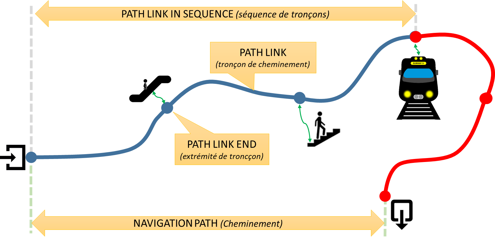
*vue schématiques des CHEMINEMENTs*

Le schéma UML ci-dessous décrit la structure des cheminements dans NeTEx
(et Transmodel).

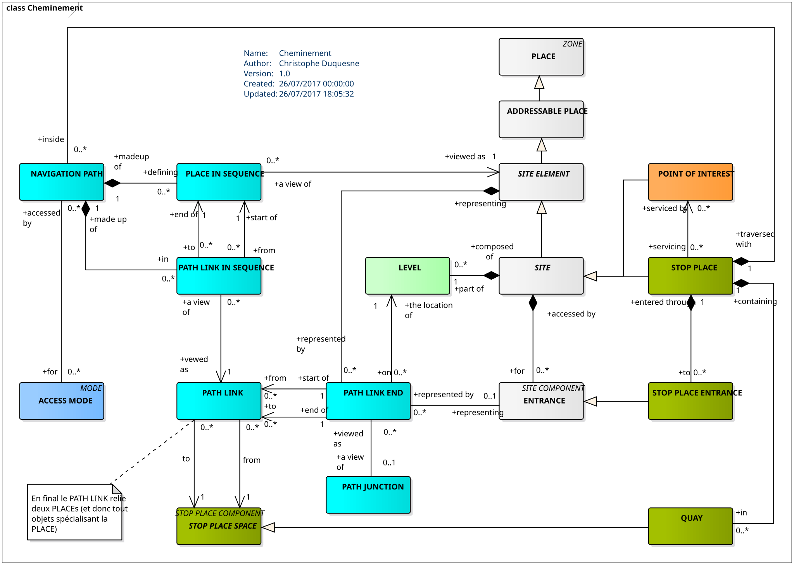
*Structure générique des CHEMINEMENTs*

On notera, en plus des concepts introduits plus haut, la notion de
JONCTION DE TRONÇON (<span lang="en">PATH JUNCTION</span>) qui permet de créer de "carrefours"
où plusieurs TRONÇONs DE CHEMINEMENT se rejoignent. Les EXTRÉMITÉs DE
TRONÇON, en plus de pouvoir être associés à un ÉLÉMENT DE SITE peuvent
être associés à un niveau (pour notifier un changement d'étage par
exemple) est aussi plus explicitement à une entrée du SITE ou du LIEU
D'ARRÊT.

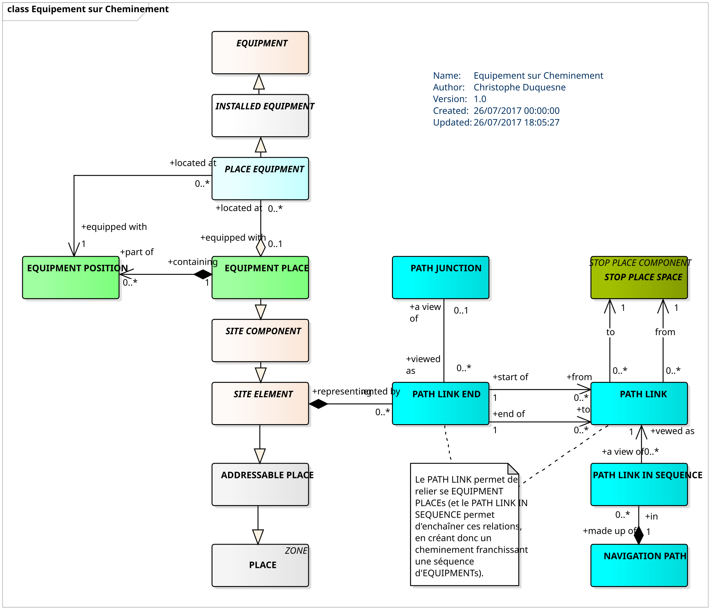
*Liens entre CHEMINEMENTs et ÉQUIPEMENTs*

Le schéma ci-dessus reprend le précédent et se concentre sur la relation
entre les CHEMINEMENTs et les ÉQUIPEMENTs : cette relation est en effet
cruciale dans le contexte de l'accessibilité et permet de bien situer
les différents ÉQUIPEMENTs sur le parcours du voyageur. Cette relation
passe là aussi par l'ÉLÉMENT DE SITE.

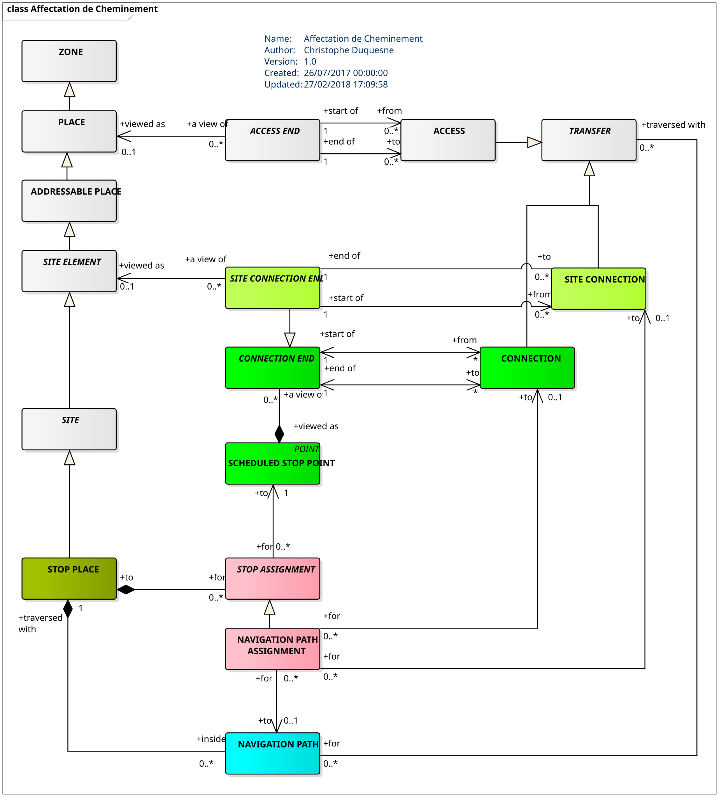
*CHEMINEMENTs pour les correspondances*

Enfin, le schéma ci-dessus montre comment les CHEMINEMENTs sont affectés
aux correspondances : deux solutions sont possibles dans NeTEx, mais le
profil pour l'accessibilité ne retiendra que la possibilité de lier un
<span lang="en">TRANSFER</span> et un <span lang="en">NAVIGATION PATH</span> (relation *<span lang="en">traversedWith</span>* sur la figure,
c'est en effet la solution la plus générique), implémentée au travers du
champ ***<span lang="en">Transfers</span>*** du <span lang="en">NAVIGATION PATH</span> (voir plus bas).

Il est important de prendre en compte le fait que les <span lang="en">PathLink</span> décrits
ci-dessous peuvent être segmentés autant que nécessaire : ainsi si la
nature du cheminement évolue et que l'on souhaite le renseigner au
travers d'un changement des attributs portés par le <span lang="en">PathLink</span> (par
exemple un changement d'éclairage, un changement de pente, etc.), il
suffit de le "couper" à partir de l'endroit où l'on souhaite faire
apparaître les nouvelles informations. Il n'y a pas de limite minimale à
la taille que peut représenter un <span lang="en">PathLink</span>, mais il reste toutefois
recommandé de ne pas trop les subdiviser (et donc de ne pas les faire
trop petits) pour éviter de surcharger l'utilisateur en information et
aussi pour limiter le volume d'information à gérer par les systèmes.

<span class="hl">À noter qu’en présence de bandes de guidage, il est obligatoire de créer un 
ou plusieurs objets <span lang="en">SitePathLink</span> pour les modéliser avec l'attribut *<span lang="en">TactileGuidingStrip</span>* dûment renseigné. 
Sa définition détaillée est en Table 11 plus bas. </span>

<div class="table-title"><span lang="en">SitePathLink</span> – Élément</div>

<table style="width:100%;">
<colgroup>
<col style="width: 8%" />
<col style="width: 20%" />
<col style="width: 21%" />
<col style="width: 6%" />
<col style="width: 43%" />
</colgroup>
<tbody>
<tr class="odd">
<td><strong>Classification</strong></td>
<td><strong>Nom</strong></td>
<td><strong>Type</strong></td>
<td><strong>Cardinalité</strong></td>
<td><strong>Description</strong></td>
</tr>
<tr class="even">
<td><em>::></em></td>
<td><em>::></em></td>
<td><em><span lang="en">Link</span></em></td>
<td><em>::></em></td>
<td><span lang="en">PATH LINK</span> hérite de <span lang="en">LINK</span>.</td>
</tr>
<tr class="odd">
<td>«PK»</td>
<td>id</td>
<td><span lang="en">PathLinkIdType</span></td>
<td>1:1</td>
<td>Identifiant du <span lang="en">PATH LINK</span>.</td>
</tr>
<tr class="even">
<td></td>
<td><span lang="en">Distance</span></td>
<td><span lang="en">DistanceType</span></td>
<td><p>0:1</p>
<p><span class="hl">1:1</span></p></td>
<td><p>Longueur du tronçon de cheminement.</p>
<p><span class="hl">L'attribut Distance, hérité de LINK, est rendu obligatoire pour les tronçons de cheminement par le profil pour l'accessibilité. Il s'agit de la distance parcourue le long du tronçon de cheminement et non de la distance à vol d'oiseau entre les points de départ et d'arrivée.</span></p></td>
</tr>
<tr class="odd">
<td>«<span lang="en">cntd</span>»</td>
<td><span lang="en">LineString</span></td>
<td><span lang="en">gmlLineString</span></td>
<td><p>0:1</p>
<p><span class="hl">1:1</span></p></td>
<td><p>Géométrie du tronçon de cheminement.</p>
<p><span class="hl">Dans le contexte du profil pour l'accessibilité, la géométrie des <span lang="en">PATH LINKs</span> sera systématiquement décrite avec l'attribut <em><strong><span lang="en">LineString</span></strong></em> (GML) hérité de LINK. Il est important de bien noter que cette géométrie peut être différente, notamment au niveau des extrémités, des centroïdesdes objets référencés par <em><strong><span lang="en">From</span></strong></em> et <em><strong><span lang="en">To</span></strong></em> (qui sont généralement des centroïdes de zone, relativement imprécis). De plus les extrémités du <span lang="en">LineString</span> devront coïncider avec ceux des autres <span lang="en">PATH LINK</span> connectés dans le cadre d'un <span lang="en">NAVIGATION PATH</span>.</span></p></td>
</tr>
<tr class="even">
<td>«FK»</td>
<td><span lang="en">From</span></td>
<td><span lang="en">PathLinkEnd</span></td>
<td>1:1</td>
<td>Point ou lieu de départ du <span lang="en">PATH LINK</span>. Voir tableau suivant</td>
</tr>
<tr class="odd">
<td>«FK»</td>
<td><span lang="en">To</span></td>
<td><span lang="en">PathLinkEnd</span></td>
<td>1:1</td>
<td><p>Point ou lieu de fin du <span lang="en">PATH LINK</span>. Voir tableau suivant</p>
<p><span class="hl"><em><strong><span lang="en">From</span></strong></em> et <em><strong><span lang="en">To</span></strong></em> peuvent référencer le même espace, mais avec des <em><strong><span lang="en">LineString</span></strong>(voir ci-dessus)</em> différentes. On utilisera notamment cette particularité pour traverser des équipements long (comme un tapis roulant) situés dans un <span lang="en">EQUIPMENT PLACE</span> (ZONE).</span></p></td>
</tr>
<tr class="even">
<td></td>
<td><span lang="en">Description</span></td>
<td><span lang="en">MultilingualString</span></td>
<td>0:1</td>
<td>Description du <span lang="en">PATH LINK</span>.</td>
</tr>
<tr class="odd">
<td>«<span lang="en">cntd</span>»</td>
<td><span lang="en">AccessibilityAssesment</span></td>
<td><span lang="en">AccessibilityAssesment</span></td>
<td>0:1</td>
<td><p><span lang="en">ACCESSIBILITY</span> du <span lang="en">PATH LINK</span>.</p><p>Voir le détail en Annexe.</p></td>
</tr>
<tr class="odd">
<td></td>
<td><span lang="en">PublicUse</span></td>
<td>xsd:<span lang="en">boolean</span></td>
<td>0:1</td>
<td><p>Indique si le cheminement est ouvert au public.</p>
<p><span class="hl">Public (<span lang="en">true</span>) par défaut (si l'attribut n'est pas fourni)</span></p></td>
</tr>
<tr class="even">
<td></td>
<td><span lang="en">Covered</span></td>
<td><span lang="en">CoveredEnum</span></td>
<td>0:1</td>
<td>Type de couverture.
<p><span class="hl">La valeur <em><span lang="en">mixed</span></em> est déconseillée dans le cadre du profil pour l'accessibilité : il convient dans ce cas de segmenter en plusieurs <span lang="en">SitePathLink</span> avec chacun un type de couverture propre.</span></p></td>
</tr>
<tr class="odd">
<td></td>
<td><span lang="en">Gated</span></td>
<td><span lang="en">GatedEnum</span></td>
<td>0:1</td>
<td>Type de porte ou portillon d’accès</td>
</tr>
<tr class="even">
<td></td>
<td><span lang="en">Lighting</span></td>
<td><span lang="en">LightingEnum</span></td>
<td>0:1</td>
<td><p>Nature de l’éclairage</p>
<ul>
<li><p><em><span lang="en">wellLit</span></em> : adapté pour les déficients visuels</p></li>
<li><p><em><span lang="en">poorlyLit</span></em> : éclairé mais non adapté pour les déficients visuels</p></li>
<li><p><em><span lang="en">unlit</span></em> : non éclairé</p></li>
<li><p><em><span lang="en">unknown</span></em> : information non disponible</p></li>
</ul></td>
</tr>
<tr class="odd">
<td></td>
<td><span lang="en">AllAreasWheelchair</span></td>
<td>xsd:<span lang="en">boolean</span></td>
<td>0:1</td>
<td>Indique si le cheminement est pratiquable en fauteuil roulant.</td>
</tr>
<tr class="odd">
<td>«<span lang="en">cntd</span>»</td>
<td><span lang="en">facilities</span></td>
<td><span lang="en">SiteFacilitySet</span></td>
<td>0:*</td>
<td><span lang="en">FACILITIES</span> associées au <span lang="en">PATH LINK</span>.</td>
</tr>
<tr class="even">
<td></td>
<td><span lang="en">Towards</span></td>
<td><span lang="en">MultilingualString</span></td>
<td>0:1</td>
<td>Direction indiquée quand le cheminement est effectué dans le sens <span lang="en">FROM</span> vers <span lang="en">TO</span> (sens direct).</td>
</tr>
<tr class="odd">
<td></td>
<td><span lang="en">Back</span></td>
<td><span lang="en">MultilingualString</span></td>
<td>0:1</td>
<td>Direction indiquée quand le cheminement est effectué dans le sens <span lang="en">TO</span> vers <span lang="en">FROM</span>.</td>
</tr>
<tr class="even">
<td></td>
<td><span lang="en">NumberOfSteps</span></td>
<td>xsd:<span lang="en">integer</span></td>
<td>0:1</td>
<td>Nombre de marches rencontrées sur le cheminement.
<p><span class="hl">Il s'agit du nombre de marches total de l'escalier si le tronçon de cheminement correspond à un escalier, ou du nombre de ressauts ou marches isolées sinon.</span></p></td>
</tr>
<tr class="odd">
<td></td>
<td><span lang="en">MinimumWidth</span></td>
<td><span lang="en">LengthType</span></td>
<td>0:1</td>
<td><p>Largeur minimale du cheminement</p>
<p><span class="hl">La largeur renseignée doit tenir compte des éventuels obstacles présents le long du tronçon de cheminement.</span></p>
<p><span class="hl">Cet élément est rendu obligatoire par l'arrêté du 28 mai 2024 pour les ascenseurs et trottoirs.</span></p>    
</tr>
<tr class="odd">
<td></td>
<td><span lang="en">AllowedUse</span></td>
<td><span lang="en">DirectionOfUseEnum</span></td>
<td>0:1</td>
<td>Indique si le cheminement est empruntable dans les deux sens.</td>
</tr>
<tr class="even">
<td></td>
<td><span lang="en">Transition</span></td>
<td><span lang="en">TransitionEnum</span></td>
<td>0:1</td>
<td><p>Type de transition du cheminement :</p>
<ul>
<li><p><em><span lang="en">up</span> (montée)</em></p></li>
<li><p><em><span lang="en">down</span> (descente)</em></p></li>
<li><p><em><span lang="en">level</span> (pas de changement de niveau)</em></p></li>
</ul><p><span class="hl">Les valeurs <em><span lang="en">upAndDown</span></em> (montée puis descente) et <em><span lang="en">downAndUp</span></em> (descente puis montée) sont déconseillées dans le cadre du profil pour l'accessibilité : il convient dans ces cas de segmenter en plusieurs <span lang="en">SitePathLink</span> avec chacun un type de transition propre.</span></p></td>
</tr>
<tr class="odd">
<td></td>
<td><span lang="en">Gradient</span></td>
<td>xsd:<span lang="en">integer</span></td>
<td>0:1</td>
<td><p>Pente en degrés (dans le sens direct, <span lang="en">from/to</span>, du cheminement)</p>
<p><span class="hl">Cet élément est rendu obligatoire par l'arrêté du 28 mai 2024 pour les trottoirs.</span></p>   
</td>
</tr>
<tr class="odd">
<td></td>
<td><span lang="en">TiltAngle</span></td>
<td>xsd:<span lang="en">integer</span></td>
<td>0:1</td>
<td><p>Dévers (inclinaison latérale) de +20 a -20 degrés (dans le sens direct, <span lang="en">from/to</span>, du cheminement)</p>
<p><span class="hl">Cet élément est rendu obligatoire par l'arrêté du 28 mai 2024 pour les trottoirs.</span></p>   
</td>
</tr>
<tr class="even">
<td></td>
<td><span lang="en">TiltType</span></td>
<td><span lang="en">TiltTypeEnum</span></td>
<td>0:1</td>
<td><p>Valeur codée du dévers</p>
<ul>
<li><p><em><span lang="en">strongLeftTilt</span> (dévers fort à gauche)</em></p></li>
<li><p><em><span lang="en">mediumLeftTilt</span> (dévers moyen à gauche)</em></p></li>
<li><p><em><span lang="en">nearlyFlat</span> (presque plat)</em></p></li>
<li><p><em><span lang="en">mediumRightTilt</span> (dévers moyen à droite)</em></p></li>
<li><p><em><span lang="en">strongRightTilt</span> (dévers fort à droite)</em></p></li>
</ul></td>
</tr>
<tr class="odd">
<td></td>
<td><span lang="en">AccessFeatureType</span></td>
<td><span lang="en">AccessFeatureEnum</span></td>
<td>0:1</td>
<td><p>Type de caractéristique associée au <span lang="en">PATH LINK</span> :</p>
<ul>
<li><p><em>lift (ascenseur)</em></p></li>
<li><p><em><span lang="en">escalator</span> (escalator)</em></p></li>
<li><p><em><span lang="en">freightElevator</span> (monte charge)</em></p></li>
<li><p><em><span lang="en">travelator</span> (tapis roulant)</em></p></li>
<li><p><em><span lang="en">ramp</span> (rampe)</em></p></li>
<li><p><em><span lang="en">stairs</span> (escalier)</em></p></li>
<li><p><em><span lang="en">seriesOfStairs</span> (série d’escalier)</em></p></li>
<li><p><em><span lang="en">shuttle</span> (navette)</em></p></li>
<li><p><em><span lang="en">crossing</span> (passage piéton, carrefour)</em></p></li>
<li><p><em><span lang="en">barrier</span> (barrière)</em></p></li>
<li><p><em><span lang="en">narrowEntrance</span> (passage étroit)</em></p></li>
<li><p><em><span lang="en">hall</span> (hall)</em></p></li>
<li><p><em><span lang="en">concourse</span> (hall, convergence de couloirs et accès)</em></p></li>
<li><p><em><span lang="en">confinedSpace</span> (espace confiné)</em></p></li>
<li><p><em><span lang="en">queueManagement</span> (gestion de queue)</em></p></li>
<li><p><em><span lang="en">openSpace</span> (espace ouvert)</em></p></li>
<li><p><em><span lang="en">street</span> (rue)</em></p></li>
<li><p><em><span lang="en">pavement</span> (trottoir)</em></p></li>
<li><p><em><span lang="en">footpath</span> (chemin piéton)</em></p></li>
<li><p><em><span lang="en">passage</span> (passage)</em></p></li>
</ul></td>
</tr>
<tr class="even">
<td></td>
<td><span lang="en">PassageType</span></td>
<td><span lang="en">PassageTypeEnum</span></td>
<td>0:1</td>
<td><p>Précision du type de caractéristique associée au <span lang="en">PATH LINK</span> :</p>
<p>:</p>
<ul>
<li><p><em><span lang="en">pathway</span> (sentier, en surface)</em></p></li>
<li><p><em><span lang="en">corridor</span> (couloir)</em></p></li>
<li><p><em><span lang="en">overpass</span> (passerelle, pont)</em></p></li>
<li><p><em><span lang="en">underpass</span> (passage sous-terrain)</em></p></li>
<li><p><em><span lang="en">tunnel</span> (tunnel)</em></p></li>
</ul></td>
</tr>
<tr class="even">
<td></td>
<td><span lang="en">FlooringType</span></td>
<td><span lang="en">FlooringTypeEnum</span></td>
<td>0:1</td>
<td><p>Type de surface au sol</p>
<ul>
<li><p><em><span lang="en">Carpet</span> (tapis)</em></p></li>
<li><p><em><span lang="en">Concrete</span> (béton)</em></p></li>
<li><p><em><span lang="en">Asphalt</span> (asphalte)</em></p></li>
<li><p><em><span lang="en">Cork</span> (liège)</em></p></li>
<li><p><em><span lang="en">FibreglassGrating</span> (taillebotis en fibre de verre)</em></p></li>
<li><p><em><span lang="en">GlazedCeramicTiles</span> (carreaux de céramique émaillés)</em></p></li>
<li><p><em><span lang="en">PlasticMatting</span> (matière plastique)</em></p></li>
<li><p><em><span lang="en">CeramicTiles</span> (carrelage)</em></p></li>
<li><p><em><span lang="en">Rubber</span> (caoutchouc)</em></p></li>
<li><p><em><span lang="en">SteelPlate</span> (plaques métalique)</em></p></li>
<li><p><em><span lang="en">Vinyl</span> (vinyle)</em></p></li>
<li><p><em><span lang="en">Wood</span> (bois)</em></p></li>
<li><p><em><span lang="en">Stone</span> (pierre)</em></p></li>
<li><p><em><span lang="en">Grass</span> (gazon)</em></p></li>
<li><p><em><span lang="en">Earth</span> (terre)</em></p></li>
<li><p><em><span lang="en">Gravel</span> (graviers)</em></p></li>
<li><p><em><span lang="en">Uneven</span> (inégal)</em></p></li>
<li><p><em><span lang="en">Unknown</span> (inconnu)</em></p></li>
<li><p><em><span lang="en">Other</span> (autre)</em></p></li>
</ul>
</tr>
<tr class="odd">
<td></td>
<td><em><span lang="en">RightSideBorder</span></em></td>
<td><em><span lang="en">BorderTypeEnum</span></em></td>
<td>0:1</td>
<td><p>Type de bordure sur le côté droit (dans le sens direct, <span lang="en">from/to</span>, du cheminement)</p>
<ul>
<li><p><em><span lang="en">Wall</span> (mur)</em></p></li>
<li><p><em><span lang="en">Grass</span> (gazon)</em></p></li>
<li><p><em><span lang="en">Dirt</span> (terre)</em></p></li>
<li><p><em><span lang="en">Barrier</span> (barrière)</em></p></li>
<li><p><em><span lang="en">Road</span> (route)</em></p></li>
<li><p><em><span lang="en">CyclingLane</span> (piste cyclable)</em></p></li>
<li><p><em><span lang="en">Step</span> (marche)</em></p></li>
<li><p><em><span lang="en">Rail</span> (rail)</em></p></li>
<li><p><em><span lang="en">Plants</span> (plantes)</em></p></li>
<li><p><em><span lang="en">Trees</span> (arbres)</em></p></li>
<li><p><em><span lang="en">Mud</span> (boue)</em></p></li>
<li><p><em><span lang="en">SolidEdge</span> (bord solide)</em></p></li>
<li><p><em><span lang="en">Water</span> (eau)</em></p></li>
<li><p><em><span lang="en">Gravel</span> (gravier)</em></p></li>
<li><p><em><span lang="en">NoPhysicalBorder</span> (pas de bordure matérialisée)</em></p></li>
<li><p><em><span lang="en">OtherPhysicalBorder</span> (autre type de bordure)</em></p></li>
<li><p><em><span lang="en">Unknown</span> (inconnu)</em></p></li>
</ul></td>
</tr>
<tr class="even">
<td></td>
<td><em><span lang="en">LeftSideBorder</span></em></td>
<td><em><span lang="en">BorderTypeEnum</span></em></td>
<td>0:1</td>
<td>Type de bordure sur le côté droit (dans le sens direct, <span lang="en">from/to</span>, du cheminement)</td>
</tr>
<tr class="even">
<td></td>
<td><em><span lang="en">TactileWarningStrip</span></em></td>
<td><em><span lang="en">TactileWarningEnum</span></em></td>
<td>0:1</td>
<td><p>Indique s’il y a des bandes d’interception podotactiles (dans le sens direct, <span lang="en">from/to</span>, du cheminement) :</p>
<ul>
<li><p><em><span lang="en">TactileStripAtBeginning</span> (bande au départ)</em></p></li>
<li><p><em><span lang="en">TactileStripAtEnd</span> (bande à l’arrivée)</em></p></li>
<li><p><em><span lang="en">TactileStripAtBothEnds</span> (bandes aux deux extrémités)</em></p></li>
<li><p><em><span lang="en">noTactileStrip</span> (pas de bandes d’interception)</em></p></li>
<li><p><em><span lang="en">unknown</span> (inconnu)</em></p></li>
</ul>
<p><span class="hl">Cet élément est rendu obligatoire par l'arrêté du 28 mai 2024 pour les escaliers et passages piétons.</span></p>   
</td>
</tr>
<tr class="odd">
<td></td>
<td><em><span lang="en">TactileGuidingStrip</span></em></td>
<td>xsd:<span lang="en">boolean</span></td>
<td>0:1</td>
<td><p>Indique s’il y a des bandes de guidage podotactiles.</p>
<p><span class="hl">En cas de présence de bandes de guidage podotactiles, il 
est obligatoire de renseigner les tronçons de cheminement correspondants.</span></p></td>
</tr>
<tr class="even">
<td>«<span lang="en">cntd</span>»</td>
<td><span lang="en">TransferDuration</span></td>
<td><span lang="en">TransferDuration</span></td>
<td>0:1</td>
<td><p>Temps moyens pour franchir le cheminement (4 valeurs disponibles) :</p>
<ul>
<li><p><em><span lang="en">DefaultDuration</span> (durée moyenne)</em></p></li>
<li><p><em><span lang="en">FrequentTravellerDuration</span> (durée pour un voyageur habitué)</em></p></li>
<li><p><em><span lang="en">OccasionalTravellerDuration</span> (durée pour un voyageur occasionnel)</em></p></li>
<li><p><em><span lang="en">MobilityRestrictedTravellerDuration</span> (durée pour un voyageur à mobilité réduite)</em></p></li>
</ul></td>
</tr>
<tr class="odd">
<td></td>
<td><em><span lang="en">placeEquipments</span></em></td>
<td><span lang="en">Equipment</span></td>
<td>0:1</td>
<td>Liste des <span lang="en">AccessEquipment</span> (équipements d’accès) dont dépend le tronçon de cheminement.</td>
</tr>
</tbody>
</table>

<div class="table-title"><span lang="en">PathLinkEnd</span> – Élément</div>

|                     |             |                    |                  |                                                          |
|---------------------|-------------|--------------------|------------------|----------------------------------------------------------|
| **Classification** | **Nom**    | **Type**           | **Cardinalité** | **Description**                                          |
| «FK»                | <span lang="en">PlaceRef</span>    | <span lang="en">PlaceOrJunctionRef</span> | 1:1              | Point ou lieu à l’extrémité du <span lang="en">PATH LINK</span>.                |
| «FK»                | <span lang="en">LevelRef</span>    | <span lang="en">LevelRef</span>           | 0:1              | Niveau auquel le <span lang="en">PATH LINK</span> se connecte.                  |
| «FK»                | <span lang="en">EntranceRef</span> | <span lang="en">EntranceRef</span>        | 0:1              | Entrée (ou sortie) associée à l’extrémité du <span lang="en">PATH LINK</span>. |

<div class="table-title"><span lang="en">PathJunction</span> (croisement/jonction de cheminement) – Élément</div>

<table>
<colgroup>
<col style="width: 8%" />
<col style="width: 19%" />
<col style="width: 18%" />
<col style="width: 8%" />
<col style="width: 45%" />
</colgroup>
<tbody>
<tr class="odd">
<td><strong>Classification</strong></td>
<td><strong>Nom</strong></td>
<td><strong>Type</strong></td>
<td><strong>Cardinalité</strong></td>
<td><strong>Description</strong></td>
</tr>
<tr class="even">
<td><em>::></em></td>
<td><em>::></em></td>
<td><em>Point</em></td>
<td><em>::></em></td>
<td><span lang="en">PATH JUNCTION</span> hérite de POINT.</td>
</tr>
<tr class="odd">
<td>«PK»</td>
<td>id</td>
<td><span lang="en">PathJunctionIdType</span></td>
<td>1:1</td>
<td>Identifiant du <span lang="en">PATH JUNCTION</span>.</td>
</tr>

<tr class="odd">
<td></td>
<td><span lang="en">PublicUse</span></td>
<td><span lang="en">PublicUseEnum</span></td>
<td>0:1</td>
<td>Indique si le <span lang="en">PATH JUNCTION</span> est accessible au public</td>
</tr>
<tr class="even">
<td></td>
<td><span lang="en">Covered</span></td>
<td><span lang="en">CoveredEnum</span></td>
<td>0:1</td>
<td>Type de couverture</td>
</tr>
<tr class="odd">
<td></td>
<td><span lang="en">Gated</span></td>
<td><span lang="en">GatedEnum</span></td>
<td>0:1</td>
<td>Type de porte ou portillon d’accès</td>
</tr>
<tr class="even">
<td></td>
<td><span lang="en">Lighting</span></td>
<td><span lang="en">LightingEnum</span></td>
<td>0:1</td>
<td><p>Nature de l’éclairage</p>
<ul>
<li><p><em><span lang="en">wellLit</span></em> : adapté pour les déficients visuels</p></li>
<li><p><em><span lang="en">poorlyLit</span></em> : éclairé mais non adapté pour les déficients visuels</p></li>
<li><p><em><span lang="en">unlit</span></em> : non éclairé</p></li>
<li><p><em><span lang="en">unknown</span></em> : information non disponible</p></li>
</ul></td>
</tr>
<tr class="odd">
<td></td>
<td><span lang="en">AllAreasWheelchair</span></td>
<td>xsd:<span lang="en">boolean</span></td>
<td>0:1</td>
<td>Indique si le cheminement est pratiquable en fauteuil roulant.</td>
</tr>

<tr class="odd">
<td>«<span lang="en">cntd</span>»</td>
<td><span lang="en">facilities</span></td>
<td><span lang="en">SiteFacilitySet</span></td>
<td>0:*</td>
<td><span lang="en">FACILITIES</span> associées au <span lang="en">PATH JUNCTION</span>.</td>
</tr>
<tr class="even">
<td></td>
<td><em><strong><span lang="en">Label</span></strong></em></td>
<td><em><span lang="en">MultilingualString</span></em></td>
<td>0:1</td>
<td>Label additionnel associé au <span lang="en">PATH JUNCTION</span>.</td>
</tr>
<tr class="odd">
<td></td>
<td><em><strong><span lang="en">SiteComponentRef</span></strong></em></td>
<td><em><span lang="en">SiteComponentRef</span></em></td>
<td>0:1</td>
<td>Le <span lang="en">PATH JUNCTION</span> se situe au sein du <span lang="en">SITE COMPONENT</span> référencé.</td>
</tr>
</tbody>
</table>

<div class="table-title"><span lang="en">PathLinkInSequence</span> – Élément</div>

|                     |                   |                      |                  |                                                                                                                                                             |
|---------------------|-------------------|----------------------|------------------|-------------------------------------------------------------------------------------------------------------------------------------------------------------|
| **Classification** | **Nom**          | **Type**             | **Cardinalité** | **Description**                                                                                                                                             |
| *::>*               | *::>*             | *<span lang="en">VersionedChild</span>*     | *::>*            | <span lang="en">PATH LINK IN SEQUENCE</span> hérite de <span lang="en">VERSIONED CHILD</span>                                                                                                             |
| «PK»                | id                | <span lang="en">LinkInSequenceIdType</span> | 1:1              | Identifiant du <span lang="en">PATH LINK IN SEQUENCE</span>.                                                                                                                       |
| «FK»                | <span lang="en">PathLinkRef</span>       | <span lang="en">PathLinkRef</span>          | 1:1              | Référence à un <span lang="en">PATH LINK</span>.                                                                                                                                   |
|                     |                   |                      |                  |                                                                                                                                                             |
|                     | ***<span lang="en">Reverse</span>***     | xsd:<span lang="en">boolean</span>          | 0:1              | Indique si, dans le cadre de la séquence, on emprunte le cheminent en sens inverse (de *<span lang="en">To</span>* vers *<span lang="en">From</span>*). La valeur par défaut est *<span lang="en">false</span>* (sens direct). |
|                     |                   |                      |                  |                                                                                                                                                             |
|                     |                   |                      |                  |                                                                                                                                                             |
|                     | ***<span lang="en">Instruction</span>*** | *<span lang="en">MultilingualString</span>* | 0:1              | Instruction de guidage sur le cheminement.                                                                                                                  |
|                     | <span lang="en">Label</span>             | <span lang="en">MultilingualString</span>   | 0:1              | Label associé au <span lang="en">PATH LINK IN SEQUENCE</span>.                                                                                                                     |
|                     |                   |                      |                  |                                                                                                                                                             |

<div class="table-title"><span lang="en">NavigationPath</span> – Élément</div>

<table>
<colgroup>
<col style="width: 8%" />
<col style="width: 17%" />
<col style="width: 22%" />
<col style="width: 8%" />
<col style="width: 43%" />
</colgroup>
<tbody>
<tr class="odd">
<td><strong>Classification</strong></td>
<td><strong>Nom</strong></td>
<td><strong>Type</strong></td>
<td><strong>Cardinalité</strong></td>
<td><strong>Description</strong></td>
</tr>
<tr class="even">
<td><em>::></em></td>
<td><em>::></em></td>
<td><em><span lang="en">LinkSequence</span></em></td>
<td><em>::></em></td>
<td><span lang="en">NAVIGATION PATH</span> hérite de <span lang="en">LINK SEQUENCE</span>.</td>
</tr>
<tr class="odd">
<td>«PK»</td>
<td>id</td>
<td><span lang="en">NavigationPathIdType</span></td>
<td>1:1</td>
<td>Identifiant du <span lang="en">NAVIGATION PATH</span>.</td>
</tr>
<tr class="even">
<td></td>
<td><span lang="en">From</span></td>
<td><span lang="en">PathLinkEnd</span></td>
<td>0:1</td>
<td>Point de départ du <span lang="en">NAVIGATION PATH</span>. Obligatoire si le détail des <span lang="en">PATH LINKs</span> n’est pas fourni.</td>
</tr>
<tr class="odd">
<td></td>
<td><span lang="en">To</span></td>
<td><span lang="en">PathLinkEnd</span></td>
<td>0:1</td>
<td>Destination du <span lang="en">NAVIGATION PATH</span>. Obligatoire si le détail des <span lang="en">PATH LINKs</span> n’est pas fourni.</td>
</tr>

<tr class="even">
<td></td>
<td><span lang="en">NavigationType</span></td>
<td><span lang="en">NavigationTypeEnum</span></td>
<td>0:1</td>
<td><p>Type de <span lang="en">NAVIGATION PATH</span>:</p>
<ul>
<li><blockquote>
<p><em><span lang="en">hallToQuay</span> (hall vers quai)</em></p>
</blockquote></li>
<li><blockquote>
<p><em><span lang="en">hallToStreet</span> (hall vers rue)</em></p>
</blockquote></li>
<li><blockquote>
<p><em><span lang="en">quayToHall</span> (quai vers hall)</em></p>
</blockquote></li>
<li><blockquote>
<p><em><span lang="en">quayToQuay</span> (quai vers quai)</em></p>
</blockquote></li>
<li><blockquote>
<p><em><span lang="en">quayToStreet</span> (qui vers rue)</em></p>
</blockquote></li>
<li><blockquote>
<p><em><span lang="en">streetToHall</span> (rue vers hall)</em></p>
</blockquote></li>
<li><blockquote>
<p><em><span lang="en">streetToQuay</span> (rue vers quai)</em></p>
</blockquote></li>
<li><blockquote>
<p><em><span lang="en">streetToSpace</span> (rue vers espace/esplanade)</em></p>
</blockquote></li>
<li><blockquote>
<p><em><span lang="en">spaceToStreet</span> (vers esplanade vers rue)</em></p>
</blockquote></li>
<li><blockquote>
<p><em><span lang="en">spaceToHall</span> (vers esplanade vers hall)</em></p>
</blockquote></li>
<li><blockquote>
<p><em><span lang="en">hallToSpace</span> (hall vers vers esplanade)</em></p>
</blockquote></li>
<li><p><em><span lang="en">spaceToSpace</span></em> (<em>esplanade vers esplanade)</em></p></li>
</ul></td>
</tr>

<tr class="even">
<td>«<span lang="en">cntd</span>»</td>
<td><span lang="en">pathLinksInSequence</span></td>
<td><span lang="en">PathLinkInSequence</span></td>
<td>0:*</td>
<td><span lang="en">PATH LINKs</span> faisant partie du <span lang="en">NAVIGATION PATH</span>.</td>
</tr>
<tr class="odd">
<td>«<span lang="en">cntd</span>»</td>
<td><span lang="en">transfers</span></td>
<td><span lang="en">TransferRef</span></td>
<td>0:*</td>
<td><span lang="en">TRANSFERs</span> (correspondance) et <span lang="en">ACCESS LINKs</span> correspondant au <span lang="en">NAVIGATION PATH</span> et dont il décrit le cheminement détaillé (voir Profil Réseaux pour les <span lang="en">TRANSFERs</span> et <span lang="en">ACCESS LINKs</span>).</td>
</tr>
</tbody>
</table>

# Entêtes NeTEx

*Note : les entêtes NeTEx sont présentés dans le document éléments
communs. Seules les spécificités de la partie "accessibilité" du profil sont
présentées ici.*

Pour rappel, la liste des fichiers d'un export NeTEx profil France est décrite dans Éléments Communs.

Une <span lang="en">GeneralFrame</span> de type **<span lang="en">NETEX_ACCESSIBILITY</span>** est utilisée pour échanger la description l'accessibilité 
dans le fichier <span lang="en">`accessibility.xml`</span>. 


## <span lang="en">TypeOfFrame</span> : type spécifique *<span lang="en">NETEX_ACCESSIBILITY</span>*

Lorsqu'une <span lang="en">FRAME</span> a pour <span lang="en">TypeOfFrame</span> la valeur <span lang="en">`NETEX_ACCESSIBILITY`</span>, seuls les objets de premier niveau suivants sont autorisés : 
- <span lang="en">SitePathLink</span>
- <span lang="en">PathLink</span>
- <span lang="en">PathJunction</span>
- <span lang="en">NavigationPath</span>
- <span lang="en">FacilitySet</span>
- <span lang="en">AccessEquipment</span>, et tous les équipements qui en héritent
- <span lang="en">PlaceEquipment</span>, et tous les équipements qui en héritent
- <span lang="en">SignEquipment</span>, et tous les équipements qui en héritent
- <span lang="en">PassengerEquipment</span>, et tous les équipements qui en héritent
- <span lang="en">SiteEquipment</span>, et tous les équipements qui en héritent
- <span lang="en">LocalService</span>, et tous les équipements qui en héritent

Les équipements sont précisés dans l'annexe 8 de ce document.

Voici un exemple de cadre du fichier `accessibility.xml` :

```xml
<?xml version="1.0" encoding="utf-8"?>
<PublicationDelivery xmlns="http://www.netex.org.uk/netex" version="2.0:FR-NETEX-2.4">
  <PublicationTimestamp>2023-01-01T00:00:00.0Z</PublicationTimestamp>
  <ParticipantRef>Exemple</ParticipantRef>
  <dataObjects>
    <GeneralFrame id="exemple:GeneralFrame:NETEX_ACCESSIBILITY:" version="2.0:FR-NETEX-2.4">
      <TypeOfFrameRef ref="FR:TypeOfFrame:NETEX_ACCESSIBILITY:" />
      <members>
        <!--
          SitePathLink
          PathLink
          PathJunction
          NavigationPath
          FacilitySet
          AccessEquipment, et tous les équipements qui en héritent
          PlaceEquipment, et tous les équipements qui en héritent
          SignEquipment, et tous les équipements qui en héritent
          PassengerEquipment, et tous les équipements qui en héritent
          SiteEquipment, et tous les équipements qui en héritent
          LocalService, et tous les équipements qui en héritent
          -->
      </members>
    </GeneralFrame>
  </dataObjects>                  
</PublicationDelivery> 
```

# Annexe (normative) - Détail des équipements

Les tableaux ci-dessous fournissent les détails des attributs propres à
chaque type d'équipement.

Dans un certain nombre de cas, des attributs complémentaires ont été
demandés pour le profil accessibilité. Pour répondre à cette demande, on
utilise le mécanisme d'extension par clef-valeur proposé par NeTEx (<span lang="en">KeyList</span>, voir
le profil Éléments Commun pour plus de détail sur ce mécanisme). Les
tableaux contenants ces extensions sont présentées à la suite des
descriptions des objets qu'ils complètent.

## <span lang="en">Passenger Service Equipment</span>

<div class="table-title"><span lang="en">PassengerEquipment</span> (équipement pour les passagers) –</div>
Élément

| **Classification** | **Nom**             | **Type**         | **Cardinalité** | **Description**                        |
| --------------- | ------------- | ---------------------- | ------------ | --------------------------------------------- |
| ::>                | ::>      | *<span lang="en">Equipment</span>*   | ::>             | <span lang="en">PASSENGER EQUIPMENT</span> hérite de <span lang="en">EQUIPMENT</span>.                                                           |
|                    | <span lang="en">Fixed</span>    | *xsd:*<span lang="en">boolean</span> | 0:1             | Indique si l’<span lang="en">EQUIPMENT</span> est fixe au sein d’une <span lang="en">PLACE</span> ou s’il est à bord d’un <span lang="en">VEHICLE</span> (donc mobile). |

<div class="table-title"><span lang="en">PassengerSafetyEquipment</span> (équipement pour la sécurité des</div>
passagers)* *–* Élément

<table>
<colgroup>
<col style="width: 7%" />
<col style="width: 19%" />
<col style="width: 20%" />
<col style="width: 6%" />
<col style="width: 45%" />
</colgroup>
<tbody>
<tr class="odd">
<td><strong>Classification</strong></td>
<td><strong>Nom</strong></td>
<td><strong>Type</strong></td>
<td><strong>Cardinalité</strong></td>
<td><strong>Description</strong></td>
</tr>
<tr class="even">
<td><em>::></em></td>
<td><em>::></em></td>
<td><em><span lang="en">PassengerEquipment</span></em></td>
<td><em>::></em></td>
<td><span lang="en">PASSENGER SAFETY EQUIPMENT</span> hérite de <span lang="en">PASSENGER EQUIPMENT</span>.</td>
</tr>
<tr class="odd">
<td>«PK»</td>
<td>id</td>
<td><span lang="en">PassengerSafet­yFacilityIdType</span></td>
<td>1:1</td>
<td>Identifiant du <span lang="en">PASSENGER SAFETY EQUIPMENT</span>.</td>
</tr>


<tr class="even">
<td></td>
<td><em><strong><span lang="en">PanicButton</span></strong></em></td>
<td>xsd:<span lang="en">boolean</span></td>
<td>0:1</td>
<td>Indique si un bouton « <span lang="en">panic</span> » est disponible</td>
</tr>
<tr class="odd">
<td></td>
<td><em><strong><span lang="en">SosPanel</span></strong></em></td>
<td>xsd:<span lang="en">boolean</span></td>
<td>0:1</td>
<td>Indique si un dispositif d’appel d’urgence est disponible</td>
</tr>
<tr class="even">
<td></td>
<td><em><strong><span lang="en">HeightOfSosPanel</span></strong></em></td>
<td><span lang="en">LengthType</span></td>
<td>0:1</td>
<td>Hauteur du dispositif d’appel d’urgence</td>
</tr>
<tr class="odd">
<td></td>
<td><em><strong><span lang="en">Lighting</span></strong></em></td>
<td><em><span lang="en">LightingEnum</span></em></td>
<td>0:1</td>
<td><p>Type d’éclairage.</p>
<ul>
<li><p><em><span lang="en">wellLit</span></em> : adapté pour les déficients visuels</p></li>
<li><p><em><span lang="en">poorlyLit</span></em> : éclairé mais non adapté pour les déficients visuels</p></li>
<li><p><em><span lang="en">unlit</span></em> : non éclairé</p></li>
<li><p><em><span lang="en">unknown</span></em> : information non disponible</p></li>
</ul></td>
</tr>
<tr class="even">
<td></td>
<td><em><strong><span lang="en">AcousticAnnouncements</span></strong></em></td>
<td>xsd:<span lang="en">boolean</span></td>
<td>0:1</td>
<td>Indique s’il y a des annonces acoustiques</td>
</tr>
<tr class="odd">
<td></td>
<td><em><strong><span lang="en">AcousticAnnouncementsTrigger</span></strong></em></td>
<td><span lang="en">AcousticAnnouncementsTriggerEnum</span></td>
<td>0:1</td>
<td><p>Mode de déclenchement des annonces acoustiques</p>
<ul>
<li><p><em><span lang="en">onDemand</span></em> (à la demande)</p></li>
<li><p><em><span lang="en">automatic</span></em> (automatique)</p></li>
</ul></td>
</tr>
<tr class="even">
<td></td>
<td><em><strong><span lang="en">AnnouncementsTriggeringMethod</span></strong></em></td>
<td><span lang="en">AnnouncementsTriggeringMethodEnum</span></td>
<td>0:1</td>
<td><p>Méthode de déclenchement des annonces acoustiques</p>
<ul>
<li><p><em><span lang="en">presenceDetector</span></em> (détecteur de présence)</p></li>
<li><p><em><span lang="en">app</span></em> (application sur smartphone)</p></li>
<li><p><em><span lang="en">internetPage</span></em> (Page internet via <em><strong>Image</strong>-xsd:<span lang="en">anyURI</span></em> hérité de <span lang="en">EQUIPMENT</span>)</p></li>
<li><p><em><span lang="en">specificDevice</span> (</em>télécommande<em>)</em></p></li>
<li><p><em><span lang="en">pushButton</span> </em>(bouton poussoir)</p></li>
</ul></td>
</tr>
</tbody>
</table>

<div class="table-title"><span lang="en">SanitaryEquipment</span> (sanitaires) – Élément</div>

| **Classification** | **Nom**             | **Type**         | **Cardinalité** | **Description**                        |
| --------------- | ------------- | ---------------------- | ------------ | --------------------------------------------- |
| *::>*               | *::>*                       | *<span lang="en">PassengerEquipment</span>*   | *::>*            | <span lang="en">SANITARY EQUIPMENT</span> hérite de <span lang="en">ACCESS EQUIPMENT</span>                                               |
| «PK»                | id                          | <span lang="en">SanitaryEquipmentIdType</span>| 0:1              | Identifiant du <span lang="en">SANITARY EQUIPMENT</span>.                                                          |
|                     | **<span lang="en">AccessibilityAssessment</span>** | *<span lang="en">AccessibilityAssessment</span>*| 0:1            | <p>Caractéristiques d’accessibilité des sanitaires.</p><p>Voir le détail en Annexe.</p>     |
|                     | <span lang="en">Gender</span>                      | <span lang="en">GenderLimitationEnum</span>   | 0:1              | Limitation de genre (homme/femme) pour l’utilisation des sanitaires.                        |
|                     | <span lang="en">SanitaryFacilityList</span>        | <span lang="en">SanitaryFacilityEnum</span>   | 0:*              | <p>Type de sanitaire</p><ul><li><p><em><span lang="en">toilet</span></em> (toilettes)</p></li><li><p><em><span lang="en">wheelChairAccessToilet</span></em>(toilettes accessibles en fauteuil roulant)</p></li><li><p><em><span lang="en">shower</span></em> (douche)</p></li><li><p><em><span lang="en">washingAndChangeFacilities</span></em> (espace pour se nettoyer et se changer)</p></li><li><p><em><span lang="en">babyChange</span></em>(espace bébé)</p></li><li><p><em><span lang="en">wheelchairBabyChange</span></em> (espace bébé accessible en fauteuil roulant)</p></li></ul>                                                          |
|                     | <span lang="en">WheelchairTurningCircle</span>     | <span lang="en">LengthType</span>             | 0:1              | Diamètre de giration pour les fauteuils roulants                                           |
|                     | <span lang="en">SharpsDisposal</span>              | xsd:<span lang="en">boolean</span>            | 0:1              | Disponibilité d’une poubelle pour objets tranchants                                        |
|                     | <span lang="en">Staffing</span>                    | <span lang="en">StaffingEnum</span>           | 0:1              | Présence de personnel                                                                      |
|                     | <span lang="en">KeyScheme</span>                   | xsd:<span lang="en">normalizedString</span>   | 0:1              | <span class="hl">Texte libre décrivant les conditions d'accessibilité : peut notamment compléter les informations comme</span><br /><span class="hl">- Espaces usage, barres de transfert, position du cercle de retournement, lave main (présence, hauteur), position du papier toilette, etc.</span>         |
|                     | <span lang="en">CallButtonAvailable</span>         | xsd:<span lang="en">boolean</span>            | 0:1              | Présence d’un bouton d’appel                                                               |
|                     | <span lang="en">SupportBarHeigth</span>            | xsd:<span lang="en">decimal</span>            | 0:1              | Hauteur de la barre de support (quand il y en a une)                                       |
|                     | <span lang="en">LockedAccess</span>                | xsd:<span lang="en">boolean</span>            | 0:1              | Indique si les toilettes peuvent être verrouillées et donc une clé (ou un outil équivalent) est nécessaire pour y accéder. |
|                     | <span lang="en">HandWashing</span>                 | xsd:<span lang="en">boolean</span>            | 0:1              | Indique s'il y a le nécessaire pour se laver les mains avec du savon                       |
|                     | <span lang="en">DrinkingWater</span>               | xsd:<span lang="en">boolean</span>            | 0:1              | Indique si de l'eau potable est disponible                                                 |
|                     | <span lang="en">ToiletsType</span>                 | <span lang="en">ToiletsTypeEnumeration</span> | 0:1              | Indique le type de toilettes.<ul><li><em><span lang="en">seated</span></em> (position assise sur un siège avec une cuvette)</li><li><em><span lang="en">urinal</span></em> (urinoir utilisable uniquement debout)</li><li><em><span lang="en">squat</span></em> (position <span lang="en">accroupie</span>, sans siège ni cuvette)</li><li><em><span lang="en">seatedAndUrinal</span></em> (des sièges avec cuvette et des urinoirs sont disponibles)</li></ul> |

<div class="table-title"><span lang="en">RubbishDisposalEquipment</span> (poubelles) – Élément</div>

| **Classification** | **Nom**             | **Type**         | **Cardinalité** | **Description**                        |
| --------------- | ------------- | ---------------------- | ------------ | --------------------------------------------- |
| *::>*               | *::>*                | *<span lang="en">PassengerEquipment</span>*            | *::>*            | <span lang="en">RUBBISH DISPOSAL EQUIPMENT</span> hérite de <span lang="en">PASSENGER EQUIPMENT</span> |
| «PK»                | id                   | <span lang="en">RubbishDisposalEquipmentIdType</span> | 1:1              | Identifiant du <span lang="en">RUBBISH DISPOSAL EQUIPMENT</span>.                   |
|                     | ***<span lang="en">SharpsDisposal</span>*** | xsd:<span lang="en">boolean</span>                     | 0:\*             | Disponibilité d’une poubelle pour objets tranchants          |

## <span lang="en">Waiting Equipment</span>

<div class="table-title"><span lang="en">LuggageLockerEquipment</span> (casiers à bagages) – Élément</div>

<table>
<colgroup>
<col style="width: 8%" />
<col style="width: 17%" />
<col style="width: 22%" />
<col style="width: 8%" />
<col style="width: 43%" />
</colgroup>
<tbody>
<tr class="odd">
<td><strong>Classification</strong></td>
<td><strong>Nom</strong></td>
<td><strong>Type</strong></td>
<td><strong>Cardinalité</strong></td>
<td><strong>Description</strong></td>
</tr>
<tr class="even">
<td><em>::></em></td>
<td><em>::></em></td>
<td><em><span lang="en">SiteEquipment</span></em></td>
<td><em>::></em></td>
<td><span lang="en">LUGGAGE LOCKER EQUIPMENT</span> hérite de <span lang="en">SITE EQUIPMENT</span></td>
</tr>
<tr class="odd">
<td>«PK»</td>
<td>id</td>
<td><span lang="en">LockerEquipmentIdType</span></td>
<td>1:1</td>
<td>Identifiant du <span lang="en">LOCKER EQUIPMENT</span>.</td>
</tr>
<tr class="even">
<td></td>
<td><span lang="en">NumberOfLockers</span></td>
<td>xsd:<span lang="en">integer</span></td>
<td>0:1</td>
<td>Nombre de casiers</td>
</tr>
<tr class="odd">
<td></td>
<td><span lang="en">LockerWidth</span></td>
<td><span lang="en">LengthType</span></td>
<td>0:1</td>
<td>Largeur des casiers</td>
</tr>
<tr class="even">
<td></td>
<td><span lang="en">LockerHeight</span></td>
<td><span lang="en">LengthType</span></td>
<td>0:1</td>
<td>Hauteur des casiers</td>
</tr>
<tr class="odd">
<td></td>
<td><span lang="en">LockerDepth</span></td>
<td><span lang="en">LengthType</span></td>
<td>0:1</td>
<td>Profondeur des casiers</td>
</tr>
<tr class="even">
<td></td>
<td><em><strong><span lang="en">LockerType</span></strong></em></td>
<td><span lang="en">LuggageLockerEnum</span></td>
<td>0:1</td>
<td><p>Type de casier à bagages</p>
<ul>
<li><p><em><span lang="en">leftLuggageOffice</span></em> (consigne)</p></li>
<li><p><em><span lang="en">lockers</span></em> (casier)</p></li>
<li><p><em><span lang="en">bikeRack</span></em> (porte vélo)</p></li>
<li><p><em><span lang="en">bikeCarriage</span></em> (garage à vélos)</p></li>
<li><p><em><span lang="en">other</span></em> (autre)</p></li>
</ul></td>
</tr>
<tr class="odd">
<td></td>
<td><em><strong><span lang="en">WheelcahairAccepted</span></strong></em></td>
<td><em>xsd:<span lang="en">boolean</span></em></td>
<td>0:1</td>
<td>Signale si le casier/emplacement peut contenir un fauteuil roulant</td>
</tr>
<tr class="even">
<td></td>
<td><em><strong><span lang="en">LockingType</span></strong></em></td>
<td><em><span lang="en">LockingTypeEnum</span></em></td>
<td>0:1</td>
<td><p>Type de verrou :</p>
<ul>
<li><p><em><span lang="en">key</span></em> (clé)</p></li>
<li><p><em><span lang="en">keyboard</span></em> (clavier)</p></li>
<li><p><em><span lang="en">mechanicalNumbering</span></em> (numérotation mécanique)</p></li>
<li><p><em><span lang="en">contactless</span></em> (sans contact)</p></li>
<li><p><em><span lang="en">phoneApp</span></em> (application sur téléphone)</p></li>
</ul></td>
</tr>
<tr class="odd">
<td></td>
<td><em><strong><span lang="en">BlindAccessible</span></strong></em></td>
<td><em>xsd:<span lang="en">boolean</span></em></td>
<td>0:1</td>
<td>Indique si une personne malvoyante peut utiliser le mécanisme</td>
</tr>
</tbody>
</table>

<div class="table-title"><span lang="en">TrolleyStandEquipment</span> (stand de chariots) – Élément</div>

| **Classification** | **Nom**             | **Type**         | **Cardinalité** | **Description**                        |
| --------------- | ------------- | ---------------------- | ------------ | --------------------------------------------- |
| *::>*               | *::>*     | *<span lang="en">SiteEquipment</span>*        | *::>*            | <span lang="en">TROLLEY STAND EQUIPMENT</span> hérite de <span lang="en">SITE EQUIPMENT</span>. |
| «PK»                | id        | <span lang="en">TrolleyEquipmentIdType</span> | 1:1              | Identifiant du <span lang="en">TROLLEY STAND EQUIPMENT</span>.           |
|                     | <span lang="en">FreeToUse</span> | xsd:<span lang="en">boolean</span>            | 0:1              | Indique si le chariot est libre d’accès           |

<div class="table-title"><span lang="en">WaitingEquipment</span> (espace d’attente) – Élément</div>

| **Classification** | **Nom**             | **Type**         | **Cardinalité** | **Description**                        |
| --------------- | ------------- | ---------------------- | ------------ | --------------------------------------------- |
| *::>*               | *::>*                 | *<span lang="en">SiteEquipment</span>* | *::>*            | <span lang="en">WAITING EQUIPMENT</span> hérite de <span lang="en">SITE EQUIPMENT</span>.               |
|                     | <span lang="en">Seats</span>                 | xsd:<span lang="en">integer</span>     | 0:1              | Nombre de sièges dans la zone                             |
|                     | <span lang="en">Width</span>                 | <span lang="en">LengthType</span>      | 0:1              | Largeur de l’espace d’attente                             |
|                     | <span lang="en">Length</span>                | <span lang="en">LengthType</span>      | 0:1              | Largeur de l’espace d’attente                             |
|                     | <span lang="en">StepFree</span>              | xsd:<span lang="en">boolean</span>     | 0:1              | Signale si l’espace d’attente contient des marches ou non |
|                     | <span lang="en">WheelchairAreaWidth</span>   | <span lang="en">LengthType</span>      | 0:1              | Largeur de l’espace dédié aux fauteuils roulants          |
|                     | <span lang="en">WheelchairAreaLength</span> | <span lang="en">LengthType</span>      | 0:1              | Longueur de l’espace dédié aux fauteuils roulants         |
|                     | <span lang="en">SmokingAllowed</span>        | xsd:<span lang="en">boolean</span>     | 0:1              | Signale s’il est autorisé de fumer ou non                 |
|                     | ***<span lang="en">Heated</span>***          | xsd:<span lang="en">boolean</span>     | 0:1              | Signale si l’espace est chauffé                         |
|                     | ***<span lang="en">AirConditioned</span>***  | xsd:<span lang="en">boolean</span>     | 0:1              | Signale si l’espace est climatisé                       |

<div class="table-title"><span lang="en">SeatingEquipment</span> (sièges) – Élément</div>

| **Classification** | **Nom**       | **Type**               | **Cardinalité** | **Description**                               |
| ------------------ | ------------- | ---------------------- | --------------- | --------------------------------------------- |
| *::>*              | *::>*         | *<span lang="en">WaitingEquipment</span>*     | *::>*           | <span lang="en">SEATING EQUIPMENT</span> hérite de <span lang="en">WAITING EQUIPMENT</span> |
| «PK»               | id            | <span lang="en">SeatingEquipmentIdType</span> | 1:1             | Identifiant du <span lang="en">SEATING EQUIPMENT</span>.             |
|                    | <span lang="en">Armrest</span>       | xsd:<span lang="en">boolean</span>            | 0:1             | Signale si le siège dispose d’un accoudoir    |
|                    | <span lang="en">Backrest</span>      | xsd:<span lang="en">boolean</span>            | 0:1             | Signale si le siège dispose d’un dossier      |
|                    | <span lang="en">SeatingHeight</span> | xsd:<span lang="en">decimal</span>            | 0:1             | Hauteur de l’assise                           |

<div class="table-title"><span lang="en">ShelterEquipment</span> (abris) – Élément</div>

| **Classification** | **Nom**             | **Type**         | **Cardinalité** | **Description**                        |
| --------------- | ------------- | ---------------------- | ------------ | --------------------------------------------- |
| *::>*               | *::>*                          | *<span lang="en">WaitingEquipment</span>*     | *::>*            | <span lang="en">SHELTER EQUIPMENT</span> hérite de <span lang="en">WAITING EQUIPMENT</span>.               |
| «PK»                | id                             | <span lang="en">ShelterEquipmentIdType</span> | 1:1              | Identifiant du <span lang="en">SHELTER EQUIPMENT</span>.                            |
|                     | <span lang="en">Enclosed</span>                       | xsd:<span lang="en">boolean</span>            | 0:1              | <span lang="en">Whether shelter is enclosed for protection from weather etc.</span> |
|                     | ***<span lang="en">DistanceFromNearestKerb</span>*** | <span lang="en">LengthType</span>             | 0:1              | <span lang="en">Distance of shelter from kerb</span>.                               |

<div class="table-title"><span lang="en">WaitingRoomEquipment</span> (salles d’attente) – Élément</div>

| **Classification** | **Nom**             | **Type**         | **Cardinalité** | **Description**                        |
| --------------- | ------------- | ---------------------- | ------------ | --------------------------------------------- |
| *::>*               | *::>*           | *<span lang="en">WaitingEquipment</span>*          | *::>*            | <span lang="en">WAITING ROOM EQUIPMENT</span> hérite de <span lang="en">WAITING EQUIPMENT</span>            |
| «PK»                | id              | <span lang="en">WaitingRoomEquipmentIdType</span> | 1:1              | Identifiant du <span lang="en">WAITING ROOM EQUIPMENT</span>.                        |
|                     | <span lang="en">TypeOfFareClass</span> | <span lang="en">FareClassEnum</span>               | 1:1              | Classe tarifaire nécessaire pour utiliser la salle d’attente |
|                     |                 |                             |                  |                                                               |
|                     | <span lang="en">Facilities</span>      | <span lang="en">SanitaryEquipment</span>           | 0:1              | Sanitaires disponibles dans la salle                          |
|                     |                 |                             |                  |                                                               |

## Access <span lang="en">Equipment</span>

<span class="hl">Dans le cas des entrées de gare, l'attribut *<span lang="en">Width</span>* est rendu obligatoire par l'arrêté du 28 mai 2024. Voir le détail dans la table ci-après.</span>

<div class="table-title"><span lang="en">AccessEquipment</span> (équipement d’accès) – Élément</div>

| **Classification** | **Nom**             | **Type**         | **Cardinalité** | **Description**                        |
| --------------- | ------------- | ---------------------- | ------------ | --------------------------------------------- |
| *::>*               | *::>*                 | *<span lang="en">PlaceEquipment</span>*           | *::>*            | <span lang="en">ACCESS EQUIPMENT</span> hérite de <span lang="en">PLACE EQUIPMENT</span>.                             |
| «PK»                | id                    | <span lang="en">PlaceAccessEquipmentIdType</span> | 1:1              | Identifiant du <span lang="en">ACCESS EQUIPMENT</span>.                                        |
|                     | ***<span lang="en">Width</span>***           | <span lang="en">meters</span>                     | 0:1              | Largeur de la porte pour l’espace d’entrée                               |
|                     | ***<span lang="en">DirectionOfUse</span>***  | <span lang="en">DirectionOfUseEnum</span>         | 0:1              | Direction dans laquelle on peut emprunter l’accès (les deux par défaut) |
|                     | ***<span lang="en">SafeForGuideDog</span>*** | *xsd:<span lang="en">boolean</span>*              | 0:1              | Signale si l’accès est sans risqué pour un chien guide.                 |

<span class="hl">En cas de présence de bandes d’interception podotactiles, il est
obligatoire renseigner l’attribut *<span lang="en">TactileWarningStrip</span>* dans tout *<span lang="en">CrossingEquipment</span>*. 
Voir la table ci-après pour la description de cet élément.</span>

<div class="table-title"><span lang="en">CrossingEquipment</span> (croisements et traversées) – Élément</div>

<table>
<colgroup>
<col style="width: 8%" />
<col style="width: 19%" />
<col style="width: 20%" />
<col style="width: 8%" />
<col style="width: 43%" />
</colgroup>
<tbody>
<tr class="odd">
<td><strong>Classification</strong></td>
<td><strong>Nom</strong></td>
<td><strong>Type</strong></td>
<td><strong>Cardinalité</strong></td>
<td><strong>Description</strong></td>
</tr>
<tr class="even">
<td><em>::></em></td>
<td><em>::></em></td>
<td><em><span lang="en">PlaceAccessEquipment</span></em></td>
<td><em>::></em></td>
<td><span lang="en">CROSSING</span> hérite de <span lang="en">ACCESS EQUIPMENT</span>.</td>
</tr>
<tr class="odd">
<td>«PK»</td>
<td>id</td>
<td><span lang="en">CrossingIdType</span></td>
<td>1:1</td>
<td>Identifiant du <span lang="en">CROSSING</span>.</td>
</tr>
<tr class="even">
<td><span lang="en">enum</span></td>
<td><em><span lang="en">CrossingType</span></em></td>
<td><span lang="en">CrossingTypeEnum</span></td>
<td>0:1</td>
<td><p>Type de <span lang="en">CROSSING</span>:</p>
<ul>
<li><p><em><span lang="en">levelCrossing</span></em> (passage à niveau)</p></li>
<li><p><em><span lang="en">barrowCrossing</span></em> (passage à niveau sans barrière)</p></li>
<li><p><em><span lang="en">roadCrossing</span></em> (passage piéton, traversée de route)</p></li>
<li><p><em><span lang="en">roadCrossingWithIsland</span></em> (passage piéton avec îlot en centre de voirie)</p></li>
<li><p><em><span lang="en">other</span></em> (autre)</p></li>
</ul></td>
</tr>
<tr class="odd">
<td></td>
<td><em><span lang="en">ZebraCrossing</span></em></td>
<td>xsd:<span lang="en">boolean</span></td>
<td>0:1</td>
<td>Signale la présence de zébras</td>
</tr>
<tr class="even">
<td></td>
<td><em><span lang="en">PedestrianLights</span></em></td>
<td>xsd:<span lang="en">boolean</span></td>
<td>0:1</td>
<td>Signale la présence de feu pour les piétons</td>
</tr>
<tr class="odd">
<td></td>
<td><em><span lang="en">AcousticDeviceSensors</span></em></td>
<td>xsd:<span lang="en">boolean</span></td>
<td>0:1</td>
<td>Signale la présence de capteurs de signaux</td>
</tr>
<tr class="even">
<td></td>
<td><em><span lang="en">AcousticCrossingAids</span></em></td>
<td>xsd:<span lang="en">boolean</span></td>
<td>0:1</td>
<td><p>Signale la présence d’une aide acoustique à la traversée</p>
<p><span class="hl">Cet élément est rendu obligatoire par l'arrêté du 28 mai 2024 pour les passages piétons.</span></p> 
</td>
</tr>
<tr class="odd">
<td></td>
<td><em><span lang="en">TactileGuidanceStrips</span></em></td>
<td>xsd:<span lang="en">boolean</span></td>
<td>0:1</td>
<td>Signale la présence de bandes de guidage podotactiles</td>
</tr>
<tr class="even">
<td></td>
<td><em><span lang="en">VisualGuidanceBands</span></em></td>
<td>xsd:<span lang="en">boolean</span></td>
<td>0:1</td>
<td>Signale la présence de bandes de guidage visuel</td>
</tr>
<tr class="odd">
<td></td>
<td><em><span lang="en">DroppedKerb</span></em></td>
<td>xsd:<span lang="en">boolean</span></td>
<td>0:1</td>
<td>Signale la présence de bateaux (abaissement du trottoir) des deux côtés.</td>
</tr>
<tr class="even">
<td><span lang="en">enum</span></td>
<td><em><span lang="en">MarkingStatus</span></em></td>
<td><span lang="en">MarkingStatusEnumeration</span></td>
<td>0:1</td>
<td>État du marquage au sol de la traversée piétonne
<ul>
<li><p><em><span lang="en">good</span></em> (bon état)</p></li>
<li><p><em><span lang="en">worn</span></em> (dégradation sans gravité)</p></li>
<li><p><em><span lang="en">hazardous</span></em> (dégradation entraînant un problème de sécurité immédiat)</p></li>
<li><p><em><span lang="en">none</span></em> (pas de marquage au sol)</p></li>
<li><p><em><span lang="en">unknown</span></em> (inconnu)</p></li>
</ul>
</td>
</tr>
<tr class="odd">
<td></td>
<td><em><span lang="en">VibratingCrossingAids</span></em></td>
<td>xsd:<span lang="en">boolean</span></td>
<td>0:1</td>
<td>Signale la présence d'un équipement délivrant des vibrations lorsque la traversée est permise.</td>
</tr>
<tr class="even">
<td></td>
<td><em><span lang="en">BumpCrossing</span></em></td>
<td>xsd:<span lang="en">boolean</span></td>
<td>0:1</td>
<td>Indique si la traversée est convexe ou bombée (elle monte puis descend).</td>
</tr>
<tr class="odd">
<td><span lang="en">enum</span></td>
<td><em><span lang="en">VisualObstacle</span></em></td>
<td><span lang="en">VisualObstacleEnumeration</span></td>
<td>0:1</td>
<td> Indique la présence et le type de masque visuel. Il s'agit d'un élément, positionné jusqu'à 5 mètres en amont de la traversée, et qui gêne le piéton pour voir et être vu au moment de traverser
<ul>
<li><p><em><span lang="en">carParking</span></em> (stationnement voiture)</p></li>
<li><p><em><span lang="en">vegetation</span></em> (végétation)</p></li>
<li><p><em><span lang="en">building</span></em> (bâti)</p></li>
<li><p><em><span lang="en">streetFurniture</span></em> (mobilier urbain)</p></li>
<li><p><em><span lang="en">other</span></em> (autre)</p></li>
<li><p><em><span lang="en">none</span></em> (aucun)</p></li>
</ul>
</td>
</tr>
<tr class="odd">
<td><span lang="en">enum</span></td>
<td><em><span lang="en">TactileWarningStrip</span></em></td>
<td><em><span lang="en">TactileWarningEnum</span></em></td>
<td>0:1</td>
<td><p>Signale la présence de bandes d’interception podotactiles (dans le sens du <span lang="en">PATHLINK</span> associé) :</p>
<ul>
<li><p><em><span lang="en">TactileStripAtBeginning</span></em> (bande d’interception au début)</p></li>
<li><p><em><span lang="en">TactileStripAtEnd</span></em> (bande d’interception à la fin)</p></li>
<li><p><em><span lang="en">TactileStripAtBothEnds</span></em> (bandes d’interception des deux côtés)</p></li>
<li><p><em><span lang="en">noTactileStrip</span></em> (pas de bande d’interception)</p></li>
<li><p><em><span lang="en">unknown</span></em> (inconnu)</p></li>
</ul>
<p><span class="hl">Cet élément est rendu obligatoire par l'arrêté du 28 mai 2024 pour les passages piétons.</span></p> 
</td>
</tr>
</tbody>
</table>

<span class="hl">Il faudra porter une attention toute particulière aux éléments de
description des *<span lang="en">EntranceEquipment</span>* (entrées), notamment sur le détail des types de porte 
et plus particulièrement les attributs *<span lang="en">RevolvingDoor</span>*, *<span lang="en">AutomaticDoor</span>*,
*<span lang="en">NecessaryForceToOpen</span>* détaillés dans la table ci-après.</span>

<div class="table-title"><span lang="en">EntranceEquipment</span> (entrées) – Élément</div>

| **Classification**  | **Nom**                     | **Type**               | **Cardinalité**  | **Description**                                                                            |
| ------------------- | --------------------------- | ---------------------- | ---------------- | ------------------------------------------------------------------------------------------ |
| *::>*               | *::>*                       | <span lang="en">PlaceAccessEquipment</span>   | *::>*            | <span lang="en">ENTRANCE EQUIPMENT</span> hérite de <span lang="en">ACCESS EQUIPMENT</span>                                              |
| «PK»                | id                          | <span lang="en">EntranceEquipmentIdType</span>| 1:1              | Identifiant du <span lang="en">ENTRANCE EQUIPMENT</span>                                                          |
|                     | <span lang="en">Door</span>                        | xsd:<span lang="en">boolean</span>            | 0:1              | Signale la présence d’une porte (*<span lang="en">false</span>* indique qu’il n’y a pas de porte)                 |
|                     | <span lang="en">KeptOpen</span>                    | xsd:<span lang="en">boolean</span>            | 0:1              | Signale si la porte est conservée en position ouverte (pendant les heures d’ouverture)     |
|                     | <span lang="en">RevolvingDoor</span>               | xsd:<span lang="en">boolean</span>            | 0:1              | Signale une porte tambour (en complément de **<span lang="en">Door</span>**)                                      |
|                     | <span lang="en">Barrier</span>                     | xsd:<span lang="en">boolean</span>            | 0:1              | Signale la présence d’une barrière physique pour le franchissement de la porte             |
|                     | <span lang="en">NumberOfGates</span>               | xsd:<span lang="en">integer</span>            | 0:1              | Nombre de portes (ou passages)                                                             |
|                     | <span lang="en">Staffing</span>                    | xsd:<span lang="en">boolean</span>            | 0:1              | Signale la présence d’agents du personnel à l’entrée                                       |
|                     | <span lang="en">EntranceRequiresStaffing</span>    | xsd:<span lang="en">boolean</span>            | 0:1              | Signale que le passage requiert la présence d’agents du personnel                          |
|                     | <span lang="en">EntranceRequiresTicket</span>      | xsd:<span lang="en">boolean</span>            | 0:1              | Signale que le passage requiert un ticket                                                  |
|                     | <span lang="en">AcousticSensor</span>              | xsd:<span lang="en">boolean</span>            | 0:1              | Signale la présence de capteurs acoustiques                                                |
|                     | <span lang="en">AutomaticDoor</span>               | xsd:<span lang="en">boolean</span>            | 0:1              | Signale que la porte est à ouverture/fermeture automatique<br><span class="hl">Cet élément est rendu obligatoire par l'arrêté du 28 mai 2024 pour les entrées de gare.</span>                 |
|                     | <span lang="en">DropKerbOutside</span>             | xsd:<span lang="en">boolean</span>            | 0:1              | Signale la présence de bateaux (abaissement du trottoir) au franchissement du passage      |
|                     | <span lang="en">GlassDoor</span>                   | xsd:<span lang="en">boolean</span>            | 0:1              | Signale la présence d’une porte vitrée                                                     |
|                     | <span lang="en">WheelchairPassable</span>          | xsd:<span lang="en">boolean</span>            | 0:1              | Signale la possibilité de franchissement en fauteuil roulant.                              |
|                     | <span lang="en">WheelchairUnaided</span>           | xsd:<span lang="en">boolean</span>            | 0:1              | Signale la possibilité de franchissement en fauteuil roulant sans aide.                    |
|                     | <span lang="en">EntranceAttention</span>           | <span lang="en">EntranceAttentionEnum</span>  | 0:1              | Nature de la sonnette ou du signal d’appel <li><p><em><span lang="en">doorbell</span></em> (sonnette)</p></li> <li><p><em><span lang="en">helpPoint</span></em> (point d'aide)</p></li><li><p><em><span lang="en">intercom</span></em> (<span lang="en">intercom</span>)</p></li><li><p><em><span lang="en">none</span></em> (aucun)</p></li><li><p><em><span lang="en">other</span></em> (autre)</p></li>                 |
|                     | <span lang="en">AudioOrVideoIntercom</span>        | xsd:<span lang="en">boolean</span>            | 0:1              | Signale la nécessité d’une communication audioou vidéo pour pouvoir entrer                |
|                     | <span lang="en">Airlock</span>                     | xsd:<span lang="en">boolean</span>            | 0:1              | Signale la présence d’un sas                                                               |
|                     | <span lang="en">DoorstepMark</span>                | xsd:<span lang="en">boolean</span>            | 0:1              | Signale la présente d’une marque de seuil (de franchissement) podotactile.                 |
|                     | <span lang="en">AudioPassthroughIndicator</span>   | xsd:<span lang="en">boolean</span>            | 0:1              | Signale la présente d’un signal sonore de franchissement.                                  |
|                     | <span lang="en">NecessaryForceToOpen</span>        | <span lang="en">NecessaryForceEnum</span>     | 0:1              | Force nécessaire pour l’ouverture de la porte <li><p><em><span lang="en">noForce</span></em> (aucune force nécessaire)</p></li> <li><p><em><span lang="en">lightForce</span></em> (force légère)</p></li><li><p><em><span lang="en">mediumForce</span></em> (force moyenne)</p></li><li><p><em><span lang="en">heavyForce</span></em> (force importante)</p></li><li><p><em><span lang="en">unknown</span></em> (inconnu)</p></li><br><span class="hl">Cet élément est rendu obligatoire par l'arrêté du 28 mai 2024 pour les entrées de gare.</span>                 |
|                     | <span lang="en">DoorHandleOutside</span>           | <span lang="en">DoorTypeEnumeration</span>    | 0:1              | Caractéristiques de la poignée de porte à l'extérieur <li><p><em>lever</em> (poignée classique)</p></li> <li><p><em><span lang="en">button</span></em> (bouton)</p></li><li><p><em><span lang="en">grabRail</span></em> (poignée de tirage)</p></li><li><p><em><span lang="en">windowLever</span></em> (levier de fenêtre)</p></li><li><p><em><span lang="en">vertical</span></em> (bâton de maréchal, barre verticale)</p></li><li><p><em><span lang="en">knob</span></em> (poignée ronde)</p></li><li><p><em><span lang="en">crashBar</span></em> (barre antipanique)</p></li><li><p><em><span lang="en">other</span></em> (autre type de poignée)</p></li><li><p><em><span lang="en">none</span></em> (pas de poignée)</p></li>                |
|                     | <span lang="en">DoorHandleInside</span>            | <span lang="en">DoorTypeEnumeration</span>    | 0:1              | Caractéristiques de la poignée de porte à l'intérieur <li><p><em>lever</em> (poignée classique)</p></li> <li><p><em><span lang="en">button</span></em> (bouton)</p></li><li><p><em><span lang="en">grabRail</span></em> (poignée de tirage)</p></li><li><p><em><span lang="en">windowLever</span></em> (levier de fenêtre)</p></li><li><p><em><span lang="en">vertical</span></em> (bâton de maréchal, barre verticale)</p></li><li><p><em><span lang="en">knob</span></em> (poignée ronde)</p></li><li><p><em><span lang="en">crashBar</span></em> (barre antipanique)</p></li><li><p><em><span lang="en">other</span></em> (autre type de poignée)</p></li><li><p><em><span lang="en">none</span></em> (pas de poignée)</p></li>                |
|                     | <span lang="en">RampDoorbell</span>                | xsd:<span lang="en">boolean</span>            | 0:1              | Lorsqu'il y a une rampe amovible pour accéder à l'entrée, indique la présence d’une sonnette au droit de la rampe                 |
|                     | <span lang="en">Recognizable</span>                | xsd:<span lang="en">boolean</span>            | 0:1              | Indique si l’entrée est facilement repérable dans son environnement en tenant compte de l'architecture, de la signalisation et du contraste visuel. On met *<span lang="en">false</span>* lorsque l'entrée est difficile à repérer.                              |
|                     | <span lang="en">TurningSpacePosition</span>        | <span lang="en">EntranceTurningSpacePositionEnumeration</span>   | 0:1              | Indique la présence, à proximité immédiate de la porte, d'un espace pour la manœuvrer correctement (au minimum un diamètre d'1,5m). <li><p><em><span lang="en">outside</span></em> (à l'extérieur)</p></li> <li><p><em><span lang="en">inside</span></em> (à l'intérieur)</p></li><li><p><em><span lang="en">insideAndOutside</span></em> (à l'intérieur et à l'extérieur)</p></li><li><p><em><span lang="en">none</span></em> (pas d'espace de manœuvre)</p></li> <br><br><span class="hl">Voir l'annexe informative pour plus d'informations sur le remplissage de l'attribut.</span>                                  |
|                     | <span lang="en">WheelchairTurningCircle</span>     | <span lang="en">LengthType</span>            | 0:1              | Diamètre de giration pour les fauteuils roulants <br><span class="hl">On considérera le diamètre du plus petit espace de manœuvre (intérieur ou extérieur).</span>                              |

<div class="table-title"><span lang="en">QueueingEquipment</span> (gestion de queue) – Élément</div>

| **Classification** | **Nom**             | **Type**         | **Cardinalité** | **Description**                        |
| --------------- | ------------- | ---------------------- | ------------ | --------------------------------------------- |
| *::>*               | *::>*                       | *<span lang="en">PlaceAccessEquipment</span>* | *::>*            | <span lang="en">QUEUING EQUIPMENT</span> hérite de <span lang="en">ACCESS EQUIPMENT</span>                                               |
| «PK»                | *id*                        | <span lang="en">QueuingEqupmentIdType</span>  | 0:1              | Identifiant du <span lang="en">QUEUING EQUIPMENT</span>.                                                          |
|                     | *<span lang="en">RailedQueue</span>*               | xsd:<span lang="en">boolean</span>            | 0:1              | Indique que la queue est guidée par une barrière ou une rampe                              |
|                     | *<span lang="en">TicketedQueue</span>*             | xsd:<span lang="en">boolean</span>            | 0:1              | Indique que l’ordre dans la queue est géré par un système de tickets                       |
|                     | ***<span lang="en">DisabledPriority</span>***      | xsd:<span lang="en">boolean</span>            | 0:1              | Indique une priorité d’accès aux personnes handicapées (et généralement femmes enceintes). |
|                     | ***<span lang="en">QueuingSeatedPossible</span>*** | xsd:<span lang="en">boolean</span>            | 0:1              | Indique la possibilité d’être assis en faisant la queue                                    |

<div class="table-title"><span lang="en">RampEquipment</span> (rampes) – Élément</div>

| **Classification** | **Nom**             | **Type**         | **Cardinalité** | **Description**                        |
| --------------- | ------------- | ---------------------- | ------------ | --------------------------------------------- |
| *::>*               | *::>*                       | *<span lang="en">PlaceAccessEquipment</span>*       | *::>*            | <span lang="en">RAMP EQUIPMENT</span> hérite de <span lang="en">ACCESS EQUIPMENT</span>                                               |
| «PK»                | *id*                        | <span lang="en">RampIdType</span>                  | 0:1              | Identifiant du <span lang="en">RAMP EQUIPMENT</span>                                                           |
|                     | *<span lang="en">Length</span>*                    | <span lang="en">LengthType</span>                   | 0:1              | Longueur de la rampe                                                                    |
|                     | *<span lang="en">Gradient</span>*                  | xsd:<span lang="en">integer</span>                  | 0:1              | Inclinaison de la rampe                                                                 |
| «<span lang="en">enum</span>»              | *<span lang="en">GradientType</span>*              | <span lang="en">GradientType</span>                 | 0:1              | Inclinaison de la rampe en valeurs codées : <br><ul><li><em><span lang="en">verySteep</span></em> (très pentu)</li><li><em><span lang="en">steep</span></em> (pentu)</li><li><em><span lang="en">medium</span></em> (pente moyenne)</li><li><em><span lang="en">gentle</span></em> (pente légère)</li><li><em><span lang="en">level</span></em> (plat)</li></ul>                                             |
|                     | *<span lang="en">Pedestal</span>*                  | <span lang="en">LengthType</span>                   | 0:1              | Indique si la rampe repose sur un pied central                                          |
|                     | *<span lang="en">HandrailHeight</span>*            | xsd:<span lang="en">boolean</span>                  | 0:1              | Hauteur de la main courante                                                             |
| «<span lang="en">enum</span>»              | *<span lang="en">HandrailType</span>*              | <span lang="en">HandrailEnumeration</span>          | 0:1              | Type de main courante : <br><ul><li><p><em><span lang="en">none</span></em> (aucune)</p></li><li><p><em><span lang="en">oneSide</span></em> (d’un côté uniquement)</p></li><li><p><em><span lang="en">bothSides</span></em> (des deux côtés)</p></li></ul>                          |
|                     | *<span lang="en">TactileGuidanceStrips</span>*     | xsd:<span lang="en">boolean</span>                  | 0:1              | Indique si la rampe dispose d’une bande de guidage podotactile                          |
|                     | *<span lang="en">VisualGuidanceBands</span>*       | xsd:<span lang="en">boolean</span>                  | 0:1              | Indique si la rampe dispose de bandes de guidage visuelles                              |
|                     | *<span lang="en">Temporary</span>*                 | xsd:<span lang="en">boolean</span>                  | 0:1              | Signale que la rampe est temporaire                                                     |
|                     | *<span lang="en">RestStopDistance</span>*          | xsd:<span lang="en">boolean</span>                  | 0:1              | Distance maximale entre deux paliers de repos <br><span class="hl">Il est recommandé d'implanter un palier de repos en bas et en haut de chaque rampe, ainsi que tous les 10 mètres en cas de longue rampe.</span>  |
| «<span lang="en">enum</span>»              | *<span lang="en">SafetyEdge</span>*                | <span lang="en">SafetyEdgeEnum</span>               | 0:1              | Indique la présence d'une bordure chasse-roue. Il s'agit d'une bordure latérale visant à bloquer la roue du fauteuil roulant pour éviter les chutes. <br><ul><li><em><span lang="en">oneSide</span> </em>(d’un côté uniquement)</li><li><em><span lang="en">bothSides</span> </em>(des deux côtés)</li><li><em><span lang="en">none</span> </em>(pas de chasse-roue)</li></ul>   |
| «<span lang="en">enum</span>»              | *<span lang="en">TurningSpace</span>*              | <span lang="en">RampTurningSpacePositionEnum</span> | 0:1              | Indique la présence d'une aire de rotation (ou espace de manœuvre) UFR en bas et/ou en haut de la rampe : <br><ul><li><em><span lang="en">bottom</span> </em>(en bas uniquement)</li><li><em>top </em>(en haut uniquement)</li><li><em><span lang="en">topAndBottom</span> </em>(en haut et en bas)</li><li><em><span lang="en">none</span></em> (pas d'aire de rotation)</li><li><em><span lang="en">level</span></em> (plat)</li></ul>      |

<div class="table-title"><span lang="en">PlaceLighting</span> (éclairage) – Élément</div>

<table>
<colgroup>
<col style="width: 8%" />
<col style="width: 17%" />
<col style="width: 22%" />
<col style="width: 8%" />
<col style="width: 43%" />
</colgroup>
<tbody>
<tr class="odd">
<td><strong>Classification</strong></td>
<td><strong>Nom</strong></td>
<td><strong>Type</strong></td>
<td><strong>Cardinalité</strong></td>
<td><strong>Description</strong></td>
</tr>
<tr class="even">
<td><em>::></em></td>
<td><em>::></em></td>
<td><em><span lang="en">PlaceEquipment</span></em></td>
<td><em>::></em></td>
<td><span lang="en">PLACE LIGHTING</span> hérite de <span lang="en">PLACE EQUIPMENT</span></td>
</tr>
<tr class="odd">
<td>«PK»</td>
<td>id</td>
<td><span lang="en">PlaceLightingIdType</span></td>
<td>1:1</td>
<td>Identifiant du <span lang="en">PLACE LIGHTING</span>.</td>
</tr>
<tr class="even">
<td></td>
<td><span lang="en">Lighting</span></td>
<td><em><span lang="en">LightingEnum</span></em></td>
<td>0:1</td>
<td><p>Type d’éclairage</p>
<ul>
<li><p><em><span lang="en">wellLit</span></em> : adapté pour les déficients visuels</p></li>
<li><p><em><span lang="en">poorlyLit</span></em> : éclairé mais non adapté pour les déficients visuels</p></li>
<li><p><em><span lang="en">unlit</span></em> : non éclairé</p></li>
<li><p><em><span lang="en">unknown</span></em> : information non disponible</p></li>
</ul></td>
</tr>
<tr class="odd">
<td></td>
<td><span lang="en">AlwaysLit</span></td>
<td>xsd:<span lang="en">boolean</span></td>
<td>0:1</td>
<td>Indique si le lieu est éclairé en permanence.</td>
</tr>
<tr class="even">
<td></td>
<td><em><strong><span lang="en">LightingMethod</span></strong></em></td>
<td><em><span lang="en">LightingMethodEnum</span></em></td>
<td>0:1</td>
<td><p>Méthode d’activation de l’éclairage :</p>
<ul>
<li><p><em><span lang="en">movementDetector</span></em> (détecteur de mouvements)</p></li>
<li><p><em><span lang="en">stepingDetector</span></em> (capteur au sol)</p></li>
<li><p><em><span lang="en">switchOnTheWall</span></em> (interrupteur sur le mur)</p></li>
<li><p><em><span lang="en">atDoorOpening</span></em> (à l’ouverture de la porte)</p></li>
<li><p><em><span lang="en">onlyAtNight</span></em> (seulement la nuit, activation automatique)</p></li>
<li><p><em><span lang="en">other</span></em> (autre)</p></li>
</ul></td>
</tr>
</tbody>
</table>

<div class="table-title"><span lang="en">RoughSurface</span> (surface irrégulière) – Élément</div>

<table>
<colgroup>
<col style="width: 8%" />
<col style="width: 17%" />
<col style="width: 22%" />
<col style="width: 8%" />
<col style="width: 43%" />
</colgroup>
<tbody>
<tr class="odd">
<td><strong>Classification</strong></td>
<td><strong>Nom</strong></td>
<td><strong>Type</strong></td>
<td><strong>Cardinalité</strong></td>
<td><strong>Description</strong></td>
</tr>
<tr class="even">
<td><em>::></em></td>
<td><em>::></em></td>
<td><em><span lang="en">PlaceEquipment</span></em></td>
<td><em>::></em></td>
<td><span lang="en">ROUGH SURFACE</span> hérite de <span lang="en">PLACE EQUIPMENT</span>.</td>
</tr>
<tr class="odd">
<td>«PK»</td>
<td>id</td>
<td><span lang="en">SurfaceIdType</span></td>
<td>1:1</td>
<td>Identifiant du <span lang="en">ROUGH SURFACE</span>.</td>
</tr>
<tr class="even">
<td></td>
<td><span lang="en">SurfaceType</span></td>
<td><span lang="en">SurfaceEnum</span></td>
<td>1:1</td>
<td><p>Type de Surface.</p>
<ul>
<li><p><em><span lang="en">asphalt</span></em> (asphalte)</p></li>
<li><p><em><span lang="en">bricks</span></em> (brique)</p></li>
<li><p><em><span lang="en">cobbles</span></em> (pavés)</p></li>
<li><p><em><span lang="en">earth</span></em> (terre)</p></li>
<li><p><em><span lang="en">grass</span></em> (gazon)</p></li>
<li><p><em><span lang="en">looseSurface</span></em> (surface instable)</p></li>
<li><p><em><span lang="en">pavingStones</span></em> (pierres)</p></li>
<li><p><em><span lang="en">roughSurface</span></em> (surface irrégulière)</p></li>
<li><p><em><span lang="en">smooth</span></em> (lisse)</p></li>
<li><p><em><span lang="en">other</span></em> (autre)</p></li>
</ul></td>
</tr>

</tbody>
</table>

<div class="table-title"><span lang="en">StaircaseEquipment</span> (escalier) – Élément </div>

<table>
<colgroup>
<col style="width: 8%" />
<col style="width: 20%" />
<col style="width: 19%" />
<col style="width: 8%" />
<col style="width: 43%" />
</colgroup>
<tbody>
<tr class="odd">
<td><strong>Classification</strong></td>
<td><strong>Nom</strong></td>
<td><strong>Type</strong></td>
<td><strong>Cardinalité</strong></td>
<td><strong>Description</strong></td>
</tr>
<tr class="even">
<td><em>::></em></td>
<td><em>::></em></td>
<td><em><span lang="en">StairEquipment</span></em></td>
<td><em>::></em></td>
<td><span lang="en">STAIRCASE</span> hérite de <span lang="en">STAIR EQUIPMENT</span> (qui hérite de <span lang="en">ACCESS EQUIPMENT</span>).</td>
</tr>
<tr class="odd">
<td>«PK»</td>
<td>id</td>
<td><span lang="en">StaircaseIdType</span></td>
<td>1:1</td>
<td>Identifiant du <span lang="en">STAIRCASE</span>.</td>
</tr>
<tr class="even">
<td rowspan="13"><span lang="en">StairGroup</span></td>
<td><span lang="en">Depth</span></td>
<td><span lang="en">LengthType</span></td>
<td>0:1</td>
<td>Hauteur (profondeur) de l’escalier</td>
</tr>
<tr class="odd">
<td><span lang="en">NumberOfSteps</span></td>
<td>xsd:<span lang="en">integer</span></td>
<td>0:1</td>
<td>Nombre de marches</td>
</tr>
<tr class="even">
<td><span lang="en">StepHeight</span></td>
<td><span lang="en">LengthType</span></td>
<td>0:1</td>
<td>Hauteur des marches (individuellement)</td>
</tr>
<tr class="odd">
<td><span lang="en">StepLength</span></td>
<td><span lang="en">LengthType</span></td>
<td>0:1</td>
<td>Profondeur de la marche</td>
</tr>
<tr class="even">
<td><span lang="en">StepColourContrast</span></td>
<td>xsd:<span lang="en">boolean</span></td>
<td>0:1</td>
<td><p>Indique la présence d'une bande visuellement contrastée permettant de bien distinguer le bord des marches.</p>
<p><span class="hl">Les bandes doivent être présentes sur chaque marche, sur l'intégralité de la largeur des marches et d'une profondeur de 2 cm.</span></p>
</td>
</tr>
<tr class="odd">
<td><span lang="en">StepCondition</span></td>
<td><span lang="en">StepConditionEnumeration</span></td>
<td>0:1</td>
<td><p>Indique la régularité des marches</p><p>Valeurs possibles : </p>
<ul>
<li><p><em><span lang="en">even</span></em> (l'escalier dispose de marches régulières, toutes de même hauteur et profondeur)</p></li>
<li><p><em><span lang="en">uneven</span></em> (les marches ne sont pas toutes de même taille, certaines peuvent être légèrement en pente)</p></li>
<li><p><em><span lang="en">rough</span></em> (les marches sont de taille très différentes, certaines peuvent être manquantes ou fortement en pente)</p></li>
</ul>
</td>
</tr>
<tr class="even">
<td><span lang="en">HandrailType</span></td>
<td><em><span lang="en">HandrailEnum</span></em></td>
<td>0:1</td>
<td><p>Type de main courante</p>
<ul>
<li><p><em><span lang="en">none</span></em> (aucun)</p></li>
<li><p><em><span lang="en">oneSide</span></em> (d’un côté seulement)</p></li>
<li><p><em><span lang="en">bothSides</span></em> (des deux côtés)</p></li>
</ul></td>
</tr>
<tr class="odd">
<td><span lang="en">HandrailHeight</span></td>
<td><span lang="en">LengthType</span></td>
<td>0:1</td>
<td>Hauteur de la main courante (à partir de la marche)</td>
</tr>
<tr class="even">
<td><span lang="en">LowerHandrailHeight</span></td>
<td><span lang="en">LengthType</span></td>
<td>0:1</td>
<td>Hauteur d’une éventuelle seconde main courante abaissée</td>
</tr>
<tr class="odd">
<td><span lang="en">TactileWriting</span></td>
<td>xsd:<span lang="en">boolean</span></td>
<td>0:1</td>
<td>Indique si du texte peut être lu de manière tactile sur la main courante de l'escalier</td>
</tr>
<tr class="even">
<td><span lang="en">StairRamp</span></td>
<td><span lang="en">StairRampEnumeration</span></td>
<td>0:1</td>
<td><p>Indique la présence d'une rampe (à vélo, à bagage, etc) au sein de l'escalier</p><p>Valeurs possibles : </p>
<ul>
<li><p><em><span lang="en">bicycle</span></em> (goulotte ou rampe sur le côté des marches, qui peut être utilisée pour pousser un vélo)</p></li>
<li><p><em><span lang="en">luggage</span></em> (rampe à valise, permettant de pousser des bagages)</p></li>
<li><p><em><span lang="en">stroller</span></em> (rampe à poussette : une paire de rampes peu larges, avec des petites marches entre les deux)</p></li>
<li><p><em><span lang="en">other</span></em> (un autre type de rampe dans l'escalier)</p></li>
<li><p><em><span lang="en">none</span></em> (pas de rampe dans l'escalier)</p></li>
</ul></td>
</tr>
<tr class="odd">
<td><span lang="en">TopEnd</span></td>
<td><span lang="en">StairEnd</span></td>
<td>0:1</td>
<td><p>Caractérisation de l’extrémité haute de l’escalier</p>
<p><span class="hl">Cet élément est rendu obligatoire par l'arrêté du 28 mai 2024 pour les bandes d'éveil de vigilance en haut des escaliers.</span></p>
</td>
</tr>
<tr class="even">
<td><span lang="en">BottomEnd</span></td>
<td><span lang="en">StairEnd</span></td>
<td>0:1</td>
<td>Caractérisation de l’extrémité basse de l’escalier</td>
</tr>
<tr class="odd">
<td rowspan="5"><span lang="en">StaircaseGroup</span></td>
<td><span lang="en">ContinuousHandrail</span></td>
<td>xsd:<span lang="en">boolean</span></td>
<td>0:1</td>
<td>Indique si la main courante est continue et sans rupture sur toute la longueur de l’escalier, y compris entre les volées de marches</td>
</tr>
<tr class="even">
<td><span lang="en">WithoutRiser</span></td>
<td>xsd:<span lang="en">boolean</span></td>
<td>0:1</td>
<td>Signale des marches ouvertes (pas de contremarches)</td>
</tr>
<tr class="odd">
<td><span lang="en">SpiralStair</span></td>
<td>xsd:<span lang="en">boolean</span></td>
<td>0:1</td>
<td>Signale un escalier en spirale</td>
</tr>
<tr class="even">
<td><span lang="en">NumberOfFlights</span></td>
<td>xsd:<span lang="en">integer</span></td>
<td>0:1</td>
<td>Nombre de volées de marches</td>
</tr>
<tr class="odd">
<td><span lang="en">flights</span></td>
<td><span lang="en">StairFlight</span></td>
<td>0:\*</td>
<td>Description des volées de marches constituant l’escalier</td>
</tr>
</tbody>
</table>

<div class="table-title"><span lang="en">StairEnd</span> (extrémités d’escaliers) – Élément</div>

| **Classification** | **Nom**             | **Type**         | **Cardinalité** | **Description**                        |
| --------------- | ------------- | ---------------------- | ------------ | --------------------------------------------- |
|                     | <span lang="en">ContinuingHandrail</span> | xsd:<span lang="en">boolean</span> | 0:1              | Indique si la main courante de l'escalier se prolonge au-delà des marches. <br> <span class="hl">La prolongation doit être au moins égale à la largeur d'une marche.</span>                                                                                                            |
|                     | <span lang="en">TexturedSurface</span>     | xsd:<span lang="en">boolean</span> | 0:1              | Signale une surface au sol texturée. <br> <span class="hl">On indiquera ainsi la présence d'une bande d'éveil à la vigilance (BEV).</span>                                                                                                                                             |
|                     | <span lang="en">VisualContrast</span>      | xsd:<span lang="en">boolean</span> | 0:1              | Indique un signalement (du début ou de la fin de l’escalier suivant le cas) par contraste de couleur.  <br> <span class="hl">On indiquera ainsi par exemple la présence de contremarches d'une couleur différente du reste de l'escalier pour la première et la dernière marche.</span> |

<div class="table-title"><span lang="en">StairFlight</span> (volées de marche d’escalier) – Élément</div>

| Classification  | Nom           | Type                   | Cardinalité  | Description                                   |
| --------------- | ------------- | ---------------------- | ------------ | --------------------------------------------- |
| «PK»                | id                  | <span lang="en">StairFlightIdType</span> | 1:1              | Identifiant du <span lang="en">STAIR FLIGHT</span>.                                            |
|                     | <span lang="en">ContinuingHandrail</span> | xsd:<span lang="en">boolean</span>       | 0:1              | Signale une main courante continue avec la volée de marches précédente |

<div class="table-title"><span lang="en">EscalatorEquipment</span> (escalator) – Élément</div>

| **Classification** | **Nom**                 | **Type**         | **Cardinalité** | **Description**                                                                                                              |
| ------------------ | ----------------------- | ---------------- | --------------- | ---------------------------------------------------------------------------------------------------------------------------- |
| *::>*              | *::>*                   | *<span lang="en">StairEquipment</span>* | *::>*           | <span lang="en">ESCALATOR</span> hérite de <span lang="en">STAIR EQUIPMENT</span>                                                                                          |
| «PK»               | id                      | <span lang="en">EscalatorIdtype</span>  | 1:1             | Identifiant de l'ESCALATOR.                                                                                                  |
|                    | <span lang="en">TactileActuators</span>        | xsd:<span lang="en">boolean</span>      | 0:1             | Signale une mise en marche par détecteur (tactile ou autre)                                                                  |
|                    | <span lang="en">EnergySaving</span>            | xsd:<span lang="en">boolean</span>      | 0:1             | Signale un escalator à économie d’énergie (ralentissement ou arrêt quand il n’est pas utilisé)                               |
|                    | <span lang="en">DogsMustBeCarried</span>       | xsd:<span lang="en">boolean</span>      | 0:1             | Signale si les chiens doivent être pris dans les bras (ou transportés d’une autre manière) pour pouvoir franchir l’escalator |
|                    | <span lang="en">EscalatorWithLanding</span>    | xsd:<span lang="en">boolean</span>      | 0:1             | Signale un escalator avec une zone plate au début ou à la fin                                                                |
|                    | <span lang="en">MonitoringRemoteControl</span> | xsd:<span lang="en">boolean</span>      | 0:1             | Signale la présence d'un système de contrôle à distance du fonctionnement de l'équipement                                    |

<div class="table-title"><span lang="en">TravelatorEquipment</span> (tapis roulant) – Élément</div>

| **Classification** | **Nom**                 | **Type**               | **Cardinalité** | **Description**                                                                                    |
| ------------------ | ------------------------ | ---------------------- | --------------- | -------------------------------------------------------------------------------------------------- |
| *::>*              | *::>*                    | *<span lang="en">PlaceAccessEquipment</span>* | *::>*           | <span lang="en">TRAVELATOR</span> hérite de <span lang="en">ACCESS EQUIPMENT</span>                                                              |
| «PK»               | id                       | <span lang="en">TravelatorIdtype</span>       | 1:1             | Identifiant du <span lang="en">TRAVELATOR</span>.                                                                         |
|                    | <span lang="en">TactileActuators</span>         | xsd:<span lang="en">boolean</span>            | 0:1             | Signale une mise en marche par détecteur (tactile ou autre)                                        |
|                    | <span lang="en">EnergySaving</span>             | xsd:<span lang="en">boolean</span>            | 0:1             | Signale un tapis roulant à économie d’énergie (ralentissement ou arrêt quand il n’est pas utilisé) |
|                    | <span lang="en">Speed</span>                    | <span lang="en">SpeedType</span>              | 0:1             | Vitesse du tapis roulant                                                                           |
|                    | <span lang="en">Length</span>                   | <span lang="en">LengthType</span>             | 0:1             | Longueur du tapis roulant                                                                          |
|                    | <span lang="en">Gradient</span>                 | xsd:<span lang="en">Integer</span>            | 0:1             | Pente (en degrés entiers) du tapis roulant                                                         |
|                    | <span lang="en">IntegrateAnEscalatorPart</span> | xsd:<span lang="en">boolean</span>            | 0:1             | Signale la présence d’une partie en escalator                                                      |

<div class="table-title"><span lang="en">LiftEquipment</span> (ascenseur) – Élément</div>

| **Classification** | **Nom**                     | **Type**             | **Cardinalité** | **Description**                                                                                                                                                                                                                                                                                                                                                                                       |
| ------------------ | --------------------------- | -------------------- | --------------- | ----------------------------------------------------------------------------------------------------------------------------------------------------------------------------------------------------------------------------------------------------------------------------------------------------------------------------------------------------------------------------------------------------- |
| *::>*              | *::>*                       | <span lang="en">PlaceAccessEquipment</span> | *::>*           | <span lang="en">LIFT</span> hérite de <span lang="en">ACCESS EQUIPMENT</span>                                                                                                                                                                                                                                                                                                                                                                       |
| «PK»               | id                          | <span lang="en">LiftIdType</span>           | 1:1             | identifiant du <span lang="en">LIFT EQUIPMENT</span>                                                                                                                                                                                                                                                                                                                                                                         |
|                    | <span lang="en">Depth</span>                       | <span lang="en">LengthType</span>           | 0:1             | Profondeur de l’ascenseur      <br><span class="hl">Cet élément est rendu obligatoire par l'arrêté du 28 mai 2024 pour les ascenseurs.</span>                                                                                                                                                                                                                                                         |
|                    | <span lang="en">MaximumLoad</span>                 | <span lang="en">WeightType</span>           | 0:1             | Charge maximale                                                                                                                                                                                                                                                                                                                                                                                       |
|                    | <span lang="en">WheelchairPassable</span>          | xsd:<span lang="en">boolean</span>          | 0:1             | Signale si l’utilisation en fauteuil roulant est possible                                                                                                                                                                                                                                                                                                                                             |
|                    | <span lang="en">WheelchairTurningCircle</span>     | <span lang="en">LengthType</span>           | 0:1             | Diamètre de giration pour les fauteuils roulants dans l’ascenseur                                                                                                                                                                                                                                                                                                                                     |
|                    | <span lang="en">InternalWidth</span>               | <span lang="en">LengthType</span>           | 0:1             | Largeur à l'intérieur de la cabine                                                                                                                                                                                                                                                                                                                                                                    |
|                    | <span lang="en">HandrailType</span>                | <span lang="en">HandrailEnum</span>         | 0:1             | Type de main courante <li><p><em><span lang="en">none</span></em> (aucun)</p></li> <li><p><em><span lang="en">oneSide</span></em> (d’un côté seulement)</p></li><li><p><em><span lang="en">bothSides</span></em> (des deux côtés)</p></li>                                                                                                                                                                                                                                 |
|                    | <span lang="en">HandrailHeight</span>              | <span lang="en">LengthType</span>           | 0:1             | Hauteur de la main courante                                                                                                                                                                                                                                                                                                                                                                           |
|                    | <span lang="en">CallButtonHeight</span>            | <span lang="en">LengthType</span>           | 0:1             | Hauteur du bouton d’appel de l’ascenseur (à partir du sol)                                                                                                                                                                                                                                                                                                                                             |
|                    | <span lang="en">DirectionButtonHeight</span>       | <span lang="en">LengthType</span>           | 0:1             | Hauteur des boutons d’appel directionnels de l’ascenseur (à partir du sol), valeur la plus haute                                                                                                                                                                                                                                                                                                       |
|                    | <span lang="en">LowerHandrailHeight</span>         | <span lang="en">LengthType</span>           | 0:1             | Hauteur de la main courante (à partir du sol)                                                                                                                                                                                                                                                                                                                                                         |
|                    | <span lang="en">RaisedButtons</span>               | xsd:<span lang="en">boolean</span>          | 0:1             | Signale si les boutons sont en relief                                                                                                                                                                                                                                                                                                                                                                 |
|                    | <span lang="en">BrailleButtons</span>              | xsd:<span lang="en">boolean</span>          | 0:1             | Signale si les boutons sont marqués en braille. À utiliser aussi pour les marques tactiles (non braille)                                                                                                                                                                                                                                                                                              |
|                    | <span lang="en">MirrorOnOppositeSide</span>        | xsd:<span lang="en">boolean</span>          | 0:1             | Signale la présence d’un miroir en face de l’ascenseur                                                                                                                                                                                                                                                                                                                                                |
|                    | <span lang="en">Attendant</span>                   | xsd:<span lang="en">boolean</span>          | 0:1             | Signale s’il y a un préposé à l’ascenseur                                                                                                                                                                                                                                                                                                                                                             |
|                    | <span lang="en">Automatic</span>                   | xsd:<span lang="en">boolean</span>          | 0:1             | Signale s’il s’agit d’un ascenseur automatique                                                                                                                                                                                                                                                                                                                                                        |
|                    | <span lang="en">AlarmButton</span>                 | xsd:<span lang="en">boolean</span>          | 0:1             | Signale si l’ascenseur dispose d’un bouton d’alarme                                                                                                                                                                                                                                                                                                                                                   |
|                    | <span lang="en">TactileActuators</span>            | xsd:<span lang="en">boolean</span>          | 0:1             | Signale si l'ascenseur a des actionneurs tactiles                                                                                                                                                                                                                                                                                                                                                     |
|                    | <span lang="en">AudioAnnouncements</span>          | xsd:<span lang="en">boolean</span>          | 0:1             | Signale si l'ascenseur dispose d’un mécanisme d’annonces sonores                                                                                                                                                                                                                                                                                                                                      |
|                    | <span lang="en">ReachedFloorAnnouncement</span>    | xsd:<span lang="en">boolean</span>          | 0:1             | Signale si l'ascenseur est équipé d'un système d'annonce sonore et/ou d'affichage visuel de l'étage atteint (il peut s'agir soit d'un numéro de niveau, soit de l'indication des services à cet étage) <li><em><span lang="en">visual</span></em> (affichage visuel)</li><li><em><span lang="en">audio</span></em> (annonce sonore)</li><li><em><span lang="en">visualAndAudio</span></em> (annonce sonore et affichage visuel)</li><li><em><span lang="en">none</span></em> (aucun système)</li> |
|                    | <span lang="en">MagneticInductionLoop</span>       | xsd:<span lang="en">boolean</span>          | 0:1             | Signale la présence d’une boucle d’induction magnétique                                                                                                                                                                                                                                                                                                                                               |
|                    | <span lang="en">SignageToLift</span>               | xsd:<span lang="en">boolean</span>          | 0:1             | Signale si l’accès à l'ascenseur est fléché/signalé                                                                                                                                                                                                                                                                                                                                                   |
|                    | <span lang="en">TactileGroundFloorButton</span>    | xsd:<span lang="en">boolean</span>          | 0:1             | Signale la présence d’une marque tactile spécifique sur le bouton du rez-de-chaussée                                                                                                                                                                                                                                                                                                                  |
|                    | <span lang="en">ExternalFloorSelection</span>      | xsd:<span lang="en">boolean</span>          | 0:1             | Signale que la sélection de l’étage de destination se fait à l’extérieur de l’ascenseur                                                                                                                                                                                                                                                                                                               |
|                    | <span lang="en">ButtonsHeight</span>               | <span lang="en">LengthType</span>           | 0:1             | Hauteur (taille) des boutons                                                                                                                                                                                                                                                                                                                                                                          |
|                    | <span lang="en">GroundMarkalignedWithButton</span> | xsd:<span lang="en">boolean</span>          | 0:1             | Signale la présence de marquage podotactile pour repérer les boutons                                                                                                                                                                                                                                                                                                                                  |

Remarque : <span class="hl">plusieurs modélisations sont possibles pour les ascenseurs. Dans le cadre du profil, voici celle qui est préconisée :

- un <span lang="en">LIFT EQUIPMENT</span>
- un <span lang="en">SITE PATH LINK</span> pour chaque niveau traversé. Cet objet a une géométrie linéaire mais verticale (les coordonnées des points de départ et d'arrivée sont identiques, à l'exception de l'altitude éventuelle) <span>

exemple :

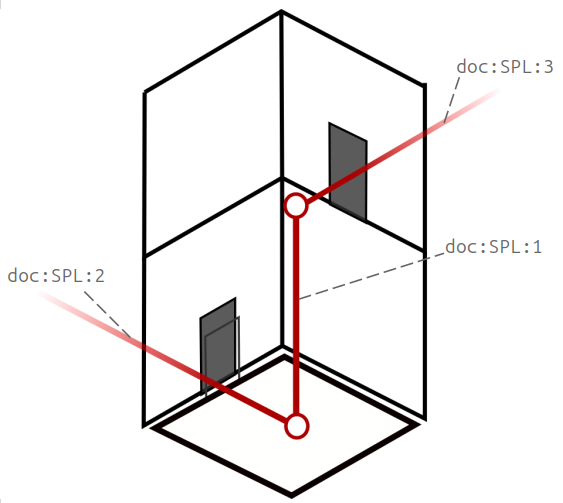

- l'équipement de l'ascenseur :

```xml
<LiftEquipment id="doc:LiftEquipment:1" version="1">(...)</LiftEquipment>
```

- le tronçon de cheminement de l'ascenseur :

```xml
<SitePathLink id="doc:SPL:1" version="1"> 
        (...)
        <AccessFeatureType>lift</AccessFeatureType>
        <placeEquipments>
                <LiftEquipmentRef ref="doc:LiftEquipment:1"/>
        </placeEquipments>
</SitePathLink>
```

Si d'autres étages sont desservis, d'autres tronçons de cheminements avec <span lang="en">AccessFeatureType=lift</span> sont nécessaires.

## <span lang="en">Sign Equipment</span>

<div class="table-title"><span lang="en">SignEquipment</span> (signalétique) – Élément</div>

<table>
<colgroup>
<col style="width: 8%" />
<col style="width: 17%" />
<col style="width: 22%" />
<col style="width: 8%" />
<col style="width: 43%" />
</colgroup>
<tbody>
<tr class="odd">
<td><strong>Classification</strong></td>
<td><strong>Nom</strong></td>
<td><strong>Type</strong></td>
<td><strong>Cardinalité</strong></td>
<td><strong>Description</strong></td>
</tr>
<tr class="even">
<td><em>::></em></td>
<td><em>::></em></td>
<td><em><span lang="en">PlaceEquipment</span></em></td>
<td><em>::></em></td>
<td><span lang="en">SIGN</span> hérite de <span lang="en">PLACE  EQUIPMENT</span>.</td>
</tr>
<tr class="odd">
<td>«PK»</td>
<td>id</td>
<td><span lang="en">SignIdType</span></td>
<td>1:1</td>
<td>Identifiant du <span lang="en">SIGN</span>.</td>
</tr>
<tr class="even">
<td></td>
<td><span lang="en">AsBraille</span></td>
<td>xsd:<span lang="en">boolean</span></td>
<td>0:1</td>
<td>Indique la présence d’une inscription en braille</td>
</tr>
<tr class="odd">
<td></td>
<td><span lang="en">Height</span></td>
<td><span lang="en">LengthType</span></td>
<td>0:1</td>
<td>Hauteur (dimension) du panneau ou signe.</td>
</tr>
<tr class="even">
<td></td>
<td><span lang="en">Width</span></td>
<td><span lang="en">LengthType</span></td>
<td>0:1</td>
<td>Largeur (dimension) du panneau ou signe.</td>
</tr>
<tr class="odd">
<td></td>
<td><span lang="en">HeightFromFloor</span></td>
<td><span lang="en">LengthType</span></td>
<td>0:1</td>
<td>Hauteur à laquelle le panneau ou signe se situe (depuis le sol)</td>
</tr>
<tr class="even">
<td></td>
<td><span lang="en">Placement</span></td>
<td>xsd:<span lang="en">string</span></td>
<td>0:1</td>
<td>Description textuelle de la position du panneau ou signe.</td>
</tr>
<tr class="odd">
<td></td>
<td><span lang="en">BrandGraphic</span></td>
<td>xsd:<span lang="en">anyUrl</span></td>
<td>0:1</td>
<td>URL d’information sur la marque associée au panneau ou au signe.</td>
</tr>
<tr class="even">
<td></td>
<td><span lang="en">SignGraphic</span></td>
<td>xsd:<span lang="en">anyUrl</span></td>
<td>0:1</td>
<td><p>URL associée d’information associée au panneau ou au signe.</p>
<p><span class="hl">Doit être conforme à l'accessibilité RGAA</span></p></td>
</tr>
<tr class="odd">
<td></td>
<td><span lang="en">MachineReadable</span></td>
<td>xsd:<span lang="en">boolean</span></td>
<td>0:1</td>
<td>Signale si la signalétique peut être lue par un machine (smartphone, tablette, etc.)</td>
</tr>
<tr class="even">
<td></td>
<td><em><strong><span lang="en">AudioAnnoucementType</span></strong></em></td>
<td><em><span lang="en">AudioAnnoucementTypeEnum</span></em></td>
<td>0:1</td>
<td><p>Signale si la signalétique est ou peut être lue par un dispositif audio :</p>
<ul>
<li><p><em><span lang="en">cyclicReading</span></em> (lecture automatique à intervalles réguliers)</p></li>
<li><p><em><span lang="en">whenSomebodyIsDetected</span></em> (lecture automatique quand une présence est détectée)</p></li>
<li><p><em><span lang="en">throughAnApp</span></em> (via une app)</p></li>
<li><p><em><span lang="en">throughASpecificDevice</span></em> (via un terminal spécifique)</p></li>
</ul></td>
</tr>
<tr class="odd">
<td></td>
<td><em><strong><span lang="en">FontSize</span></strong></em></td>
<td><em><span lang="en">FontSizeEnum</span></em></td>
<td>0:1</td>
<td><p>Taille de la police de caractères :</p>
<ul>
<li><p><em><span lang="en">verySmall</span></em> (très petite)</p></li>
<li><p><em><span lang="en">Small</span></em> (petite)</p></li>
<li><p><em><span lang="en">Medium</span></em> (moyenne)</p></li>
<li><p><em><span lang="en">Big</span></em> (grande)</p></li>
<li><p><em><span lang="en">VeryBig</span></em> (très grande)</p></li>
</ul></td>
</tr>
<tr class="even">
<td></td>
<td><em><strong><span lang="en">Contrast</span></strong></em></td>
<td><em><span lang="en">PercentageType</span></em></td>
<td>0:1</td>
<td>Différence de luminosité entre le fond et les caractères (un ratio d’au moins 3 est attendu)</td>
</tr>
</tbody>
</table>

<div class="table-title"><span lang="en">HeadingSign</span> (panneau de direction) – Élément</div>

| **Classification** | **Nom**             | **Type**         | **Cardinalité** | **Description**                        |
| --------------- | ------------- | ---------------------- | ------------ | --------------------------------------------- |
| *::>*               | *::>*                 | *<span lang="en">SignEquipment</span>*    | *::>*            | <span lang="en">HEADING SIGN</span> hérite de <span lang="en">SIGN EQUIPMENT</span>.                                   |
| «PK»                | id                    | <span lang="en">HeadingSignIdType</span>  | 1:1              | Identifiant du <span lang="en">HEADING SIGN</span>.                                             |
|                     | <span lang="en">PlaceName</span>             | <span lang="en">MultilingualString</span> | 0:1              | Nom du lieu indiqué sur le panneau                                        |
|                     | <span lang="en">LineName</span>              | <span lang="en">MultilingualString</span> | 0:1              | Nom de la ligne de transport en commun concernée par le panneau         |
|                     | <span lang="en">DirectionName</span>         | <span lang="en">MultilingualString</span> | 0:1              | Direction que le panneau indique (texte)                                  |
| «FK»                | <span lang="en">DestinationDisplayRef</span> | <span lang="en">LineRef</span>            | 0:1              | <span lang="en">DESTINATION DISPLAY</span> référencée par le <span lang="en">HEADING SIGN</span> (référence technique) |

<div class="table-title"><span lang="en">GeneralSign</span> (affichage générique) – Élément</div>

<table>
<colgroup>
<col style="width: 8%" />
<col style="width: 17%" />
<col style="width: 22%" />
<col style="width: 8%" />
<col style="width: 43%" />
</colgroup>
<tbody>
<tr class="odd">
<td><strong>Classification</strong></td>
<td><strong>Nom</strong></td>
<td><strong>Type</strong></td>
<td><strong>Cardinalité</strong></td>
<td><strong>Description</strong></td>
</tr>
<tr class="even">
<td><em>::></em></td>
<td><em>::></em></td>
<td><em><span lang="en">SignEquipment</span></em></td>
<td><em>::></em></td>
<td><span lang="en">GENERAL SIGN</span> hérite de <span lang="en">SIGN EQUIPMENT</span>.</td>
</tr>
<tr class="odd">
<td>«PK»</td>
<td>id</td>
<td><span lang="en">GeneralSignIdType</span></td>
<td>1:1</td>
<td>Identifiant du <span lang="en">GENERAL SIGN</span>.</td>
</tr>
<tr class="even">
<td></td>
<td><span lang="en">Content</span></td>
<td><span lang="en">MultilingualString</span></td>
<td>0:1</td>
<td>Contenu textuel de l’affichage</td>
</tr>
<tr class="odd">
<td></td>
<td><em><strong><span lang="en">SignContentType</span></strong></em></td>
<td><em><span lang="en">SignContentEnum</span></em></td>
<td>0:1</td>
<td><p>Type de contenu :</p>
<ul>
<li><p><em><span lang="en">entrance</span></em> (entrée)</p></li>
<li><p><em><span lang="en">exit</span></em> (sortie)</p></li>
<li><p><em><span lang="en">emergencyExit</span></em> (sortie de secours)</p></li>
<li><p><em><span lang="en">transportMode</span></em> (mode de transport)</p></li>
<li><p><em><span lang="en">noSmoking</span></em> (interdiction de fumer)</p></li>
<li><p><em><span lang="en">tickets</span></em> (billets)</p></li>
<li><p><em><span lang="en">assistance</span></em> (assistance)</p></li>
<li><p><em><span lang="en">sosPhone</span></em> (téléphone de secours)</p></li>
<li><p><em><span lang="en">touchPoint</span></em> (point de contact)</p></li>
<li><p><em><span lang="en">meetingPoint</span></em> (point de rendez-vous)</p></li>
<li><p><em><span lang="en">TransportModePoint</span></em> (point associé à une mode de transport)</p></li>
<li><p><em><span lang="en">Other</span></em> (autre)</p></li>
</ul></td>
</tr>
</tbody>
</table>

<div class="table-title"><span lang="en">PlaceSign</span> (panneau d’indication de lieu) – Élément</div>

| **Classification** | **Nom**             | **Type**         | **Cardinalité** | **Description**                        |
| --------------- | ------------- | ---------------------- | ------------ | --------------------------------------------- |
| *::>*               | *::>*     | *<span lang="en">SignEquipment</span>*    | *::>*            | <span lang="en">PLACE SIGN</span> hérite de <span lang="en">SIGN EQUIPMENT</span>. |
| «PK»                | id        | <span lang="en">SignIdType</span>         | 1:1              | Identifiant du <span lang="en">PLACE SIGN</span>.           |
|                     | <span lang="en">PlaceName</span> | <span lang="en">MultilingualString</span> | 1:1              | Nom du lieu indiqué                  |

## <span lang="en">Ticketing Equipment</span>

<div class="table-title"><span lang="en">TicketValidatorEquipment</span> (validateur) – Élément</div>

| **Classification** | **Nom**             | **Type**         | **Cardinalité** | **Description**                        |
| --------------- | ------------- | ---------------------- | ------------ | --------------------------------------------- |
| *::>*               | *::>*                           | *<span lang="en">PassengerEquipment</span>*  | *::>*            | <span lang="en">TICKET VALIDATOR EQUIPMENT</span> hérite de <span lang="en">PASSENGER EQUIPMENT</span>                                                         |
| «PK»                | id                              | <span lang="en">TicketValidatorIdType</span> | 1:1              | Identifiant du <span lang="en">TICKET VALIDATOR EQUIPMENT</span>.                                                                       |
|                     | <span lang="en">ValidatorList</span>                   | <span lang="en">TicketValidatorEnum</span>   | 0:\*             | Type de <span lang="en">TICKET VALIDATOR</span>.                                                                                        |
|                     | ***<span lang="en">AudioValidationFeedback</span>***   | xsd:<span lang="en">boolean</span>           | 0:1              | Indique s’il y a une confirmation audio de la validation du titre                                                |
|                     | ***<span lang="en">VisualValidationFeedback</span>***  | xsd:<span lang="en">boolean</span>           | 0:1              | Indique s’il y a une confirmation visuelle de la validation du titre                                             |
|                     | ***<span lang="en">TactileValidationFeedback</span>*** | xsd:<span lang="en">boolean</span>           | 0:1              | Indique s’il y a une confirmation tactile de la validation du titre                                              |
|                     | ***<span lang="en">ValidationGuidance</span>***        | <span lang="en">MultilingualString</span>    | 0:1              | Texte libre décrivant les modalités de validation (comment valider le titre, comment trouver le valideur, etc.). |

<div class="table-title"><span lang="en">TicketingEquipment</span> (équipement billettique) – Élément</div>

| **Classification** | **Nom**             | **Type**         | **Cardinalité** | **Description**                        |
| --------------- | ------------- | ---------------------- | ------------ | --------------------------------------------- |
| *::>*               | *::>*                           | *<span lang="en">PassengerEquipment</span>*     | *::>*            | <span lang="en">TICKETING EQUIPMENT</span> hérite de <span lang="en">PASSENGER EQUIPMENT</span>.                              |
| «PK»                | id                              | <span lang="en">TicketingEquipmentIdType</span> | 1:1              | Identifiant du <span lang="en">TICKETING EQUIPMENT</span>.                                             |
|                     | <span lang="en">TicketMachines</span>                  | xsd:<span lang="en">boolean</span>              | 0:1              | Signale la disponibilité de machines de vente de titres de transport            |
|                     | <span lang="en">NumberOfMachines</span>                | xsd:<span lang="en">integer</span>              | 0:1              | Nombre de machines                                                              |
|                     | <span lang="en">HeightOfMachine</span>­Interface       | <span lang="en">LengthType</span>               | 0:1              | Hauteur a laquelle se trouve l’interface de la machine                          |
|                     | ***<span lang="en">TicketCounter</span>***             | xsd:<span lang="en">boolean</span>              | 0:1              | Signale la disponibilité d’un guichet                                           |
|                     | <span lang="en">InductionLoops</span>                  | xsd:<span lang="en">boolean</span>              | 0:1              | Signale la présence d’un détecteur à boucle d’induction                         |
|                     | <span lang="en">LowCounterAccess</span>                | xsd:<span lang="en">boolean</span>              | 0:1              | Signale la présence d’un comptoir abaissé pour l’accessibilité                  |
|                     | <span lang="en">HeightOfLowCounter</span>             | <span lang="en">LengthType</span>               | 0:1              | Hauteur du comptoir (comptoir abaissé pour l’accessibilité)                     |
|                     | ***<span lang="en">TactileInterfaceAvailable</span>*** | xsd:<span lang="en">boolean</span>              | 0:1              | Signale la disponibilité d’une interface tactile                                |
|                     | ***<span lang="en">AudioInterfaceAvailable</span>***   | xsd:<span lang="en">boolean</span>              | 0:1              | Signale la disponibilité d’une interface audio (permettant un usage en aveugle) |
|                     | ***<span lang="en">DisabledPriority</span>***          | xsd:<span lang="en">boolean</span>              | 0:1              | Signale la une priorité handicapés (sans faire la queue)                        |
|                     | ***<span lang="en">WheelchairSuitable</span>***        | xsd:<span lang="en">boolean</span>              | 0:1              | Signale la possibilité d’être utilise à partir d’un fauteuil roulant            |

## <span lang="en">Local Service</span>

<div class="table-title"><span lang="en">AssistanceService</span> (service d’assistance) – Élément</div>

<table>
<colgroup>
<col style="width: 8%" />
<col style="width: 17%" />
<col style="width: 22%" />
<col style="width: 8%" />
<col style="width: 43%" />
</colgroup>
<tbody>
<tr class="odd">
<td><strong>Classification</strong></td>
<td><strong>Nom</strong></td>
<td><strong>Type</strong></td>
<td><strong>Cardinalité</strong></td>
<td><strong>Description</strong></td>
</tr>
<tr class="even">
<td><em>::></em></td>
<td><em>::></em></td>
<td><em><span lang="en">LocalService</span></em></td>
<td><em>::></em></td>
<td><span lang="en">ASSISTANCE SERVICE</span> hérite de <span lang="en">LOCAL SERVICE</span>.</td>
</tr>
<tr class="odd">
<td>«PK»</td>
<td>id</td>
<td><span lang="en">AssistanceServiceIdType</span></td>
<td>1:1</td>
<td>Identifiant du <span lang="en">ASSISTANCE SERVICE</span>.</td>
</tr>
<tr class="even">
<td></td>
<td><em><strong><span lang="en">AssistanceFacilityList</span></strong></em></td>
<td><em><span lang="en">AssistanceFacilityEnume</span></em></td>
<td>0:*</td>
<td><p>Type d'assistance fournie :</p>
<ul>
<li><p><em><span lang="en">personalAssistance</span></em> (personnel d’assistance)</p></li>
<li><p><em><span lang="en">boardingAssistance</span> <span class="hl">(le champ Description sera utilisé pour préciser l'assistant à l'embarquement/débarquement, notamment dans le cas des correspondances multimodales)</span></em></p></li>
<li><p><em><span lang="en">wheechairAssistance</span></em> (assistance pour les fauteuils roulants)</p></li>
<li><p><em><span lang="en">unaccompaniedMinorAssistance</span></em> (assistance pour les mineurs non accompagnés)</p></li>
<li><p><em><span lang="en">wheelchairUse</span></em> (utilisation de fauteuil roulant)</p></li>
<li><p><em><span lang="en">conductor</span></em> (controleur)</p></li>
<li><p><em>information</em> (information)</p></li>
</ul></td>
</tr>
<tr class="odd">
<td></td>
<td><em><strong><span lang="en">AssistanceAvailability</span></strong></em></td>
<td><em><span lang="en">AssistanceAvailabilityEnum</span></em></td>
<td>0:1</td>
<td><p>Disponibilité du service d’assistance</p>
<ul>
<li><p><em><span lang="en">none</span> :</em> pas d’assistance disponible</p></li>
<li><p><em><span lang="en">available</span> :</em> assistance normalement disponible</p></li>
<li><p><em><span lang="en">availableIfBooked</span> :</em> assistance disponible sur réservation</p></li>
<li><p><em><span lang="en">availableAtCertainTimes</span> :</em> assistance disponible à certaines heures seulement.</p></li>
<li><p><em><span lang="en">unknown</span> :</em> inconnu.</p></li>
</ul></td>
</tr>
<tr class="even">
<td></td>
<td><span lang="en">Staffing</span></td>
<td><span lang="en">StaffingEnum</span></td>
<td>0:1</td>
<td><p>Signale si le personnel est disponible</p>
<ul>
<li><p><em><span lang="en">fullTime</span></em> (à plein temps)</p></li>
<li><p><em><span lang="en">partTime</span></em> (à temps partiel)</p></li>
</ul></td>
</tr>
<tr class="odd">
<td></td>
<td><span lang="en">AccessibilityTools</span></td>
<td><span lang="en">AccessibilityToolEnum</span></td>
<td>0:*</td>
<td><p>Dispositif et équipement d’accessibilité disponibles</p>
<ul>
<li><p><em><span lang="en">wheelchair</span> </em>: fauteuil roulant</p></li>
<li><p><em><span lang="en">walkingstick</span> </em>: canne</p></li>
<li><p><em><span lang="en">audioNavigator</span></em> : navigateur audio</p></li>
<li><p><em><span lang="en">visualNavigator</span></em> navigateur visuel</p></li>
<li><p><em><span lang="en">passengerCart</span> </em>: chariot</p></li>
<li><p><em><span lang="en">pushchair</span></em> : poussette</p></li>
<li><p><em><span lang="en">umbrella</span> </em>: parapluie</p></li>
<li><p><em><span lang="en">buggy</span></em> : voiturette</p></li>
</ul></td>
</tr>
<tr class="odd">
<td></td>
<td><span lang="en">AccessibilityTrained­Staff</td>
<td>xsd:<span lang="en">boolean</span></td>
<td>0:1</td>
<td>Indique que le personnel a été formé à la prise en compte des problématiques d’accessibilité</td>
</tr>
<tr class="even">
<td></td>
<td><span lang="en">Emergency</span>­Services</td>
<td><span lang="en">EmergencyServicesEnum</span></td>
<td>0:*</td>
<td><p>Services d’urgence disponibles</p>
<ul>
<li><p><em><span lang="en">police</span></em> : police</p></li>
<li><p><em><span lang="en">fire</span></em>: incendie/pompiers</p></li>
<li><p><em><span lang="en">firstAid</span></em> : premiers secours</p></li>
<li><p><em><span lang="en">sosPoint</span></em> : point SOS (appel d’urgence)</p></li>
<li><p><em><span lang="en">other</span></em><u> </u>: autre</p></li>
</ul></td>
</tr>
<tr class="odd">
<td></td>
<td><em><strong><span lang="en">SafetyFacilityList</span></strong></em></td>
<td><em><span lang="en">SafetyFacilityList</span></em></td>
<td>0:1</td>
<td><p>Dispositifs de sécurité disponibles</p>
<ul>
<li><p><em><span lang="en">ccTv</span></em> : caméras</p></li>
<li><p><em><span lang="en">mobileCoverage</span></em> : couverture téléphone portable</p></li>
<li><p><em><span lang="en">sosPoints</span></em> : point SOS (appel d’urgence)</p></li>
<li><p><em><span lang="en">staffed</span></em> : personnel</p></li>
</ul></td>
</tr>
</tbody>
</table>

<div class="table-title"><span lang="en">LuggageService</span> (service de bagages) – Élément</div>

| **Classification** | **Nom**             | **Type**         | **Cardinalité** | **Description**                        |
| --------------- | ------------- | ---------------------- | ------------ | --------------------------------------------- |
| *::>*               | *::>*                      | *<span lang="en">LocalService</span>*       | *::>*            | <span lang="en">LUGGAGE SERVICE</span> hérite de <span lang="en">LOCAL SERVICE</span>.                                                        |
| «PK»                | id                         | <span lang="en">LuggageServiceIdType</span> | 1:1              | Identifiant du <span lang="en">LUGGAGE SERVICE</span>.                                                                 |
|                     | <span lang="en">LuggageTrolleys</span>            | xsd:<span lang="en">boolean</span>          | 0:1              | Signale si des chariots à bagage sont disponibles                                               |
|                     | <span lang="en">WheelchairLuggageTrolleys</span> | xsd:<span lang="en">boolean</span>          | 0:1              | Signale si des chariots à bagage adaptés pour les personnes en fauteuil roulant sont disponibles |
|                     | ***<span lang="en">MaximumBagWidth</span>***      | *<span lang="en">LengthType</span>*         | 0:1              | Largeur maximale des bagages                                                                    |
|                     | ***<span lang="en">MaximumBagHeight</span>***     | *<span lang="en">LengthType</span>*         | 0:1              | Hauteur maximale des bagages                                                                    |
|                     | ***<span lang="en">MaximumBagDepth</span>***      | *<span lang="en">LengthType</span>*         | 0:1              | Profondeur maximale des bagages                                                                 |
|                     | ***<span lang="en">LuggageMaximalWeigth</span>*** | *xsd:<span lang="en">decimal</span>*        | 0:1              | Poids maximal des bagages                                                                        |

<div class="table-title"><span lang="en">CustomerService</span> (service clientèle) – Élément</div>

| **Classification** | **Nom**             | **Type**         | **Cardinalité** | **Description**                        |
| --------------- | ------------- | ---------------------- | ------------ | --------------------------------------------- |
| *::>*               | *::>*    | *<span lang="en">LocalService</span>*   | *::>*            | <span lang="en">CUSTOMER SERVICE</span> hérite de <span lang="en">LOCAL SERVICE</span>|
|                     | <span lang="en">Email</span>    | <span lang="en">EmailAddressType</span> | 0:1              | Email du service client                  |
|                     | <span lang="en">Phone</span>    | <span lang="en">PhoneNumberType</span>  | 0:1              | Téléphone du service client              |
|                     | <span lang="en">InfoLink</span> | <span lang="en">InfoLink</span>         | 0:1              | Lien URL pour accèder au service client  |

<div class="table-title"><span lang="en">LostPropertyService</span> (objets trouvés) – Élément</div>

| **Classification** | **Nom**             | **Type**         | **Cardinalité** | **Description**                        |
| --------------- | ------------- | ---------------------- | ------------ | --------------------------------------------- |
| *::>*               | *::>*    | *<span lang="en">LocalService</span>*            | *::>*            | <span lang="en">LOST PROPERTY SERVICE</span> hérite de <span lang="en">CUSTOMER SERVICE</span>. |
|                     | id       | <span lang="en">LostPropertyServiceIdType</span> | 1:1              | Identifiant du <span lang="en">LOST PROPERTY SERVICE</span>.                                    |

<div class="table-title"><span lang="en">MeetingPoint</span> (point rencontre et rendez-vous) – Élément</div>

<table>
<colgroup>
<col style="width: 8%" />
<col style="width: 17%" />
<col style="width: 22%" />
<col style="width: 8%" />
<col style="width: 43%" />
</colgroup>
<tbody>
<tr class="odd">
<td><strong>Classification</strong></td>
<td><strong>Nom</strong></td>
<td><strong>Type</strong></td>
<td><strong>Cardinalité</strong></td>
<td><strong>Description</strong></td>
</tr>
<tr class="even">
<td><em>::></em></td>
<td><em>::></em></td>
<td><em><span lang="en">LocalService</span></em></td>
<td><em>::></em></td>
<td><span lang="en">MEETING POINT SERVICE</span> hérite de <span lang="en">CUSTOMER SERVICE</span></td>
</tr>
<tr class="odd">
<td>«PK»</td>
<td>id</td>
<td><span lang="en">MeetingServiceIdType</span></td>
<td>1:1</td>
<td>Identifiant du <span lang="en">MEETING POINT SERVICE</span>.</td>
</tr>
<tr class="even">
<td></td>
<td><span lang="en">MeetingPointType</span></td>
<td><span lang="en">MeetingPointEnum</span></td>
<td>1:1</td>
<td><p>Type de point de rendez-vous</p>
<ul>
<li><p><em><span lang="en">meetingPoint</span></em> : point de rendez-vous</p></li>
<li><p><em><span lang="en">groupMeeting</span></em> : point de rendez-vous pour les groupes</p></li>
<li><p><em><span lang="en">schoolMeetingPoint</span></em> : point de rendez-vous pour les scolaires</p></li>
<li><p><em><span lang="en">other</span></em> : autre</p></li>
</ul></td>
</tr>
<tr class="odd">
<td></td>
<td><em><strong><span lang="en">Label</span></strong></em></td>
<td><span lang="en">MultilingualString</span></td>
<td>0:1</td>
<td>Label (texte) permettant d’identifier le point de rendez-vous</td>
</tr>
</tbody>
</table>

<div class="table-title"><span lang="en">TicketingService</span> (service de vente de billets) – Élément</div>

| **Classification** | **Nom**             | **Type**         | **Cardinalité** | **Description**                        |
| --------------- | ------------- | ---------------------- | ------------ | --------------------------------------------- |
| *::>*               | *::>*                 | *<span lang="en">LocalService</span>*         | *::>*            | <span lang="en">TICKETING SERVICE</span> hérite de <span lang="en">LOCAL SERVICE</span>.                       |
| «PK»                | id                    | <span lang="en">TicketingServiceIdType</span> | 1:1              | Identifiant du <span lang="en">TICKETING SERVICE</span>.                                |
|                     | <span lang="en">TicketCounterService</span>­ | xsd:<span lang="en">boolean</span>            | 0:1              | Signale la possibilité d’achat de titre de transport au comptoir |
|                     | <span lang="en">OnboardPurchase</span>       | xsd:<span lang="en">boolean</span>            | 0:1              | Signale la possibilité d’achat de titre à bord                   |
|                     | <span lang="en">MobileDevice­Tickets</span>  | xsd:<span lang="en">boolean</span>            | 0:1              | Signale la possibilité d’achat de titre sur smartphone           |

## Commercial Service

<div class="table-title"><span lang="en">HireService</span> (service de location) – Élément</div>

<table>
<colgroup>
<col style="width: 8%" />
<col style="width: 17%" />
<col style="width: 22%" />
<col style="width: 8%" />
<col style="width: 43%" />
</colgroup>
<tbody>
<tr class="odd">
<td><strong>Classification</strong></td>
<td><strong>Nom</strong></td>
<td><strong>Type</strong></td>
<td><strong>Cardinalité</strong></td>
<td><strong>Description</strong></td>
</tr>
<tr class="even">
<td><em>::></em></td>
<td><em>::></em></td>
<td><em><span lang="en">LocalService</span></em></td>
<td><em>::></em></td>
<td><span lang="en">HIRE SERVICE</span> hérite de <span lang="en">LOCAL SERVICE</span></td>
</tr>
<tr class="odd">
<td></td>
<td><span lang="en">TypeOfService</span></td>
<td><span lang="en">HireFacilityEnum</span></td>
<td>1:*</td>
<td><p>Classifications des services de location:</p>
<ul>
<li><p><em><span lang="en">unknown</span></em> : inconnu</p></li>
<li><p><em><span lang="en">carHire</span></em> : location de chariots</p></li>
<li><p><em><span lang="en">motorCycleHire</span></em> : location de cycles motorisés</p></li>
<li><p><em><span lang="en">cycleHire</span></em> : location de cycles</p></li>
<li><p><em><span lang="en">taxi</span></em> : taxi</p></li>
<li><p><em><span lang="en">recreationDeviceHire</span></em> : location pour les loisirs</p></li>
</ul></td>
</tr>
</tbody>
</table>

## <span lang="en">Parking Equipment</span>

Notez que les parkings automobiles sont décrits en tant que tels et
indépendamment des équipements.

<div class="table-title"><span lang="en">CycleStorageEquipment</span> (parcs à vélos) – Élément</div>

| **Classification** | **Nom**             | **Type**         | **Cardinalité** | **Description**                        |
| --------------- | ------------- | ---------------------- | ------------ | --------------------------------------------- |
| *::>*               | *::>*          | *<span lang="en">PlaceEquipment</span>*   | *::>*            | <span lang="en">CYCLE STORAGE EQUIPMENT</span> hérite de <span lang="en">PLACE EQUIPMENT</span>. |
| «PK»                | id             | <span lang="en">CycleStorageIdType</span> | 1:1              | Identifiant du <span lang="en">CYCLE STORAGE EQUIPMENT</span>.            |
|                     | <span lang="en">NumberOfSpaces</span> | xsd:<span lang="en">integer</span>        | 0:1              | Nombre maximal de places disponibles             |

# Annexe (informative) - Détail des évaluations d'accessibilité (<span lang="en">AccessibilityAssessment</span>)

Il n’existait pas encore de critères unifiés au niveau national pour les évaluations d’accessibilité. 
Voici une proposition de définition aidant à choisir entre les valeurs disponibles (oui/non/partiel) 
dans chaque cas. En cas de doute, se référer systématiquement à la réglementation en vigueur 
(principalement l’arrêté du 15 janvier 2007 modifié) relatif l'accessibilité de la voirie et des espaces 
publics et l’arrêté du 20 avril 2017 relatif à l’accessibilité des établissements recevant du public (ERP).

## Définition des *<span lang="en">AccessibilityLimitation</span>* retenus pour le TRONÇON DE CHEMINEMENT (<span lang="en">SITE PATH LINK</span>)

**<span lang="en">WheelchairAccess</span>** : le sol est plat, de revêtement lisse et stable ; l’espace est assez large 
et sans obstacle permanent bloquant.

En particulier :
- lisse et stable signifie que le revêtement ne cause pas de secousse ou de risques de s’enfoncer ;
- on utilisera les valeurs de références suivantes pour la valeur <span lang="en">true</span> : dévers de moins de 2%,
 pente de moins de 5% et largeur d’au moins 1,40m ;
- si le dévers est de moins de 5%, ou la pente de moins de 8%, ou la largeur d’au moins 90 cm,
 on pourra utiliser *<span lang="en">partial</span>* ;
- on pourra également utiliser *<span lang="en">partial</span>* pour qualifier une rampe conforme à la réglementation
 française mais pas à cette définition ;
- *<span lang="en">false</span>* sera systématiquement utilisé pour les *<span lang="en">AccessFeatureType</span>* suivants :
* <span lang="en">stairs</span>
* <span lang="en">seriesOfStairs</span>
* <span lang="en">escalator</span>
* <span lang="en">travelator</span>


**<span lang="en">AllAreasWheelchairAccessible</span>** vaudra *<span lang="en">true</span>* si **<span lang="en">WheelchairAccess</span>** vaut *<span lang="en">true</span>*, 
et *<span lang="en">false</span>* si **<span lang="en">WheelchairAccess</span>** est *<span lang="en">false</span>*.
Pour plus de détails, renseigner aussi :
- <span lang="en">TiltAngle</span>, <span lang="en">TiltType</span>
- <span lang="en">Gradient</span>, <span lang="en">GradientType</span>
- <span lang="en">FlooringType</span>
- <span lang="en">MinimumWidth</span>

On utilisera la définition suivante pour **<span lang="en">AccessFeatureType</span>** valant *<span lang="en">lift</span>* : 
L’ascenseur dispose d’une profondeur d’au moins 1,25m et de portes coulissantes 
d’une largeur de passage d’au moins 80cm.
**<span lang="en">LiftEquipment/WheelchairPassable</span>** vaudra *<span lang="en">true</span>* si **<span lang="en">WheelchairAccess</span>** vaut *<span lang="en">true</span>*, 
et *<span lang="en">false</span>* si **<span lang="en">WheelchairAccess</span>** est *<span lang="en">false</span>*.
Pour plus de détails, renseigner aussi :
- <span lang="en">LiftEquipment/Depth</span>
- <span lang="en">LiftEquipment/InternalWidth</span>
- <span lang="en">LiftEquipment/WheelchairTurningCircle</span>


**<span lang="en">StepFreeAccess</span>** : il n’y a pas de marche infranchissable.
En particulier, ça sera 
- *<span lang="en">true</span>* s’il n’y a pas de marche ou s’il y a une marche de moins de 2 cm
- *<span lang="en">partial</span>* s’il y a une marche de moins de 4 cm
- *<span lang="en">false</span>* s’il y a une marche de plus de 4cm

Pour **<span lang="en">AccessFeatureType</span>** valant *<span lang="en">crossing</span>*, on considérera les éventuelles marches 
à toutes les extrémités. 
**<span lang="en">StepFreeAccess</span>** prendra la valeur *<span lang="en">false</span>* pour les **<span lang="en">AccessFeatureType</span>** suivants :
- <span lang="en">stairs</span>
- <span lang="en">seriesOfStairs</span>

**<span lang="en">StepFreeAccess</span>** prendra la valeur *<span lang="en">true</span>* pour les **<span lang="en">AccessFeatureType</span>** suivants :
- <span lang="en">escalator</span>
- <span lang="en">travelator</span>
- <span lang="en">lift</span>
- <span lang="en">ramp</span>

**<span lang="en">NumberOfSteps</span>** vaudra 0 si **<span lang="en">StepFreeAccess</span>** vaut *<span lang="en">true</span>*.
**<span lang="en">CrossingEquipment/DroppedKerb</span>** vaudra *<span lang="en">true</span>* si **<span lang="en">StepFreeAccess</span>** vaut *<span lang="en">true</span>*, 
et *<span lang="en">false</span>* si **<span lang="en">WheelchairAccess</span>** est *<span lang="en">false</span>*.


**<span lang="en">EscalatorFreeAccess</span>** : ce n'est pas un escalator.
En particulier, **<span lang="en">EscalatorFreeAccess</span>** prendra la valeur *<span lang="en">false</span>* pour **<span lang="en">AccessFeatureType</span>** valant *<span lang="en">escalator</span>*, 
et la valeur *<span lang="en">true</span>* dans tous les autres cas. 
En d'autres termes, si le <span lang="en">SitePathLink</span> est un <span lang="en">escalator</span>, la valeur vaut **<span lang="en">true</span>** ; sinon elle vaut **<span lang="en">false</span>**.


**<span lang="en">LiftFreeAccess</span>** : ce n'est pas un ascenseur.
En particulier, **<span lang="en">LiftFreeAccess</span>** prendra la valeur *<span lang="en">false</span>* pour **<span lang="en">AccessFeatureType</span>** valant *<span lang="en">lift</span>*, 
et la valeur <span lang="en">true</span> dans tous les autres cas. 
En d'autres termes, si le <span lang="en">SitePathLink</span> est un ascenseur, la valeur vaut **<span lang="en">true</span>** ; sinon elle vaut **<span lang="en">false</span>**.


**<span lang="en">AudibleSignalsAvailable</span>**
- Pour les **<span lang="en">AccessFeatureType</span>** valant *<span lang="en">hall</span>* ou *<span lang="en">concourse</span>* : il existe un système de guidage 
 sonore en bon état de fonctionnement le long de ce cheminement.
- Pour les **<span lang="en">AccessFeatureType</span>** valant *<span lang="en">crossing</span>* : il y a des feux sonores d’aide à la
 traversée en bon état en marche
- Pour les **<span lang="en">AccessFeatureType</span>** valant *<span lang="en">lift</span>* : l’ascenseur est équipé d’un mécanisme
 d’annonces sonores de l’étage en bon état de marche

**<span lang="en">CrossingEquipment/AcousticCrossingAids</span>** et **<span lang="en">LiftEquipment/AudioAnnouncements</span>** vaudra *<span lang="en">true</span>* 
si **<span lang="en">AudibleSignalsAvailable</span>** vaut *<span lang="en">true</span>*, et *<span lang="en">false</span>* si **<span lang="en">AudibleSignalsAvailable</span>** est *<span lang="en">false</span>*.


**<span lang="en">VisualSignsAvailable</span>**
- Pour les **<span lang="en">AccessFeatureType</span>** valant *<span lang="en">hall</span* ou *<span lang="en">concourse</span>* : il existe des panneaux
 <span lang="en">directionnels</span> le long de ce cheminement
- Pour les **<span lang="en">AccessFeatureType</span>** valant *<span lang="en">crossing</span>* : il y a un marquage au sol en bon état de
 type <span lang="en">zébra</span> guidant la traversée 
- Pour les **<span lang="en">AccessFeatureType</span>** valant *<span lang="en">lift</span>* : l’ascenseur est équipé d’un panneau
 d’affichage en cabine indiquant l’étage.

**<span lang="en">CrossingEquipment/ZebraCrossing</span>** vaudra *<span lang="en">true</span>* si **<span lang="en">VisualSignsAvailable</span>** vaut *<span lang="en">true</span>*, 
et *<span lang="en">false</span>* si **<span lang="en">VisualSignsAvailable</span>** est *<span lang="en">false</span>*.

**<span lang="en">TactileGuidanceAvailable</span>** : il y a des bandes de guidage, ou il y a un élément linéaire 
au sol qui peut être détecté et suivi avec une canne (mur, caniveau, etc).

S'il y a des bandes de guidage podotactile, on renseignera également l'attribut **<span lang="en">TactileGuidingStrip</span>**.

## Définition des <span lang="en">AccessibilityLimitation</span> retenus pour les sanitaires (<span lang="en">SANITARY EQUIPMENT</span>)

**<span lang="en">WheelchairAccess</span>** : un usager en fauteuil roulant peut se positionner sur la cuvette 
et atteindre et utiliser tous les équipements (lumière, lave-main, etc.)
Cela signifie notamment qu’il faut un espace d’au moins 1,50 m à côté de la cuvette, 
une barre d’appui, un lave-main accessible, etc.

## Définition des *<span lang="en">AccessibilityLimitation</span>* retenus pour les zones d'embarquement (<span lang="en">QUAY</span>)

**<span lang="en">WheelchairAccess</span>** : le sol est plat, de revêtement lisse et stable, assez large pour faire demi-tour en fauteuil (1,50m) et sans obstacle permanent bloquant

En particulier :

- lisse et stable signifie que le revêtement ne cause pas de secousse ou de risques de s’enfoncer
- on utilisera les valeurs de références suivantes pour la valeur <span lang="en">true</span> : dévers de moins de 2%, pente de moins de 5%
- si le dévers est de moins de 5%, ou la pente de moins de 8%, ou la largeur d’au moins 90 cm, on pourra utiliser <span lang="en">partial</span>

**<span lang="en">AudibleSignalsAvailable</span>** : il y a des annonces sonores, en général des prochains passages, indiquant au moins les lignes desservies ainsi que leur direction.

**<span lang="en">VisualSignsAvailable</span>** : il y a au moins le nom de l'arrêt, les lignes desservies ainsi que leur direction, et un tableau ou écran d'affichage (présentant les horaires, le plan du réseau, des lignes desservies ou des abords). Les textes écrits sont conformes aux recommandations en vigueur en terme de taille de caractère, de lisibilité de la police et de contraste visuel par rapport à l'arrière plan (voir arrêté du 15 janvier 2007 pour plus de détails).

**<span lang="en">TactileGuidanceAvailable</span>** : il y a des bandes de guidage podotactile menant à la porte permettant d'embarquer dans le véhicule, et elle sont connectées à des éléments linéaires au sol qui peuvent être détectés et suivis avec une canne (mur, bandes de guidage, etc).

## Définition des *<span lang="en">AccessibilityLimitation</span>* retenus pour les entrées (<span lang="en">ENTRANCE</span>)

Ces définitions concernent tous les éléments qui héritent de <span lang="en">ENTRANCE</span> : accès de lieu d'arrêt (<span lang="en">STOP PLACE ENTRANCE</span>), accès piéton d'un parking (<span lang="en">PARKING PASSENGER ENTRANCE</span>), accès de point d'intérêt (<span lang="en">POINT OF INTEREST ENTRANCE</span>), etc.

**<span lang="en">WheelchairAccess</span>** : il y a une largeur de passage d’au moins 80 cm et pas de marche infranchissable. S’il y a une porte, elle s’ouvre sans forcer (moins de 50 Newton).

On utilisera les mêmes valeurs de référence pour la hauteur de la marche éventuelle que pour <span lang="en">StepFreeAccess</span> (voir ci-après).

**<span lang="en">StepFreeAccess</span>** : il n’y a pas de marche infranchissable.

En particulier, ça sera :

- <span lang="en">true</span> s’il n’y a pas de marche ou s’il y a une marche de moins de 2 cm
- <span lang="en">partial</span> s’il y a une marche de moins de 4 cm
- <span lang="en">false</span> s’il y a une marche de plus de 4 cm

**<span lang="en">TactileGuidanceAvailable</span>** : des bandes de guidage podotactile partent de cette entrée.

## Définition des *<span lang="en">AccessibilityLimitation</span>* retenus pour les lieux d'arrêts (<span lang="en">STOP PLACE</span>)

**<span lang="en">WheelchairAccess</span>** : chaque quai est pratiquable en fauteuil roulant et il existe un cheminement pratiquable en fauteuil roulant entre chaque zone d'embarquement et au moins un accès.

Se référer aux définitions plus précises de *<span lang="en">WheelchairAccess</span>* pour les zones d'embarquement (<span lang="en">Quay</span>), les accès de lieu d'arrêt (<span lang="en">StopPlaceEntrance</span>) et les cheminements (<span lang="en">SitePathLink</span>).

**<span lang="en">StepFreeAccess</span>** : il est possible d’atteindre chaque zone d'embarquement depuis au moins un accès sans franchir de marche.

En particulier, ça sera :

- <span lang="en">true</span> s’il n’y a pas de marche ou s’il y a une marche de moins de 2 cm
- <span lang="en">partial</span> s’il y a une marche de moins de 4 cm
- <span lang="en">false</span> s’il y a une marche de plus de 4 cm

**<span lang="en">EscalatorFreeAccess</span>** : il est possible d’atteindre chaque zone d'embarquement depuis au moins un accès sans passer par un escalator.

**<span lang="en">LiftFreeAccess</span>** : il est possible d’atteindre chaque zone d'embarquement depuis au moins un accès sans passer par un ascenseur.

**<span lang="en">AudibleSignalsAvailable</span>** : il y a des annonces sonores.

**<span lang="en">VisualSignsAvailable</span>** : il y a au moins le nom du lieu d'arrêt, les lignes desservies, et un tableau ou écran d'affichage (présentant les horaires, le plan du réseau, des lignes desservies ou des abords). Les textes écrits sont conformes aux recommandations en vigueur en terme de taille de caractère, de lisibilité de la police et de contraste visuel par rapport à l'arrière plan (voir arrêté du 15 janvier 2007 pour plus de détails).

**<span lang="en">TactileGuidanceAvailable</span>** : il y a un réseau de bandes de guidage podotactile qui relient chaque zone d'embarquement à au moins un accès.

## Définition des *<span lang="en">AccessibilityLimitation</span>* retenus pour les places de stationnement (<span lang="en">PARKING BAY</span>)

**<span lang="en">WheelchairAccess</span>** : le sol est plat, de revêtement lisse et stable ; la largeur est d'au moins 3.30m et on peut rejoindre la place depuis le trottoir sans franchir de marche.

En particulier :

- lisse et stable signifie que le revêtement ne cause pas de secousse ou de risques de s’enfoncer ;
- plat signifie dévers de moins de 2% et pente de moins de 2%

**<span lang="en">StepFreeAccess</span>** : il est possible de rejoindre la place directement depuis le trottoir sans rencontrer de marche infranchissable.

En particulier, ça sera :

- *<span lang="en">true</span>* s’il n’y a pas de marche ou s’il y a une marche de moins de 2 cm
- *<span lang="en">partial</span>* s’il y a une marche de moins de 4 cm
- *<span lang="en">false</span>* s’il y a une marche de plus de 4cm

**<span lang="en">VisualSignsAvailable</span>** : 
- dans le cas général : la place de stationnement est délimitée par un marquage au sol
- dans le cas d'un stationnement réservé aux PMR : un marquage au sol et une signalisation verticale conformes à la réglementation indiquent la place de stationnement

En particulier, ça sera :

- *<span lang="en">true</span>* s'il y a un panneau de signalisation (panneaux B6d et M6h) et un pictogramme UFR blanc peint au sol sur les limites ou le long de l'emplacement. Voir l'arrêté du 7 juin 1977 modifié et l'instruction interministérielle sur la signalisation routière pour plus de détails.
- *<span lang="en">partial</span>* s'il y a un panneau ou un pictogramme
- *<span lang="en">false</span>* si les deux sont absents

**<span lang="en">TactileGuidanceAvailable</span>** : des bandes de guidage podotactile partent de cette place de stationnement.

## Définition des *<span lang="en">AccessibilityLimitation</span>* pour les véhicules

**<span lang="en">WheelchairAccess</span>** : Il existe un espace assez large pour accueillir les personnes en fauteuil roulant à bord, et on peut rentrer dans le véhicule de plain-pied ou à l'aide d'un système d'embarquement (palette, rampe amovible, etc).

**<span lang="en">AudibleSignalsAvailable</span>** : des annonces sonores d'information voyageur sont diffusées dans le véhicule. Il peut s'agir d'annonces à la porte avant rappelant la ligne et la destination, ou d'annonce à bord indiquant le prochain arrêt.

**<span lang="en">VisualSignsAvailable</span>** : il y a un système d'affichage visuel de l'information voyageur. Il peut s'agir d'un affichage à l'extérieur (à l'avant et à l'arrière) indiquant la ligne et la destination, ou d'affichage à bord indiquant le prochain arrêt. Des critères de visibilité s'appliquent concernant le contraste, la taille et la police des caractères.

**<span lang="en">StepFreeAccess</span>** : on peut rentrer dans le véhicule de plain-pied ou à l'aide d'un système d'embarquement (palette, rampe amovible, etc).

Les autres évaluations d'accessibilité ne sont pas retenues pour le véhicule.

## Définition des *<span lang="en">AccessibilityLimitation</span>* retenus pour la course commerciale (<span lang="en">SERVICE JOURNEY</span>)

On considère que l'évaluation d'accessibilité est remplie pour la course commerciale lorsque 100% des véhicules susceptibles d'opérer cette course commerciale remplissent cette évaluation d'accessibilité. Se rapporter aux définitions sur les véhicules pour connaitre les critères pour chaque évaluation d'accessibilité.

Si certains véhicules ne sont pas équipés, on peut utiliser la valeur "<span lang="en">partial</span>", en renseignant un commentaire pour donner plus de détails.

## Définition des *<span lang="en">AccessibilityLimitation</span>* retenus pour la ligne (<span lang="en">LINE</span>)

De manière générale, ces critères sont pour une évaluation d'accessibilité de l'ensemble de la ligne. Pour des informations plus fines sur les arrêts desservis par la ligne et/ou les véhicules utilisés, se reporter directement à ces objets. Si les informations des arrêts et/ou des véhicules de la ligne font état d'une accessibilité partielle sur l'un des critères ci-dessous, la valeur "<span lang="en">partial</span>" est à privilégier au niveau de la ligne, accompagnée d'un commentaire. 

**<span lang="en">WheelchairAccess</span>** : La ligne est officiellement ouverte aux personnes en fauteuil roulant par l'opérateur ou l'autorité organisatrice. Cela signifie en général que le personnel est formé à la prise en charge des personnes en situation de handicap, que les supports d'information voyageur  (aux arrêts et à bord des véhicules) l'indiquent et que le matériel roulant est équipé en conséquence selon des critères dépendant de la politique locale.

**<span lang="en">AudibleSignalsAvailable</span>** : Tous les véhicules circulant sur cette ligne et tous les arrêts desservis par cette ligne diffusent des annonces sonores. Se rapporter aux critères sur le véhicule et sur l'arrêt pour en savoir plus.

**<span lang="en">VisualSignsAvailable</span>** : Tous les véhicules circulant sur cette ligne et tous les arrêts desservis par cette ligne disposent un système d'affichage visuel de l'information voyageur. Se rapporter aux critères sur le véhicule et sur l'arrêt pour en savoir plus.

**<span lang="en">StepFreeAccess</span>** : On peut embarquer de plain-pied ou à l'aide d'un système d'embarquement (palette, rampe amovible, etc) dans n'importe quel véhicule circulant sur cette ligne.

Pour les critères qui portent sur tous les véhicules / sur tous les arrêts, on peut utiliser la valeur "<span lang="en">partial</span>" si certains véhicules ou arrêts ne sont pas équipés, en renseignant un commentaire pour donner plus de détails.

Les autres évaluations d'accessibilité ne sont pas retenues pour la ligne dans le cadre du profil.

Remarque : ces définitions sont également valables pour les lignes de transport à la demande (lignes flexibles ou mixtes). Pour plus de détails sur la description du transport à la demande, se référer à la partie Réseaux du profil.

## Espace de manœuvre pour les entrées (<span lang="en">ENTRANCE EQUIPMENT</span>)

L'espace de manœuvre (ou aire de rotation) désigne à un espace situé juste devant la porte, permettant de la manœuvrer correctement et de faire demi-tour en fauteuil roulant afin de l'emprunter. Un diamètre d'1,50 m est attendu et on peut en retrouver de chaque côté de la porte (attribut **<span lang="en">TurningSpacePosition</span>**).

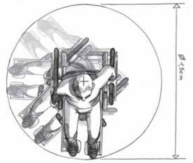


# Bibliographie

<span lang="en">EN 15531-1, Public transport - Service interface for real-time
information relating to public transport operations - Part 1: Context
and framework</span>

<span lang="en">EN 15531-2, Public transport - Service interface for real-time
information relating to public transport operations - Part 2:
Communications infrastructure3</span>

<span lang="en">EN 15531-3, Public transport - Service interface for real-time
information relating to public transport operations - Part 3: Functional
service interfaces4</span>

<span lang="en">CEN/TS 15531-4, Public transport - Service interface for real-time
information relating to public transport operations - Part 4: Functional
service interfaces: Facility Monitoring</span>

<span lang="en">CEN/TS 15531-5, Public transport - Service interface for real-time
information relating to public transport operations - Part 5: Functional
service interfaces - Situation Exchange</span>

Étude CAMERA:
<http://www.predim.org/IMG/pdf/rapport_etude_camera_2015.pdf> *(note:
cette étude ne porte que sur les modes de surface)*

<span lang="en">EN 28701, Intelligent transport systems - Public transport -
Identification of Fixed Objects in Public Transport (IFOPT)</span>

Standard CNIG Accessibilité du cheminement en voirie : 
http://cnig.gouv.fr/IMG/documents_wordpress/2022/05/220504_Standard_CNIG_Accessibilite_v2022-05.pdf 
(v2021-10 rev. 2022-05)

Documentation collaborative sur la cartographie des cheminements piétons
et de l'accessibilité dans OpenStreetMap : 
https://wiki.openstreetmap.org/wiki/FR:Cheminements_pi%C3%A9tons

Règles de conversion vers le présent profil, depuis OpenStreetMap et depuis le standard CNIG Accessibilité :
https://doc.transport.data.gouv.fr/documentation/normes-europeennes/accessibilite
