# Domaine d'application

Le Profil France NeTex pour les nouveaux modes concerne spécifiquement l'échange de données de référence pour soutenir les "nouveaux" modes alternatifs pour les services de mobilité, en ajoutant certains nouveaux concepts au schéma NeTEx (indiqués comme NeTEx v1.2.2), mais aussi en utilisant dans une large mesure des éléments de schéma existants définis dans les parties 1, 2 et 3 de NeTEx.

La conception de haut niveau pour le soutien aux modes alternatifs est dérivée d'un modèle conceptuel pour les modes alternatifs CEN PT1711 (CEN/TS 17413:2020) préparé par le groupe de travail TC278 WG17 de CEN. Cette spécification technique CEN décrit un modèle conceptuel pour les modes alternatifs comme une extension de Transmodel V6.0 et basé sur un ensemble détaillé de cas d'utilisation tirés de CEN PT1711, fournis en annexe A.

Le format NeTEx concerne un sous-ensemble des cas d'utilisation pour les données de référence (les cas d'utilisation en temps réel sont couverts par des protocoles dynamiques tels que SIRI et DATEX II). En général, il concerne les données pour les objectifs suivants :

- Permettre l'intégration des segments de voyage effectués avec des modes alternatifs avec ceux effectués avec des modes conventionnels dans des plans de voyage sans couture ;
- Décrire les zones de couverture des services de mobilité par modes alternatifs afin que les moteurs de planification de voyages et d'autres systèmes puissent informer les passagers de la possibilité de les utiliser et fournir des liens appropriés pour invoquer les services dynamiques ;
- Localiser les points d'accès pour les services de modes alternatifs, tels que les points de stationnement, les stations de covoiturage, etc., y compris leur relation avec les points d'accès pour les modes conventionnels ;

NeTEx concerne principalement l'échange de données de référence pour permettre l'intégration de nouveaux modes avec d'autres données ; il ne décrit pas les services dynamiques.

# Références normatives

Les documents de référence suivants sont indispensables pour l'application du présent document. Pour les références datées, seule l'édition citée s'applique. Pour les références non datées, la dernière édition du document de référence s'applique (y compris les éventuels amendements).

CEN/TS 16614-1, Network and Timetable Exchange (NeTEx) - Part 1: Public transport network topology exchange format

CEN/TS 16614-2, Network and Timetable Exchange (NeTEx) - Part 2: Public transport scheduled timetables exchange format

CEN/TS 16614-3, Network and Timetable Exchange (NeTEx) - Part 3: Fare exchange format

CEN/TS 16614-5, Network and Timetable Exchange (NeTEx) - Part 5: Alternative Modes exchange format

EN 12896, Road transport and traffic telematics - Public transport - Reference data model (Transmodel)

Le profil France NeTex modes Alternatifs s'appuie sur les profils NeTex France mentionnés ci-après. Les informations décrites dans ces profil nationaux ne sont pas reprises dans ce document.

NeTex Profil France v2.3 - Parking

# Termes et définitions

Pour les besoins du présent document, les termes et définitions suivants s'appliquent. Une grande partie d'entre eux est directement issue de Transmodel et NeTEx.

NOTE Les termes spécifiquement introduits par le profil d'arrêt sont signalés par le mot (profil), en italique et entre parenthèses. Les définitions ci-dessous sont des traductions littérales du document normatif.

NOTE Les définitions ci-dessus sont des traductions littérales du document normatif.

**ACTUAL VEHICLE EQUIPMENT (équipement réel du véhicule)**

Cet élément permet de spécifier un équipement d'un type particulier effectivement disponible dans un véhicule donné.

**ALTERNATIVE MODE OF OPERATION** (Transmodel)

Tout mode d'exploitation annoncé publiquement différent du mode d'exploitation conventionnel, notamment le partage de véhicules, la location de véhicules et le covoiturage.

**BOOKING ARRANGEMENT** (Transmodel)

Ensemble des règles et informations décrivant les modalités selon lesquelles un service de transport peut être réservé, incluant les conditions de réservation, les délais, les moyens de contact et les procédures à suivre par l’usager.

**CAR MODEL PROFIL** (NeTEx)

Description structurée des caractéristiques d’un modèle de véhicule utilisé dans un service de transport, incluant ses propriétés techniques, ses capacités et ses équipements, afin de qualifier son usage dans le système de transport.

Selon le niveau de détail, cela peut inclure par exemple :

* capacité (nombre de places),
* type de motorisation (thermique, électrique, hybride),
accessibilité (PMR),
* équipements (climatisation, espace bagages, etc.).

**CAR POOLING SERVICE** (NeTEx)

Service de transport dans lequel plusieurs usagers partagent un véhicule privé pour effectuer tout ou partie d’un trajet commun, selon des conditions définies d’organisation, de mise en relation et d’exploitation.

**COMMON VEHICLE SERVICE**

Un SERVICE DE MOBILITE est en soi abstrait. Un SERVICE DE VEHICULES COMMUNS est une spécialisation d'un SERVICE DE MOBILITÉ impliquant des VÉHICULES.

Trois spécialisations d'un SERVICE DE VÉHICULES COMMUNS sont possibles :

- SERVICE DE LOCATION DE VÉHICULES : Offre de service de transport liée à la LOCATION DE VÉHICULES. Hors périmètre du présent profil,
- SERVICE DE PARTAGE DE VÉHICULES : Offre de service de transport liée au PARTAGE DE VÉHICULES.
- SERVICE DE VEHICULES PARTAGES (covoiturage) : Service de transport mettant en relation conducteur et passager(s) pour effectuer des trajets.

**CONVENTIONAL MODE OF OPERATION** (Transmodel)

Mode d'exploitation traditionnel proposé sous forme d'offre de transport programmée et/ou flexible, annoncée publiquement, s'appuyant sur un ensemble de caractéristiques :

- Les conducteurs sont des salariés ;
- La flotte appartient à une autorité, ou est détenue ou exploitée par un opérateur,
- La topologie du réseau est définie bien à l'avance et repose sur les lignes et les schémas de déplacement

**CYCLE MODEL PROFILE** (NeTEx)

Le PROFIL DU MODÈLE DE CYCLE décrit l'ÉQUIPEMENT installé à bord des cycles d'un MODÈLE DE CYCLE spécifique

**FLEET (Flotte)**- (Transmodel)

Une flotte appartient à une organisation de transport, un organisme légalement constitué lié à tout aspect du système de transport. Une organisation de transport peut posséder plusieurs flottes.

**MOBILITY CONSTRAINT ZONE** (NeTEx)

Une ZONE DE CONTRAINTE DE SERVICE DE MOBILITE définit des restrictions de déplacement au sein d'une zone pour un MODE DE FONCTIONNEMENT donné.

**MOBILITY SERVICE** (Transmodel)

Service de transport alternatif disponible sur un territoire étendu, par exemple le covoiturage, la location, etc.

**MODE OF OPERATION**

Un des trois types de mode d'exploitation parmi ;

- Les modes d'exploitation conventionnels,
- Les modes d'exploitation alternatifs
- Les modes d'exploitation personnels

**ONLINE SERVICES** (NeTEx)

L'entité SERVICE EN LIGNE représente tout service accessible à distance permettant d'accéder à tout mode de transport et/ou à des informations relatives aux services de transport.

**ONLINE SERVICES OPERATOR** (Exploitant de services en ligne) (NeTEx)

Organisation responsable de la fourniture et de l’exploitation de services numériques permettant l’accès, la réservation, l’information ou la vente de services de transport via des canaux en ligne.

**PARKING** (parking) (Transmodel)

Emplacements désignés pour stationner des véhicules tels que des voitures, des motos et des vélos.

**PARKING AREA** (zone de parking) (Transmodel)

Zone identifiée à l'intérieur d'un parking, et contenant des places de stationnement (PARKING BAYs).

**PARKING AREA CAPACITY ASSIGNMENT** (NeTEx)

Association qui définit l’allocation d’une capacité de stationnement à une aire de stationnement donnée, en précisant comment une capacité (totale ou partielle) est affectée à un usage, un type de véhicule ou un service spécifique.

**PARKING BAY** (place de stationnement) _(Transmodel)_

Emplacement où l'on peut stationner un (unique) véhicule.

**PERSONAL MODE OF OPERATION** _(Transmodel)_

Mode de d'exploitation privé excluant toute utilisation annoncée publiquement.


**SERVICE ACCES CODE** (Code d’accès à un service)(NeTEx)

Code définissant une condition ou une règle d’accès applicable à un service de transport, précisant les restrictions, permissions ou modalités d’utilisation associées à ce service.

**SERVICE PROFILE QUALIFICATION** (NeTEx)

Ensemble des attributs ou critères permettant de qualifier un profil de service de transport, afin de décrire ses caractéristiques fonctionnelles, opérationnelles ou commerciales et de le distinguer d’autres profils de service.

**SIMPLE VEHICLE TYPE** _(NeTex)_

Définit les exigences applicables à un véhicule utilisé pour fournir des services de modes alternatifs.

Il peut inclure des caractéristiques empruntées à d'autres types de véhicules (par exemple : vélos, trottinettes, scooters).

**TRANSPORT TYPE** _(NeTex)_

Un **TRANSPORT TYPE** peut être associé à un **VEHICLE MODEL**, qui décrit un ensemble de propriétés répondant à un **VEHICLE EQUIPMENT PROFILE**.

Chaque véhicule possède :

- un TRANSPORT TYPE,
- un VEHICLE MODEL.

**USER PROFILE QUALIFICATION** (Transmodel)

Ensemble des attributs ou critères permettant de qualifier un profil d’utilisateur de transport, afin de déterminer ses droits, conditions d’accès ou avantages applicables dans le cadre d’un système de transport.

**VEHICULE CHARGING EQUIPMENT** (NeTEx)

L'EQUIPEMENT DE RECHARGE DE VEHICULE est une spécialisation de l'EQUIPEMENT DE LIEU indiquant la disponibilité de la recharge de véhicule.

**VEHICLE MEETING PLACE** (NeTEx)

Lieux où les véhicules/voyageurs/conducteurs se rencontrent pour changer de mode de transport, pour embarquer, débarquer, prendre en charge, déposer, etc. Un LIEU DE RENCONTRE DE VEHICULES peut être associé à un SITE spécifique (tel qu'un LIEU D'ARRÊT ou un POINT D'INTéRÊT) ou à tout composant du SITE

**VEHICLE MODEL** (Transmodel)

Classification des véhicules de transport public d'un même type selon l'équipement ou la génération de modèle.

**VEHICLE MODEL PROFILE** (NeTEx)

Le PROFIL DU MODÈLE DE VEHICULE décrit l'EQUIPEMENT installé à bord des VEHICULES d'un MODÈLE DE VEHICULE spécifique

**VEHICLE POOLER PROFIL**

Ensemble des caractéristiques décrivant un utilisateur ou un acteur qui met un véhicule à disposition dans un service de covoiturage, permettant de qualifier son rôle, ses droits et ses conditions de participation au service.

**VEHICLE SHARING** (Transmodel)

Partage de véhicule à court terme où le véhicule peut être pris et stationné à différents endroits de la zone urbaine, souvent sans la contrainte de ramener le véhicule à un endroit spécifique dédié.

**Vehicle Pooling** (Transmodel)

Mode particulier d’exploitation d’un véhicule appartenant à un particulier, consistant à partager le véhicule pour un trajet entre un conducteur désigné, déjà engagé dans le trajet, et au moins un autre voyageur.

**VEHICLE POOLING MEETING PLACE** (Lieu de rencontre pour covoiturage) (Transmodel)

Lieu défini où les participants d’un service de covoiturage se rencontrent pour débuter ou organiser un trajet commun.

**VEHICLE POOLING PARKING BAY** (Emplacement de parking pour covoiturage) (Transmodel)

Emplacement de stationnement dédié ou identifié au sein d’une aire de stationnement, destiné à l’usage des véhicules participant à un service de covoiturage.

**VEHICLE POOLING PARKING AREA** (zone de parking pour covoiturage) (Transmodel)

Zone de stationnement dédiée ou qualifiée pour l’usage des véhicules participant à un service de covoiturage (vehicle pooling), permettant d’organiser et de restreindre l’utilisation de l’aire à ce type de service.

**VEHICLE SERVICE PLACE ASSIGNEMENT**

Association définissant l’affectation d’un lieu de service à l’usage des véhicules dans le cadre d’un service de transport, précisant les conditions dans lesquelles ce lieu peut être utilisé pour l’embarquement, le débarquement ou l’exploitation du service.

**VEHICLE SHARING PLACE ASSIGNEMENT**

Association définissant l’affectation d’un lieu à un service de partage de véhicule, précisant les conditions dans lesquelles ce lieu peut être utilisé pour la prise, la restitution ou l’exploitation de véhicules partagés.

**VEHICLE SHARING PARKING AREA** (zone de parking pour véhicule partagé) (NeTEx)

Zone identifiée à l'intérieur d'un parking dédié au véhicules partagés, et contenant des places de stationnement (PARKING BAYs).

**VEHICLE SHARING PARKING BAY** (place de stationnement pour véhicule partagé) _(Transmodel)_

Emplacement où l'on peut stationner un (unique) véhicule partagé.

**VEHICLE SHARING PLACE ASSIGNEMENT** (NeTEx)

Une ATTRIBUTION DE PLACE DE PARTAGE DE VEHICULE peut être utilisée pour attribuer des ZONES DE STATIONNEMENT et des PLACES DE STATIONNEMENT spécifiques à utiliser par un service donné.

**VEHICLE SHARING SERVICE** (NeTEx)

Service de transport permettant à des utilisateurs d’accéder à des véhicules partagés, généralement en libre-service ou sur réservation, selon des conditions d’utilisation définies par un opérateur.

**VEHICLE SHARING TYPE** (NeTEx)

Type définissant la catégorie ou le mode de fonctionnement d’un service de partage de véhicules, caractérisant la manière dont les véhicules sont mis à disposition et utilisés par les usagers.

**VEHICLE TYPE** _(NeTex)_

Définit les exigences applicables à un véhicule programmé pour le transport de passagers. Ces exigences peuvent inclure :

- **Exigence de transport de passagers** : capacité en passagers fauteuil roulant, etc.).
- **Exigence de manœuvrabilité** : contraintes liées à la capacité de manœuvre du véhicule.
- **Exigence d'équipements** : installations requises à bord (accessibilité, siège bébé, etc.).

**VEHICLE TYPE ZONE RESTRICTION** (Type de Zone de restriction de circulation)(NeTEx)

Règle définissant les restrictions applicables à un type de véhicule dans une zone géographique donnée, précisant si ce type de véhicule est autorisé, limité ou interdit dans cette zone.

# Symboles et abréviations

**LOM** : Loi d'orientation des mobilités

**NeTEx** : Network Timetable Exchange

**NM** : Nouveaux Modes

**SIRI** : Service Interface for Real Time Information.

**XSD** : XML Schema Definition

# Exigences minimales liées au code des transports et la règlementation européenne

La mise à disposition des données, quand elles existent, est obligatoire et se conforme aux exigences :

- Au niveau européen, du règlement délégué (UE) 2017/1926 de la Commission du 31 mai 2017 modifié par le règlement délégué (UE) 2024/490 de la Commission du 29 novembre 2023 (&lt;<https://eur-lex.europa.eu/eli/reg_del/2017/1926/2024-03-04>&gt;), dit "règlement MMTIS" ;
- Au niveau français, des articles L. 1115-1 à L. 1115-7 , D. 1115-1, R. 1115-2 à R. 1115-8 et D. 1115-9 à D. 1115-11 du code du transports, notamment créés ou modifiés par les articles 25 et 27 de loi n° 2019-1428 du 24 décembre 2019 d'orientation des mobilités, dites loi « LOM ».

Ces mêmes articles de la LOM précisent le calendrier de mise à disposition des données.

Le tableau ci-dessous résulte de l'analyse du code des transports et du règlement MMTIS et fournit la liste des concepts concernés dans le présent profil correspondant aux données mentionnées dans l'annexe du règlement. Il sera donc nécessaire de fournir ces données pour être conforme au cadre réglementaire (il s'agit bien de mettre à disposition toutes les données existantes dans les SI transport, et non de créer des données qui n'existeraient pas encore sous forme informatique).

Notez que beaucoup de concepts dépendent des concepts issus de Transmodel/NeTEx et sont liés entre eux, soit par héritage, soit par relation au sens UML des termes. Par ailleurs, certains concepts additionnels peuvent relever d'autres parties du profil France précisés dans le tableau le cas échéant.

De plus, les noms des catégories (colonnes Catégorie et Détail) ont été conservés dans la langue originale du document (l'anglais) pour éviter tout risque de confusion.

La première colonne reprend la notion de _\*niveau\*_ tel qu'il est décrit et utilisé par le règlement européen et a notamment une incidence sur le calendrier de mise à disposition de la donnée (voir le règlement pour plus de détails).

Les différents concepts retenus ne sont bien sûr pas détaillés dans ce tableau, mais dans le profil lui-même. C'est aussi dans la description du profil que l'on trouvera les détails concernant les attributs (obligatoire/facultatif, règles de remplissage, codification, etc.).

Pour ce qui est des attributs facultatifs, la règle reste que, pour les objets ci-dessous, toute information disponible est supposée être fournie (mais on ne crée pas d'information si elle n'est pas disponible).

L'attente du règlement délégué est très vaste et ne permet malheureusement pas de réaliser une sélection de concepts dans ce que propose NeTEx (qui est de plus très vaste).

| **Niveau** | **Catégorie** | **Détail** | **Concept** | **Autre Concept** |
| --- | --- | --- | --- | --- |
| 2   | Recherche de localisation (origine/destination) | Identifiants d'adresse (numéro de bâtiment, nom de rue, code postal) | ENTRANCE (VéHICULE et PASSAGER) PARKING |     |
| 2   | Recherche de localisation (modes à la demande) | \- Arrêts Park & Ride<br><br>\- Stations de partage de vélos<br><br>\- Stations de covoiturage<br><br>\- Stations de ravitaillement accessibles au public (stations de recharge pour véhicules électriques) | PARKING<br><br>PARKING AREA<br><br>VEHICLE CHARGING EQUIPMENT |     |
| 2   | Service d'information | Où et comment acheter des billets pour les modes programmés, modes à la demande et le stationnement (tous modes programmés et à la demande, incluant canaux de vente, méthodes de distribution, modes de paiement) | PARKING (attributs relatifs à la tarification) |     |
| 3   | Service d'information (tous modes) | Comment réserver le covoiturage, les, la vélos partage, etc. (incluant canaux de vente, méthodes de distribution, modes de paiement) | BOOKING ARRANGEMENTS |     |
| 3   | Service d'information (tous modes) | Où et comment payer le stationnement, les stations de recharge publiques pour véhicules électriques et les points de ravitaillement pour véhicules au GNC/GNL, hydrogène, essence et diesel (incluant canaux de vente, méthodes de distribution, modes de paiement) |     |     |
| 1   | Types des données routières statiques | Localisation des places de stationnement et zones de service | **PARKING** | **PARKING AREA** |
| 1   | Types des données routières statiques | Localisation des points de recharge pour véhicules électriques et conditions d'utilisation | VEHICLE CHARGING EQUIPMENT |     |

_Table 1 - Concepts relatifs à la LOM et à la Règlementation Européenne_

# Description du profil d'échange

## Conventions de représentation

### Tableaux d'attributs

**NOTE** les choix de conventions présentées ici ont pour vocation d'être cohérents avec ceux réalisés dans le cadre du profil SIRI (Île-de-France Mobilités et CEREMA). De plus tous les profils NeTEx partagent les mêmes conventions.

Les messages constituant ce profil d'échange sont décrits ci-dessous selon un double formalisme: une description sous forme de diagrammes XSD (leur compréhension nécessite une connaissance préalable de XSD: XML Schema Definition) et une description sous forme tabulaire. Les tableaux proposent ces colonnes:

| Classification | Nom | Type | Cardinalité | Description |
| --- | --- | --- | --- | --- |

**Classification** : permet de catégoriser l'attribut. Les principales catégories sont:

PK (Public Key) que l'on peut interpréter comme Identifiant Unique: il permet à lui seul d'identifier l'objet, de façon unique, pérenne et non ambiguë. C'est l'identifiant qui sera utilisé pour référencer l'objet dans les relations.

AK (Alternate Key) est un identifiant secondaire, généralement utilisé pour la communication, mais qui ne sera pas utilisé dans les relations.

FK (Foreign Key) indique que l'attribut contient l'identifiant unique (PK) d'un autre objet avec lequel il est en relation.

GROUP est un groupe XML nommé (ensemble d'attributs utilisables dans différents contextes) (cf: <http://www.w3.org/TR/2001/REC-xmlschema-0-20010502/#AttrGroups> )

**Nom** : nom de l'élément ou attribut XSD

**Type** : type de l'élément ou attribut XSD (pour certains d'entre eux, il conviendra de se référer à la XSD NeTEx)

**Cardinalité** : cardinalité de l'élément ou attribut XSD exprimée sous la forme "**_minimum:maximum_**" ("0:1" pour au plus une occurrence; "1:\*" au moins une occurrence et sans limites de nombre maximal; "1:1" une et une seule occurrence; etc.).

Description : texte de description de l'élément ou attribut XSD (seul les attributs retenus par le profil ont un texte en français; les textes surlignés en jaune indiquent une spécificité du profil par rapport à NeTEx).

Les textes surlignés en jaune sont ceux présentant une particularité (spécialisation) par rapport à NeTEx: une codification particulière, une restriction d'usage, etc.

Les textes surlignés en bleu correspondent à des éléments de NeTEx non retenus dans le cadre de ce profil (présentés à titre informatif donc). Dans les diagrammes XSD, les éléments et attributs apparaissant sur fond bleu sont ceux qui ne sont pas retenus par le profil (et ce sont donc systématiquement des éléments ou attributs facultatifs de NeTEx).

La description XSD utilisée est strictement celle de NeTEx, sans aucune modification (ceci explique notamment que tous les commentaires soient en anglais).

Les attributs et éléments rendus obligatoires dans le cadre de ce profil restent facultatifs dans l'XSD (le contrôle de cardinalité devra donc être réalisé applicativement).

### Valeurs de code de profil

Dans la mesure du possible, le profil sélectionne les valeurs de code à utiliser pour caractériser des éléments et les limite à un ensemble de valeurs documentées. NETEX propose plusieurs mécanismes différents pour spécifier les valeurs de code autorisées:

- Des énumérations fixes définies dans le cadre du schéma XSD NeTEx. Le profil impose alors un sous-ensemble des codes NeTEx.
- Des spécialisations de TYPE OF VALUE, utilisées pour définir des ensembles de codes ouverts pouvant être ajoutés au fil du temps sans modifier le schéma, par exemple, pour enregistrer des classifications d'entités héritées. Le profil lui-même utilise le mécanisme TYPE OF VALUE dans quelques cas pour spécifier des codes normalisés supplémentaires : ceux-ci sont affectés à un CODESPACE «FR_IV_metadata» (<https://netex-cen.eu/FR_IV>) indiqué par un préfixe «FR_IV». (par exemple, «FR_IV: monomodal».
- Des instances TypeOfFrame: le profil utilise plusieurs TYPES DE FRAME pour spécifier l'utilisation de VERSION FRAME dans le profil.

### Indication des classes abstraites

NeTEx, et Transmodel, utilisent largement l'héritage de classe; cela simplifie considérablement la spécification en évitant les répétitions puisque les attributs partagés sont déclarés par une superclasse et que des sous-classes viennent ensuite les spécialiser sans avoir à répéter ces attributs et en n'ajoutant que ceux qui lui sont spécifiques. La plupart des superclasses sont «abstraites» - c'est-à-dire qu'il n'existe aucune instance concrète; seules les sous-classes terminales sont «concrètes».

Un inconvénient de l'héritage est que si l'on veut comprendre les propriétés d'une classe concrète unique, il faut également examiner toutes ses super-classes. Pour cette raison, le profil inclut les classes abstraites nécessaires pour comprendre les classes concrètes, même si ces classes concrètes ne sont jamais directement instanciées dans un document NeTEx.

- Les super-classes sont signalées dans les en-têtes par le suffixe «_(abstrait)_»
- Dans les diagrammes UML (comme pour NeTEx et Transmodel), les noms des classes abstraites sont indiqués en italique et les classes abstraites sont de couleur gris clair.
- Certaines super-classes ne sont techniquement pas abstraites dans NeTEx, mais ne sont pas utilisées comme classes concrètes dans le profil : elles sont signalées avec la même convention que les classes abstraites.

### Classes de sous-composants

Un certain nombre de classes ont des sous-composants qui constituent leur définition. Celles-ci fournissent des détails auxiliaires (par exemple, AlternativeText, AlternativeName, TrainComponent) et sont signalées dans les en-têtes par le suffixe « _(objet inclus)_ ».

## Les éléments non définis dans l'offre des service (réseau et horaires)

Sans Objet

# Concepts de base pour la description des modes de transport alternatif

Le terme 'mode' désigne tout moyen de transport utilisé ou disponible. Il est divisé en 'mode véhicule' et 'mode d'accès'.

Le 'mode véhicule' est une caractérisation de l'exploitation du transport public selon le moyen de transport, par exemple, bus, tramway, métro, train, ferry, bateau ou vélo.

Le 'mode d'accès' (par exemple, la marche, le cyclisme, la conduite de voiture privée, etc.) est une caractérisation du mouvement du voyageur (par exemple, marcher, faire du vélo, etc.) lui permettant d'atteindre le 'mode véhicule' ou de réaliser un voyage complet.

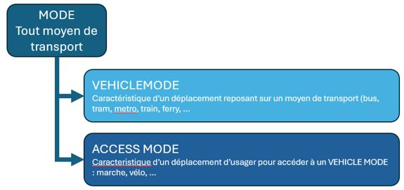

Une distinction est faite entre le 'mode véhicule' et le 'type de véhicule'. Chaque 'mode véhicule' peut correspondre à une gamme de 'types de véhicules' (par exemple, pour le 'mode véhicule' 'autobus', on peut avoir des types comme 'standard', 'articulé', 'minibus', 'à deux étages').

Une catégorisation plus fine des modes de transport est fournie par le concept de 'sous-mode', qui est une variante d'un 'mode'. Par exemple, pour le mode 'rail', les sous-modes possibles sont 'rail international' ou 'rail domestique' ; pour le mode 'autobus', l'exemple de sous-mode est 'autobus régional', pour le mode 'voiture', les exemples de sous-modes sont 'voiture électrique', 'voiture conventionnelle', 'voiture autonome'.

Les modes et sous-modes définis comme des 'moyens de transport' peuvent être caractérisés en termes de types de fonctionnement, c'est-à-dire des façons dont ils sont opérés.

Ce document distingue les types suivants de 'mode de fonctionnement' :

- **Mode de fonctionnement conventionnel** : le mode de fonctionnement traditionnel qui est proposé sous forme d'une offre de transport public annoncée et/ou flexible, selon un horaire fixe et/ou flexible. Ce mode de fonctionnement suit soit un horaire et des itinéraires fixes, soit est lié à un réseau/horaires fixes mais offre de la flexibilité, afin d'optimiser par exemple le service ou de répondre à la demande des passagers ;
- **Mode alternatif de fonctionnement** : tout mode de fonctionnement public annoncé différent du mode de fonctionnement conventionnel, notamment le partage de véhicules, la location de véhicules et le covoiturage ;
- **Mode personnel de fonctionnement** : un mode de transport privé excluant toute utilisation publiquement annoncée.

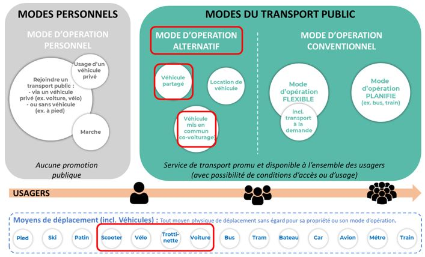

Le champ d'application de ce document concerne le mode de fonctionnement alternatif, à l'exception de la location de véhicules. La distinction entre les modes de fonctionnement alternatif et conventionnel repose sur le fait qu'un mode conventionnel repose sur un ensemble de caractéristiques : les conducteurs sont des employés, la flotte est détenue par un opérateur ou une autorité, et la topologie du réseau est définie à l'avance et repose sur des lignes et des modèles de trajets ; tandis que les modes alternatifs peuvent ne pas remplir une ou plusieurs de ces caractéristiques.

Ce document concerne le mode alternatif de fonctionnement.

# Cas d'utilisation & Concepts rattachés

La prise en charge par NeTEx des modes alternatifs vise à inclure l'échange de données de référence afin de permettre une information voyageur intégrée pour tous les modes. L'échange de données dynamiques, telles que les statuts et prévisions en temps réel, les offres de trajets en temps réel, etc., sera couvert par d'autres API pour les fonctions dynamiques liées aux modes alternatifs qui ne relèvent pas du champ d'application de NeTEx, mais qui sont incluses dans le périmètre de Transmodel et, pour la plupart, couvertes par SIRI pour l'échange de données.

Le champ de couverture du profil France Nouveaux Modes partie Statique inclut les cas d'utilisation suivants. Pour les aspects tarification et parking, il convient de se reporter aux profils France NeTEx associés.

## Description du réseau

| **Cas d'utilisation** | **Description** | **éléments de modélisation concernés dans ce document** |
| --- | --- | --- |
| Recherche de localisation : Parc-relais | Trouver l'emplacement d'un parc-relais | **PARKING** |
| Recherche de localisation : Stations de vélopartage | Trouver une station de vélopartage | **STOP PLACE**, **SITE** |
| Recherche de localisation : Stations d'autopartage | Trouver une station d'autopartage | Modèle **PARKING** |
| Recherche de localisation : Stations de ravitaillement accessibles au public pour véhicules à combustion, stations de recharge pour véhicules électriques | Trouver des stations de ravitaillement accessibles au public<br><br>**NB** : les détails sont définis dans le Profil FR Parking | **PARKING MODEL**, |
| Recherche de localisation : Stationnement sécurisé pour véhicules | Trouver des stationnements sécurisés pour vélos et autres types de véhicules, y compris horaires d'ouverture et durées de stationnement autorisées | Modèle **PARKING** |
| Véhicules disponibles | Fourniture de services avec des véhicules enregistrés | Modèles **FLEET** et **VEHICLE MODE** |
| Couverture de service | Disponibilité d'un service alternatif dans une zone donnée | **MOBILITY SERVICE** |
| Découverte de services | Services en ligne disponibles | **ON-LINE SERVICE** |

_Table 2 - Cas d'utilisation Description du réseau_

## Planification de trajets Multi Modes (yc NM)

À compléter ultérieurement

## Informations relatives aux trajets

| **Cas d'utilisation** | **Description** | **éléments de modélisation concernés dans ce document** |
| --- | --- | --- |
| équipements et services disponibles (Siège Auto, Navigation, Nombre de places, …) | équipements que le voyageur peut trouver dans le mode alternatif | **FACILITY SET**, **FACILITY**, **EQUIPMENT** |
| Comment réserver un service d'autopartage, un vélo en libre-service, etc. | Inclut les canaux de vente, les méthodes de délivrance, les moyens de paiement | **BOOKING ARRANGEMENTS** |
| Comment accéder à un véhicule | Procédures d'accès à un véhicule partagé | **SERVICE ACCESS CODE**, **VEHICLE ACCESS ASSIGNMENT** |
| Où et comment payer pour un stationnement, un plein d'hydrogène, de carburant ou une recharge électrique | Inclut les canaux de vente, les méthodes de délivrance, les moyens de paiement | **BOOKING ARRANGEMENTS**, **TICKETING EQUIPMENT**, CHARGING EQUIPEMENT |

_Table 3 - Cas d'utilisation Information générale_

# Description fonctionnelle

À la suite d'un mode de fonctionnement alternatif, de **nouveaux services** sont proposés et mis en œuvre à destination des voyageurs.

Cette section décrit ces **nouveaux services** à travers certains aspects et fonctions qui les caractérisent.

Les **deux aspects suivants** sont particulièrement pertinents :

- **Types de véhicules** : vélos, voitures, types de vélos, types de voitures, etc., caractérisés en particulier par leur **équipement**,
- **Modes de fonctionnement** : covoiturage, partage, location, usage personnel,

Les **domaines fonctionnels** principalement concernés par les modes alternatifs sont regroupés dans les catégories suivantes :

- **Fourniture d'informations (au voyageur)** : activités consistant à fournir au voyageur des informations sur les règles et conditions liées à un service de transport,
- **Services aux voyageurs** : activités (généralement initiées par les utilisateurs) visant à faciliter ou permettre un déplacement,
- **Services opérationnels** : activités réalisées par les acteurs responsables de l'exploitation d'un service.

Les sections suivantes décrivent plus en détail les **domaines fonctionnels**, en les présentant selon les **fonctions (activités)**, avec une courte définition de chaque fonction.

Comme mentionné précédemment au point 0, l'objectif principal des sections suivantes est **d'illustrer le périmètre du modèle conceptuel de données développé**, en mettant l'accent sur la **fourniture d'informations**.

Les **spécificités de chaque mode de fonctionnement particulier** sont décrites dans les sections correspondantes (partage de vélos, vélo, covoiturage, partage de voitures).

## Fonctions relatives à la mise à disposition d'informations aux voyageurs

Les fonctions suivantes sont consacrées à la fourniture d'informations aux voyageurs. Dans la plupart des cas, la fourniture d'informations peut être générale (concernant une zone entière) ou spécifique, liée à une requête particulière d'un utilisateur avec des paramètres définis.

### Informations sur la réservation

Cette activité consiste à fournir des informations sur les règles de réservation ainsi que des données complémentaires permettant à l'utilisateur de décider de réserver un service. Les informations suivantes sont considérées comme pertinentes :

- Méthodes de réservation : description du mode de réservation (par Internet, via une agence, etc.)
- Conditions de réservation : délai minimal de réservation, nécessité d'une garantie, etc.
- Coordonnées de contact : URL, adresse, etc. pour contacter le service de réservation
- Nombre/type de véhicules disponibles par station ;
- Règles d'utilisation : conditions temporelles, lieux de prise en charge et de restitution, pénalités, profil utilisateur, etc.

### Informations sur la disponibilité du service

Cette activité consiste à fournir des informations sur la disponibilité d'un mode de fonctionnement particulier, par exemple les heures d'ouverture

### Informations sur la disponibilité des véhicules des modes alternatifs

Cette activité consiste à fournir des informations, statiques (ou dynamiques), sur la disponibilité de véhicules dans les zones dédiées aux modes alternatifs.

- L'information statique correspond à la capacité prévue des zones.
- L'information dynamique (présence réelle de véhicules disponibles) peut être dérivée des données de localisation des véhicules et des données prévues de disponibilité.

### Informations sur l'accès à l'infrastructure

Cette activité consiste à fournir des informations indiquant où et comment accéder à un emplacement dédié à un mode alternatif (partage de véhicule), et où restituer le véhicule après usage. L'information est statique.

### Informations sur la localisation des véhicules

Cette activité consiste à fournir des informations dynamiques indiquant où trouver un véhicule ou où il a été déposé.

### Informations sur l'accès au véhicule

Cette activité consiste à fournir des informations expliquant comment déverrouiller un véhicule avant usage et comment le sécuriser après usage, en particulier pour les services de partage. Les informations peuvent être statiques ou dynamiques.

### Informations tarifaires

Cette activité consiste à fournir des informations sur les règles tarifaires, les formules de prix (à l'heure, à la semaine, au mois), les réductions, etc. L'information est généralement statique.

### Informations sur le paiement

Cette activité consiste à fournir des informations sur les moyens et méthodes de paiement, ainsi que les lieux de paiement. L'information est généralement statique.

Elle comprend :

- Méthodes de paiement : espèces, carte bancaire, paiement mobile, etc.
- Garanties de paiement : garantie par carte bancaire, coordonnées bancaires, enregistrement d'identité.

### Informations sur l'équipement des zones de modes alternatifs

Cette activité consiste à fournir des informations sur les équipements présents dans les emplacements dédiés aux modes alternatifs : installations de stockage sécurisé, stations de recharge, mais aussi bornes de billetterie, guichets d'information, etc.

Les informations peuvent être statiques (présence prévue) ou dynamiques (état actuel de fonctionnement).

### Informations sur les parkings des modes alternatifs

Cette activité consiste à fournir des informations sur les zones de stationnement où un véhicule peut être garé et laissé sans surveillance, ainsi que sur le nombre de places disponibles pour le dépôt. Cette information est dynamique.

### Informations sur l'inscription

Cette activité consiste à fournir des informations sur le processus d'inscription pour être reconnu comme utilisateur du service.

Les informations pertinentes sont :

- Informations d'identité : nom, prénom, date et lieu de naissance, adresse de résidence
- Coordonnées : adresse e-mail du service, numéro de mobile et adresse e-mail de l'utilisateur
- Informations supplémentaires : données de paiement (carte bancaire, compte bancaire) - principalement utilisées comme garantie de paiement.

### Informations sur les services de réparation

Cette activité consiste à fournir des informations sur les lieux où la réparation et/ou la maintenance des véhicules est possible. Une description des réparations possibles peut être fournie (ex. : réparation de crevaisons, remplacement de chaîne, réparation d'éclairage). Ces informations peuvent être statiques ou dynamiques (disponibilité en temps réel).

## Services aux voyageurs

Les paragraphes suivantes donnent des exemples de services aux voyageurs. Cette liste n'est pas exhaustive, mais fournit des exemples typiques rencontrés dans le contexte des nouveaux modes. Par exemple, les fonctions d'aide au voyage comme la planification d'itinéraire ne sont pas décrites ici, car elles sont largement couvertes par les normes liées aux modes conventionnels.

### Réservation

La réservation est un service aux voyageurs (électronique ou non) dédié à la réservation d'un véhicule ou d'un trajet à une date et heure définie dans le cadre de la mobilité urbaine.

### Inscription

L'inscription est un service aux voyageurs considéré comme l'identification initiale, virtuelle ou physique, de l'utilisateur pour accéder à un service de transport. Elle peut être effectuée à distance via une plateforme Internet (PC ou mobile) ou physiquement dans des lieux spécifiques.

### Contrôle d'accès au véhicule

Service consistant à vérifier et à activer les mécanismes de déverrouillage et de verrouillage d'un véhicule utilisé dans le cadre d'un mode alternatif.

### Contrôle d'accès aux stations

Activité consistant à autoriser ou refuser l'accès à une station d'arrêt à des véhicules fonctionnant selon des modes alternatifs.

### Paiement

Le paiement est un service permettant de régler un service de transport. Dans le contexte des modes alternatifs, il s'effectue principalement par moyens électroniques.

### Planification de trajet

La planification de trajet est applicable au contexte du covoiturage.

Les outils modernes d'aide au déplacement permettent aux voyageurs de préparer leur trajet, notamment en répondant à une demande de trajet. Cette fonction identifie les lieux de départ et d'arrivée d'un voyage et propose une ou plusieurs solutions de déplacement, en prenant en compte les contraintes ou préférences de l'utilisateur (durée minimale, nombre d'interconnexions, tarif le plus bas, etc.).

Le système propose ensuite un modèle de trajet, incluant les transferts à pied ou en correspondance, ainsi que les différents modes de transport public et alternatifs. Il est possible de calculer une durée précise (ou moyenne), les coûts correspondants, la compatibilité avec les personnes à mobilité réduite, etc.

Si la demande concerne un trajet le jour même, les conditions suivies en temps réel peuvent être prises en compte pour affiner la proposition (ex. : perturbations, retards, annulations).

## Services opérationnels

### Transfert de véhicules

Activité consistant à transférer des véhicules à travers la ville, notamment pour assurer un bon équilibre entre les stations de partage de véhicules (disponibilité de véhicules et d'emplacements).

### Réparation et maintenance

Fourniture de services de réparation et d'entretien pour tous types de véhicules, dans des zones équipées d'outils et de pièces de rechange.

### Recharge et ravitaillement

Processus de recharge des véhicules électriques (par exemple dans une station de partage) et de ravitaillement en carburant des véhicules thermiques lorsque nécessaire.

## Partage de véhicules (Vehicle Sharing)

### Cycles

Ce paragraphe décrit certains aspects spécifiques supplémentaires liés au cyclisme.

Le cyclisme désigne l'utilisation d'un cycle par un utilisateur pour effectuer un déplacement. Dans le cadre du mode du partage de vélos (VLS).

La modélisation des informations liées au cyclisme peut être utilisée pour fournir des services aux voyageurs ; par exemple, les algorithmes existants de planification d'itinéraires peuvent utiliser des données relatives au cyclisme pour calculer des trajets multimodaux incluant la location et le partage de vélos.

Le partage de vélos repose sur une relation commerciale entre un utilisateur et une organisation mettant des vélos à disposition.

Les types de cycles suivants sont pris en compte dans ce document :

- **Cycle classique** : véhicule composé de roues attachées à un cadre. Il est propulsé par la force musculaire humaine ;
- **Cycle à propulsion électrique** : véhicule équipé d'un moteur électrique de faible puissance ; entrent dans cette catégorie les vélos électriques, mais aussi les gyropodes, hoverboards, monocycles motorisés, etc.

#### Partage de vélos

Le partage de vélos est un mode d'exploitation dédié à la location de vélos généralement de courte durée, dans lequel le vélo peut être pris et déposé à différents endroits, n'importe où en zone urbaine.

L'une des principales différences entre le partage de vélos et la location de vélos réside dans leur mode de fonctionnement. Le partage de vélos s'appuie sur un ensemble d'utilisateurs abonnés qui partagent le service, en général pour des trajets courts en durée ou en distance, moyennant un abonnement mensuel ou annuel fixe. Le tarif dépend d'un ensemble de paramètres, par exemple le « profil de voyageur fréquent ».

##### Réservation

Les services de partage de vélos offrent une réservation à court terme permettant aux utilisateurs de vérifier la station disponible la plus proche, de réserver un vélo et de s'enregistrer en peu de temps. Cependant, la plupart du temps, il n'y a pas de réservation à l'avance ; l'utilisateur prend un des vélos disponibles à la station la plus proche.

##### Tarifs et paiement

Dans le cadre du partage de vélos, dans la plupart des cas, les utilisateurs paient le service une seule fois lors de l'abonnement, puis chaque fois qu'ils ont utilisé le vélo au-delà de la durée gratuite de location.

##### Scénarios de disponibilité

Les scénarios suivants sont possibles selon le type de système de partage de vélos :

- **Docké (stationné)** : les vélos sont obtenus à partir d'un emplacement prédéterminé spécifique tel qu'une station de vélos où la station communique la disponibilité d'un vélo et enregistre quand il est pris et retourné ainsi que par qui. La station dispose de systèmes pour libérer un vélo au voyageur potentiel. Une station peut en fait avoir une capacité supérieure au nombre strict de docks si elle dispose de personnel capable d'apporter des véhicules supplémentaires depuis ou vers un stockage afin d'équilibrer la demande - ce que l'on appelle un « service voiturier ». Il peut être tout aussi important pour un utilisateur qu'il y ait un dock vide disponible pour rendre son vélo à la fin de son trajet, sinon il risque une recherche longue et même une pénalité pour utilisation prolongée.
- **Station virtuel** : Idem que le point précédent sans dock physique associé. Les cycles peuvent être obtenus / restitué dans des zones virtuelles définis par l'opérateur de transport.
- **Flottant (free-floating)** : pour les vélos d'un système de partage sans station, qui possèdent généralement un verrou d'immobilisation intégré à leur cadre, une station n'est pas nécessaire. Le vélo peut être laissé à n'importe quel endroit sûr dans la zone du service et être immobilisé ou réactivé à l'aide d'un code.

##### Géorepérage et zones d'usage autorisé

- La plupart des systèmes de partage de véhicules (vélos, trottinettes, voitures, etc.) fonctionnent uniquement dans une zone spatiale spécifique. Cette zone peut être indiquée via des cartes ou des informations aux usagers, ou, pour les véhicules équipés de systèmes d'immobilisation à distance, être appliquée électroniquement grâce à la détection GNSS.
- De plus, certaines zones à l'intérieur de la zone opérationnelle peuvent être restreintes pour des raisons opérationnelles, de sécurité ou autres, par exemple pour contrôler la pollution environnementale. Des sanctions financières peuvent être appliquées en cas de violation des limites restreintes à tout moment ou à des moments précis.
- Les zones autorisées peuvent être décrites à l'aide de zones de contraintes de mobilité, chacune exprimant une étendue spatiale et les usages permis.

### Voitures

#### Partage de Voiture

Le partage de voitures consiste en l'utilisation d'un véhicule appartenant à un fournisseur commercial de partage de voitures pour une durée spécifiée et préalablement convenue.

Le partage de voitures se distingue du covoiturage en ce que c'est le véhicule qui est partagé, et non un groupe de voyageurs utilisant simultanément le même véhicule pour effectuer un trajet.

Les principaux types de partage de voitures sont :

- Mise à disposition de véhicules par une organisation (partage commercial) ;
- Mise à disposition entre particuliers (club d'autopartage) ;
- Location de voitures classique.

Seule la gestion du premier type est intégrée au profil France NeTex.

Les types de voitures pris en compte dans ce document sont :

- Voitures conventionnelles : voitures de différentes tailles, équipements et types de boîte de vitesses utilisant un carburant liquide conventionnel (essence ou diesel) ; les voitures hybrides ne nécessitant pas de recharge peuvent aussi faire partie de cette catégorie ;
- Voitures à propulsion électrique : voitures nécessitant une recharge après les trajets ou à la fin de la période de partage ;

##### Partage commercial de voitures

Plusieurs types de partage commercial existent : Business to Business (B2B) et Business to Consumer (B2C). Seul le B2C est intégré au présent profil France -

Il est à noter que NeTEx permet de faire du B2B.

- Business to Consumer (B2C) : c'est le partage de voitures conventionnel, où une organisation dispose d'un parc de véhicules disponibles en partage aux consommateurs enregistrés sur demande.

##### Enregistrement

Pour la majorité des services commerciaux, l'utilisateur doit s'enregistrer auprès de la société de partage de voitures. Cet enregistrement permet de mettre en place un mode de paiement, d'enregistrer les informations du conducteur pour l'utilisation du service, et éventuellement un dépôt couvrant les risques en cas de dommages ou perte du véhicule. Cet enregistrement crée aussi les applications nécessaires pour accéder et utiliser le service.

##### Scénarios de disponibilité

Selon le type de partage de voitures, le véhicule peut se trouver à un emplacement prédéterminé (place de stationnement pour partage de voitures) ou à l'endroit où il a été laissé après son dernier usage. Plusieurs scénarios existent autour de ces deux conditions :

- **Boucle fermée** : la voiture est prise et rendue au même emplacement, aussi appelé « voyage en boucle à partir d'une station » ;
- **Aller simple** : la voiture est prise à un endroit et rendue à un autre emplacement prédéfini, aussi appelé « station de pool en libre-service » ;
- **Free floating (libre-service sans station)** : la voiture est prise là où elle a été laissée précédemment et rendue où le trajet se termine. L'application de partage guide l'utilisateur vers l'emplacement le plus proche ou accessible d'un véhicule adapté, également appelé « zone opérationnelle « free floating» ;
- Installations spéciales de docking (pour véhicules électriques).

Certains types de véhicules nécessitent des emplacements adaptés à leur type de carburant. Les véhicules électriques doivent être garés à des endroits équipés de bornes de recharge. Par conséquent, l'option free floating n'est pas toujours applicable.

##### Tarifs et paiement

Plusieurs modèles de paiement existent pour ce service :

- Service par abonnement donnant droit à un nombre d'utilisations et un kilométrage convenus ;
- Paiement au kilomètre, avec facturation basée sur les kilomètres parcourus ;
- Paiement au temps d'utilisation, facturant la durée pendant laquelle le véhicule est utilisé et indisponible pour d'autres ;
- Ou une combinaison des deux (temps et distance).

Le présent profil ne décrit pas les modalités de tarification. Le Profil NeTex France Tarif s'applique pour ces cas d'utilisation.

## Covoiturage

### Introduction

Le covoiturage consiste à partager des voitures particulières (ou éventuellement d’autres types de véhicules ou modes de transport) entre des voyageurs pour des trajets particuliers ou des portions de trajets (le plus souvent, le conducteur et les passagers ne partagent pas la même origine ni la même destination).

Dans le présent document, le covoiturage est considéré comme planifié et organisé, et non informel.

Le covoiturage n’est pas toujours organisé sur l’intégralité d’un trajet. En particulier pour les longs trajets, il est courant que les passagers ne participent qu’à une partie du parcours et versent une contribution proportionnelle à la distance parcourue.

### Covoiturage générique

Les conducteurs proposent une place pour des trajets spécifiques, à une date et une heure données, via un service en ligne (généralement un site web ou une application). Les passagers consultent ces offres et sélectionnent celle qui leur convient.

Différents algorithmes de mise en relation offre-demande sont disponibles. Une fois qu’un passager a trouvé une offre appropriée (qui peut concerner une partie du trajet proposé ou nécessiter une légère modification du parcours), un contact est établi entre le conducteur et le passager afin de convenir des détails du trajet.

La réservation finale (une fois tous les détails convenus) et le paiement peuvent varier selon le service de covoiturage utilisé.

### Covoiturage dynamique

\[Non retenu dans le cadre du profil France : Pas retenu pour L’instant 15/01/26\]. Ce n’est pas du planifé

Le covoiturage dynamique est similaire au covoiturage conventionnel, mais permet la mise en relation une fois le trajet commencé. Il est principalement adapté au contexte urbain (par opposition aux longues distances, généralement interurbaines et planifiées à l’avance).

### Fonctions du covoiturage

Les paragraphes suivants décrivent les fonctions du covoiturage

#### Tarification

\[Description A confirmer dans le profil FR\] 15/01/26 renvoyer vers le profil Tarif\] Permet de failre les abn

Le prix que le passager doit payer pour son trajet en covoiturage est censé couvrir une partie des coûts du conducteur (carburant, coûts du véhicule, etc.), mais ne constitue jamais un moyen pour le conducteur de réaliser un bénéfice (contrairement aux taxis et aux voitures avec chauffeur).

Le principe de base de la tarification consiste à calculer le prix en divisant la somme du carburant, des péages éventuels, de la dépréciation liée à l’achat et à l’entretien du véhicule, de l’assurance et des taxes payées par le conducteur, répartie entre les voyageurs proportionnellement à la distance parcourue par le passager et au nombre de personnes ayant partagé le véhicule.

Une tarification basée sur la distance a également été proposée par certains services de covoiturage (indépendamment du nombre de voyageurs, sur la base du nombre maximal de voyageurs).

Il est à noter que la tarification nécessite presque toujours un accord sur la distance du trajet avant le départ (la durée du trajet n’entre pas dans le calcul du prix). Le détour effectué par un conducteur pour prendre un passager doit également être pris en compte.

Il convient également de noter que la tarification n’a pas toujours lieu : dans certains cas, il peut s’agir d’un échange de services ou d’un accord pour être conducteur lors d’un trajet futur.

#### Preuve de covoiturage

\[Pas de preuve de portée par NeTex\] Intérêt

Pour être payé ou pour pouvoir bénéficier de certains avantages réservés aux conducteurs en covoiturage (par exemple le stationnement gratuit ou l’accès aux voies réservées aux véhicules à occupation multiple), le conducteur peut avoir besoin d’une preuve de covoiturage.

Cette preuve peut également être requise à des fins fiscales pour le conducteur (contrôle des revenus) ou pour le voyageur (preuve d’achat lorsqu’un remboursement est possible, par exemple pour les employés d’une entreprise).

Il n’est pas toujours possible d’obtenir une preuve de covoiturage et il n’existe pas de méthode totalement fiable pour l’obtenir. En pratique, cette preuve peut être une déclaration personnelle, dans laquelle le covoitureur atteste avoir effectivement pratiqué le covoiturage ce jour-là. Cette déclaration peut être vérifiée, par exemple en contrôlant les plaques d’immatriculation ou, sur des voies dédiées, en vérifiant le nombre de personnes à l’intérieur du véhicule.

#### Inscription

- Valable pour Partage & Covoiturage – Description de service Usage Parameter – Vehicle Sharing Service \[A intégrer dans le Profil\] -VehicleAccessCredential.

étant donné que le covoiturage est une activité de personne à personne, les services sont censés offrir un très haut niveau de confiance et de sécurité (sécurité personnelle, en plus de la sécurité financière).

Par conséquent, l’inscription implique le plus souvent plusieurs niveaux de vérification et de validation de l’identité, notamment :

- L’adresse e-mail (fournie pour mettre en relation deux utilisateurs) ;
- Le numéro de téléphone (fourni pour mettre en relation deux utilisateurs) ;
- Le lien vers un réseau social (afin que les utilisateurs puissent consulter le type d’activité sur un compte Facebook, par exemple) ;
- Le numéro de carte d’identité ou de passeport (seul le fait que la vérification a été effectuée est communiqué aux autres utilisateurs) ;
- Le permis de conduire et l’assurance.

#### Mécanismes de mise en relation et de réservation des trajets

\[Préciser si via Site ou Num Tel\] Laisser la partie explicative / Seule info nécessaire a l’echange cf Booking Arrangement

Les mécanismes de mise en relation des trajets peuvent être très simples (correspondance origine/destination et fenêtre temporelle) ou assez complexes, pouvant intégrer des fonctionnalités telles que :

- L’utilisation d’un algorithme réel de planification de trajets basé sur le réseau routier (d’autres peuvent se contenter de « corridors » géographiques, de simples points de passage ou de villes) ;
- L’élargissement possible de la zone autour des lieux de départ et d’arrivée ;
- L’intégration possible de trajets multimodaux ;
- L’intégration de zones de covoiturage (et éventuellement une aide à leur localisation) ;
- L’intégration de détours possibles ;
- L’intégration de la correspondance des profils utilisateurs ;
- L’intégration de connexions possibles avec les transports publics (en proposant aux voyageurs de commencer ou de terminer leur trajet en transport public ou, dans certains cas, de basculer vers le covoiturage en cas de perturbation des transports publics) ;
- L’enregistrement des demandes et la réception d’alertes lorsqu’une offre correspondante est disponible (par exemple alertes SMS, e-mails, notifications dans les applications et autres formats de messagerie).

#### Paiement

Pas traité dans ce Profil : Cf Profil FR Tarification

Les services de covoiturage intègrent un mécanisme de paiement sécurisé, jouant le rôle d’intermédiaire entre le conducteur et le voyageur. Les moyens de paiement les plus courants, tels que la carte de crédit, PayPal, le virement bancaire (pour les conducteurs), etc., sont généralement acceptés.

Différents scénarios et caractéristiques peuvent exister :

- Il n’y a pas de paiement direct du voyageur au conducteur ;
- Le voyageur paie via le service en ligne (site web ou application) au moment de la réservation du trajet ;
- Le paiement inclut généralement le coût du trajet, les frais de service et les taxes éventuelles ;
- Une fois le trajet terminé et si aucun événement particulier n’a été signalé, le conducteur est généralement payé quelques jours après le voyage, afin de laisser au voyageur le temps de signaler d’éventuels problèmes ;
- En cas de problème ou si, pour une raison quelconque, le trajet n’a pas été effectué, le voyageur peut être remboursé (généralement sous conditions et pas toujours à 100 % ; les frais de service ne sont en général pas remboursés).

#### Accessibilité pour les personnes à mobilité réduite

Certains services de covoiturage fournissent une description du véhicule et indiquent la capacité du conducteur à transporter des voyageurs en situation de handicap, notamment en fauteuil roulant ; toutefois, ce n’est pas la situation la plus courante et cela reste généralement spécifique à certains services de covoiturage.

#### Infrastructures

En plus du réseau routier lui-même, certaines infrastructures plus spécifiques peuvent être utilisées pour le covoiturage.

Les aires de covoiturage sont des zones signalées où un conducteur peut prendre ou déposer un passager pour commencer ou terminer un trajet en covoiturage. Il n’existe pas de structure prédéfinie pour une aire de covoiturage :

- Il peut s’agir simplement d’une zone signalée accessible depuis le réseau routier ;
- Elle peut faire partie d’une aire de stationnement ;
- Elle peut être une zone dédiée ;
- Elle peut être fermée ou ouverte ;
- L’accès à la zone peut être gratuit, contrôlé ou réglementé ;

L’accès pour les passagers peut se faire uniquement à pied, mais la zone peut aussi offrir des places de stationnement (sous conditions convenues) permettant aux passagers de laisser leur propre voiture ou leur vélo et de commencer un trajet en covoiturage ; ou encore, une aire de covoiturage signalée peut être utilisée à d’autres fins (aire de repos, etc.).

Les aires de covoiturage ne sont pas obligatoires pour pratiquer le covoiturage ; elles visent principalement à le faciliter, à le promouvoir et à garantir une prise en charge et une dépose en toute sécurité. Dans certains pays, il peut exister des réglementations concernant la signalisation et la gestion des aires de covoiturage.

### Utilisateurs du covoiturage

#### Généralités

Les profils des utilisateurs du covoiturage sont essentiels pour instaurer la confiance dans le service. Il existe deux principaux types de profils utilisateurs :

- Le profil du conducteur ;
- Le profil du voyageur.

Afin d’offrir un niveau de confiance suffisant, les utilisateurs (et donc les services de covoiturage) attendent la fourniture d’un maximum d’informations, ce qui soulève néanmoins des questions potentielles de protection de la vie privée qui doivent être gérées par les services de covoiturage.

#### Conducteurs

En général, davantage de données sont collectées pour le conducteur que pour le voyageur. Le niveau de détail fourni varie selon l’étape du processus de réservation :

- Phase initiale de mise en relation (liste des trajets disponibles) : niveau minimal d’information ;
- Sélection d’un trajet : informations un peu plus détaillées (le nom et les coordonnées du conducteur ne sont pas fournis, la communication se fait généralement via le service) ;
- Acceptation de la demande par le conducteur : informations complètes.

Les informations suivantes concernant le conducteur sont généralement requises :

- **Nom** (généralement partiellement masqué lors des premières étapes de la réservation) ;
- Permis de conduire et assurance valides ;
- Âge ;
- Niveau de vérification du compte du conducteur (adresse e-mail, numéro de téléphone, carte d’identité, etc.) ;
- Statistiques du compte du conducteur : nombre de trajets proposés, nombre de personnes transportées, date de première inscription, date du dernier trajet proposé, etc. ;
- Style de conduite du conducteur, selon les voyageurs ;
- Caractère bavard ou réservé du conducteur ;
- Statut fumeur ou non-fumeur ;
- Présence éventuelle d’un animal dans le véhicule, même s’il n’est pas présent lors du trajet concerné ;
- évaluations des voyageurs : note moyenne, nombre d’évaluations, etc. ;
- Commentaires des voyageurs ;
- Type de véhicule, incluant éventuellement des détails sur celui-ci ;
- Intégration aux réseaux sociaux : nombre d’amis sur Facebook, etc.

Exigences acceptées concernant les passagers :

- Possibilité de transporter des bagages, avec indication des dimensions ;
- Possibilité de détours (y compris en termes de temps et de distance) ;
- Possibilité de transporter un animal ;
- équipements pour les voyageurs en situation de handicap ;
- Accompagnateurs pour les voyageurs en situation de handicap.

#### Voyageurs

Le profil du voyageur est transmis au conducteur, qui peut alors accepter la demande, engager une discussion avec le voyageur demandeur ou rejeter la demande.

Le profil du voyageur est généralement similaire à celui du conducteur, à l’exception des informations spécifiques au conducteur (type de véhicule, etc.).

Les conducteurs peuvent évaluer les voyageurs, tout comme les voyageurs peuvent évaluer les conducteurs (ils sont généralement tous deux informés de toute évaluation ou commentaire, comme sur tout réseau social).

#### Priorité

Le covoiturage peut bénéficier d’une priorité pour l’utilisation des voies de transport public ou d’une priorité aux feux de circulation, avec l’autorisation des autorités locales de gestion du trafic. Une information par signalisation sur ces priorités est nécessaire, ainsi qu’un moyen robuste de déterminer quels véhicules pratiquent effectivement le covoiturage à un instant donné.

\[Pas dans le profil à date : Cf travaux en cours sur les infrastructure velo\]


# Modèle de données

## Les modes Alternatifs (nouveaux modes)

### Modèle Conceptuel

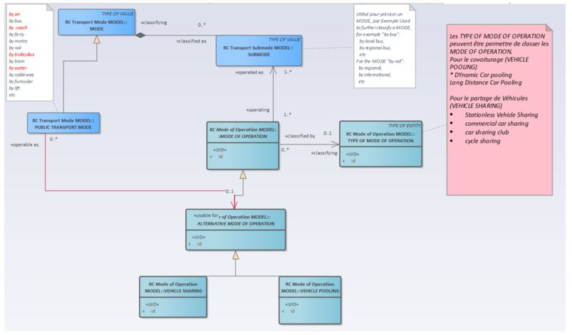

Figure 3 : Mode Alternatif NM

### Modèle de données

### Description des concepts

Le diagramme ci-dessus a pour objectif de clarifier la distinction entre les deux concepts suivants :

- Le concept de **MODE**, défini comme tout moyen de transport (communiqué au public d'une façon ou d'une autre), ou **SUBMODE** qui défini comme une variante d'un **MODE**, lié au **VEHICLE TYPE** (voir EN 12896-1) ;
- Le concept de **MODE OF OPERATION** qui représente la manière dont le **MODE** ou le **SUBMODE** est exploité. 

Le **MODE OF OPERATION** dispose de trois spécialisations : **CONVENTIONAL MODE OF OPERATION**, **PERSONAL MODE OF OPERATION**, et **ALTERNATIVE MODE OF OPERATION**. Seul le dernier sera détaillé dans ce profil.


Le **ALTERNATIVE MODE OF OPERATION** correspond à tout mode d'exploitation annoncé publiquement différent du **CONVENTIONAL MODE OF OPERATION**, par exemple : **VEHICLE SHARING**, **VEHICLE RENTAL** et **VEHICLE POOLING**.
    - **VEHICLE RENTAL** (non détaillé dans la version actuelle de ce profil) : Un **ALTERNATIVE MODE OF OPERATION** d'un véhicule issu d'une **FLEET** de véhicules (en général détenus par des entités privées), disponible pour une utilisation pendant une certaine durée (potentiellement longue) et moyennant des frais, avec la contrainte de le restituer dans des agences spécifiées.
    - **VEHICLE SHARING** : Location de véhicule à court terme où le véhicule peut être pris et restitué à différents endroits de la zone urbaine, éventuellement sans la contrainte de restituer le véhicule dans un lieu spécifique.
    - **VEHICLE POOLING** : Un **ALTERNATIVE MODE OF OPERATION** d'un véhicule détenu par une entité privée (personne physique ou morale), consistant à partager le véhicule pour un trajet entre le conducteur qui effectue lui-même un déplacement et au moins un autre voyageur.


> **NOTE** — *Chauffeured Car* (correspondant notamment aux VTC) et *Taxi* sont des types particuliers de **VEHICLE POOLING** (avec un **TYPE OF OPERATION** dédié).

Le diagramme  montre que tout **SUBMODE** peut se voir attribuer un ou plusieurs **MODEs OF OPERATION**. Par exemple, un *mini-bus* peut être exploité en **CONVENTIONAL MODE OF OPERATION** (à horaires fixes ou à la demande), ou comme un **ALTERNATIVE MODE**, par exemple dédié au **VEHICLE SHARING**.

**TYPE OF MODE OF OPERATION** caractérise plus précisément les manières possibles d'exploiter un **SUBMODE** donné.

#### MODE OF OPERATION (Mode d'exploitation)

| **Classification** | **Nom** | **Type** | **Cardinalité** | **Description** |
| --- | --- | --- | --- | --- |
| ::> | ::> | TypeOfValue | ::> | MODE OF OPERATION hérite de TYPE OF VALUE. |
| «PK» | id  | ModeOfOperationIdType | 1:1 | Identifiant du MODE OF OPERATION. |
| «FK» | TypeOfModeOfOperationRef | TypeOfModeOfOperationRef | 0:1 | Référence à un TYPE OF MODE OF OPERATION. |
| «FK» | submodes | SubmodeRef | 1:\* | Référence à un SUB MODE. |

Table 4 - Mode d'opération

#### Alternative Mode Of Operation (Mode d'exploitation Alternatif)

Il s'agit d'un mode de transport public, différent des modes conventionnels, par exemple l'auto partage, le vélo en libre-service, ou le covoiturage

| **Classification** | **Nom** | **Type** | **Cardinalité** | **Description** |
| --- | --- | --- | --- | --- |
| ::> | ::> | ModeOfOperation | ::> | ALTERNATIVE MODE OF OPERATION hérite de MODE OF OPERATION. |
| «PK» | id  | AlternativeModeOfOperationIdType | 1:1 | Identifiant d'un ALTERNATIVE MODE OF OPERATION. |

Table 5 - Mode d'opération alternatif

##### COVOITURAGE

A rédiger ultérieurement

##### VEHICLE SHARING (Partage de véhicule)

Location de véhicule à court terme où le véhicule peut être pris et stationné à différents endroits dans la zone urbaine, éventuellement sans l'obligation de ramener le véhicule à un lieu spécifique.

| **Classification** | **Nom** | **Type** | **Cardinalité** | **Description** |
| --- | --- | --- | --- | --- |
| ::> | ::> | AlternativeModeOfOperation | ::> | VEHICLE SHARING hérite de ALTERNATIVE MODE OF OPERATION. |
| «PK» | id  | VehicleSharingIdType | 1:1 | Identifiant de VEHICLE SHARING MODEL OF OPERATION. |
| «enum» | VehicleSharingType | VehicleSharingTypeEnum | 0:1 | Valeurs autorisées pour un VEHICLE SHARING. Cf la table ci-après |

Table 6 - Partage de véhicule

###### VEHICULE SHARING TYPE (Type de partage de véhicule)

Cette table indique les valeurs autorisées pour VehicleSharingType dans le cadre du profil France

| **Valeur** | **Description** |
| --- | --- |
| carSharingClub | Car Sharing Club. |
| peerToPeerCarSharingClub | Peer-to-peer Car Sharing Club. |
| vehicleSharing | Partage de véhicule |

Table 7 - Type de Partage de véhicule

###### TypeOfModeOfOperation

Classification de MODE OF OPERATION.

<div class="joplin-table-wrapper"><table><tbody><tr><th><p><strong>Classification</strong></p></th><th><p><strong>Nom</strong></p></th><th><p><strong>Type</strong></p></th><th><p><strong>Cardinalité</strong></p></th><th><p><strong>Description</strong></p></th></tr><tr><td><p>::&gt;</p></td><td><p>::&gt;</p></td><td><p>TypeOfValue</p></td><td><p>::&gt;</p></td><td><p>TYPE OF MODE OF OPERATION hérite de TYPE OF VALUE.</p></td></tr><tr><td><p><a id="BKM_2D231185_EAE2_440B_8E14_F78C1D499CE1"></a>«PK»</p></td><td><p>id</p></td><td><p>TypeOfModeOfOperationIdType</p></td><td><p>1:1</p></td><td><p>Identifiant de TYPE OF MODE OF OPERATION.</p><p>Pour le partage de véhicule sont autorisés&nbsp;:</p><ul><li>Stationless Vehicle Sharing</li><li>Cycle sharing</li><li>Commercial Car sharing</li></ul>

<p>Pour le covoiturage est autorisé&nbsp;:</p><ul><li>Long Distance Carpooling</li></ul>

</td></tr></tbody></table></div>

Table 8 - Type de mode d'opération

## Flotte de véhicule

**Statut implémentation : OBLIGATOIRE**. Cette partie du profil doit être implémentée en cohérence avec le contexte (pour les services de partage de véhicules).

### Modèle Conceptuel

Le modèle de flotte NM décrit la flotte de véhicules, définie comme un ensemble de véhicules de tout type. Le concept de flotte est général, c'est-à-dire qu'il ne dépend pas du mode d'exploitation, mais il est particulièrement utile pour décrire les services offerts par certains modes d'exploitation alternatifs (NM).

Une flotte appartient à une organisation de transport (Opérateur, Autorité organisatrice), un organisme légalement constitué lié à un aspect quelconque du système de transport. Une organisation de transport peut posséder plusieurs flottes.

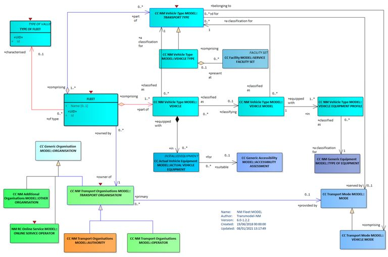

Figure 4 : Flotte de véhicule NM

### Modèle de données

#### Fleet (Flotte)

Un ensemble de véhicule de tout type.

| **Classification** | **Nom** | **Type** | **Cardinalité** | **Description** |
| --- | --- | --- | --- | --- |
| ::> | ::> | _GroupOfEntities_ | ::> | FLEET hérite de GROUP OF ENTITies. |
| «PK» | **_id_** | _FleetIdType_ | 1:1 | Identifiant de FLEET. |
| «cntd» | **_members_** | _Vehicle_ | 0:\* | VEHICULES de la flotte. Cf VEHICULE<br><br>Voir § 10.6. |
| «FK» | **_TransportOrganisationRef_** | _TransportOrganisationRef_ | 0:1 | Identifiant de l'organisation TRANSPORT ORGANISATION possédant la Flotte |
| «FK» | **_TypeOfFleetRef_** | _TypeOfFleetRef_ | 0:1 | Identifiant du TYPE OF FLEET. |
| «cntd» | **_transportTypes_** | _TransportTypeRef_ | 0:\* | TRANSPORT TYPEs et VEHICLE TYPEs de la Flotte. |

Table 9 - Flotte

##### Type of Fleet (Type de Flotte)

Classification d'une flotte de véhicule.

| **Classification** | **Nom** | **Type** | **Cardinalité** | **Description** |
| --- | --- | --- | --- | --- |
| ::> | ::> | _TypeOfValue_ | ::> | TYPE OF FLEET hérite de TYPE OF VALUE. |
| «PK» | **_id_** | _TypeOfFleetIdType_ | 1:1 | Identifiant de TYPE OF FLEET. |

Table 10 - Type de flotte

### Flotte - XML Exemple

#### Cas du vélo Partage

Exemple xml 1 : Flotte de vélos

#### Cas d'une flotte de voitures

Exemple xml 2 : Flotte de véhicules

## Service En ligne

**Statut implémentation : FACULTATIF** : Cette partie du profil doit être implémentée en cohérence avec le contexte.

### Modèle conceptuel

L'entité SERVICE EN LIGNE représente tout service accessible à distance offrant un accès à un mode de transport et/ou à des informations relatives aux services de transport.

Un OPÉRATEUR DE SERVICE EN LIGNE est responsable de la gestion d'un SERVICE EN LIGNE (mais pas nécessairement du transport lui-même, c'est-à-dire différent d'un OPÉRATEUR DE TRANSPORT), par exemple pour fournir des informations à un utilisateur sur des offres de covoiturage disponibles ou adaptées, via une application web. Le SERVICE EN LIGNE assure une interface entre les utilisateurs (entre le conducteur et le voyageur pour le covoiturage, par exemple) ou entre utilisateurs et opérateurs.

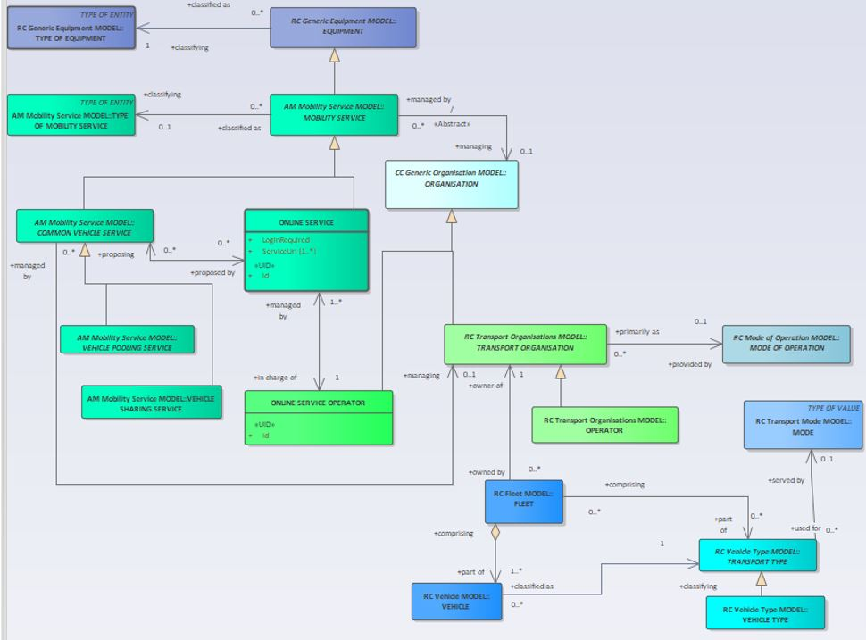

Figure 5 : Services en ligne NM

### Modèle de données

#### OnlineServiceOperator (Opérateur de Service en ligne)

Une organisation qui fournit un accès en ligne à un SERVICE EN LIGNE sans nécessairement exploiter des services de transport pour les voyageurs.

Note : un SERVICE EN LIGNE peut être exploité par tout OPÉRATEUR, mais un OPÉRATEUR DE SERVICE EN LIGNE gère uniquement des SERVICES EN LIGNE.

| **Classification** | **Nom** | **Type** | **Cardinalité** | **Description** |
| --- | --- | --- | --- | --- |
| ::> | ::> | _TransportOrganisation_ | ::> | ONLINE SERVICE OPERATOR hérite de TRANSPORT ORGANISATION |
| «PK» | **_id_** | _OnlineServiceOperatorIdType_ | 1:1 | Identifiant de ONLINE SERVICE OPERATOR. |
| "cntd» | **_onlineServices_** | _OnlineServiceRef_ | 0:\* | ONLINE SERVICES opérés par l'opérateur |

Table 11 - OnlineServiceOperator

##### OnlineService (Service en ligne)

Tout service accessible à distance offrant un accès à un mode de transport et/ou à des informations relatives aux services de transport

| **Classification** | **Nom** | **Type** | **Cardinalité** | **Description** |
| --- | --- | --- | --- | --- |
| ::> | ::> | _MobilityService_ | ::> | ONLINE SERVICE hérite de MOBILITY SERVICE |
| «PK» | **_id_** | _OnlineServiceIdType_ | 1:1 | Identifiant de ONLINE SERVICE. |
|     | **_LoginRequired_** | _xsd:boolean_ | 0:1 | Utilisation d'un login pour accéder au service (oui/non) |
| «cntd» | **_proposingServices_** | _CommonVehicleServiceRef_ | 0:\* | VEHICLE SERVICEs proposéspar ONLINE SERVICE. |

Table 12 - OnlineService

### Exemple d'Online Service

#### Service en ligne pour VLS

Exemple xml 3 : Online Service

## Zone de Stationnement

**Statut implémentation : OBLIGATOIRE** : Cette partie du profil doit être implémentée en cohérence avec le contexte.

### Modèle conceptuel

La description des zones de stationnement pour les modes de déplacement de type véhicule partagé est décrite dans le profil France Parking ;

Cette partie du modèle permet de décrire les zones de dépôt des véhicules. Le lien avec les véhicules et services rattachés sont décrits au paragraphe 10.7.2.2.

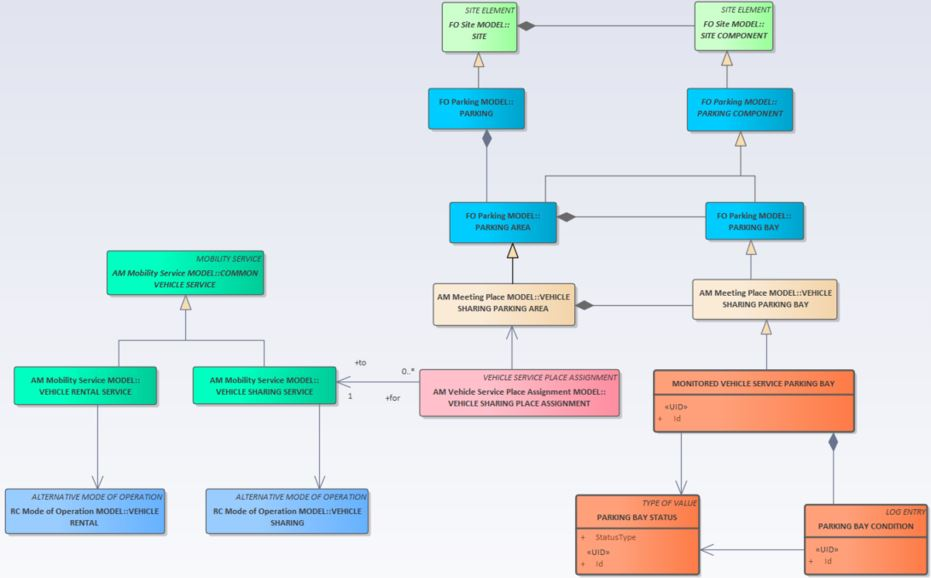

Figure 6 Modèle Emplacement NM

### Modèle de données

#### PARKING (Station)

La définition des zones de stationnement et de leurs emplacements est décrite dans le profil France Parking (paragraphe 6.2).

| **Classification** | **Nom** | **Type** | **Cardinalité** | **Description** |
| --- | --- | --- | --- | --- |
| ::> | ::> | ParkingArea | ::> | VEHICLE SHARING PARKING AREA hérite PARKING AREA.<br>(Voir le profil Parking pour les nombreux élément hérités) |
| «PK» | id  | VehicleSharingParkingAreaIdType | 1:1 | Identifiant de VEHICLE SHARING PARKING AREA. |

Table 13 - **PLACES DE STATIONNEMENT**

#### VEHICLE SHARING PARKING AREA (Zone de partage de véhicule)

La VEHICLE SHARING PARKING AREA n'a pas d'attribut supplémentaire par rapport à une PARKING AREA (voir Profil Parking): c'est une une spécialisation qui a pour vocation de réserver la zone de parking au partage de vehicules.

Il est aussi possible affecter certains place d'un parking classique à un service de partage de véhicule, sans pour autant que toute la zone lui soit attribuée. L'affectation d'une place (PARKING BAY) se fait alors parun un VEHICLE SHARING PLACE ASSIGNMENT.

| **Classification** | **Nom** | **Type** | **Cardinalité** | **Description** |
| --- | --- | --- | --- | --- |
| ::> | ::> | VehicleServicePlaceAssignment | ::> | VEHICLE SHARING PLACE ASSIGNMENT hérite de VEHICLE SERVICE PLACE ASSIGNMENT. |
| «PK» | id  | VehicleSharingPlaceAssignmentIdType | 1:1 | Identifiant de VEHICLE SHARING PLACE ASSIGNMENT. |
| «cntd» | VehicleCommonServiceRef | VehicleSharingServiceRef | 0:\* | Référence à un VEHICLE SHARING SERVICE (pour réserver une place ou connaitre la disponibilité, par exemple) |
| «FK» | VehicleSharingParkingAreaRef | VehicleSharingParkingAreaRef | 1:1 | Référence un VEHICLE SHARING PARKING AREA. |
| «FK» | VehicleSharingParkingBayRef | ParkingBayRef | 1:1 | Référence à VEHICLE SHARING PARKING BAY. |

Table 14 - **AFFECTATION DE PLACES DE STATIONNEMENT POUR VÉHICULES PARTAGÉS**

#### Vehicle Pooling Parking Area (Zone de covoiturage)

_Une partie dédiée de l’AIRE DE STATIONNEMENT pour le covoiturage composée d’une ou de plusieurs PLACES DE STATIONNEMENT DE COVOITURAGE._.

Il est possible de préciser que la zone de parking est dédiée au covoiturage en utilisant la balise **ParkingType** avec la valeur _liftShareParking_ (Se reporter au profil NexTEx France Parking pour plus de détails sur les objest ci-dessous).

Exemple : 
``` xml
<VehiclePoolingParkingArea id="FR:VehiclePoolingParkingArea:76-6:Qpark" version="any"><Name>Zone réservée aux covoitureurs</Name><TotalCapacity>2</TotalCapacity></VehiclePoolingParkingArea>
```
															
					
|     |     |     |     |     |
| --- | --- | --- | --- | --- |
| **Classification** | **Nom** | **Type** | **Cardinalité** | **Description** |
| ::> | ::> | _ParkingArea_ | ::> | VEHICLE POOLING PARKING AREA hérite de from PARKING AREA<br><br>\[non décrit dans PART5 NeTex\] |
| «PK» | **_id_** | _VehiclePoolingParkingAreaIdType_ | 1:1 | Identifier of VEHICLE POOLING PARKING AREA. |

Table 14 — Zone de covoiturage

#### ParkingBay (Place de stationnement)

Une place dans le PARKING réservée au partage de véhicules.

| **Classification** | **Nom** | **Type** | **Cardinalité** | **Description** |
| --- | --- | --- | --- | --- |
| ::> | ::> | ParkingBay | ::> | VEHICLE SHARING PARKING BAY hérite PARKING BAY. |
| «PK» | id  | VehicleSharingParkingBayIdType | 1:1 | Identifiant de VEHICLE SHARING PARKING BAY. |

Table 15 - **Place de stationnement pour véhicule**

##### **_VehicleSharingParkingBay (Emplacement de parking à l'usage de partage de véhicule)_**

Permet de définir un Place de parking pour le partage de véhicule.

| **Classifi­cation** | **Name** | **Type** | **Cardin­ality** | **Description** |
| --- | --- | --- | --- | --- |
| ::> | ::> | _ParkingBay_ | ::> | VEHICLE SHARING PARKING BAY hérite de PARKING BAY. |
| «PK» | **_id_** | _VehicleSharingParkingBayIdType_ | 1:1 | Identifiant du VEHICLE SHARING PARKING BAY. |

Table 16 - **Place de stationnement pour véhicule partagé**

VehiculeSharingParkingArea est une spécialisation de ParkingArea qui permet de préciser les emplacements dévolus au covoiturage lorsqu’existant


``` xml 
<VehicleSharingParkingArea id="FR:ParkingArea:76-5:Qpark" version="any">
<Name>Zone Autopartage</Name>
<TotalCapacity>10</TotalCapacity>
</VehicleSharingParkingArea>
```

##### VehiclePoolingParkingBay

Un emplacement dédié pour garer soit un véhicule participant à un service de covoiturage, soit le véhicule d’un utilisateur du service de covoiturage

|     |     |     |     |     |
| --- | --- | --- | --- | --- |
| **Classification** | **Nom** | **Type** | **Cardinalité** | **Description** |
| ::> | ::> | _ParkingBay_ | ::> | VEHICLE POOLING PARKING BAY hérite de PARKING BAY. |
| «PK» | **_id_** | _VehiclePoolingParkingBayIdType_ | 1:1 | Identifiant du VEHICLE POOLING PARKING BAY. |

Table 17 — **Dock de stationnement pour véhicule de covoiturage**

## Point de rencontre (Covoiturage)

**Statut implémentation : OBLIGATOIRE** : Cette partie du profil doit être implémentée en cohérence avec le contexte.

### Modèle conceptuel

Le modèle NM VEHICLE MEETING PLACE définit les lieux d’arrêt où les passagers se retrouvent avec leurs modes de transport alternatifs. Au niveau le plus général, il peut s’agir de tout lieu disposant d’une adresse. Ceux-ci peuvent inclure des STOP PLACE et des PARKING, ainsi que leurs composant.

Transmodel inclut un modèle permettant de décrire les éléments de stationnement comme des spécialisations de SITE COMPONENT. La relation entre les lieux d’arrêt et les services qui s’y arrêtent est décrite dans le modèle NM VEHICLE SERVICE PLACE ASSIGNMENT.

Le modèle NM VEHICLE MEETING PLACE distingue deux grands types d'ADDRESSABLE PLACE, c’est-à-dire des lieux pouvant être localisés par des coordonnées spatiales et/ou par une adresse postale ou routière :

VEHICLE MEETING PLACE : lieux où des véhicules, des voyageurs ou des conducteurs se rencontrent afin de changer de mode de transport, pour la montée, la descente, la prise en charge, la dépose, etc. Un VEHICLE MEETING PLACE peut être associé à un SITE spécifique (tel qu’un STOP PLACE ou un POINT OF INTEREST) ou à tout composant au sein de ce SITE.Il est aussi naturellement possible de l'associer à toute ADRESSABLE PLACE qui peut correspondre, si nécessaire, à une adresse personnelle.

Ces lieux se distinguent par l’usage qui en est fait. Dans les VEHICLE MEETING PLACE, il n’est pas possible de laisser des véhicules sans surveillance pendant une durée prolongée. 

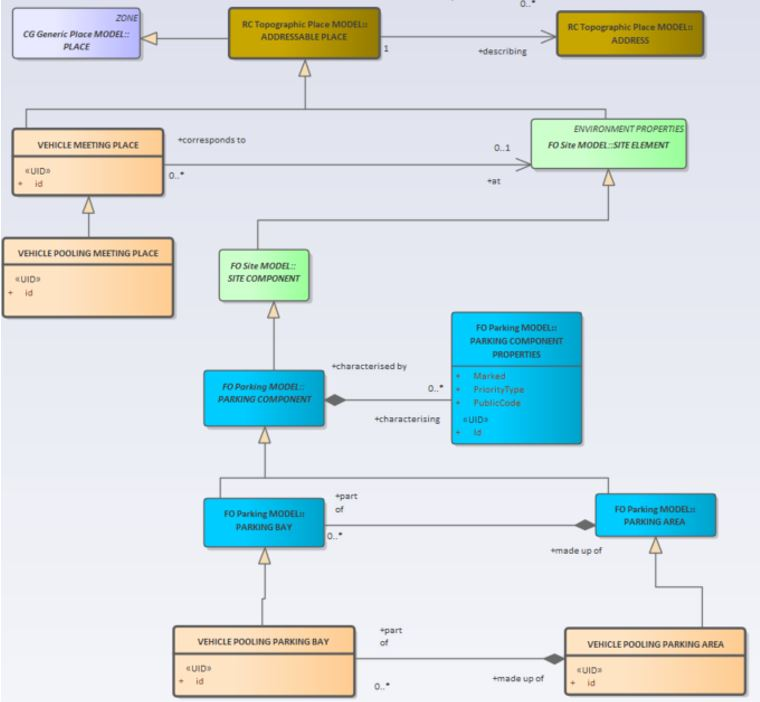

Figure 7 : Lieux de rencontre (Covoiturage) NM

### Modèle de données

#### VEHICLE MEETING PLACE

Un lieu où véhicules et passagers se rencontrent pour changer de mode de transport, pour monter à bord, descendre, prendre en charge ou déposer, etc.

|     |     |     |     |     |
| --- | --- | --- | --- | --- |
| **Classification** | **Nom** | **Type** | **Cardinalité** | **Description** |
| ::> | ::> | _AddressablePlace_ | ::> | VEHICLE MEETING PLACE hérite de ADDRESSABLE PLACE. |
| «PK» | **_id_** | _VehicleMeetingPlaceIdType_ | 1:1 | Identifiant du VEHICLE MEETING PLACE. |
| «FK» | **_TopographicPlaceRef_** | _TopographicPlaceRef_ | 0:1 | Reference à un TOPOGRAPHIC PLACE. |
| «FK» | **_SiteElementRef_** | _SiteElementRef_ | 0:1 | Référence à un SITE ELEMENT, tel que PARKING, PARKING AREA, PARKING BAP, STOP PLACE, QUAY, POINT OF INTEREST, etc. |

Table 19 — VehicleMeetingPlace — élément

#### Vehicle Pooling Meeting Place (Lieu de rendez-vous)

Un lieu de rendez-vous pour le covoiturage, désigné ou convenu par le conducteur et le passager, c’est-à-dire l’endroit où conducteurs et passagers se rencontrent pour la prise en charge ou la dépose.

|     |     |     |     |     |
| --- | --- | --- | --- | --- |
| **Classifi-cation** | **Name** | **Type** | **Cardinality** | **Description** |
| ::> | ::> | _VEHICLE MEETING PLACE_ | ::> | **_VEHICLE POOLING MEETING PLACE_** inherits from **_VEHICLE MEETING PLACE._** |
| «UID» | **_Id_** | _VehiclePoolingMeetingPlaceIdType_ | 1:1 | Identifier of VEHICLE POOLING MEETING PLACE. |

Table 19 - VEHICLE POOLING MEETING PLACE – Attributs


Note : Voir VehicleSharingPlaceAssignment pour affectation de ce MEETING PLACEs aux services.

## Géofencing

**Statut implémentation : OBLIGATOIRE** : Cette partie du profil doit être implémentée en cohérence avec le contexte.

**Une ZONE DE CONTRAINTE DE SERVICE DE MOBILITÉ** (MOBILITY SERVICE CONSTRAINT ZONE ) impose des restrictions sur les déplacements à l'intérieur d'une zone pour un **MODE DE FONCTIONNEMENT** donné.

Une **RESTRICTION DE ZONE PAR TYPE DE VéHICULE** (VEHICLE TYPE ZONE RESTRICTION ) spécifie quel **TYPE DE RESTRICTION** s'applique à un **TYPE DE TRANSPORT** (TRANSPORT TYPE) donné.

### Modèle conceptual
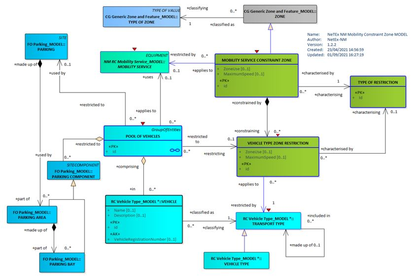

Figure 8 : Modèle Géofencing NM

### Modèle de données

#### MobilityConstraintZone (Zone de mobilité contrainte)

ZONE définissant une zone de restriction de l'utilisation d'un MOBILITY SERVICE, par exemple : interdiction d'entrée, interdiction de dépose, etc

| **Classification** | **Nom** | **Type** | **Cardinalité** | **Description** |
| --- | --- | --- | --- | --- |
| ::> | ::> | Zone | ::> | MOBILITY SERVICE CONSTRAINT ZONE hérite de ZONE. |
| «PK» | id  | MobilityConstraintZoneIdType | 1:1 | Identifiant d'une MOBILITY SERVICE CONSTRAINT ZONE. |
| «enum» | RuleApplicability | RuleApplicabilityEnum | 0:1 | Indique si la règle s'applique à l'intérieur ou l'extérieur de la zone.<br><br>Par défaut : Intérieur. |
| «enum» | ZoneUse | ZoneUseTypeEnum | 0:1 | Comment la zone peut être utilisée |
| «cntd» | vehicleTypeRestrictions | VehicleTypeZoneRestriction | 0:\* | Restrictions applicables à différents types de véhicules |
|     | MaximumSpeed | Speed | 0:1 | Vitesse maximale dans la zone |
| «FK» | MobilityServiceRef | MobilityServiceRef | 0:1 | MOBILITY SERVICE associés à la MOBILITY SERVICE CONSTRAINT ZONE. |

Table 17 - MobilityConstraintZone

##### ZoneUseType (Type de zone d'usage)

Les valeurs autorisées pour **ZoneUseType (**ZoneUseTypeEnumeration**) sont les suivantes** **:**

| **Valeur** | **Description** |
| --- | --- |
| allUsesAllowed | Toute utilisation autorisée : Ramassage, dépose, via |
| forbiddenZone | Interdiction de ramassage ou de dépôt dans la zone |
| cannotPickUpInZone | Interdiction de ramassage dans la zone |
| cannotDropOffInZone | Interdiction de dépôt dans la zone |
| mustPickUpInZone | Obligation de ramassage dans la zone |
| mustDropOffInZone | Obligation de dépôt dans la zone |
| passThroughUseOnly | Interdiction de ramassage ou de Dépôt dans la zone mais possibilité de traversée |
| noPassThrough | Interdiction de traverse uniquement (obligation de ramassage ou dépôt dans la zone) |
| cannotPickUpAndDropOfInSameZone | Interdiction de ramassage et dépôt dans la même zone. |
| mustPickUpAndDropOffInSameZone | Obligation de ramassage et dépôt dans la zone |
| other | Autres restrictions. |

Table 18 - ZoneUseType

##### VehicleTypeZoneRestriction (Zone de restriction de Circulation)

Restriction d'utilisation dans une MOBILITY SERVICE CONSTRAINT ZONE TRANSPORT TYPE pour un mode de transport.

| **Classification** | **Nom** | **Type** | **Cardinalité** | **Description** |
| --- | --- | --- | --- | --- |
| ::> | ::> | VersionedChild | ::> | VEHICLE TYPE ZONE RESTRICTION hérite de VERSIONED CHILD. |
| «PK» | id  | PoolOfVehiclesIdType | 1:1 | Identifiant VEHICLE TYPE ZONE RESTRICTION. |
| «enum» | ZoneUse | ZoneUseTypeEnum | 0:1 | Modalité d'utilisation de la zone. |
|     | MaximumSpeed | Speed | 0:1 | Vitesse maximum dans MOBILITY SERVICE CONSTRAINT ZONE. |
| «FK» | MobilityServiceConstraintZoneRef | MobilityServiceConstraintZoneRef | 0:1 | MOBILITY SERVICE CONSTRAINT ZONE auxquels les restrictions s'appliquent |
| «FK» | TransportTypeRef | TransportTypeRef | 0:1 | TRANSPORT TYPE auxquels les restrictions s'appliquent |

Table 19 - Type de zone de restriction

## Types de Véhicules et Véhicules

**Statut implémentation : FACULTATIF** : Cette partie du profil doit être implémentée en cohérence avec le contexte.

### Modèle conceptuel

La définition d'un véhicule (Cycle, Voiture) répond à la décomposition conceptuelle suivante.

Note : dans le contexte des Nouveaux Modes, la description de véhicule se fera essentiellement via des SIMPLE VEHICLE TYPE (qui, comme de VEHICLE TYPE, héritent de TRANSPORT TYPE)

Note : les VEHICLE TYPEs sont déjà décrits dans le **NeTEx - Profil France - Horaires**, ce chapitre vient en complément pour la cas particulier des Nouveaux Modes.

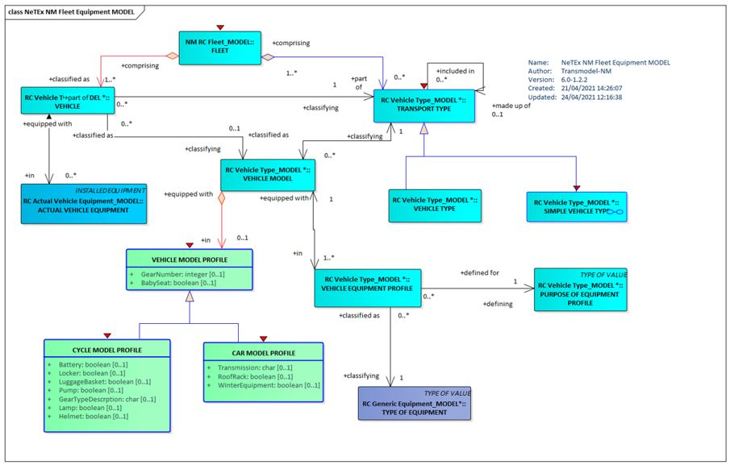

Figure 9 : Véhicule - MC

L'équipement réel du véhicule spécifie le type d'équipement à utiliser dans un véhicule donné

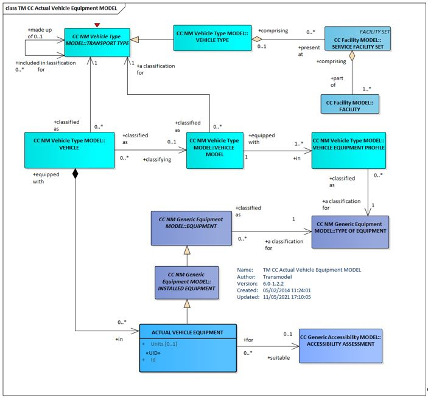

Figure 10 : Actual Vehicle Equipment MC

### Modèle de données

Le modèle **SIMPLE** **VEHICLE TYPE** décrit les types de véhicules « personnels » et leurs propriétés.

Les types de véhicules peuvent être classés en fonction des exigences de planification, notamment :

- Le modèle,
- La capacité,
- Les équipements embarqués (Siège bébé, …)

Ces mêmes exigences peuvent être associées à un **SERVICE JOURNEY** ou un **SINGLE JOURNEY** (typiquement pour un service de covoiturage) pour indiquer que ce service doit être assuré par un véhicule de ce type.

#### Vehicle (Véhicule)

Description d'un véhicule de transport des passagers.

Rappel: Le **VEHICLE** est utilisé pour décrire les véhicules physiques de transport disponibles pour les opérations et l'affectation quotidienne (par opposition aux véhicules logiques considérés pour la planification des ressources). Chaque **VEHICLE** doit être classifié comme étant d'un **VEHICLE TYPE** particulier.

| **Classification** | **Nom** | **Type** | **Cardinalité** | **Description** |
| --- | --- | --- | --- | --- |
| ::> | ::> | DataManagedObject | ::> | VEHICLE hérite de DATA MANAGED OBJECT. |
| «PK» | **_id_** | VehicleIdType | 1:1 | Identifiant |
|     | **_Name_** | MultilingualString | 0:1 | Nom du véhicule |
|     | ShortName | MultilingualString | 0:1 | Nom court VEHICLE. |
| «AK» | Registration­Number | xsd:normalizedString | 0:1 | Immatriculation du VEHICULE. |
|     | Registration Date | xsd:date | 0:1 | date d'immatriculation du VEHICULE |
| «AK» | OperationalNumber | xsd:normalizedString | 0:1 | Operational number of VEHICLE. |
| «AK» | PrivateCode | PrivateCode | 0:1 | Identifiant alternatif du VEHICULE.<br><br>Peut être utilisé pour les identifiant interne. |
| «FK» | TransportOrganisationRef | TransportOrganisationRef | 1:1 | Identifiant de l'OPERATEUR ou d'une TRANSPORT ORGANISATION. |
| «FK» | TransportTypeRef | TransportTypeRef | 0:1 | Identifiant d'un TRANSPORT TYPE du VEHICLE |
| «FK» | VehicleModelRef | VehicleModelRef | 0:1 | Identifiant MODEL du VEHICLE |
| «FK» | VehicleModelProfileRef | VehicleModelProfileRef | 0:1 | Identifiant MODEL EQUIPMENT PROFILE of VEHICLE |
| «cntd» | actualVehicle­Equipments | (EquipmentRef) \| (Equipment) | 0:1 | Identifiant ou description du Actual vehicle equipment, i.e., EQUIPMENT for VEHICLE |

Table 20 - Vehicle - Element

#### Actual Vehicle Equipment (équipement réel du véhicule)

Cet élément permet de spécifier un équipement d'un type particulier effectivement disponible dans un véhicule donné.

| **Classification** | **Name** | **Type** | **Cardinality** | **Description** |
| --- | --- | --- | --- | --- |
| ::> | ::> | _InstalledEquipment_ | ::> | ACTUAL VEHICLE EQUIPMENT hérite de PASSENGER EQUIPMENT. |
| «PK» | **_id_** | _ActualVehicleEquipmentIdType_ | 1:1 | Identifiant ACTUAL VEHICLE EQUIPMENT. |
|     | **_Units_** | _xsd:nonNegativeInteger_ | 0:1 | Nombre d'exemplaires de l'ACTUAL VEHICLE EQUIPMENT there are on vehicle. |
| «FK» | **_VehicleTypeRef_** | _VehicleTypeRef_ | 0:1 | VEHICLE TYPE auquel s'applique l'ACTUAL VEHICLE EQUIPMENT. |
| «cntd» | **_Accessibility­Assessment_** | _AccessibilityAssessment_ | 0:1 | ACCESSIBILITY ASSESSMENT de l'ACTUAL VEHICLE EQUIPMENT.<br><br>Se reporter au profil France accessibilité. |

Table 21 - Équipement disponible dans le véhicule

#### TransportType (Type de transport)

Classification de tout type de véhicule en fonction de ses caractéristiques

| **Classification** | **Nom** | **Type** | **Cardinalité** | **Description** |
| --- | --- | --- | --- | --- |
| ::> | ::> | DataManagedObject | ::> | TRANSPORT TYPE hérite de DATA MANAGED OBJECT. |
| «PK» | id  | TransportTypeIdType | 1:1 | Identifiant TRANSPORT TYPE. |
|     | Name | MultilingualString | 0:1 | nom du TRANSPORT TYPE. |
|     | ShortName | MultilingualString | 0:1 | Nom court TRANSPORT TYPE. |
|     | Description | MultilingualString | 0:1 | Description of TRANSPORT TYPE. |
| «AK» | PrivateCode | PrivateCode | 0:1 | Identifiant interne TRANSPORT TYPE. |
| XGRP | TransportType­PropertiesGroup | xmlGroup | 0:1 | Elément décrivant les propriétés du TRANSPORT TYPE. Voir ci-dessous |
| «enum» | TransportMode | AllVehicleModesEnum | 0:1 | Mode de transport : Valeurs autorisées |
|     | EuroClass | xsd:normalizedString | 0:1 | Euroclass du véhicule type. |
| «cntd» | Passenger­Capacity | PassengerCapacity | 0:1 | Capacité en nombre de passage du TRANSPORT TYPE. |

Table 22 - Transport Type

##### TransportTypePropertiesGroup (Groupe de propriétés des types de transport)

| **Classification** | **Nom** | **Type** | **Cardinalité** | **Description** |
| --- | --- | --- | --- | --- |
|     | Reversing­Direction | xsd:boolean | 0:1 | Whether VEHICLE TYPE has a reversing direction. |
|     | SelfPropelled | xsd:boolean | 0:1 | Whether VEHICLE TYPE is self-propelled. |
| «enum» | PropulsionType | PropulsionTypeEnum | 0:1 | Type de propulsion du VEHICLE TYPE. Cf ci-dessous |
| «enum» | FuelType | FuelTypeEnum | 0:1 | Type de carburant du VEHICLE TYPE. Cf ci-dessous |
|     | MaximumRange | DistanceType | 0:1 | Autonomie maximale en km |

Table 23 -TransportTypePropertiesGroup

###### PropulsionType (Type de propulsion)

| **Valeurs** | **Description** |
| --- | --- |
| combustion | Thermique de tout type |
| hybrid | Hybride Electrique / Thermique |
| human | Humaine (Pédalage) |
| electricAssist | Assistance Electrique (velo / Trotinette) |
| other | Autres |

Table 24 -PropulsionType - Valeurs

###### FuelType (Type de carburant)

Valeurs autorisées pour **_FuelType_** (_FuelTypeEnum_).

| **valeurs** | **Description** |
| --- | --- |
| battery | Batterie |
| biodiesel | Biodiesel. |
| _diesel_ | Diesel |
| dieselBatteryHybrid | Hybride Diesel & Batteried |
| electricContact | Electrique nécessitant un contact avec un cable ou un rail. |
| ethanol | Ethanol |
| hydrogen | Hydrogène. |
| liquidGas | Gaz Liquide |
| _tpg_ | TPG (Thermochemical Power Group). |
| methane | Methane. |
| _petrol_ | Essence. |
| petrolLeaded | Essence Plomb |
| petrolUnLeaded | Essence Sans Plomb |
| petrolBatteryHybrid | Hybride Essance & Batterie. |
| other | Autre carburant |
| none | Pas de carburant necessaire |

Table 25 - FuelType - Valeurs

#### VéhicleModel (Modèle de Véhicule)

Classification des véhicules de transport public d'un même type, par exemple selon les spécifications de l'équipement ou la génération du modèle.

| **Classification** | **Nom** | **Type** | **Cardinalité** | **Description** |
| --- | --- | --- | --- | --- |
| ::> | ::> | DataManagedObject | ::> | VEHICLE MODEL hérite de DATA MANAGED OBJECT. |
| «PK» | **_id_** | VehicleModelIdType | 1:1 | Identifiant de VEHICLE MODEL. |
|     | **_Name_** | MultilingualString | 0:1 | Nom du VEHICLE MODEL. |
|     | Description | MultilingualString | 0:1 | Description du VEHICLE MODEL. |
|     | Manufacturer | MultilingualString | 0:1 | Fabricant du VEHICLE MODEL. |
| «FK» | TransportTypeRef | TransportTypeRef | 1:1 | Identifiant du TRANSPORT TYPE ou du VEHICLE TYPE du VEHICLE MODEL. |
| «FK» | VehicleModelProfileRef | VehicleModelProfileRef | 0:1 | VEHICLE MODEL PROFILE du VEHICLE MODEL |
| «FK | equipmentProfiles | VehicleEquipmentProfileRef | 0:\* | Equipment profile for VEHICLE MODEL. |

Table 26 - Modèle de véhicule

##### Vehicle Model Profile (Profil de Modèle de véhicule)

Ensemble des caractéristiques des équipements installés dans un véhicule et définissant un modèle de véhicule.

| **Classification** | **Nom** | **Type** | **Cardinalité** | **Description** |
| --- | --- | --- | --- | --- |
| ::> | ::> | _DataManagedObject_ | ::> | VEHICLE MODEL PROFILE hérite de DATA MANAGED OBJECT. |
|     | **_Name_** | _MultilingualString_ | 0:1 | Nom du VEHICLE MODEL PROFILE. |
|     | **_NumberOfGears_** | _xsd:nonNegativeInteger_ | 0:1 | Nombre de Vitesse du véhicule VEHICLE. |
| «enum» | **_ChildSeat_** | _ChildSeatEnumeration_ | 0:1 | Indique la présence d'un siège enfant à bord. |
|     | **_RangeBetweenRefuelling_** | _DistanceType_ | 0:1 | Autonomie du véhicule MODEL PROFILE. |
|     | **_IsPortable_** | _xsd:boolean_ | 0:1 | Indique si le véhicule peut être transporté facilement : concerne les scooter, skateboard, bicycle pliable. |

Table 27 - Profil de modèle de véhicule

###### ChildSeat (Siège Enfant)

La définition du siège enfant peut prendre les valeurs suivantes : **_._**

| **Valeur** | **Description** |
| --- | --- |
| _baby_ | Siège adapté pour les bébés |
| _smallChild_ | Siège adapté pour les enfants entre 9-18 kg. |
| _olderChild_ | Siège adapté pour les enfants entre 15-36 kg. |
| _none_ | Pas de siège enfant |
| _other_ | Autre type de siège |

Table 28 - Définition d'un siège Enfant

#### SimpleVehicleType (Type de Véhicule Simple)

Un type de véhicule simple, définit les exigences pour un VéHICULE utilisé afin de fournir des services de modes alternatifs et peut inclure des caractéristiques d'autres types de véhicules tels que les vélos, trottinettes, etc. »

| **Classification** | **Nom** | **Type** | **Cardinalité** | **Description** |
| --- | --- | --- | --- | --- |
| ::> | _::>_ | _TransportType_ | ::> | SimpleVehicleType hérite de TransportType |
| «PK» | **_id_** | _SimpleVehicleTypeIdType_ | 1:1 | Identifiant de SIMPLE VEHICLE TYPE. |
| «enum» | **_LicenceRequirements_** | _LicenceRequirementsEnum_ | 0:1 | Indique si ce type de véhicule nécessite un permis. |
|     | **_MinimumAge_** | _xsd:integer_ | 0:1 | Age minimum pour l'utilisation du véhicule |
| «enum» | **_VehicleCategory_** | _VehicleCategoryEnum_ | 0:1 | Catégorie du véhicule |
|     | **_Portable_** | _xsd:boolean_ | 0:1 | Indique si le véhicule est portable, par exemple un vélo pliant ou une trottinette. |

Table 29 - Type de véhicule simple

##### LicenceRequirements - Valeurs autorisées

Valeurs autorisées pour un permis d'utilisation (_LicenceRequirementsEnum_).

| **Value** | **Description** |
| --- | --- |
| _full_ | _Permis nécessaire_ |
| _provisional_ | _Requires at least a provisional licence_ |
| _additional_ | _Requires additional vehicle category licence._ |
| _none_ | _Aucun permis requis_ |

Table 30 - Type de permis d'utilisation

##### PersonalVehicleCategory - Valeurs autorisées

Valeurs autorisées pour la catégorie de véhicule Personnel _PersonalVehicleCategoryEnum_).

| **Value** | **Description** |
| --- | --- |
| _scooter_ | Scooter - small wheeled low mobile platform. |
| _bicycle_ | Bicycle. |
| _tricycle_ | Tricycle. |
| _tandem_ | Tandem bicycle. |
| _moped_ | Moped (Petite moto). |
| _motorcycle_ | Moto. |
| _quadbike_ | Quad |
| _car_ | Voiture |
| _microCar_ | Extremely small vehicle. |
| _miniCar_ | Very small vehicle. |
| _smallCar_ | Small vehicle. |
| _mediumCar_ | Compact vehicle. |
| _largeCar_ | Large vehicle. |
| _minivan_ | Minivan. |
| _transporter_ | minibus. |
| _snowmobile_ | MotoNeige |
| _other_ | Autre |

Table 31 - Type de Véhicule

### Exemple d'utilisation «  SimpleVehicleType »

#### Cas d'une flotte de vélos

Exemple xml 4 : Exemple modélisation « SimpleVehiculeType »

## Identifiants d'accès aux véhicules

Un code d'accès au service (SERVICE ACCESS CODE) est une spécialisation du document de voyage (TRAVEL DOCUMENT) qui fournit à l'utilisateur le code nécessaire pour utiliser un service. Pour mémoire, un TRAVEL DOCUMENT peut prendre de nombreuses formes que ce soit une carte à puce, un document sur un smartphone ou une application sur un smartphone, etc.

Les documents de voyage sont associés à un client de transport donné via un contrat tarifaire (FARE CONTRACT). Ils peuvent également être liés à un package d'achat client (CUSTOMER PURCHASE PACKAGE) en tant que représentation électronique de l'achat effectué par le client.

Un code d'accès au service peut être associé à un véhicule physique et à un dispositif d'accès au support (MEDIUM ACCESS DEVICE) via une affectation d'accès au véhicule (VEHICLE ACCESS ASSIGNMENT). Cette association constitue un lien indépendant pouvant être utilisé de manière anonyme vis-à-vis du client pour exploiter le système d'accès.

Le diagramme NM Vehicle Access MODEL décrit un contexte plus large lié à la mise à disposition d'un contrat permettant d'accéder à un service de transport. En particulier, le contrat tarifaire (FARE CONTRACT) peut héberger les codes d'accès au service fournis pour un service de mobilité, quel que soit le mode de transport alternatif.

Note : les concepts liés à la tarification (TRAVEL DOCUMENT, FARE CONTRACT, etc.), ainsi que leur utilisation, sont détaillés dans le **Profil France - Tarifs**

Note : les codes d'accès ne sont utiles à échanger pour vers un service dédié à l'émission du titre de voyage. Dans un contexte classique d'information voyageur seule l'indication qu'un code d'accès sera fournit suffira (_UsageValidityPeriod.ActivationMeans_).


### Modèle conceptuel

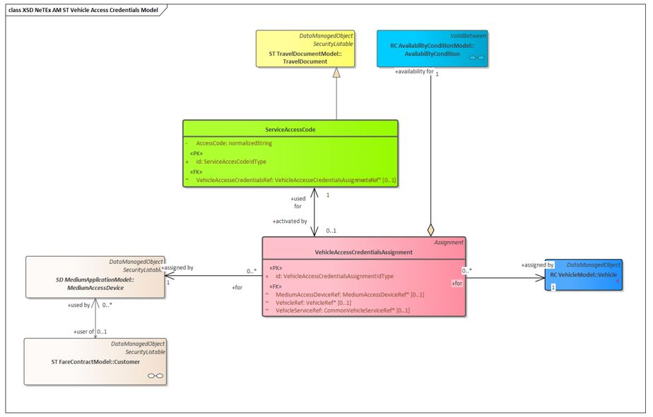

Figure 11 : Identifiants d'accès au Véhicule

### Modèle de données

#### Code d'accès à un service (ServiceAccessCode)

Code permettant d'accéder à un service, qui peut être un **code numérique**, un **code-barres**, un **flashcode (QR code)**, etc

| **Classification** | **Nom**                                     | **Type**                                | **Cardinalité** | **Description**                                                                                                                                                                                                   |
| ------------------ | ------------------------------------------- | --------------------------------------- | --------------- | ----------------------------------------------------------------------------------------------------------------------------------------------------------------------------------------------------------------- |
| «PK»               | **_id_**                                    | _ServiceAccessCodeIdType_               | 1:1             | Identifiant SERVICE ACCESS CODE                                                                                                                                                                                   |
|                    | **_AccessCode_**                            | _xsd:normalizedString_                  | 1:1             | Chaîne de caractères fournie aux voyageurs pour accéder à un véhicule particulier.                                                                                                                                |
|                    | **_ExpiryDate_**                            | _xsd:dateTime_                          | 1:1             | Date d'expiration d'un code d'accès au service                                                                                                                                                                    |
| «FK»               | **_VehicleAccessCredentialsAssignmentRef_** | _VehicleAccessCredentialsAssignmentRef_ | 0:1             | Affectation d'accès au véhicule qui associe un code d'accès au service (SERVICE ACCESS CODE) à un véhicule et/ou à un dispositif d'accès afin de permettre l'utilisation du service d'accès de manière sécurisée, |

Table 37 - Service de mobilitéAffectation des identifiants d'accès au véhicule (Vehicle Access Credentials Assignment)

L'allocation d'un dispositif d'accès au support (MEDIUM ACCESS DEVICE) à un véhicule spécifique, afin de permettre à l'utilisateur (client transport - TRANSPORT CUSTOMER) d'accéder au véhicule (généralement dans le cadre d'un service de partage de véhicule ou de location de véhicule). Cette affectation peut être soumise à des limites de validité.

| **Classification** | **Nom**                       | **Type**                                   | **Cardinalité** | **Description**                                                                                                     |
| ------------------ | ----------------------------- | ------------------------------------------ | --------------- | ------------------------------------------------------------------------------------------------------------------- |
| ::>                | ::>                           | _Assignment_                               | ::>             | VEHICLE ACCESS CREDENTIALS ASSIGNMENT hérite de ASSIGNMENT                                                          |
| «PK»               | **_id_**                      | _VehicleAccessCredentialsAssignmentIdType_ | 1:1             | **Identifiant de l'assignation des identifiants d'accès au véhicule (VEHICLE ACCESS CREDENTIALS ASSIGNMENT)** :     |
| «FK»               | **_CommonVehicleServiceRef_** | _CommonVehicleServiceRef_                  | 0:1             | Référence au service de véhicule (VEHICLE SERVICE) auquel l'accès est effectué.                                     |
| «FK»               | **_VehicleRef_**              | _VehicleRef_                               | 0:1             | Référence au véhicule auquel l'accès est autorisé / auquel l'accès est effectué.                                    |
| «FK»               | **_MediumAccessDeviceRef_**   | _MediumAccessDeviceRef_                    | 0:1             | Référence au dispositif d'accès au support (MEDIUM ACCESS DEVICE) utilisé pour transmettre le code à l'utilisateur. |
| «FK»               | **_ServiceAccessCodeRef_**    | _ServiceAccessCodeRef_                     | 1:1             | **Référence au code d'accès au service (SERVICE ACCESS CODE) permettant l'accès au véhicule.**                      |

Table 39 - Vehicle Access Credentials Assignment

## Paramètres d'utilisation (Usage Parameters)

### **Modèle conceptuel - Paramètres d'éligibilité d'usage NM**

Transmodel inclut des **paramètres d'usage** permettant de spécifier les restrictions relatives aux personnes autorisées à acheter un produit, notamment le **profil utilisateur (USER PROFILE)**.

Pour les nouveaux modes de transport, ces paramètres sont complétés par l'ajout d'un paramètre supplémentaire : le **profil du covoitureur (VEHICLE POOLER PROFILE)**, qui définit des restrictions additionnelles concernant les utilisateurs d'un service de **covoiturage (VEHICLE POOLING)**.

Par exemple, un service peut être proposé avec un VEHICLE POOLER PROFILE indiquant que les passagers doivent être de sexe féminin et non-fumeurs. Ces informations peuvent être mises en correspondance avec les préférences des passagers potentiels afin de sélectionner le trajet le plus approprié.

Les détails relatifs aux bagages pouvant être transportés peuvent être spécifiés à l'aide du paramètre franchise bagage (LUGGAGE ALLOWANCE).

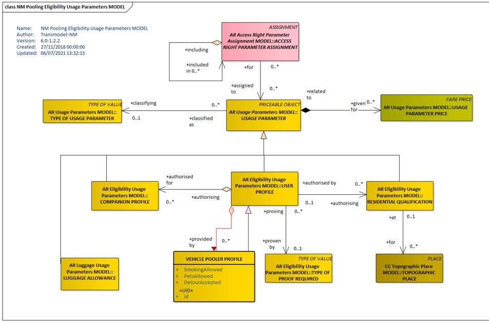

Figure 12 : Paramètres d'utilisation

### Modèle de données

#### Profil Utilisateur

Profil social d'un passager, basé sur des critères tels que le groupe d'âge, le niveau d'éducation, la profession, le statut social, le sexe, etc., souvent utilisé pour déterminer l'éligibilité à des réductions tarifaires : par exemple 18-40 ans, diplômés, conducteurs, personnes sans emploi, femmes, etc

| **Classification** | **Nom**                               | **Type**               | **Cardinalité** | **Description**                                                                                                                                    |
| ------------------ | ------------------------------------- | ---------------------- | --------------- | -------------------------------------------------------------------------------------------------------------------------------------------------- |
| ::>                | ::>                                   | _UsageParameter_       | ::>             | USER PROFILE hérite de USAGE PARAMETER..                                                                                                           |
| «PK»               | **_id_**                              | _UserProfileIdType_    | 1:1             | Identifiant du USER PROFILE.                                                                                                                       |
| «FK»               | **_BaseUserProfileRef_**              | _UserProfileRef_       | 0:1             | **Profil utilisateur de base (BASE USER PROFILE)** que ce profil vient spécialiser / affiner.                                                      |
| «FK»               | **_TypeOf­ConcessionRef_**            | _TypeOfConcessionRef_  | 0:1             | Classification par type de concession                                                                                                              |
| «enum»             | **_UserType_**                        | _UserTypeEnum_         | 0:1             | Classification des utilisateurs selon leur catégorie. Voir les valeurs autorisées ci-dessous.                                                      |
| XGRP               | **_UserProfile­Qualification­Group_** | **_xmlGroup_**         | 0:1             | Éléments décrivant les conditions d'éligibilité pour un utilisateur.                                                                               |
| «enum»             | **_Gender­Limitation_**               | _GenderLimitationList_ | 0:1             | Information relative au **genre exigé** pour l'éligibilité à un produit ou service, notamment pertinent pour les produits d'hébergement mono-sexe. |
| «enum»             | **_ProofRequired_**                   | _ProofOfIdentityEnum_  | 0:\*            | Document ou justificatif demandé pour attester du statut de l'utilisateur. Voir les valeurs autorisées ci-dessous.                                 |
| «enum»             | **_DiscountBasis_**                   | _DiscountBasisEnum_    | 0:1             | Type d'avantage tarifaire accordé à cette catégorie d'utilisateurs. Voir les valeurs autorisées précédemment                                       |
| «cntd»             | **_companion­Profiles_**              | _CompanionProfile_     | 0:\*            | **Profils des accompagnateurs (COMPANION PROFILE)** décrivant les utilisateurs autorisés à voyager avec l'utilisateur principal.                   |

Table 31 - Profil Utilisateur

##### Type d'utilisateur (UserType)

Le tableau suivant présente les valeurs autorisées pour le type d'utilisateur

| **Valeur**          | **Description**                                  |
| ------------------- | ------------------------------------------------ |
| _anyone_            | User is any type of person.                      |
| _adult_             | L'utilisateur est un adulte                      |
| _child_             | L'utilisateur est un enfant                      |
| _infant_            | L'utilisateur est un nourissons                  |
| _senior_            | L'utilisateur est un sénior                      |
| _schoolPupil_       | L'utilisateur est un écolier                     |
| _student_           | L'utilisateur est un étudiant                    |
| _youngPerson_       | L'utilisateur est une jeune personne             |
| _disabled_          | L'utilisateur est handicapé                      |
| _disabledCompanion_ | L'utilisateur est handicapé avec accompagnateur  |
| _employee_          | L'utilisateur est un employé de l'opérateur      |
| _military_          | L'utilisateur est un militaire                   |
| _jobSeeker_         | L'utilisateur est sans emploi                    |
| _guideDog_          | L'utilisateur est un chien guide                 |
| _member_            | L'utilisateur dispose d'un programme de fidélité |
| _animal_            | L'utilisateur est un animal                      |

Table 31 - Profil Utilisateur

##### Qualification du profil utilisateur (User Profile Qualification)

Ensemble des critères ou attributs permettant de qualifier et d'évaluer un profil utilisateur, afin de déterminer son éligibilité à un produit, un service ou une offre tarifaire.

| **Classification** | **Nom**                           | **Type**                   | **Cardinalité** | **Description**                                                                                                                                                                                                                                                                                                                                                                       |
| ------------------ | --------------------------------- | -------------------------- | --------------- | ------------------------------------------------------------------------------------------------------------------------------------------------------------------------------------------------------------------------------------------------------------------------------------------------------------------------------------------------------------------------------------- |
|                    | **_MinimumAge_**                  | _xsd:integer_              | 0:1             | **Âge minimum requis pour l'adhésion à un profil utilisateur (USER PROFILE).**                                                                                                                                                                                                                                                                                                        |
|                    | **_MaximumAge_**                  | _xsd:integer_              | 0:1             | **Âge maximum requis pour l'adhésion à un profil utilisateur (USER PROFILE).**                                                                                                                                                                                                                                                                                                        |
|                    | **_MonthDayOn­WhichAge­Applies_** | _xsd:gmonthDay_            | 0:1             | Jour / mois à partir duquel l'âge s'applique (le cas échéant).                                                                                                                                                                                                                                                                                                                         |
|                    | **_Minimum­Height_**              | _LengthType_               | 0:1             | Taille minimale requise pour l'adhésion à un profil utilisateur (USER PROFILE).                                                                                                                                                                                                                                                                                                       |
|                    | **_MaximumHeight_**               | _LengthType_               | 0:1             | Poids maximal qu'un utilisateur doit respecter pour être éligible à un profil ou à un service, par exemple pour des raisons de sécurité (comme l'accès avec de grands chiens ou pour définir une limite applicable aux enfants)..                                                                                                                                                     |
|                    | **_LocalResident_**               | _xsd:boolean_              | 0:1             | **Indique si l'utilisateur doit être résident local.** <br>→ Valeur booléenne précisant si l'utilisateur doit être un **résident local** pour être éligible. <br>→ La valeur par défaut est **« vrai » (true)**.                                                                                                                                                                      |
| «cntd»             | **_resides_**                     | _ResidentialQualification_ | 0:\*            | **Qualifications résidentielles (RESIDENTIAL QUALIFICATIONS) pour le profil utilisateur (USER PROFILE)** - <br>→ Ensemble des conditions relatives à la résidence permettant de qualifier l'utilisateur. <br>→ Si plusieurs valeurs sont définies, elles sont combinées avec un **opérateur logique OU (OR)**, c'est-à-dire qu'il suffit qu'une seule des conditions soit satisfaite. |

Table 31 - Qualification du profil utilisateur

##### Preuves necessaires (ProofRequired)

Le tableau suivant présente les valeurs autorisées pour le champ ProofRequired (ProofOfIdentityEnumeration).

Il s'agit des types de preuves d'identité pouvant être exigées pour justifier l'éligibilité d'un utilisateur à un produit ou service.

| **Valeur**          | **Description**                                                                                                                                                          |
| ------------------- | ------------------------------------------------------------------------------------------------------------------------------------------------------------------------ |
| _noneRequired_      | Aucun justificatif d'identité n'est nécessaire pour l'accès au produit, au service ou au profil utilisateur concerné.                                                    |
| _passport_          | La preuve requise est la présentation d'un passeport.                                                                                                                    |
| _drivingLicence_    | La preuve requise est la présentation d'un permis de conduire.                                                                                                           |
| _birthCertificate_  | La preuve requise est la présentation d'un acte de naissance.                                                                                                            |
| _membershipCard_    | La preuve requise est la présentation d'un document d'identité, tel qu'une preuve d'appartenance à une organisation (carte de membre, justificatif d'affiliation, etc.). |
| _studentCard_       | La preuve requise est la présentation d'une carte étudiante.                                                                                                             |
| _identityDocument_  | La preuve requise est la présentation d'un document d'identité, tel qu'un permis de conduire ou un passeport.                                                            |
| _creditCard_        | La preuve requise est la présentation d'une carte bancaire (carte de crédit).                                                                                            |
| _medicalDocument_   | La preuve requise est la présentation d'un document médical ou d'une lettre émise par une autorité médicale.                                                             |
| _letterWIthAddress_ | La preuve requise est la présentation d'une lettre ou d'une facture émise par une organisation à l'adresse du demandeur.                                                 |
| _measurement_       | Mesure physique (comme la taille ou une autre mesure corporelle).                                                                                                        |
| _emailAccount_      | La preuve consiste à répondre depuis un compte e-mail valide.                                                                                                            |
| _mobileDevice_      | La preuve consiste à répondre depuis un appareil mobile associé à un compte.                                                                                             |
| _other_             | Autre preuve.                                                                                                                                                            |

Table 89 - Preuves nécessaires

##### Profil du covoitureur (VehiclePoolerProfil)

Ensemble de paramètres utilisateur caractérisant les droits d'accès à un service de covoiturage (VEHICLE POOLING SERVICE).

→ Il s'agit d'une spécialisation du profil utilisateur (USER PROFILE) permettant de définir des attributs supplémentaires tels qu'une âge minimum.

| **Classifi­cation** | **Name**                 | **Type**                     | **Cardin­ality** | **Description**                                                                                                                                                                                                                                                                    |
| ------------------- | ------------------------ | ---------------------------- | ---------------- | ---------------------------------------------------------------------------------------------------------------------------------------------------------------------------------------------------------------------------------------------------------------------------------- |
| ::>                 | ::>                      | _UserProfile_                | ::>              | VEHICLE POOLER PROFILE hérite de USER PROFILE..                                                                                                                                                                                                                                    |
| «PK»                | **_id_**                 | _VehiclePoolerProfileIdType_ | 1:1              | Identifiant du profil du covoitureur (VEHICLE POOLER PROFILE).                                                                                                                                                                                                                     |
| «FK»                | **_HostUserProfileRef_** | _UserProfileRef_             | 0:1              | Profil utilisateur de base (BASE USER PROFILE) que ce profil vient spécialiser / affiner.                                                                                                                                                                                          |
|                     | **_SmokingAllowed_**     | _xsd:boolean_                | 0:1              | Indique si le tabagisme est autorisé ou non.                                                                                                                                                                                                                                       |
|                     | **_PetsAllowed_**        | _xsd:boolean_                | 0:1              | Indique si les animaux de compagnie sont autorisés ou non.                                                                                                                                                                                                                         |
|                     | **_LuggageAllowed_**     | _xsd:boolean_                | 0:1              | Indique si le covoitureur est disposé à transporter les bagages du passager.<br><br>→ La nature des bagages acceptés peut être spécifiée via un ou plusieurs éléments distincts de franchise bagage (LUGGAGE ALLOWANCE).<br><br>→ Cette disposition peut varier selon les trajets. |
|                     | **_DetourAccepted_**     | _xsd:duration_               | 0:1              | Durée maximale acceptée pour un détour. <br>→ Indique le temps supplémentaire maximum autorisé pour effectuer un détour, par exemple pour prendre en charge ou déposer un passager lors d'un trajet.                                                                               |

Table 89 - Profil du covoitureur

## Services

**Statut implémentation : FACULTATIF** : Cette partie du profil doit être implémentée en cohérence avec le contexte.

### Services de mobilité

#### Modèle conceptual

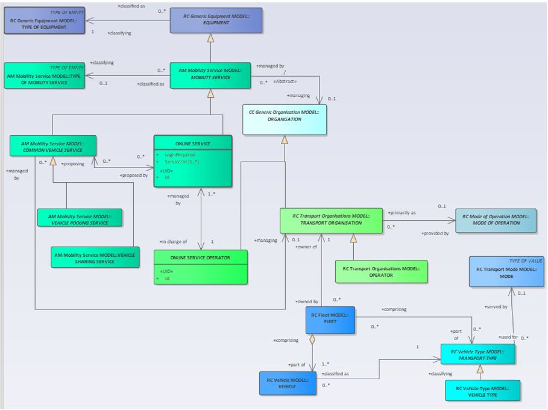

Figure 13 : Service En ligne - MC

#### Modèle de données

##### MOBILITY SERVICE (Service de mobilité)

Un service nommé disponible sur une vaste zone, par exemple le covoiturage, le partage de véhicule, etc. Le service peut être accessible à des emplacements désignés. SITEs or ADDRESSABLE PLACEs.

| **Classification** | **Nom** | **Type** | **Cardinalité** | **Description** |
| --- | --- | --- | --- | --- |
| ::> | ::> | Equipment | ::> | MOBILITY SERVICE hérite EQUIPMENT. |
| «PK» | id  | MobilityServiceIdType | 1:1 | Identifiant de MOBILITY SERVICE. |
|     | ShortName | MultilingualString | 0:1 | Nom court d'un service |
|     | StartDate | xsd:date | 0:1 | Date à laquelle le service devient opérationnel. |
| «FK» | OrganisationRef | OrganisationRef | 0:1 | Identifiant d'une ORGANISATION... |
| «FK» | TopographicPlaceRef | TopographicPlaceRef | 0:1<br><br>1:1 | Identifiant d'un TOPOGRAPHIC PLACE associé au SERVICE.<br><br>Obligatoire pour le profil France |
| «FK» | TypeOfMobilityServiceRef | TypeOfMobilityServiceRef | 0:1 | Identifiant d'un type MOBILITY SERVICE. |
| «cntd» | BookingArrangements | ServiceBookingArrangements | 0:1 | Modalité de réservation du service |

Table 32 - Service de mobilité

##### CommonVehicleService (Service de mobilité usuel )

Un service de transport qui utilise des véhicules pour effectuer des trajets. La zone de couverture du service peut être indiquée par un LIEU TOPOGRAPHIQUE. »

| **Classification** | **Nom** | **Type** | **Cardinalité** | **Description** |
| --- | --- | --- | --- | --- |
| ::> | ::> | MobilityService | ::> | COMMON VEHICLE SERVICE hérite de MOBILITY SERVICE |
| «PK» | id  | CommonVehicleServiceIdType | 1:1 | Identifiant de COMMON VEHICLE SERVICE. |
|     | BookingRequired | xsd:boolean | 1:1 | Indique si une réservation du service est nécessaire. |
|     | RegistrationRequired | xsd:boolean | 0:1 | Indique si un enregistrement est nécessaire |
| «cntd» | proposedByServices | OnlineServiceRef | 0:\* | Identifiant du ONLINE SERVICEs qui propose le service |

Table 33 - Service de mobilité usuel

##### VehicleSharingService (Service de partage de véhicule)

Un Service type Vélo en libre-service ou Auto-partage.

| **Classification** | **Nom** | **Type** | **Cardinalité** | **Description** |
| --- | --- | --- | --- | --- |
| ::> | ::> | CommonVehicleService | ::> | VEHICLE SHARING SERVICE hérite de COMMON VEHICLE SERVICE. |
| «PK» | id  | VehicleSharingServiceIdType | 1:1 | Identifiant VEHICLE SHARING SERVICE. |
| «FK» | VehicleSharingRef | VehicleSharingRef | 0:1 | Référence à un VEHICLE SHARING mode d'exploitation. |
|     | SharingPolicyUrl | xsd:anyURI | 1:1 | URL pour la politique d'utilisation |
|     | MinimumSharingPeriod | xsd:duration | 0:1 | Durée minimum de partage VEHICLE SHARING. |
|     | MaximumSharingPeriod | xsd:duration | 0:1 | Durée maximum de partage VEHICLE SHARING. |
|     | FloatingVehicles | xsd:boolean | 0:1 | Indique si le partage de véhicule est de type free floating. |
| «FK» | fleets | FleetRef | 0:\* | Référence à une FLEETs qui gère le service de partage. |

Table 34 -VehicleSharingService - Element

##### CarPoolingService (Covoiturage)

A completer ultérieurement

### Services aux voyageurs

#### Réservation

Les dispositions de réservation décrivent les paramètres spécifiques des règles de réservation pour un service et sont utilisées par plusieurs entités différentes.

Pour les nouveaux modes, les dispositions de réservation peuvent être appliquées aux services de mobilité liés aux modes d'exploitation alternatifs, notamment la location de véhicules, le partage de véhicules et le covoiturage de véhicules. La réservation des services de location, de partage et de covoiturage de véhicules peut être effectuée via un service en ligne

##### Modèle conceptual

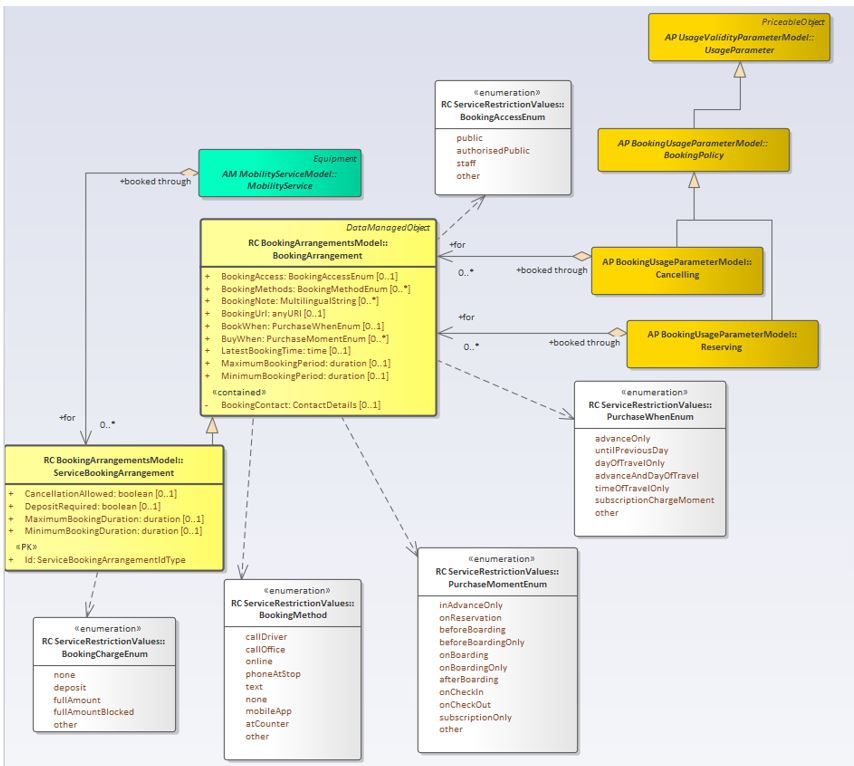

Figure 14 : Réservation - MC

##### Modèle de données

###### Booking Arrangements

Information relative aux méthodes de réservation d'un véhicule partagé.

**_Pour plus de détail sur les valeurs autorisées se reporter au Profil NeTex France Réseaux._**

| **Classification** | **Nom** | **Type** | **Cardinalité** | **Description** |
| --- | --- | --- | --- | --- |
| ««cntd» | **_BookingContact_** | _ContactDetails_ | 0:1 | Information contractuelle |
| «enum» | **_BookingMethods_** | _BookingMethodListEnum_ | 0:\* | Méthode de reservation |
| «enum» | **_BookingAccess_** | _BookingAccessEnum_ | 0:1 | Qui peut faire une réservation |
| «enum» | **_BookWhen_** | _PurchaseWhenEnum_ | 0:1 | Créneaux de réservation |
| «enum» | **_BuyWhen_** | _PurchaseMomentEnum_ | 0:\* | Créneaux d'achat |
|     | **_LatestBookingTime_** | _MultilingualString_ | 0:1 | Heure au plus tard de réservation |
|     | **_MinimumBooking­Period_** | _xsd:duration_ | 0:1 | Intervalle minimum avant le début de la commande. |
|     | **_MaximumBooking­Period_** | _xsd:duration_ | 0:1 | Intervalle minimum avant le début de la commande |
|     | **_BookingUrl_** | _xsd:anyURI_ | 0:1 | url de réservation |
| «cntd» | **_BookingNote_** | _MultilingualString_ | 0:1 | Information complémentaire |

Table 35 - BookingArrangements

#### Information sur les zones de dépôt des véhicules

##### Modèle Conceptuel

###### **Vehicle Meeting Place** (Zone de dépôt/Station)

Le **modèle NM Vehicle Meeting Place** définit les points d'arrêt où les passagers retrouvent leurs modes de transport alternatifs.

Au sens le plus large, il peut s'agir de tout lieu disposant d'une adresse. Cela peut inclure des points d'arrêt (**STOP PLACE)** et des stations (**PARKING)**, ainsi que leurs composants, tels que définis dans la Partie 1.

Une station (**PARKING)** représente un emplacement désigné pour laisser des véhicules tels que voitures, motos ou vélos. Transmodel inclut un modèle permettant de décrire les éléments de stationnement comme des spécialisations de **SITE COMPONENTs**.

La connexion entre les points d'arrêt et les services qui y opèrent se trouve dans le **modèle NM service de mobilité**.

Le **modèle NM Vehicle Meeting Place** distingue deux grands types de **ADDRESSABLE PLACE** (lieux pouvant être localisés par coordonnées spatiales et/ou adresse postale ou routière) :

- **VEHICLE MEETING PLACEs** : lieux où véhicules, voyageurs et conducteurs se rencontrent pour changer de mode de transport, embarquer, débarquer, prendre ou déposer des passagers, etc.

Un **VEHICLE MEETING PLACE** peut être associé à un **SITE** spécifique (tel qu'un **STOP PLACE** ou un **POINT OF INTEREST**) ou à tout composant à l'intérieur de ce **SITE**.

- **PARKING COMPONENTs** : emplacements désignés pour laisser des véhicules tels que voitures, motos ou vélos.

Ces lieux se distinguent par leur usage : dans un **VEHICLE MEETING PLACE**, il n'est pas possible de laisser un véhicule sans surveillance pour une durée prolongée.

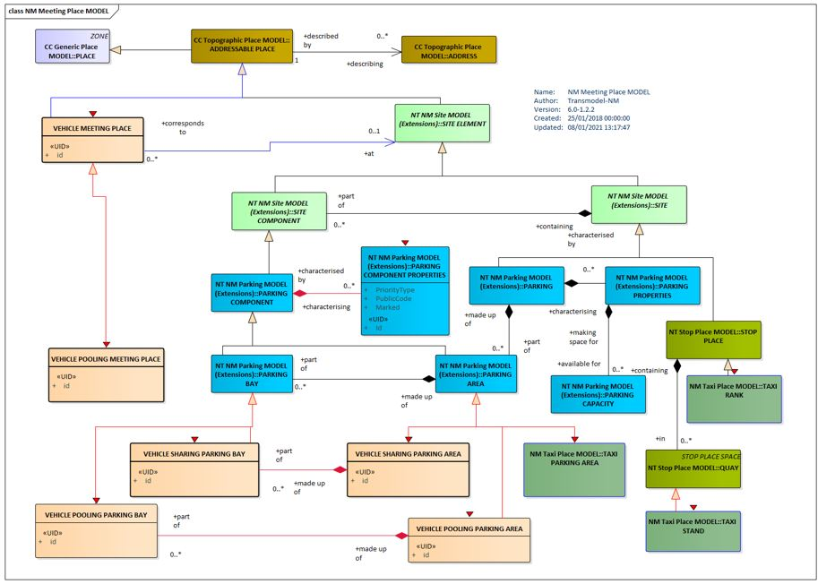

Figure 15 :NM Point de rencontre (UML)

###### Attribution des places de service des véhicules

Les différents **services de véhicules** utilisent des **emplacements spécifiques** pour **embarquer et débarquer les passagers**, ou pour permettre aux voyageurs de **prendre ou restituer un véhicule**.

Des spécialisations du mécanisme générique **Transmodel ASSIGNMENT** permettent de **lier les arrêts et les emplacements de stationnement correspondants aux services de véhicules**.

Chaque service est décrit individuellement ci-dessous.

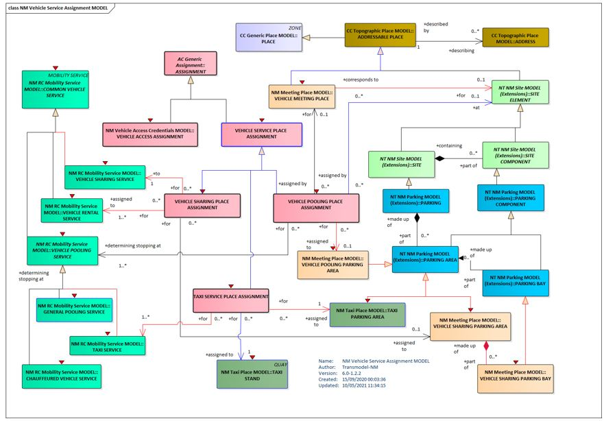

Figure 16 NM Emplacements (UML)

###### Attribution des places dans un système de partage de véhicules

Les **services d'autopartage**  ont besoin d'**emplacements** pour que les utilisateurs puissent **prendre ou déposer les véhicules**. Ces emplacements peuvent être **exclusifs à un service** ou **partagés**. Un **Vehicle Sharing Place Assignment** permet d'**attribuer des zones et places de stationnement** à un service particulier.

Certains services d'autopartage, dits **« Free-Floating »**, permettent de **déposer et récupérer le véhicule n'importe où**, par exemple à un **emplacement identifiable quelconque**, représenté par des **points de rencontre pour véhicules**.

Un même **Vehicle Sharing Place Assignment** peut **servir soit à l'autopartage, soit à la location**, mais **pas aux deux en même temps**. Si une zone de stationnement est utilisée pour un assignment et un service d'autopartage, **deux assignments distincts doivent être définis**.

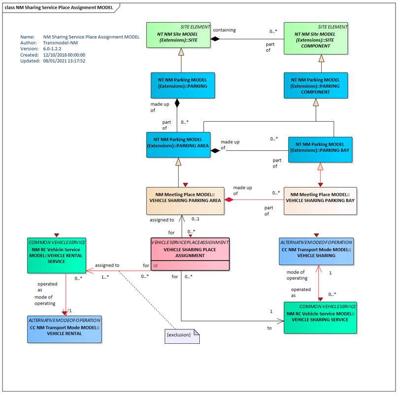

Figure 17 : NM Affectation d'un emplacement à un service de partage de vehicule (UML)

###### Affectation des places en covoiturage

A compléter ulterieurment

##### Modèle de données

###### **VehicleMeetingPlace**

Lieu où véhicules et passagers se rencontrent pour changer de mode de transport, pour embarquer, débarquer, prendre ou déposer des passagers, etc.

| **Classification** | **Nom** | **Type** | **Cardinalité** | **Description** |
| --- | --- | --- | --- | --- |
| ::> | ::> | _AddressablePlace_ | ::> | VEHICLE MEETING PLACE Hérite de ADDRESSABLE PLACE. |
| «PK» | **_id_** | _VehicleMeetingPlaceIdType_ | 1:1 | Identifiant de VEHICLE MEETING PLACE. |
| «FK» | **_TopographicPlaceRef_** | _TopographicPlaceRef_ | 0:1 | Référence à un TOPOGRAPHIC PLACE.. |
| «FK» | **_SiteElementRef_** | _SiteElementRef_ | 0:1 | Référence à un SITE ELEMENT, tel que PARKING, PARKING AREA, PARKING BAP, STOP PLACE, QUAY, POINT OF INTEREST, etc. |

Table 36 - **VehicleMeetingPlace**

###### **Vehicle Service Place Assignment**

Affectation d'un dock à un MOBILITY SERVICE

| **Classification** | **Nom** | **Type** | **Cardinalité** | **Description** |
| --- | --- | --- | --- | --- |
| ::> | ::> | _Assignment_ | ::> | VEHICLE SERVICE PLACE ASSIGNMENT inherits from ASSIGNMENT. |
| «PK» | **_id_** | _VehicleServicePlaceAssignmentIdType_ | 1:1 | Identifier of TAXI SERVICE PLACE ASSIGNMENT. |

Table 37 - VehicleServicePlaceAssignment - Element

###### **VehicleSharingPlaceAssignment**

The allocation of a VEHICLE SHARING PARKING AREA to any vehicle sharing or rental service.

| **Classification** | **Nom** | **Type** | **Cardinalité** | **Description** |
| --- | --- | --- | --- | --- |
| ::> | ::> | _VehicleServicePlaceAssignment_ | ::> | VEHICLE SHARING PLACE ASSIGNMENT inherits from VEHICLE SERVICE PLACE ASSIGNMENT. |
| «PK» | **_id_** | _VehicleSharingPlaceAssignmentIdType_ | 1:1 | Identifier of VEHICLE SHARING PLACE ASSIGNMENT. |
| «cntd» | **_VehicleCommonServiceRef_** | _VehicleSharingServiceRef_ \| _VehicleRentalServiceRef_ | 0:\* | Reference to a VEHICLE SHARING SERVICE or a VEHICLE RENTAL SERVICE. |
| «FK» | **_VehicleSharingParkingAreaRef_** | _VehicleSharingParkingAreaRef_ | 1:1 | Reference to a VEHICLE SHARING PARKING AREA.. |
| «FK» | **_VehicleSharingParkingBayRef_** | _ParkingBayRef_ | 1:1 | Reference to a VEHICLE SHARING PARKING BAY. |

Table 38 - VehicleSharingPlaceAssignment - Element

##### Exemple XML VehicleSharingParkingArea

Le fragment de code suivant montre un **stationnement** pour une **station de vélos en libre-service** avec **10 emplacements** :

Exemple xml 5 : Zone de Stationnement pour véhicule partagé

#### Disponibilité des véhicules des modes alternatifs

##### Modèle conceptuel

Le MODÈLE d'information sur la disponibilité des véhicules décrit la disponibilité prévue des véhicules pour un SERVICE DE MOBILITÉ particulier, exploité à un emplacement topographique particulier. La disponibilité prévue correspond à la présence potentielle de véhicules stationnés à un emplacement et correspond généralement à la capacité des PARKINGS et de leurs composants dédiés aux différents services.

Ces informations peuvent être globales, concernant la capacité de l'ensemble du PARKING, ou indiquer la capacité des ZONES DE STATIONNEMENT par TYPE DE VéHICULE. Il convient toutefois de noter que, pour équilibrer l'offre et la demande dans les gares très fréquentées, les opérateurs proposent parfois un service de personnel pour fournir ou retirer les véhicules supplémentaires d'un dépôt fixe ou de les placer sur des véhicules mobiles. Cela signifie que la capacité « virtuelle » d'un PARKING peut être supérieure au nombre de places physiques.

Note : Il s'agit ici d'une capacité à héberger des véhicules, si une disponibilité en temps-réel est souhaitée cela se fera par le service **SIRI FacilityMonitoring** (_MonitoredCounting_)

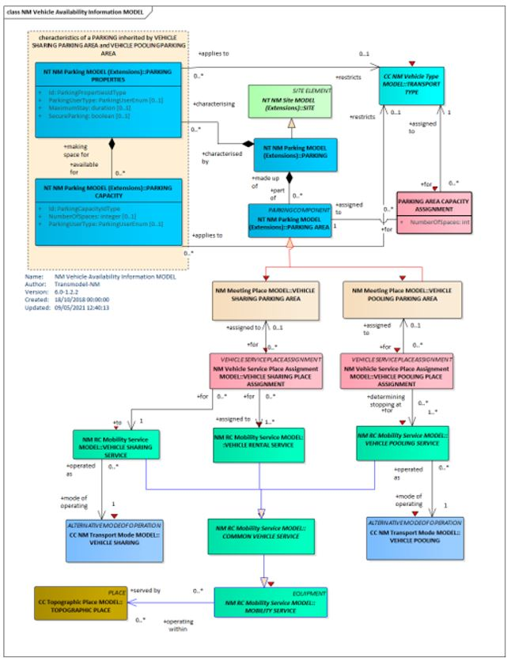

Figure 18 : Disponibilité prévue des véhicules - MC

##### Modèle de données

###### ParkingAreaCapacityAssignement

L'Affectation de la capacité d'une aire de stationnement permet l'attribution d'un nombre de places pour un type de véhicule particulier dans une aire de stationnement.

| **Classification** | **Nom** | **Type** | **Cardinalité** | **Description** |
| --- | --- | --- | --- | --- |
| ::> | ::> | _Assignment_ | ::> | PARKING AREA CAPACITY ASSIGNMENT hérite de ASSIGNMENT. |
| «PK» | **_id_** | _ParkingAreaCapacityAssignmentIdType_ | 1:1 | Identifiant du PARKING AREA CAPACITY ASSIGNMENT. |
| «FK» | **_TransportTypeRef_** | _TransportTypeRef_ | 0:1 | TRANSPORT TYPE associé au PARKING AREA CAPACITY. |
| «FK» | **_ParkingAreaRef_** | _ParkingAreaRef_ | 1:1 | PARKING AREA associé au PARKING AREA CAPACITY ASSIGNMENT. |
| «enum» | **_CapacityType_** | _ParkingCapacityTypeEnum_ | 1:1 | Type de capacité |
|     | **_NumberOfSpaces_** | _xsd:nonNegativeInteger_ | 0:1 | Nombre de place |
|     | **_AdditionalVehicleCapacity_** | _xsd:nonNegativeInteger_ | 0:1 | Nombre de places additionnelles qui peuvent être occupées par d'autres véhicules |

Table 39 - Capacité des stations

Note : Pour tout complément d'information se référer au profil France Parking.

#### Équipements de rechargement

##### Modèle conceptuel

La définition des équipements de rechargement pour les véhicules partagés électrique peut être rattachée à un emplacement de véhicule en station.

À noter que l'information d'existance de capacité de rechargement électrique est portée au niveau de la Station (_RechargingAvailable_).

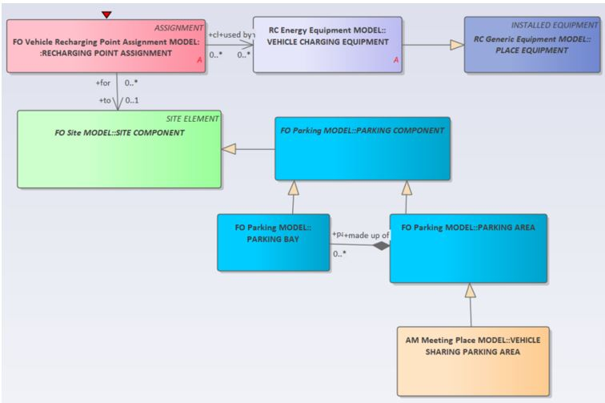

Figure 19 : Équipement de rechargement - MC

##### Modèle de données

Les **ZONES DE STATIONNEMENT POUR LE PARTAGE/CO-VOITURAGE DE VÉHICULES** peuvent être associées à des équipements spécifiques, tels que des bornes de recharge, etc.

L'emplacement des équipements est spécifié à l'aide d'un **EMPLACEMENT D'ÉQUIPEMENT**.

Les **COMPOSANTS DE STATIONNEMENT** particuliers et l'**EMPLACEMENT D'ÉQUIPEMENT** doivent faire référence au même **COMPOSANT DE SITE**

###### Vehicle charging Equipment (Équipement de rechargement des véhicules)

| **Classification** | **Nom** | **Type** | **Cardinalité** | **Description** |
| --- | --- | --- | --- | --- |
| ::> | ::> | _PlaceEquipment_ | ::> | VEHICLE CHARGING EQUIPMENT hérite de PLACE EQUIPMENT |
| «PK» | **_id_** | _VehicleChargingEquipmentId_ | 1:1 | Identifiant VEHICLE CHARGING EQUIPMENT. |
|     | **_FreeRecharging_** | _xsd:boolean_ | 0:1 | Indique si le chargement est gratuit |
|     | **_Reservation_** | _xsd:boolean_ | 0:1 | Indique si une réservation est nécessaire |
|     | **_ReservationUrl_** | _xsd:anyURI_ | 0:1 | URL de réservation. |

Table 40 - Équipement de rechargement

## Compte Client
### Modèle conceptuel
#### Moyens de paiement

Un CLIENT DE TRANSPORT peut enregistrer sur un COMPTE CLIENT les moyens de paiement qu'il souhaite utiliser pour régler les PRODUITS TARIFAIRES achetés via ce compte, par exemple une carte bancaire ou un compte de paiement mobile

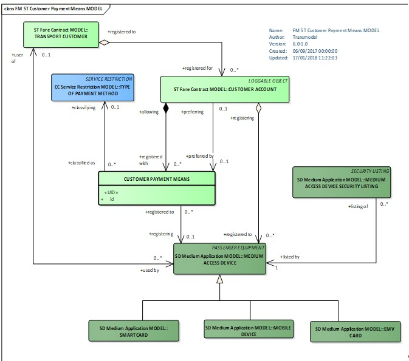

#### Restriction de Services

Le modèle des restrictions de service définit un petit nombre d'éléments réutilisables pour classer les moyens de paiement. Quelques ajouts supplémentaires sont faits pour permettre de nouveaux modes ; en particulier, les éléments des arrangements de réservation sont affinés et étendus. (Voir le modèle des ARRANGEMENTS DE RÉSERVATION).

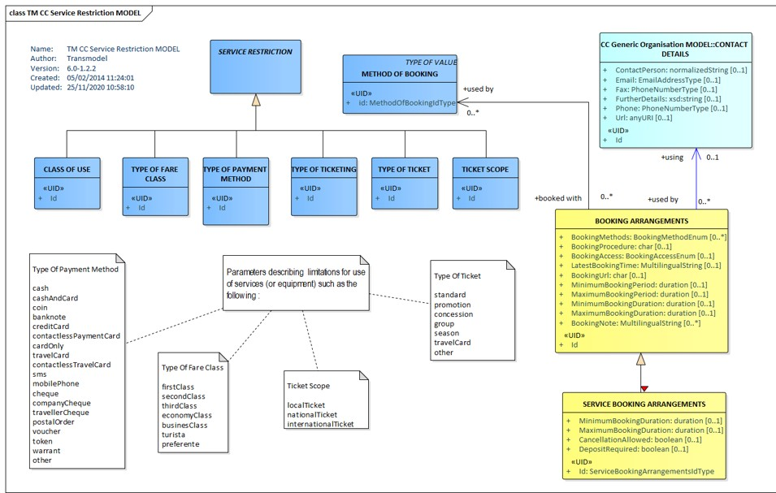

### Modèle de données

#### Moyens de Paiement 

Un moyen de paiement enregistré qu'un client de transport souhaite utiliser pour effectuer des paiements associés à un compte client, par exemple au moyen d'une carte EMV (EuroPay, MasterCard, Visa) désignée.


| Classification | Nom | Type | Cardinalité | Description |
|---|---|---|---|---|
| ::> | ::> | VersionedChild | ::> | CUSTOMER PAYMENT MEANS hérite de VERSIONED CHILD. |
| «PK» | id | CustomerPaymentMeansIdType | 1:1 | Identifiant de CUSTOMER PAYMENT MEANS. |
|  | Name | MultilingualString | 0:1 | Nom du moyen de paiement. |
| «FK» | CustomerAccountRef | CustomerAccountRef | 0:1 | Compte client associé au moyen de paiement. |
| «FK» | MediumAccessDeviceRef | MediumAccessDeviceRef | 0:1 | MEDIUM ACCESS DEVICE associé à CUSTOMER PAYMENT MEANS. |
| «enum» | PaymentMethod | PaymentMethodEnum | 0:1 | Méthode de paiement associée à CUSTOMER ACCOUNT. Cf. SERVICE RESTRICTIONs. |
| «FK» | TypeOfPaymentMethodRef | TypeOfPaymentMethodRef | 0:1 | Référence à un TYPE OF PAYMENT METHOD. |
|  | LastVerifiedDate | xsd:dateTime | 0:1 | Date de dernière vérification du moyen de paiement. |

Ci-dessous un exemple de compte client associé à deux Moyens de paiement

``` xml
<CustomerAccount version="any" id="rydt:Cust555@AC7651">
    <Name>hotrider</Name>
    <StartDate>2020-02-28T13:00:00</StartDate>
    <CustomerAccountStatusType>active</CustomerAccountStatusType>
    <CustomerPaymentMeansRef version="any" ref="rydt:Cust555@AC7651@p1" />
    <paymentMeans>
        <CustomerPaymentMeans version="any" id="rydt:Cust555@AC7651@p1">
            <Name>EZ Ritter Visa Card</Name>
            <EmvCardRef version="any" ref="visa:47594444555666" />
        </CustomerPaymentMeans>
        <CustomerPaymentMeans version="any" id="rydt:Cust555@AC7651@p2">
            <Name>EZ Ritter mobile device</Name>
            <MobileDeviceRef version="any" ref="rydt:4178671234567" />
        </CustomerPaymentMeans>
    </paymentMeans>
    <mediumAccessDevices>
        <MobileDeviceRef version="any" ref="rydt:4178671234567" />
    </mediumAccessDevices>
</CustomerAccount>
```

#### Restriction de service

Définit les restrictions applicables au compte client

##### Méthode de Paiement (TypeOfPaymentMethod)

| Classification | Nom | Type | Cardinalité | Description |
|---|---|---|---|---|
| ::> | ::> | TypeOfValue | ::> | TYPE OF PAYMENT METHOD hérité de TYPE OF VALUE. |
| «PK» | id | TypeOfPayment-MethodIdType | 1:1 | Identifiant de TYPE OF PAYMENT METHOD. |
| «enum» | PaymentMethod | PaymentMethodEnum | 0:1 | Cf les valeurs ci-dessous |
|  | AutomatedUse | xsd:boolean | 0:1 | Si le mode de paiement peut être utilisé ou si les paiements peuvent être automatisés, par exemple pour le prélèvement automatique. |

#### Méthode de Paiement – Valeurs autorisées


| Valeur | Description |
|---|---|
| `cash` | Espèce |
| `cashExactChangeOnly` | Espèce — appoint exact uniquement |
| `cashAndCard` | Espèce et carte |
| `creditCard` | Carte de crédit |
| `debitCard` | Carte de débit |
| `travelCard` | Carte de transport |
| `contactlessPaymentCard` | Paiement sans contact |
| `mobilePhone` | Téléphone mobile |
| `mobileApp` | Application mobile |
| `voucher` | Bon / coupon |


# Entêtes NeTEx

